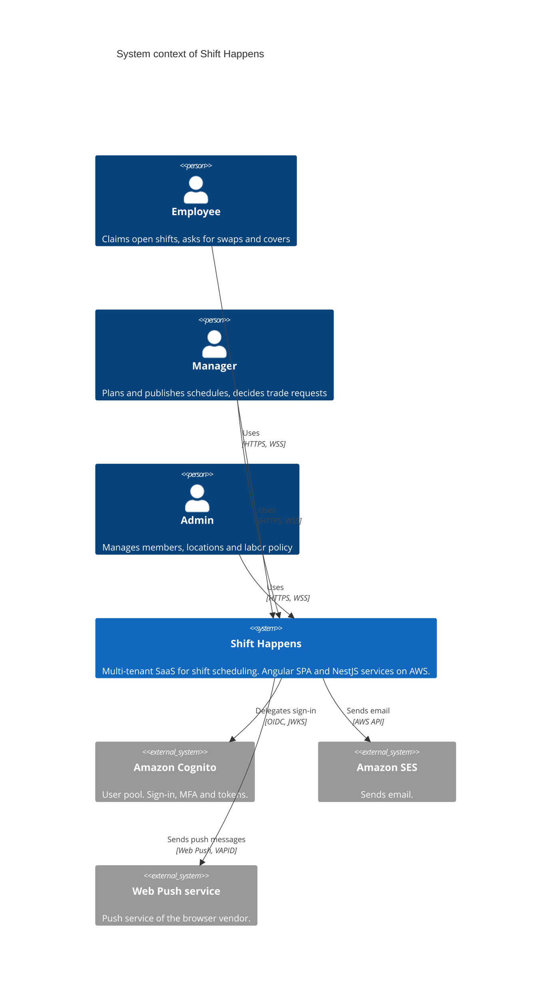
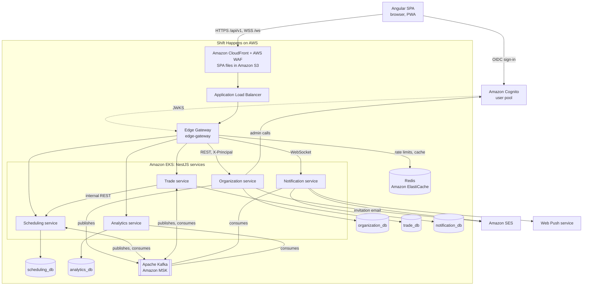
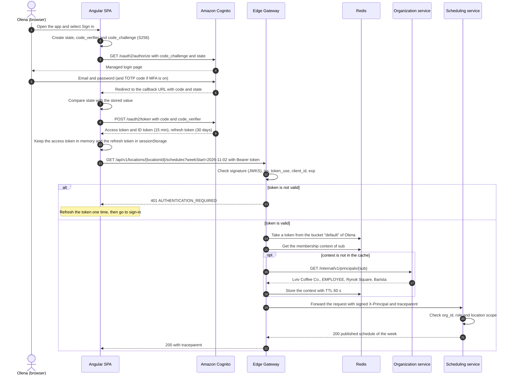
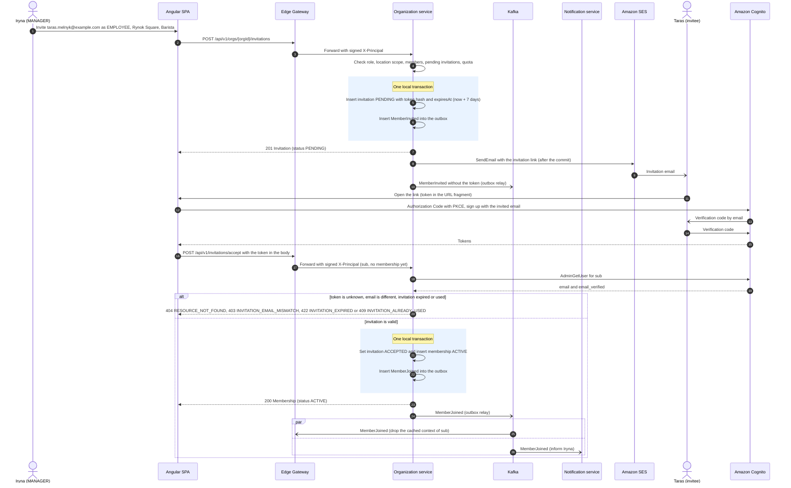
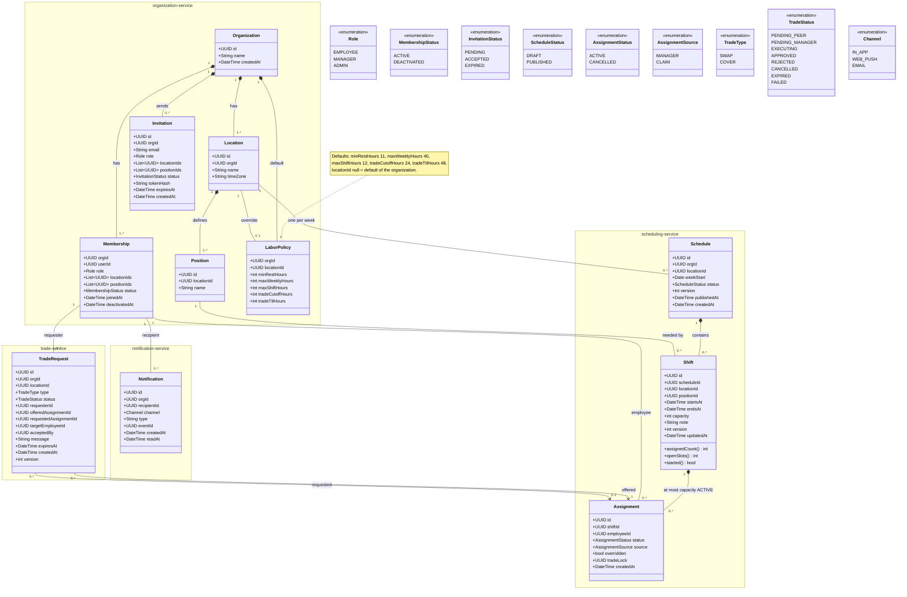
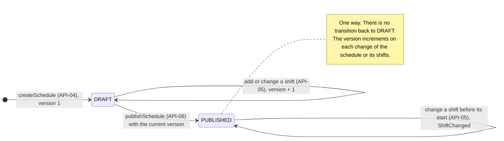
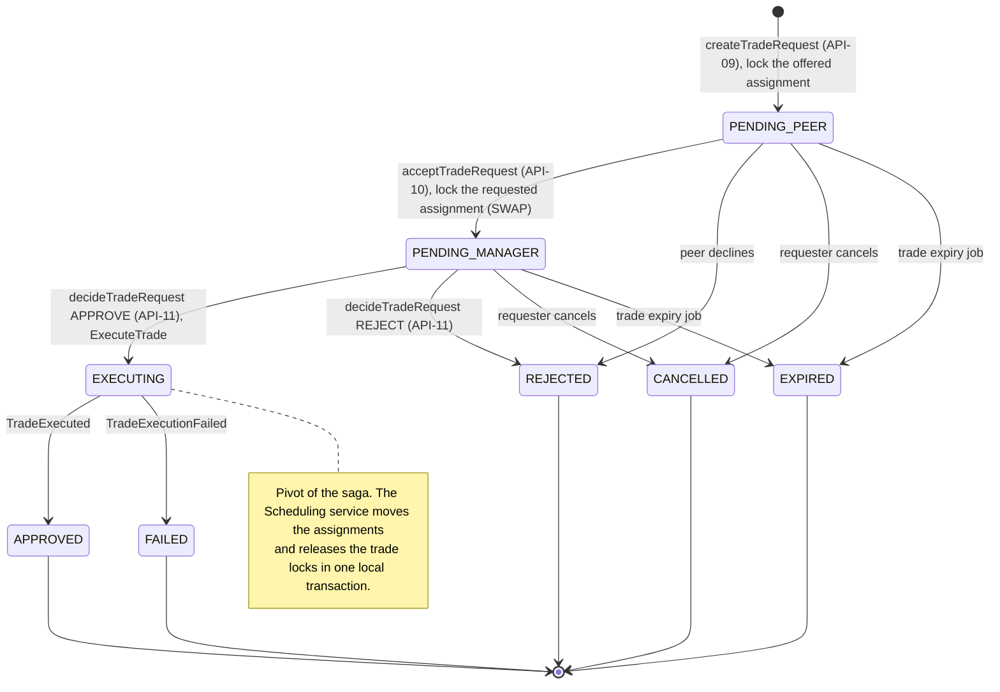

# Software Requirements Specification

## For Shift Happens

Version 1.0<br/>
Prepared by Shift Happens team<br/>
Faculty of Applied Mathematics and Informatics, Ivan Franko National University of Lviv<br/>
2026-10-29

## Table of Contents

- [Revision History](#revision-history)
- [1. Introduction](#1-introduction)
  - [1.1 Document Purpose](#11-document-purpose)
  - [1.2 Product Scope](#12-product-scope)
  - [1.3 Definitions, Acronyms, and Abbreviations](#13-definitions-acronyms-and-abbreviations)
  - [1.4 References](#14-references)
  - [1.5 Document Overview](#15-document-overview)
- [2. Product Overview](#2-product-overview)
  - [2.1 Product Perspective](#21-product-perspective)
  - [2.2 Product Functions](#22-product-functions)
  - [2.3 Product Constraints](#23-product-constraints)
  - [2.4 User Characteristics (Actors and Personas)](#24-user-characteristics-actors-and-personas)
  - [2.5 Assumptions and Dependencies](#25-assumptions-and-dependencies)
  - [2.6 Apportioning of Requirements](#26-apportioning-of-requirements)
  - [2.7 High-level Architecture](#27-high-level-architecture)
- [3. Requirements](#3-requirements)
  - [3.1 External Interfaces](#31-external-interfaces)
  - [3.2 Functional](#32-functional)
  - [3.3 Quality of Service](#33-quality-of-service)
    - [3.3.2.1 Identity and Access Management](#3321-identity-and-access-management)
  - [3.4 Compliance](#34-compliance)
  - [3.5 Design and Implementation](#35-design-and-implementation)
  - [3.6 AI/ML](#36-aiml)
- [4. Verification](#4-verification)
- [5. Appendixes](#5-appendixes)
  - [Appendix A: Domain class diagram](#appendix-a-domain-class-diagram)
  - [Appendix B: State diagrams](#appendix-b-state-diagrams)
  - [Appendix C: Use case specifications](#appendix-c-use-case-specifications)
  - [Appendix D: Traceability matrix](#appendix-d-traceability-matrix)

## Revision History

| Name | Date | Reason For Changes | Version |
|------|------|--------------------|---------|
| Shift Happens team | 2026-10-26 | Initial draft: scope, actors, list of requirements | 0.1 |
| Shift Happens team | 2026-10-29 | Submission for deliverable 3: complete requirement records, UML diagrams, identity and access management, verification and traceability | 1.0 |

## 1. Introduction

This document specifies the requirements of Shift Happens, a multi-tenant SaaS for employee shift scheduling. Section 1 gives the purpose, the scope, the terms and the references. Section 2 describes the product context, the actors and the high-level architecture. Section 3 contains the verifiable requirements. Section 4 tells how the team verifies each requirement. Section 5 contains the UML models, the use case specifications and the traceability matrix.

### 1.1 Document Purpose

This SRS defines what Shift Happens must do. It does not define how the team builds it. The course instructor uses it to grade deliverable 3. The development team uses it as the base for design, the API, tests and later deliverables. Testers use sections 3 and 4 to write test cases. Security and operations reviewers use sections 3.3 and 3.4. The related design documents are [Architecture](02-architecture.md), [Error handling design](03-error-handling.md) with the [OpenAPI specification](api/openapi.yaml), and [Concurrency patterns](04-concurrency.md).

### 1.2 Product Scope

This SRS covers Shift Happens version 1.0. Managers create and publish weekly schedules for each location. Employees claim open shifts, swap shifts and ask colleagues to cover shifts. The system checks conflicts and labor rules, sends notifications and shows coverage analytics. The intended outcome is a schedule without double booking, fewer unfilled shifts, and no trades that only exist in group chats.

Inclusions in version 1.0:

- One Angular single-page application (SPA) for the browser. It is responsive and installable as a progressive web app (PWA) for Web Push.
- NestJS services on Amazon EKS, Amazon Cognito for identity, Amazon SES for email.
- Organizations, locations, positions, labor policies, members and invitations.
- Weekly schedules, shifts, assignments, claims, swaps, covers and manager decisions.
- Notifications on the channels `IN_APP`, `WEB_PUSH` and `EMAIL`.
- Coverage analytics per location.

Exclusions:

- Payroll, time clock and attendance.
- Native mobile apps.
- AI/ML and automatic schedule generation.
- A user interface in other languages. Version 1.0 has an English UI only.
- Enterprise federation (SAML or OIDC identity providers of customers). This is a later release.

### 1.3 Definitions, Acronyms, and Abbreviations

| Term | Definition |
|------|------------|
| API | Application Programming Interface. In this document, the public REST API of Shift Happens under `/api/v1`. |
| Assignment | The link between an employee and a shift. Status `ACTIVE` or `CANCELLED`. It can have a trade lock. |
| BFF | Backend-for-Frontend. A server component that keeps tokens for the SPA. A future option, not part of version 1.0. |
| Capacity | The number of employees that a shift needs. |
| Claim | The action of an employee who takes an open slot. No approval is necessary. |
| Cover | A trade request that moves an assignment to a colleague who covers the shift. |
| Coverage rate | Filled slots divided by required slots for a period. |
| EKS | Amazon Elastic Kubernetes Service. |
| Idempotency key | A client-generated UUID in the `Idempotency-Key` header. The server uses it to find a retry of the same request. |
| Invitation | An offer to join an organization with a role, locations and positions. It expires after 7 days. |
| JWKS | JSON Web Key Set. The public keys of the Cognito user pool that verify token signatures. |
| JWT | JSON Web Token. The format of the Cognito access token and ID token. |
| Labor policy | The labor rules of an organization: minimum rest, maximum weekly hours, maximum shift length, trade cutoff, trade TTL. |
| Labor rule violation | A result of a check that breaks a labor policy rule. |
| Location | A workplace of an organization (a shop, a cafe). It has a time zone. |
| Member | A user who has a membership in an organization. |
| Membership | The link between a user and an organization: role, locations, qualified positions, status (`ACTIVE`, `DEACTIVATED`). |
| MFA | Multi-factor authentication. Shift Happens uses TOTP as the second factor. |
| MoSCoW | The priority scale Must, Should, Could, Won't. This SRS uses Must, Should and Could. |
| MSK | Amazon Managed Streaming for Apache Kafka. |
| Notification | A message to a member on one channel: `IN_APP`, `WEB_PUSH`, `EMAIL`. |
| OIDC | OpenID Connect. The identity layer on OAuth 2.0 that Amazon Cognito implements. |
| Open slot | A slot without an assignment in a published schedule. |
| Organization | A tenant. A company that uses Shift Happens. All data belongs to exactly one organization. |
| Outbox | A table in a service database that stores events in the same transaction as the business change. |
| Override | A decision of a manager to accept a labor rule violation. It needs a reason and goes to the audit log. |
| PKCE | Proof Key for Code Exchange (RFC 7636). It protects the authorization code of a public client such as the SPA. |
| Position | A job type at a location, for example Barista or Cashier. A shift needs one position. |
| Problem details | The error body format of RFC 9457 (`application/problem+json`). |
| PWA | Progressive web app. A web app that the browser can install and that can get Web Push messages. |
| RBAC | Role-based access control. |
| Role | `EMPLOYEE`, `MANAGER` or `ADMIN`. One role per membership. |
| Schedule | The plan for one location for one week (Monday 00:00 to Sunday 24:00 local time). Status `DRAFT` or `PUBLISHED`. |
| SES | Amazon Simple Email Service. |
| Shift | A time interval in a schedule for one position with a capacity (number of employees). |
| Slot | One place in a shift. A shift has `capacity` slots. |
| SPA | Single-page application. The Angular client of Shift Happens. |
| SRS | Software Requirements Specification. This document. |
| STE | ASD-STE100 Simplified Technical English. The language rules of this document. |
| Swap | A trade request that exchanges two assignments between two employees. |
| Tenant | See Organization. |
| TOTP | Time-based one-time password (RFC 6238). The MFA method of Shift Happens. |
| Trade lock | A semantic lock on an assignment while a trade request for it is pending. |
| Trade request | A request of an employee to give away an own assignment. Type `SWAP` or `COVER`. |
| TTL | Time to live. |
| UC | Use case. `UC-nn` identifies a use case specification in [Appendix C](#appendix-c-use-case-specifications). |
| UI | User Interface. The visual part of the SPA. |
| Unfilled shift | A shift in a published schedule with at least one open slot at shift start. |
| UUID | Universally unique identifier. All IDs in the API are UUID strings. |
| VAPID | Voluntary Application Server Identification for Web Push (RFC 8292). |
| WAF | AWS WAF, the web application firewall in front of Amazon CloudFront. |

### 1.4 References

| ID | Title | Owner | Version and date | Location | Type |
|----|-------|-------|------------------|----------|------|
| R1 | Course task sheet, items 3 to 6 | Course instructor | 2026 | Course materials | Normative |
| R2 | SRS Template | jam01 | `srs-template.md`, 2025-10-22 | [github.com/jam01/SRS-Template](https://github.com/jam01/SRS-Template) | Informative |
| R3 | E-Government Training Management System SRS (example SRS) | AlliedSoft and Chemonics for USAID AMIR 2.0 | 1.0, January 2003 | [Archived PDF](https://web.archive.org/web/20250202142620id_/https://pdf.usaid.gov/pdf_docs/Pnacu897.pdf) | Informative |
| R4 | Shift Happens architecture | Shift Happens team | 1.0, 2026-10-29 | [02-architecture.md](02-architecture.md) | Informative |
| R5 | Shift Happens OpenAPI specification | Shift Happens team | 1.0, 2026-10-29 | [api/openapi.yaml](api/openapi.yaml) | Normative |
| R6 | Shift Happens error handling design | Shift Happens team | 1.0, 2026-10-29 | [03-error-handling.md](03-error-handling.md) | Normative |
| R7 | Shift Happens concurrency patterns | Shift Happens team | 1.0, 2026-10-29 | [04-concurrency.md](04-concurrency.md) | Informative |
| R8 | RFC 2119, Key words for use in RFCs to Indicate Requirement Levels | IETF | March 1997 | <https://www.rfc-editor.org/rfc/rfc2119> | Normative |
| R9 | RFC 9457, Problem Details for HTTP APIs | IETF | July 2023 | <https://www.rfc-editor.org/rfc/rfc9457> | Normative |
| R10 | RFC 9110, HTTP Semantics | IETF | June 2022 | <https://www.rfc-editor.org/rfc/rfc9110> | Normative |
| R11 | RFC 6749, The OAuth 2.0 Authorization Framework, and RFC 7636, PKCE | IETF | 2012 and 2015 | <https://www.rfc-editor.org/rfc/rfc7636> | Normative |
| R12 | OpenID Connect Core 1.0 | OpenID Foundation | Errata set 2, 2023 | <https://openid.net/specs/openid-connect-core-1_0.html> | Normative |
| R13 | RFC 8030 (Web Push), RFC 8291 (message encryption), RFC 8292 (VAPID) | IETF | 2016 and 2017 | <https://www.rfc-editor.org/rfc/rfc8030> | Normative |
| R14 | W3C Trace Context | W3C | Recommendation, 2021 | <https://www.w3.org/TR/trace-context/> | Normative |
| R15 | The Idempotency-Key HTTP Header Field | IETF HTTPAPI working group | draft-ietf-httpapi-idempotency-key-header-08, 2026-10-22 | <https://datatracker.ietf.org/doc/draft-ietf-httpapi-idempotency-key-header/> | Informative |
| R16 | RateLimit header fields for HTTP | IETF HTTPAPI working group | draft-ietf-httpapi-ratelimit-headers-11 | <https://datatracker.ietf.org/doc/draft-ietf-httpapi-ratelimit-headers/> | Informative |
| R17 | Web Content Accessibility Guidelines (WCAG) 2.2 | W3C | Recommendation, 2023 | <https://www.w3.org/TR/WCAG22/> | Normative |
| R18 | ASD-STE100 Simplified Technical English | ASD | Issue 8, 2021 | <https://www.asd-ste100.org/> | Normative |
| R19 | General Data Protection Regulation (EU) 2016/679 | European Union | 2016 | <https://eur-lex.europa.eu/eli/reg/2016/679/oj> | Informative |

### 1.5 Document Overview

This SRS follows the jam01 SRS template (R2). Section 2 gives the context, section 3 gives the requirements, section 4 gives the verification plan, and section 5 gives the models. The team keeps the document in Git. Each change goes through a pull request, and the continuous integration (CI) runs the documentation checks. Each new version adds a row to the [Revision History](#revision-history).

**Where to find the course requirements:**

| Course requirement | Location in this SRS or in other documents |
|--------------------|--------------------------------------------|
| Functional requirements (min 10) | [3.2 Functional](#32-functional): 18 requirements, REQ-FUNC-001 to REQ-FUNC-018 |
| Non-functional requirements (min 5) | [3.3 Quality of Service](#33-quality-of-service): 9 requirements. Also [3.4 Compliance](#34-compliance) and [3.5 Design and Implementation](#35-design-and-implementation) |
| Actors and personas (min 2 actors) | [2.4 User Characteristics (Actors and Personas)](#24-user-characteristics-actors-and-personas): 3 primary actors with personas, 4 secondary actors |
| High-level architecture | [2.7 High-level Architecture](#27-high-level-architecture) and [2.1 Product Perspective](#21-product-perspective). Details in [02-architecture.md](02-architecture.md) |
| UML | Use case diagram in [2.2](#22-product-functions), class diagram in [Appendix A](#appendix-a-domain-class-diagram), state diagrams in [Appendix B](#appendix-b-state-diagrams), use case specifications in [Appendix C](#appendix-c-use-case-specifications), sequence diagrams in [3.3.2.1](#3321-identity-and-access-management) |
| Identity management | [3.3.2.1 Identity and Access Management](#3321-identity-and-access-management), REQ-FUNC-001 to REQ-FUNC-004, REQ-SEC-001 to REQ-SEC-003 |
| Error handling | [03-error-handling.md](03-error-handling.md) and [api/openapi.yaml](api/openapi.yaml). Summary in [3.1.3](#313-software-interfaces) |
| Concurrency | [04-concurrency.md](04-concurrency.md). Related requirements: REQ-REL-001, REQ-REL-002 |
| Verification and traceability | [4. Verification](#4-verification) and [Appendix D](#appendix-d-traceability-matrix) |

**Normative keywords.** Requirement statements use the keywords of RFC 2119 (R8):

- **shall**: the requirement is mandatory. The release cannot go out if the system does not satisfy it.
- **should**: the requirement is recommended. A deviation needs a written reason.
- **may**: the requirement is optional.

Text outside requirement statements uses "must" and "can" in their usual meaning.

**Requirement record format.** Each requirement in section 3 has a heading `REQ-[AREA]-[NNN]: Title` and these fields:

- **Statement**: one or more "The system shall ..." sentences.
- **Priority**: MoSCoW. Must = necessary for release 1.0. Should = important, but release 1.0 can go out with a workaround. Could = desirable. The template has no priority field; the team added it.
- **Rationale**: why the requirement exists.
- **Acceptance criteria**: 2 to 4 Given/When/Then items with concrete values. They use the fixture data below and the exact error codes of [03-error-handling.md](03-error-handling.md).
- **Measurement method** (quality requirements in 3.3 only, when necessary): the metric, the tool and the place of the measurement.
- **Verification method**: Test, Demonstration, Inspection or Analysis.
- **Related**: the API operations (API-nn), the concurrency scenarios (CS-n in [04-concurrency.md](04-concurrency.md)), the use cases (UC-nn) and the constraints (CON-nn).

Requirement IDs do not change. A changed requirement gets a version suffix, for example `REQ-FUNC-010-2`, and a row in the Revision History.

**Fixture data.** The examples use one fictional organization:

| Object | Value |
|--------|-------|
| Organization | "Lviv Coffee Co.", orgId `0b9f5c3e-2d1a-4f6b-8c7d-9e0a1b2c3d4e` |
| Location | "Rynok Square", locationId `7d3e2f1a-4b5c-4d6e-9f8a-0b1c2d3e4f5a`, time zone `Europe/Kyiv` |
| Position | "Barista", positionId `a1b2c3d4-e5f6-4a7b-8c9d-0e1f2a3b4c5d` |
| Schedule | Week that starts on `2026-11-02`, scheduleId `c4d5e6f7-a8b9-4c0d-9e1f-2a3b4c5d6e7f` |
| Shift | Saturday `2026-11-07T08:00:00+02:00` to `2026-11-07T16:00:00+02:00`, Barista, capacity 2, shiftId `d5e6f7a8-b9c0-4d1e-8f2a-3b4c5d6e7f80` |
| Assignment of Olena (Thursday shift) | assignmentId `e6f7a8b9-c0d1-4e2f-9a3b-4c5d6e7f8091` |
| Assignment of Taras (Friday shift) | assignmentId `f7a8b9c0-d1e2-4f3a-8b4c-5d6e7f809102` |
| Trade request | tradeRequestId `1a2b3c4d-5e6f-4a7b-8c9d-0e1f2a3b4c5e` |
| Invitation | invitationId `2b3c4d5e-6f7a-4b8c-9d0e-1f2a3b4c5d6f` |
| Trace id | `4bf92f3577b34da6a3ce929d0e0e4736` |
| Idempotency key | `0f8d6c1e-3b5a-4e7d-9c2b-6a4f8e1d3c57` |

The personas and their user IDs are in [2.4](#24-user-characteristics-actors-and-personas). Times use ISO 8601 with an offset. Dates use `YYYY-MM-DD`.

## 2. Product Overview

This section gives the context of Shift Happens: its environment, its functions, its constraints, its users and its architecture. Section 3 turns this context into verifiable requirements.

### 2.1 Product Perspective

Shift Happens is a new product. It does not replace an earlier system. Today, small companies plan shifts in spreadsheets and agree on swaps in group chats. Thus managers do not see all changes, two people can take the same slot, and nobody checks rest times. Shift Happens puts the schedule, the trades and the rule checks in one place.

Shift Happens is a multi-tenant SaaS. One deployment serves many organizations, and each organization sees only its own data. The product depends on these external systems:

- **Amazon Cognito** (identity provider): sign-up, sign-in, MFA and tokens. The Edge Gateway verifies tokens with the Cognito JWKS.
- **Amazon SES** (Email service): invitation emails and email notifications.
- **Web Push service**: the push service of the browser vendor delivers Web Push messages to the PWA.

The Shift Happens team owns the SPA, the Edge Gateway and the five domain services. AWS operates the managed services (Cognito, SES, EKS, RDS, MSK, ElastiCache) under the published AWS service level agreements. Browser vendors operate the Web Push services and give no service level agreement. Thus Web Push is best effort, and `IN_APP` is the primary channel. The availability target of the public API is 99.9 % per month ([REQ-AVAIL-001](#req-avail-001-availability)).



### 2.2 Product Functions

Shift Happens has these major functions. Section 3.2 gives the details.

- **Identity and organization** (REQ-FUNC-001 to REQ-FUNC-005): invite members, accept invitations, change and deactivate memberships, manage locations, positions and the labor policy.
- **Schedules** (REQ-FUNC-006 to REQ-FUNC-009): create a weekly draft schedule, create and edit shifts, publish the schedule, assign employees.
- **Open shifts** (REQ-FUNC-010): employees claim open slots without approval.
- **Trades** (REQ-FUNC-011 to REQ-FUNC-015): swap and cover requests, acceptance by a colleague, decision by a manager, expiry of stale requests.
- **Rule checks** (REQ-FUNC-016): conflicts and labor rule violations, overrides by managers.
- **Notifications** (REQ-FUNC-017): in-app, Web Push and email messages about changes, and shift reminders.
- **Analytics** (REQ-FUNC-018): coverage rate and unfilled shifts per location.

The UML use case diagram shows the actors and the use cases of version 1.0. `Member` is an abstract actor: Employee and Manager are kinds of Member, and Admin is a kind of Manager. Thus an Admin can do all manager actions. An «include» use case always runs as a part of its base use case. An «extend» use case adds optional behavior to its base use case.

```mermaid
%% export: use-case
usecase-beta
direction LR
accTitle: Shift Happens use cases
accDescr: Primary actors Employee, Manager and Admin, secondary actors Amazon Cognito, Email service, Web Push service and Scheduler, and the use cases of version 1.0.
actor Member("Member")
actor Employee("Employee")
actor Manager("Manager")
actor Admin("Admin")
actor Scheduler("Scheduler")
systemBoundary sh["Shift Happens"]
  SignIn("Sign in")
  AcceptInv("Accept invitation")
  Claim("Claim open shift")
  RequestSwap("Request shift swap")
  RequestCover("Request shift cover")
  AcceptTrade("Accept trade request")
  CheckRules("Check conflicts and labor rules")
  Assign("Assign employee")
  Override("Override labor rule violation")
  Decide("Approve or reject trade request")
  CreateSchedule("Create weekly draft schedule")
  EditShifts("Create and edit shifts")
  Publish("Publish schedule")
  Coverage("View coverage analytics")
  Invite("Invite member")
  ChangeMember("Change membership")
  Deactivate("Deactivate member")
  ManageOrg("Manage locations, positions and labor policy")
  Expire("Expire stale trade requests")
  Remind("Send shift reminder")
  Notify("Notify members")
end
actor Cognito("Amazon Cognito")
actor Email("Email service")
actor Push("Web Push service")
Employee --|> Member
Manager --|> Member
Admin --|> Manager
Member --> SignIn
Member --> AcceptInv
Employee --> Claim
Employee --> RequestSwap
Employee --> RequestCover
Employee --> AcceptTrade
Manager --> Assign
Manager --> Decide
Manager --> CreateSchedule
Manager --> EditShifts
Manager --> Publish
Manager --> Coverage
Manager --> Invite
Admin --> ChangeMember
Admin --> Deactivate
Admin --> ManageOrg
Scheduler --> Expire
Scheduler --> Remind
Claim ..> : include CheckRules
AcceptTrade ..> : include CheckRules
Assign ..> : include CheckRules
Decide ..> : include CheckRules
Override ..> : extend Assign
Override ..> : extend Decide
Publish ..> : include Notify
Expire ..> : include Notify
Remind ..> : include Notify
SignIn --> Cognito
AcceptInv --> Cognito
Deactivate --> Cognito
Invite --> Email
Notify --> Email
Notify --> Push
```

A rendered copy of this diagram is in [diagrams/use-case.svg](diagrams/use-case.svg).

### 2.3 Product Constraints

| ID | Constraint | Source | Kind |
|----|------------|--------|------|
| CON-01 | The client must be one Angular SPA that runs in a browser. It must be responsive and installable as a PWA. There is no native mobile app. | Team decision | Internal, mandatory |
| CON-02 | The backend must be NestJS (TypeScript) services in containers on Amazon EKS, with at least 2 replicas for each service. | Team decision | Internal, mandatory |
| CON-03 | Each service must own one PostgreSQL database on Amazon RDS. A service must not read the database of another service. | Team decision | Internal, mandatory |
| CON-04 | Services must send asynchronous events and commands through Apache Kafka (Amazon MSK) and a transactional outbox. | Team decision | Internal, mandatory |
| CON-05 | Identity must come from one Amazon Cognito user pool for all organizations. | Team decision | Internal, mandatory |
| CON-06 | The public API must be REST with JSON under `/api/v1`, described in OpenAPI 3.1. All errors must use the RFC 9457 problem details format. | Course item 5 | External, mandatory |
| CON-07 | All architecture and UML diagrams must be diagrams as code (Mermaid) that GitHub can show. | Course item 4 | External, mandatory |
| CON-08 | Each row of tenant data must carry `org_id`. | Team decision | Internal, mandatory |
| CON-09 | Labor rules must be configuration of each organization. The system must not contain the law of one country. | Team decision | Internal, mandatory |
| CON-10 | Documents must use English and ASD-STE100. The UI of version 1.0 must be English only. | Team decision | Internal, mandatory |
| CON-11 | Deliverables 3 to 6 must be ready on 2026-10-29. | Course schedule | External, mandatory |

### 2.4 User Characteristics (Actors and Personas)

Shift Happens has 3 primary actors and 4 secondary (system) actors. The role of the membership defines the primary actor. A membership has exactly one role.

#### Primary actors

| Actor | Role value | Goals | Frequency of use | Device | Access level | Expertise |
|-------|------------|-------|------------------|--------|--------------|-----------|
| Employee | `EMPLOYEE` | See own shifts, claim open shifts, swap and cover shifts fast, get notified about changes | 4 to 10 short sessions per week, 1 to 3 min each | Phone browser, installed PWA | Published schedules of own locations, own assignments, claims for qualified positions, own trade requests | No training. Knows the work, not the software. |
| Manager | `MANAGER` | Plan and publish the week on time, fill all slots, decide trade requests before the cutoff, see coverage gaps | Daily. One long session each week to plan the next week. | Laptop browser | Own locations only: draft and published schedules, shifts, assignments, overrides, trade decisions, invitations of employees, coverage | Short introduction (30 min). TOTP MFA recommended. |
| Admin | `ADMIN` | Add and remove members, keep roles and locations correct, set the labor policy | Weekly, and on each joiner or leaver | Laptop browser | All locations of the organization, all manager actions, memberships, locations, positions, labor policy | Power user. TOTP MFA mandatory. |

Accessibility and localization apply to all primary actors. The UI follows WCAG 2.2 Level AA. The UI is English only in version 1.0. The UI shows each time in the time zone of the location.

#### Personas

**Olena Kovalenko (Employee).** Olena is 24 and works as a barista at Rynok Square. She works 4 shifts per week and uses Shift Happens on her phone browser. Her userId is `5b1e6c2a-8f3d-4a7e-9c1b-2d4f6a8e0c13`. Each month she needs to change 2 or 3 shifts at short notice. In the group chat her swap messages get lost, and the manager learns about a swap too late. Olena wants to swap a shift in less than one minute and to know at once if a colleague or the manager answers. Her main use cases are UC-02 Claim Open Shift and UC-03 Request Swap. She uses one hand on a small screen, so the actions must be large and near the bottom of the screen.

**Taras Melnyk (second Employee).** Taras is a part-time student and a barista at Rynok Square. His userId is `6c2f7d3b-9a4e-4b8f-8d2c-3e5a7b9f1d24`. He takes extra shifts on days without classes, so he looks for open shifts and accepts covers. In the examples he is the target of the swap of Olena and the invitee in UC-04.

**Iryna Bondar (Manager).** Iryna manages the Rynok Square cafe. She uses a laptop and plans the next week every Thursday. Her userId is `7d3a8e4c-0b5f-4c9a-9e3d-4f6b8c0a2e35`. On Thursday 2026-10-29 she plans the week that starts on 2026-11-02 and publishes it the same evening. Today she checks rest times by hand and can miss a conflict. Iryna wants the system to show each conflict before she publishes. She also wants a clear message when another manager changes the same schedule, not a silent loss of her work. Her main use cases are UC-01 Publish Schedule and the decision step of UC-03.

**Andrii Shevchenko (Admin).** Andrii is the operations director of Lviv Coffee Co. He manages 5 locations, the members and the labor policies. His userId is `8e4b9f5d-1c6a-4d0b-8f4e-5a7c9d1b3f46`. He uses TOTP MFA on his phone. He needs to add a new barista in two minutes and to remove the access of a leaver at once. His main use cases are UC-04 Invite Member, Change membership and Deactivate member.

#### Secondary system actors

| Actor | Kind | Interaction with Shift Happens |
|-------|------|--------------------------------|
| Amazon Cognito | Identity provider | Signs members up and in, keeps MFA settings, issues tokens, disables users and signs them out on deactivation. |
| Email service (Amazon SES) | External service | Delivers invitation emails and email notifications. |
| Web Push service | External service of the browser vendor | Delivers Web Push messages to the installed PWA. |
| Scheduler | Time-based jobs inside the services | Expires stale trade requests (Trade service), sends shift reminders (Notification service), runs nightly rollups (Analytics service). One replica runs each job at a time (CS-6). |

### 2.5 Assumptions and Dependencies

| ID | Assumption or dependency | Impact if false |
|----|--------------------------|-----------------|
| AS-01 | Each location uses one IANA time zone, and all shifts of its schedules use this zone. | Week boundaries, weekly hours and rest times need a zone for each shift. |
| AS-02 | Members use a current browser with Service Worker and Push API support. Safari on iOS 16.4 or later supports Web Push only for a web app on the Home Screen. | Members without support get no Web Push. `IN_APP` and `EMAIL` notifications still work. |
| AS-03 | Each member has an individual email address. Members do not share accounts. | Invitations, the email check of API-02 and the audit log cannot identify a person. |
| AS-04 | A location has at most 200 active employees. The peak load is 200 requests/s for all organizations. | The targets of REQ-PERF-001 and REQ-PERF-002 need a new capacity plan. |
| AS-05 | Each organization sets labor policy values that are correct for its jurisdiction. The defaults are examples, not legal advice. | Rule checks accept or reject shifts incorrectly. The organization is responsible for its values. |
| AS-06 | All services use synchronized clocks (Amazon Time Sync Service). | Cutoff, expiry and "shift started" checks are wrong by the clock difference. |
| DEP-01 | Amazon Cognito is available for sign-in and token refresh. | New sign-ins fail. Access tokens that the SPA has work until they expire (15 min). |
| DEP-02 | Amazon SES can send email from the verified domain of Shift Happens. | Invitations and email notifications wait in the retry queue. `IN_APP` notifications still work. |
| DEP-03 | Browser push services accept and deliver messages. They give no service level agreement. | Web Push messages arrive late or never. `IN_APP` and `EMAIL` cover the gap. |
| DEP-04 | AWS managed services (EKS, RDS, MSK, ElastiCache) run in more than one Availability Zone. | The 99.9 % availability target of REQ-AVAIL-001 is not possible. |

### 2.6 Apportioning of Requirements

The table maps each requirement to the service that owns it and to the release. All requirements are in release 1.0. The service names are the names in [02-architecture.md](02-architecture.md).

| Requirement | Primary service | Other services and systems | Release |
|-------------|-----------------|----------------------------|---------|
| REQ-FUNC-001 Invite a member | `organization-service` (sends the invitation email through Amazon SES) | `edge-gateway` (rate limit) | 1.0 |
| REQ-FUNC-002 Accept an invitation | `organization-service` | Amazon Cognito | 1.0 |
| REQ-FUNC-003 Change a membership | `organization-service` | `edge-gateway` (cache invalidation) | 1.0 |
| REQ-FUNC-004 Deactivate a member | `organization-service` | Amazon Cognito, `scheduling-service`, `trade-service`, `notification-service` | 1.0 |
| REQ-FUNC-005 Manage locations, positions and labor policy | `organization-service` | `scheduling-service` (consumes `LaborPolicyChanged`) | 1.0 |
| REQ-FUNC-006 Create a weekly draft schedule | `scheduling-service` | — | 1.0 |
| REQ-FUNC-007 Create and edit shifts | `scheduling-service` | `notification-service` | 1.0 |
| REQ-FUNC-008 Publish a schedule | `scheduling-service` | `notification-service`, `analytics-service` | 1.0 |
| REQ-FUNC-009 Assign an employee to a shift | `scheduling-service` | — | 1.0 |
| REQ-FUNC-010 Claim an open shift | `scheduling-service` | `edge-gateway` (rate limit), Redis (idempotency) | 1.0 |
| REQ-FUNC-011 Request a shift swap | `trade-service` | `scheduling-service` (trade lock) | 1.0 |
| REQ-FUNC-012 Request a shift cover | `trade-service` | `scheduling-service` (trade lock), `notification-service` | 1.0 |
| REQ-FUNC-013 Accept a trade request | `trade-service` | `scheduling-service` (trade lock, rule check) | 1.0 |
| REQ-FUNC-014 Approve or reject a trade request | `trade-service` | `scheduling-service` (trade execution) | 1.0 |
| REQ-FUNC-015 Expire stale trade requests | `trade-service` (trade expiry job) | `scheduling-service` (`ReleaseTradeLocks`) | 1.0 |
| REQ-FUNC-016 Detect scheduling conflicts and labor rule violations | `scheduling-service` (labor rule engine) | `trade-service` (internal REST check) | 1.0 |
| REQ-FUNC-017 Notify members about changes | `notification-service` | All event producers, Amazon SES, Web Push service | 1.0 |
| REQ-FUNC-018 Show coverage analytics | `analytics-service` | — | 1.0 |
| REQ-PERF-001 API latency | `edge-gateway` | All services | 1.0 |
| REQ-PERF-002 Notification delivery time | `notification-service` | `scheduling-service` (outbox), Kafka | 1.0 |
| REQ-SEC-001 Authentication and MFA | Amazon Cognito, `edge-gateway` | `organization-service` (MFA check) | 1.0 |
| REQ-SEC-002 Tenant isolation | All services | `edge-gateway` (`X-Principal`) | 1.0 |
| REQ-SEC-003 Audit log | `organization-service`, `scheduling-service`, `trade-service` (an `audit_log` table in each database) | — | 1.0 |
| REQ-REL-001 No double booking | `scheduling-service` | — | 1.0 |
| REQ-REL-002 Idempotent writes | `scheduling-service`, `trade-service` | `organization-service` (optional key), Redis | 1.0 |
| REQ-AVAIL-001 Availability | All services | AWS managed services | 1.0 |
| REQ-OBS-001 Traceability of errors | All services | Amazon CloudWatch, AWS X-Ray | 1.0 |

Deferred items (not requirements of release 1.0):

| Item | Service | Release |
|------|---------|---------|
| Enterprise federation (SAML or OIDC identity providers of customers in Cognito) | `organization-service`, Amazon Cognito | later |
| Backend-for-Frontend that keeps tokens in HTTP-only cookies (threat model in deliverable 9) | New BFF component | later |
| Self-service export of personal data in the SPA (see 3.4) | `organization-service` | later |

### 2.7 High-level Architecture

Shift Happens is an Angular SPA and a set of NestJS microservices on Amazon EKS. Amazon CloudFront with AWS WAF serves the SPA files from Amazon S3 and sends API calls to an Application Load Balancer. The Edge Gateway validates the Cognito token, applies the rate limits, adds the membership context and routes each request to a service. Each of the five domain services owns one PostgreSQL database. Services exchange events and saga commands through Kafka, and they write them through a transactional outbox. Redis keeps the rate limit buckets, the membership cache and the idempotency reservations. The Organization service sends the invitation emails through Amazon SES. The Notification service sends all other emails and the Web Push messages. [02-architecture.md](02-architecture.md) gives the details: the architecture style decision, the service catalog, the communication rules and the AWS mapping.



## 3. Requirements

This section contains the verifiable requirements of Shift Happens. Each requirement uses the record format of [1.5](#15-document-overview). Error codes in the acceptance criteria are the codes of the error catalogue in [03-error-handling.md](03-error-handling.md).

### 3.1 External Interfaces

Shift Happens provides a user interface (the SPA), a public REST API and a WebSocket channel. It uses Amazon Cognito, Amazon SES, the Web Push services and Kafka.

#### 3.1.1 User Interfaces

The SPA has these main screens:

| Screen | Actors | Main functions | Requirements |
|--------|--------|----------------|--------------|
| Sign-in (Cognito managed login) | All | Sign up, sign in, TOTP MFA | REQ-SEC-001 |
| My shifts | Employee | Week view of own assignments, Swap and Cover actions | REQ-FUNC-011, REQ-FUNC-012 |
| Open shifts | Employee | Open slots for own locations and qualified positions, Claim action | REQ-FUNC-010 |
| Trade inbox | Employee | Trade requests to and from the employee, Accept, Decline and Cancel actions | REQ-FUNC-013 |
| Schedule editor | Manager, Admin | Week grid per position, add and edit shifts, assign employees, publish | REQ-FUNC-006 to REQ-FUNC-009 |
| Trade approvals | Manager, Admin | Trade requests in `PENDING_MANAGER`, Approve and Reject actions, override dialog | REQ-FUNC-014 |
| Coverage | Manager, Admin | Coverage rate and unfilled shifts per day or week | REQ-FUNC-018 |
| Members | Manager (invite only), Admin | Invite, change membership, deactivate | REQ-FUNC-001 to REQ-FUNC-004 |
| Organization settings | Admin | Locations, positions, labor policy | REQ-FUNC-005 |
| Notification center | All | Notification list, preferences, Web Push opt-in | REQ-FUNC-017 |

UI rules:

- The layout works from a width of 360 px (phone) to a desktop screen. The team designs the employee screens for a phone first.
- The UI follows WCAG 2.2 Level AA (R17).
- The UI shows each time in the time zone of the location, with the zone name. Example: "Sat 7 Nov, 08:00 to 16:00 (Europe/Kyiv)".
- The SPA selects the message for an error by the `code` field, not by `title`. It shows `errors[]` next to the related fields and each item of `violations[]` as a list.
- A generic error dialog shows the `traceId` and a copy button, so that support can find the request.
- After a 409 error, the SPA loads the object again and shows the current state.
- After a 429 error, the SPA disables the action and shows a countdown of `Retry-After` seconds.
- Each list has an empty state with a next step. Example: "No open shifts for your positions this week."
- The SPA asks for Web Push permission only after the member selects "Turn on push notifications".

[03-error-handling.md](03-error-handling.md) gives the client reaction for each error code.

#### 3.1.2 Hardware Interfaces

N/A. Shift Happens runs in a standard web browser and uses no dedicated hardware.

#### 3.1.3 Software Interfaces

| Interface | Direction | Protocol and format | Data | Authentication | Limits, errors and timeouts | Specification |
|-----------|-----------|---------------------|------|----------------|-----------------------------|---------------|
| Public REST API `https://api.shifthappens.example/api/v1` | Provided (SPA to Shift Happens) | HTTPS, JSON, `application/problem+json` for errors | 12 documented operations API-01 to API-12, and other endpoints | `Authorization: Bearer <Cognito access token>` on each operation | Headers `Idempotency-Key`, `traceparent`, `Retry-After`, `RateLimit-Policy`, `RateLimit`. Optimistic concurrency with `version` in the body (409 `VERSION_CONFLICT`). Errors 400, 401, 403, 404, 409, 422, 429, 500, 503. | [api/openapi.yaml](api/openapi.yaml), [03-error-handling.md](03-error-handling.md) |
| WebSocket `wss://api.shifthappens.example/ws` | Provided (Notification service to SPA, through the Edge Gateway) | WebSocket, JSON messages | `IN_APP` notifications | Cognito access token | The SPA connects again after a disconnect and loads missed items with `GET /me/notifications`. | [02-architecture.md](02-architecture.md) |
| Amazon Cognito user pool | Required | OAuth 2.0 Authorization Code with PKCE (S256), OIDC. Endpoints `/oauth2/authorize`, `/oauth2/token`, `/oauth2/revoke`, JWKS. AWS API `AdminGetUser`, `AdminDisableUser`, `AdminUserGlobalSignOut`. | `sub`, email, `email_verified`, MFA settings, tokens | Public app client of the SPA. IAM role of the Organization service for admin calls. | Access token and ID token 15 min, refresh token 30 days with rotation. If Cognito is not available, API-02 returns 503 `SERVICE_UNAVAILABLE`. The Organization service repeats a failed `AdminDisableUser` or `AdminUserGlobalSignOut` call every 60 s. | [3.3.2.1](#3321-identity-and-access-management) |
| Amazon SES | Required | AWS API (`SendEmail`) | Invitation emails (Organization service), email notifications (Notification service) | IAM role of each of the two services | The SES send quota of the AWS account. The sender retries a failed send with backoff. The raw invitation token never goes to Kafka. | [02-architecture.md](02-architecture.md) |
| Web Push service | Required | HTTP Web Push (RFC 8030), message encryption (RFC 8291), VAPID (RFC 8292) | Encrypted notification payload | VAPID key pair of Shift Happens | Best effort. The Notification service deletes a push subscription when the push service answers 404 or 410. | R13 |
| Apache Kafka (Amazon MSK) | Internal | Kafka topics `organization.events.v1`, `scheduling.events.v1`, `trade.events.v1`, `trade.commands.v1`, `<topic>.dlq`. JSON event envelope. | `eventId`, `type`, `schemaVersion`, `occurredAt`, `orgId`, `locationId`, `aggregateId`, `payload`, `traceparent` | IAM authentication of each service | At-least-once delivery. Each consumer is idempotent. After 5 failed attempts a message goes to the DLQ. | [02-architecture.md](02-architecture.md), [04-concurrency.md](04-concurrency.md) |

API versions: the major version is in the path (`/api/v1`). Version 1 gets only additive changes. A breaking change needs `/api/v2` (see [3.5.10](#3510-change-management)).

### 3.2 Functional

The functional requirements are in 5 groups. Each requirement uses the record format of [1.5](#15-document-overview).

#### 3.2.1 Identity and organization

##### REQ-FUNC-001: Invite a member

- **Statement:** The system shall let an ADMIN invite a person by email with any role, any locations and any positions of the organization. The system shall let a MANAGER invite a person only with the role `EMPLOYEE` and only to the own locations. The system shall create the invitation with the status `PENDING` and an `expiresAt` value 7 days after `createdAt`. The system shall send the invitation link to the invited email address.
- **Priority:** Must
- **Rationale:** An organization adds members only by invitation. Thus the organization controls who can see its data, and each member has an individual account.
- **Acceptance criteria:**
  - Given Iryna is the MANAGER of Rynok Square. When she sends API-01 with `taras.melnyk@example.com`, the role `EMPLOYEE`, Rynok Square and Barista. Then the system returns 201 with `status` `PENDING`, and the Email service delivers one invitation email.
  - Given Iryna sends API-01 with the role `MANAGER`. Then the system returns 403 `ROLE_NOT_ALLOWED`. For a location outside her scope, the system returns 403 `LOCATION_SCOPE_DENIED`.
  - Given a `PENDING` invitation for the same email exists. When an inviter sends API-01 again. Then the system returns 409 `INVITATION_ALREADY_PENDING`. For the email of an active member, the system returns 409 `ALREADY_MEMBER`.
  - Given Lviv Coffee Co. sent 200 invitations on the current day. When an inviter sends one more. Then the system returns 429 `INVITATION_QUOTA_EXCEEDED`.
- **Verification method:** Test
- **Related:** API-01, CS-4, UC-04, CON-05

##### REQ-FUNC-002: Accept an invitation

- **Statement:** The system shall let a signed-in person accept a `PENDING` invitation with the invitation token (API-02). The system shall accept the invitation only when the verified email of the Cognito user is the invited email. The system shall then create an `ACTIVE` membership with the role, the locations and the positions of the invitation. The system shall emit `MemberJoined`.
- **Priority:** Must
- **Rationale:** The token proves that the person got the email. The email check stops a person who only has a copy of the link.
- **Acceptance criteria:**
  - Given a `PENDING` invitation for `taras.melnyk@example.com` that is 2 days old. When Taras signs in with this email and sends API-02 with the token. Then the system returns 200 with `status` `ACTIVE` and the role `EMPLOYEE`, and it emits `MemberJoined`.
  - Given Taras signs in with another email. When he sends API-02. Then the system returns 403 `INVITATION_EMAIL_MISMATCH`.
  - Given the invitation is 8 days old, the system returns 422 `INVITATION_EXPIRED`. Given Taras accepted the invitation before, the system returns 409 `INVITATION_ALREADY_USED`.
  - Given a token that matches no invitation, the system returns 404 `RESOURCE_NOT_FOUND`.
- **Verification method:** Test
- **Related:** API-02, UC-04, CON-05

##### REQ-FUNC-003: Change a membership

- **Statement:** The system shall let an ADMIN change the role, the locations and the qualified positions of a member (`PATCH /orgs/{orgId}/members/{userId}`). The system shall emit `MembershipChanged`. The system shall apply the new permissions to all API requests not later than 60 s after the change. The system shall reject a change that leaves the organization without an active ADMIN.
- **Priority:** Should
- **Rationale:** A member can move to another location or get a new role (mover). The change must not need a new account or a new invitation.
- **Acceptance criteria:**
  - Given Andrii is an ADMIN with TOTP MFA. When he changes the role of Taras from `EMPLOYEE` to `MANAGER` for Rynok Square. Then the system returns 200 and emits `MembershipChanged`. Not later than 60 s after the change, API-07 of Taras for Rynok Square returns 201.
  - Given Iryna (MANAGER) sends the request. Then the system returns 403 `ROLE_NOT_ALLOWED`. Given Andrii has no MFA, the system returns 403 `MFA_REQUIRED`.
  - Given Andrii is the only active ADMIN. When he changes his own role to `MANAGER`. Then the system returns 409 `LAST_ADMIN`.
- **Verification method:** Test
- **Related:** other endpoint `PATCH /orgs/{orgId}/members/{userId}`, [member lifecycle](#3321-identity-and-access-management)

##### REQ-FUNC-004: Deactivate a member

- **Statement:** The system shall let an ADMIN with TOTP MFA deactivate a member with a reason (API-03). The system shall set the membership status to `DEACTIVATED` first. Then the system shall disable the Cognito user, sign the user out globally, and emit `MemberDeactivated`. After `MemberDeactivated`, the system shall cancel the future assignments of the member, so that their slots become open. The system shall cancel each pending trade request in which the member is the requester or the target. The system shall notify the managers of the member's locations.
- **Priority:** Must
- **Rationale:** A leaver must lose access at once. The shifts of the leaver must become open slots, so that managers and employees can fill them.
- **Acceptance criteria:**
  - Given Andrii has TOTP MFA. When he sends API-03 for Taras with the reason "Contract ended". Then the system returns 200 with `status` `DEACTIVATED`. Not later than 60 s after the call, the API rejects each request with the unexpired access token of Taras.
  - Given Taras has 2 future `ACTIVE` assignments and 1 pending trade request. When the services consume `MemberDeactivated`. Then both assignments have the status `CANCELLED`, 2 open slots appear, the trade request has the status `CANCELLED`, and Iryna gets a notification.
  - Given Andrii has no MFA, the system returns 403 `MFA_REQUIRED`. Given Iryna sends API-03, the system returns 403 `ROLE_NOT_ALLOWED`.
  - Given Taras is `DEACTIVATED` already, the system returns 409 `MEMBER_ALREADY_DEACTIVATED`. Given the member is the last active ADMIN, the system returns 409 `LAST_ADMIN`. Given `effectiveAt` is 1 h in the past, the system returns 422 `EFFECTIVE_DATE_IN_PAST`.
- **Verification method:** Test
- **Related:** API-03, [member lifecycle](#3321-identity-and-access-management)

##### REQ-FUNC-005: Manage locations, positions and labor policy

- **Statement:** The system shall let an ADMIN create and change locations with a name and an IANA time zone. The system shall let an ADMIN create and change the positions of each location. The system shall let an ADMIN set the labor policy of the organization and change it for one location. The system shall use the changed labor policy for all checks after the change, and emit `LaborPolicyChanged`.
- **Priority:** Must
- **Rationale:** Labor rules are different in each company and each country. Thus they are configuration, not code (CON-09).
- **Acceptance criteria:**
  - Given Andrii created a location with the time zone `Europe/Kyiv`. When a manager creates a schedule for this location. Then the schedule week starts on Monday 00:00 `Europe/Kyiv` time.
  - Given a request with the time zone `Europe/Lviv`. Then the system returns 400 `VALIDATION_FAILED`, because the IANA time zone database has no such zone.
  - Given Andrii sets `minRestHours` to 12 for Rynok Square. When Olena claims a shift that starts 11 h after the end of her previous shift. Then the system returns 422 `LABOR_RULE_VIOLATION` with `rule` `MIN_REST`, `limit` 12 and `actual` 11.
  - Given Iryna (MANAGER) sends `PUT /orgs/{orgId}/labor-policy`. Then the system returns 403 `ROLE_NOT_ALLOWED`.
- **Verification method:** Test
- **Related:** other endpoints `POST /orgs/{orgId}/locations`, `POST /locations/{locationId}/positions` and `PUT /orgs/{orgId}/labor-policy`, CON-09

#### 3.2.2 Scheduling

##### REQ-FUNC-006: Create a weekly draft schedule

- **Statement:** The system shall let a MANAGER (own locations) or an ADMIN create a schedule for one location and one week (API-04). The week shall start on Monday 00:00 and end on Sunday 24:00 in the time zone of the location. The system shall create the schedule with the status `DRAFT` and `version` 1. The system shall keep at most one schedule for each location and week.
- **Priority:** Must
- **Rationale:** One schedule for each location and week gives one place to plan, to publish and to measure coverage.
- **Acceptance criteria:**
  - Given Iryna works on 2026-10-29. When she sends API-04 for Rynok Square with `weekStart` `2026-11-02`. Then the system returns 201 with `status` `DRAFT`, `version` 1 and an empty `shifts` list.
  - Given the schedule for this week exists. Then the system returns 409 `SCHEDULE_ALREADY_EXISTS` with `currentState.scheduleId` `c4d5e6f7-a8b9-4c0d-9e1f-2a3b4c5d6e7f`.
  - Given `weekStart` is `2026-11-03` (a Tuesday), the system returns 422 `INVALID_WEEK_START`. Given `weekStart` is `02.11.2026`, the system returns 400 `VALIDATION_FAILED`.
  - Given the request has an `Idempotency-Key`. When the SPA sends it again after a timeout. Then the system returns the stored 201 response, and only one schedule exists.
- **Verification method:** Test
- **Related:** API-04, CS-4 (optional key)

##### REQ-FUNC-007: Create and edit shifts

- **Statement:** The system shall let a MANAGER (own locations) or an ADMIN add shifts to a schedule and change them (API-05). A shift shall have a start, an end, one position, a capacity of at least 1 and an optional note. The system shall accept a change only when the request contains the current `version` of the shift. The system shall reject a change of a shift that started. Each change of a shift in a published schedule shall emit `ShiftChanged` and notify the assigned employees.
- **Priority:** Must
- **Rationale:** Two managers can plan the same week at the same time. Optimistic concurrency stops a silent lost update (CS-2).
- **Acceptance criteria:**
  - Given the Saturday shift `d5e6f7a8-b9c0-4d1e-8f2a-3b4c5d6e7f80` has `version` 3, `capacity` 2 and 2 assigned employees. When Iryna sends API-05 with `version` 3 and `capacity` 3. Then the system returns 200 with `version` 4 and `openSlots` 1.
  - Given Andrii and Iryna both read `version` 3, and Iryna saved first. When Andrii sends `version` 3. Then the system returns 409 `VERSION_CONFLICT` with `currentVersion` 4.
  - Given the shift has 2 assigned employees. When Iryna sends `capacity` 1. Then the system returns 409 `CAPACITY_BELOW_ASSIGNED` with `currentState` `{ "capacity": 2, "assignedCount": 2 }`.
  - Given `endsAt` is earlier than `startsAt`, the system returns 422 `INVALID_TIME_RANGE`. Given the time is after `2026-11-07T08:00:00+02:00`, the system returns 409 `SHIFT_ALREADY_STARTED`.
- **Verification method:** Test
- **Related:** API-05, CS-2, UC-01 (A-2)

##### REQ-FUNC-008: Publish a schedule

- **Statement:** The system shall let a MANAGER (own locations) or an ADMIN publish a `DRAFT` schedule with its current `version` (API-06). The system shall publish only a schedule that has at least one shift and no invalid shift. A shift is invalid when it is outside the schedule week, when `endsAt` is not after `startsAt`, or when it is longer than `maxShiftHours`. In one transaction, the system shall set the status `PUBLISHED`, set `publishedAt`, increment `version` and write `SchedulePublished` to the outbox. After the publication, the system shall notify each active employee of the location.
- **Priority:** Must
- **Rationale:** Employees see only published schedules. The outbox makes sure that the event exists if and only if the publication committed (CS-5).
- **Acceptance criteria:**
  - Given schedule `c4d5e6f7-a8b9-4c0d-9e1f-2a3b4c5d6e7f` is `DRAFT` with `version` 12 and valid shifts. When Iryna sends API-06 with `version` 12. Then the system returns 200 with `status` `PUBLISHED` and `version` 13, and the outbox has one `SchedulePublished` event.
  - Given the current version is 13 after a change of another manager. When Iryna sends `version` 12. Then the system returns 409 `VERSION_CONFLICT` with `currentVersion` 13.
  - Given the schedule is `PUBLISHED`, the system returns 409 `SCHEDULE_ALREADY_PUBLISHED`. Given the schedule has no shifts, the system returns 422 `SCHEDULE_NOT_PUBLISHABLE` with `errors[]`.
  - Given the outbox write fails. Then the system returns 503 `SERVICE_UNAVAILABLE`, and the schedule stays `DRAFT` with `version` 12.
- **Verification method:** Test
- **Related:** API-06, CS-2, CS-5, UC-01

##### REQ-FUNC-009: Assign an employee to a shift

- **Statement:** The system shall let a MANAGER (own locations) or an ADMIN assign an active employee of the location to a shift with an open slot (API-07). The system shall create the assignment with `source` `MANAGER`. When a labor rule fails, the system shall return the violations with `overridable` `true`. The system shall accept a labor rule violation only when the request has an `override` with a reason of 10 to 500 characters. The system shall then set `overridden` to `true` and write the override to the audit log.
- **Priority:** Must
- **Rationale:** Managers fill the slots that nobody claims. An urgent gap can need an exception to a rule. The reason and the audit log make each exception traceable.
- **Acceptance criteria:**
  - Given the Saturday shift has `capacity` 2 and 1 assignment. When Iryna sends API-07 for Olena. Then the system returns 201 with `source` `MANAGER`, `overridden` `false` and `tradeLock` `null`.
  - Given the shift has 2 assignments, the system returns 409 `SLOT_FILLED`. Given Olena has an assignment on this shift, the system returns 409 `ALREADY_ASSIGNED`. Given Olena has an overlapping assignment, the system returns 409 `ASSIGNMENT_OVERLAP`.
  - Given the assignment gives Olena 44 h in the week. When Iryna sends API-07 without `override`. Then the system returns 422 `LABOR_RULE_VIOLATION` with `MAX_WEEKLY_HOURS`, `limit` 40, `actual` 44 and `overridable` `true`.
  - Given the same violation. When Iryna sends API-07 again with the reason "Two baristas are sick and Olena agreed". Then the system returns 201 with `overridden` `true`, and the audit log has the reason. Given the reason "ok", the system returns 400 `VALIDATION_FAILED` with the pointer `/override/reason`.
- **Verification method:** Test
- **Related:** API-07, CS-1

##### REQ-FUNC-010: Claim an open shift

- **Statement:** The system shall let an EMPLOYEE claim an open slot of a published shift at an own location for a qualified position (API-08). A claim shall need no approval. The system shall require an `Idempotency-Key` header. The system shall run the checks of [REQ-FUNC-016](#req-func-016-detect-scheduling-conflicts-and-labor-rule-violations) and create the assignment with `source` `CLAIM`. The system shall not let an employee override a labor rule violation.
- **Priority:** Must
- **Rationale:** Self-service fills gaps fast and without manager work. The last slot of a shift is a point of contention, so the claim must be safe under concurrent requests (CS-1) and retries (CS-4).
- **Acceptance criteria:**
  - Given the Saturday shift has `capacity` 2 and 1 open slot. When Olena and Taras send API-08 at the same time. Then exactly one request gets 201. The other request gets 409 `SLOT_FILLED` with `currentState` `{ "capacity": 2, "assignedCount": 2 }`.
  - Given the first request of Olena timed out after the commit. When the SPA sends it again with the key `0f8d6c1e-3b5a-4e7d-9c2b-6a4f8e1d3c57`. Then the system returns the stored 201 with `Idempotent-Replayed: true`, and Olena has only one assignment.
  - Given the request has no `Idempotency-Key`, the system returns 400 `IDEMPOTENCY_KEY_MISSING`. Given the shift is in a `DRAFT` schedule, the system returns 404 `RESOURCE_NOT_FOUND`.
  - Given Olena sent 10 claims in the last 60 s. When she sends one more. Then the system returns 429 `RATE_LIMITED` with `Retry-After` and `RateLimit-Policy: "claims";q=10;w=60`.
- **Verification method:** Test
- **Related:** API-08, CS-1, CS-4, UC-02

#### 3.2.3 Trades

##### REQ-FUNC-011: Request a shift swap

- **Statement:** The system shall let an EMPLOYEE create a `SWAP` trade request (API-09). The request offers an own `ACTIVE` assignment for an `ACTIVE` assignment of a colleague. The system shall require an `Idempotency-Key` header and the field `requestedAssignmentId`. The system shall accept a swap only for two shifts with the same position. The system shall place a trade lock on the offered assignment and set the status `PENDING_PEER`. The system shall set `expiresAt` to 48 h after creation, or to the trade cutoff if the cutoff is earlier. The trade cutoff of a swap is 24 h before the earlier start of the two shifts.
- **Priority:** Must
- **Rationale:** Today employees agree on swaps in group chats, and managers do not see them. A trade request makes each swap visible, checked and approved.
- **Acceptance criteria:**
  - Given Olena owns `e6f7a8b9-c0d1-4e2f-9a3b-4c5d6e7f8091` (Thursday) and Taras owns `f7a8b9c0-d1e2-4f3a-8b4c-5d6e7f809102` (Friday). When Olena sends API-09 with `type` `SWAP` for these two assignments. Then the system returns 201 with `status` `PENDING_PEER`, and the offered assignment has `tradeLock` `1a2b3c4d-5e6f-4a7b-8c9d-0e1f2a3b4c5e`.
  - Given the offered assignment has a trade lock of another pending trade request, the system returns 409 `ASSIGNMENT_LOCKED`. Given the offered assignment belongs to Taras, the system returns 403 `NOT_RESOURCE_OWNER`.
  - Given a `SWAP` without `requestedAssignmentId`, the system returns 400 `VALIDATION_FAILED`. Given the two shifts have different positions, the system returns 422 `TRADE_POSITION_MISMATCH`.
  - Given one of the two shifts starts in less than 24 h, the system returns 422 `TRADE_CUTOFF_PASSED`.
- **Verification method:** Test
- **Related:** API-09, CS-3, CS-4, UC-03

##### REQ-FUNC-012: Request a shift cover

- **Statement:** The system shall let an EMPLOYEE create a `COVER` trade request that offers an own `ACTIVE` assignment (API-09). The field `targetEmployeeId` shall be optional, and the request shall not contain `requestedAssignmentId`. Without a target, the system shall notify each active employee of the location who is qualified for the position. The first employee who accepts shall get the request. With a target, the system shall let only the target accept.
- **Priority:** Must
- **Rationale:** An employee who cannot work needs a colleague to take the shift. An open cover reaches all qualified colleagues at the same time.
- **Acceptance criteria:**
  - Given Olena offers `e6f7a8b9-c0d1-4e2f-9a3b-4c5d6e7f8091` without a target. When she sends API-09 with `type` `COVER`. Then the system returns 201 with `status` `PENDING_PEER`, and each qualified Barista of Rynok Square gets a notification.
  - Given `targetEmployeeId` is the userId of Olena, the system returns 422 `INVALID_TRADE_TARGET`. Given a `COVER` with `requestedAssignmentId`, the system returns 400 `VALIDATION_FAILED`.
  - Given the SPA sends the same `Idempotency-Key` with another body. Then the system returns 422 `IDEMPOTENCY_KEY_REUSED`.
- **Verification method:** Test
- **Related:** API-09, CS-3, CS-4

##### REQ-FUNC-013: Accept a trade request

- **Statement:** The system shall let the target employee accept a `PENDING_PEER` trade request (API-10). For a `COVER` without a target, the system shall let each active qualified employee of the location accept, and the first accept shall win. For a `SWAP`, the system shall place a trade lock on the requested assignment. The system shall check the conflicts and the labor rules of the new owners, and set the status `PENDING_MANAGER` and `acceptedBy`. The system shall let the target decline the request (`POST /trade-requests/{tradeRequestId}/decline`), and then set the status `REJECTED` and release the trade locks.
- **Priority:** Must
- **Rationale:** The colleague must agree before a manager spends time on the request. The trade lock stops a second trade of the same assignment.
- **Acceptance criteria:**
  - Given trade request `1a2b3c4d-5e6f-4a7b-8c9d-0e1f2a3b4c5e` is a `PENDING_PEER` swap with the target Taras. When Taras sends API-10. Then the system returns 200 with `status` `PENDING_MANAGER` and `acceptedBy` Taras, and `f7a8b9c0-d1e2-4f3a-8b4c-5d6e7f809102` has the trade lock.
  - Given a colleague who is not the target sends API-10, the system returns 403 `NOT_TRADE_TARGET`. Given another colleague accepted the open cover first, the system returns 409 `TRADE_NOT_PENDING` with `currentState.status` `PENDING_MANAGER`.
  - Given the requested assignment has a trade lock of another request, the system returns 409 `ASSIGNMENT_LOCKED`.
  - Given the swap leaves Taras 8 h of rest. Then the system returns 422 `LABOR_RULE_VIOLATION` with `MIN_REST`, `limit` 11, `actual` 8 and `overridable` `false`.
- **Verification method:** Test
- **Related:** API-10, CS-3, UC-03

##### REQ-FUNC-014: Approve or reject a trade request

- **Statement:** The system shall let a MANAGER (own locations) or an ADMIN approve or reject a `PENDING_MANAGER` trade request (API-11). For a rejection, the system shall set the status `REJECTED`, release the trade locks and return 200. For an approval, the system shall check the labor rules again, set the status `EXECUTING`, return 202 and send the `ExecuteTrade` command. The Scheduling service shall move the assignments and release the trade locks in one local transaction. The system shall then set the final status `APPROVED` or `FAILED` and notify the requester and the acceptor.
- **Priority:** Must
- **Rationale:** The manager keeps control of coverage and rules. The saga keeps the Trade service and the Scheduling service consistent without a distributed transaction (CS-3).
- **Acceptance criteria:**
  - Given trade request `1a2b3c4d-5e6f-4a7b-8c9d-0e1f2a3b4c5e` is `PENDING_MANAGER` without violations. When Iryna sends API-11 with `APPROVE`. Then the system returns 202 with `status` `EXECUTING`. After `TradeExecuted`, the status is `APPROVED`, Olena owns the Friday assignment, Taras owns the Thursday assignment, and both have `tradeLock` `null`.
  - Given Iryna sends `REJECT` with a comment. Then the system returns 200 with `status` `REJECTED`, and both assignments have `tradeLock` `null`.
  - Given two managers send API-11 for the same request at the same time. Then one request succeeds. The other request gets 409 `TRADE_NOT_PENDING` with the current status in `currentState.status`.
  - Given the approval breaks `MAX_WEEKLY_HOURS` for Taras, the system returns 422 `LABOR_RULE_VIOLATION` with `overridable` `true`. Given the earlier shift starts in less than 24 h, the system returns 422 `TRADE_CUTOFF_PASSED`.
- **Verification method:** Test
- **Related:** API-11, CS-3, UC-03

##### REQ-FUNC-015: Expire stale trade requests

- **Statement:** The system shall set the status `EXPIRED` for each `PENDING_PEER` or `PENDING_MANAGER` trade request not later than 2 min after its `expiresAt` time. The system shall then release the trade locks, emit `TradeExpired` and notify the requester. The trade expiry job shall run on one replica at a time. It shall use a Kubernetes Lease and a fencing token, so that each change happens only once.
- **Priority:** Must
- **Rationale:** A request that nobody decides must not keep a trade lock forever. Each final state except `APPROVED` releases the trade locks (compensation).
- **Acceptance criteria:**
  - Given trade request `1a2b3c4d-5e6f-4a7b-8c9d-0e1f2a3b4c5e` is `PENDING_MANAGER`, and its `expiresAt` time passed 2 min ago. Then the status is `EXPIRED`, both assignments have `tradeLock` `null`, and `trade.events.v1` has one `TradeExpired` event for the request.
  - Given 3 replicas of `trade-service`. When the job time comes. Then only the replica that holds the Lease runs the job. A job write with an old fencing token changes 0 rows.
  - Given the request is `EXPIRED`. When Iryna sends API-11. Then the system returns 409 `TRADE_NOT_PENDING` with `currentState.status` `EXPIRED`.
- **Verification method:** Test
- **Related:** CS-6, API-10, API-11, UC-03 (A-4)

#### 3.2.4 Rules and notifications

##### REQ-FUNC-016: Detect scheduling conflicts and labor rule violations

- **Statement:** The system shall run these checks before each change of an assignment (API-07, API-08, API-10, API-11, trade execution) or of a shift with assignments (API-05):
  - The shift has an open slot and did not start (409 `SLOT_FILLED`, 409 `SHIFT_ALREADY_STARTED`).
  - The employee has no assignment on the same shift (409 `ALREADY_ASSIGNED`) and no overlapping `ACTIVE` assignment (409 `ASSIGNMENT_OVERLAP`).
  - The employee is qualified for the position of the shift (422 `POSITION_NOT_QUALIFIED`).
  - The labor rules `MIN_REST`, `MAX_WEEKLY_HOURS` and `MAX_SHIFT_HOURS` of the location policy pass (422 `LABOR_RULE_VIOLATION`).

  The system shall return all labor rule violations of one request in one `violations[]` list. The system shall count weekly hours in the schedule week in the location time zone. The system shall check `MIN_REST` across week boundaries. The system shall run the checks and the write in one transaction under row locks.
- **Priority:** Must
- **Rationale:** The checks protect the health of employees and the coverage plan. An overlap is a hard conflict (409). A labor rule is a policy (422) that a manager can override.
- **Acceptance criteria:**
  - Given Olena has a shift that ends at `2026-11-07T00:00:00+02:00`. When she claims the Saturday shift that starts at 08:00. Then the system returns 422 `LABOR_RULE_VIOLATION` with `rule` `MIN_REST`, `limit` 11, `actual` 8, `unit` `HOURS` and `overridable` `false`.
  - Given Olena also has 36 assigned hours in the week of `2026-11-02`. Then `violations[]` has 2 items: `MIN_REST`, and `MAX_WEEKLY_HOURS` with `limit` 40 and `actual` 44.
  - Given Olena has an `ACTIVE` assignment from 12:00 to 20:00 on Saturday, the system returns 409 `ASSIGNMENT_OVERLAP`. Given Olena is not qualified for the position, the system returns 422 `POSITION_NOT_QUALIFIED`.
  - Given Iryna assigns Olena to one shift and Olena claims an overlapping shift at the same time. Then one request succeeds, and the other gets 409 `ASSIGNMENT_OVERLAP`.
- **Verification method:** Test
- **Related:** API-05, API-07, API-08, API-10, API-11, CS-1, UC-02

##### REQ-FUNC-017: Notify members about changes

- **Statement:** The system shall notify each affected member about the events in the table below. The system shall always use the channel `IN_APP`. The system shall use `WEB_PUSH` and `EMAIL` as the preferences of the member allow. The system shall send each notification at most once for each event, recipient and channel. The system shall send each assigned employee a shift reminder 12 h before the shift start.
- **Priority:** Must
- **Rationale:** Members can act on time only when they know about a change. Kafka delivers each event at least once, so without a deduplication key members get duplicates (CS-5).
- **Acceptance criteria:**
  - Given a location with 200 active employees. When Iryna publishes the schedule. Then each employee gets exactly one `IN_APP` notification, and 95 % of them arrive within 60 s ([REQ-PERF-002](#req-perf-002-notification-delivery-time)).
  - Given the Notification service gets the same `SchedulePublished` event two times. Then each employee still has one notification for each channel.
  - Given Olena turned `EMAIL` off. When her trade request becomes `APPROVED`. Then she gets `IN_APP` and `WEB_PUSH` notifications and no email.
  - Given a message fails 5 times in a consumer of `scheduling.events.v1`. Then the consumer moves it to `scheduling.events.v1.dlq`, and the operators get an alert.
- **Verification method:** Test, Demonstration
- **Related:** CS-5, CS-6, UC-01

Notification events and recipients:

| Event | Recipients | Default channels |
|-------|------------|------------------|
| Invitation (API-01) | The invited person | `EMAIL` only. The Organization service sends this email itself, because the raw token must not go to Kafka. |
| `SchedulePublished` | Each active employee of the location | `IN_APP`, `WEB_PUSH`, `EMAIL` |
| `ShiftChanged` | The assigned employees of the shift | `IN_APP`, `WEB_PUSH` |
| `AssignmentCreated` (source `MANAGER`), `AssignmentCancelled` | The employee of the assignment | `IN_APP`, `WEB_PUSH` |
| `TradeRequested` | The target, or each qualified employee for a cover without a target | `IN_APP`, `WEB_PUSH` |
| `TradeAccepted` | The requester and the managers of the location | `IN_APP`, `WEB_PUSH` |
| `TradeApproved`, `TradeRejected`, `TradeCancelled`, `TradeExpired`, `TradeFailed` | The requester and the acceptor | `IN_APP`, `WEB_PUSH`, `EMAIL` |
| `MemberDeactivated` | The managers of the locations of the member | `IN_APP`, `EMAIL` |
| Shift reminder (Scheduler, 12 h before the shift start) | The assigned employee | `IN_APP`, `WEB_PUSH` |

A member can turn `WEB_PUSH` and `EMAIL` off with `PUT /me/notification-preferences`. `IN_APP` stays on. `WEB_PUSH` needs a push subscription (`PUT /me/push-subscriptions`).

#### 3.2.5 Analytics

##### REQ-FUNC-018: Show coverage analytics

- **Statement:** The system shall let a MANAGER (own locations) or an ADMIN read the coverage of a location per day or per week (API-12). The date range shall be at most 92 days. For each period and in total, the system shall return the required slots, the filled slots, the coverage rate and the number of unfilled shifts. The system shall show the freshness of the data in the field `asOf`.
- **Priority:** Should
- **Rationale:** Managers must see gaps before they become unfilled shifts. A separate read model keeps heavy queries away from the Scheduling database.
- **Acceptance criteria:**
  - Given the week of `2026-11-02` at Rynok Square has 120 required slots and 114 filled slots. When Iryna sends API-12 with `from` `2026-11-02`, `to` `2026-11-08` and `granularity` `WEEK`. Then the system returns 200 with `coverageRate` 0.95 and one item.
  - Given normal load. Then `asOf` is not more than 5 s older than the last change of an assignment.
  - Given `from` is `2026-11-08` and `to` is `2026-11-02`, the system returns 422 `INVALID_DATE_RANGE`. Given a range of 93 days, the system returns the same code.
  - Given Olena (EMPLOYEE) sends API-12, the system returns 403 `ROLE_NOT_ALLOWED`.
- **Verification method:** Test
- **Related:** API-12

### 3.3 Quality of Service

This section contains the 9 non-functional requirements of Shift Happens. Sections 3.4 and 3.5 add compliance and design constraints.

#### 3.3.1 Performance

##### REQ-PERF-001: API latency

- **Statement:** At a load of 200 requests/s, the system shall answer API requests with a p95 latency of at most 300 ms for reads and 500 ms for writes. The system shall measure the latency at the Edge Gateway, from the arrival of the request to the last byte of the response.
- **Priority:** Must
- **Rationale:** Employees use phones on mobile networks, and a slow claim loses the last slot. Managers edit many shifts in one session.
- **Acceptance criteria:**
  - Given a staging environment with the production size and the fixture organization. When a k6 load test sends 200 requests/s for 30 min with 80 % reads and 20 % writes. Then the p95 of reads is at most 300 ms, and the p95 of writes is at most 500 ms.
  - Given the same test. Then less than 0.1 % of the responses are 5xx.
  - Given production. Then the Edge Gateway metric `http.server.request.duration` shows the same targets for each calendar week.
- **Measurement method:** OpenTelemetry histogram `http.server.request.duration` at the Edge Gateway, grouped by HTTP method. Asynchronous work (notifications, analytics) is not in this measurement. REQ-PERF-002 covers it.
- **Verification method:** Test, Analysis
- **Related:** CON-02, AS-04

##### REQ-PERF-002: Notification delivery time

- **Statement:** After the publication of a schedule with 200 affected employees, the system shall deliver 95 % of the `IN_APP` notifications within 60 s.
- **Priority:** Should
- **Rationale:** The publication is the largest burst of notifications. Employees must see the new schedule on the same evening.
- **Acceptance criteria:**
  - Given 200 test clients with an open WebSocket connection. When Iryna publishes the schedule. Then at least 190 clients get the notification within 60 s after the 200 response of API-06.
  - Given the same test. Then each client gets exactly one notification for the publication.
  - Given 50 of the 200 clients have no connection. Then their notifications are in `GET /me/notifications` within 60 s.
- **Measurement method:** The time from `occurredAt` of `SchedulePublished` to the WebSocket send time (or to the store time for clients without a connection). The Notification service records both times. Kafka consumer lag is a secondary metric.
- **Verification method:** Test
- **Related:** REQ-FUNC-008, REQ-FUNC-017, CS-5, AS-04

#### 3.3.2 Security

##### REQ-SEC-001: Authentication and MFA

- **Statement:** The system shall authenticate each member through Amazon Cognito with the OIDC Authorization Code flow and PKCE (S256). The system shall reject each API request without a valid access token with 401 `AUTHENTICATION_REQUIRED`. The system shall require TOTP MFA for each member with the role `ADMIN`, and reject admin-only operations without MFA with 403 `MFA_REQUIRED`. The system should ask each MANAGER to set up TOTP MFA.
- **Priority:** Must
- **Rationale:** The SPA is a public client and cannot keep a client secret, so PKCE protects the authorization code. An admin account can change all members, so a stolen password must not be enough.
- **Acceptance criteria:**
  - Given the SPA starts the sign-in. Then the authorize request contains `code_challenge_method=S256`. A token request with a wrong `code_verifier` fails.
  - Given an access token that expired 1 s ago, the API returns 401 `AUTHENTICATION_REQUIRED`. Given a token with a signature of another key, the API returns 401 `AUTHENTICATION_REQUIRED`.
  - Given Andrii has no TOTP MFA. When he sends API-03. Then the system returns 403 `MFA_REQUIRED`.
  - Given the SPA used a refresh token one time. When the SPA sends the same refresh token again. Then Cognito rejects it (refresh token rotation).
- **Verification method:** Test, Inspection (Cognito user pool and app client settings)
- **Related:** API-03, CON-05, [3.3.2.1](#3321-identity-and-access-management)

##### REQ-SEC-002: Tenant isolation

- **Statement:** The system shall not return or change data of another organization in any API operation. Each row of tenant data shall carry `org_id`, and each query shall filter by the `orgId` of the caller's membership context. The system shall return 404 `RESOURCE_NOT_FOUND` for a resource of another organization. The system shall take the organization of the caller only from the `X-Principal` header of the Edge Gateway, not from the request body.
- **Priority:** Must
- **Rationale:** Many companies share one deployment. A leak between tenants is the worst failure of a SaaS. The 404 response does not tell an attacker that the resource exists (RFC 9110).
- **Acceptance criteria:**
  - Given Iryna is a member of Lviv Coffee Co. only. When she sends API-05 for a shift of another organization. Then the system returns 404 `RESOURCE_NOT_FOUND`, the same response as for an unknown shift ID.
  - Given the cross-tenant test suite. When it calls each of API-01 to API-12 with a token of organization B on the resources of organization A. Then each call returns 404, and 0 rows change.
  - Given a client sends its own `X-Principal` header. Then the Edge Gateway replaces it, and the services reject a header without a valid gateway signature.
- **Verification method:** Test, Inspection (code review of each data access layer)
- **Related:** CON-08, [tenant isolation](#3321-identity-and-access-management)

##### REQ-SEC-003: Audit log

- **Statement:** The system shall record each invitation, acceptance, membership change, deactivation, override and schedule publication as an audit event in an append-only audit log. Each audit event shall contain the actor, the organization, the action, the target object, the time and the trace id. An override and a deactivation shall also contain the reason. The system shall keep each audit event for 1 year. No service shall change or delete an audit event before the end of this period.
- **Priority:** Must
- **Rationale:** Admins and managers have strong rights. An organization must be able to see who did what and why, for example for a dispute about a labor rule override.
- **Acceptance criteria:**
  - Given Iryna approves a trade request with an override reason. Then the audit log has one event with the actor `7d3a8e4c-0b5f-4c9a-9e3d-4f6b8c0a2e35`, the reason and the trace id.
  - Given an audit event that is 364 days old. Then the audit log still returns it.
  - Given the database user of a service. When it tries to update or delete an audit event. Then the database rejects the statement.
- **Verification method:** Test, Inspection
- **Related:** REQ-FUNC-001 to REQ-FUNC-004, REQ-FUNC-008, REQ-FUNC-009, REQ-FUNC-014, [audit events](#3321-identity-and-access-management)

##### 3.3.2.1 Identity and Access Management

This section describes the identity and access management (IAM) design that REQ-SEC-001 to REQ-SEC-003 and REQ-FUNC-001 to REQ-FUNC-004 require.

###### User pool and app client

- One Amazon Cognito user pool serves all organizations. It keeps identity only: `sub`, email, `email_verified`, the password and the MFA settings. It keeps no role, organization or location.
- Members sign in with email and password. Cognito must verify the email before the first sign-in.
- Self sign-up is on, because each invitee must create an account. A Cognito account without a membership can only accept an invitation and read `GET /me`. It cannot see any organization data.
- The SPA uses one public app client without a client secret. The client accepts only the Authorization Code grant with PKCE and the scopes `openid` and `email`.
- The SPA uses the Cognito managed login pages. Thus the SPA never sees the password.
- Federation with the SAML or OIDC identity provider of a customer is a later release.

###### Tokens and sessions

| Token | Lifetime | Storage in the SPA | Use |
|-------|----------|--------------------|-----|
| Access token (JWT) | 15 min | Memory only | `Authorization: Bearer` header on each API request and on the WebSocket connection |
| ID token (JWT) | 15 min | Memory only | Profile data in the UI. The SPA does not send it to the API. |
| Refresh token | 30 days, with refresh token rotation | `sessionStorage` | New tokens from `/oauth2/token`. Each refresh token works one time. |

- On sign-out, the SPA revokes the refresh token with `/oauth2/revoke`, clears the memory and `sessionStorage`, and opens the Cognito logout page.
- A script that runs in the page can read `sessionStorage`. The SPA reduces this risk with a strict Content Security Policy and the built-in sanitization of Angular. A Backend-for-Frontend that keeps tokens in HTTP-only cookies is a future option. Deliverable 9 (security model) gives the threat model.

###### MFA policy

| Role | TOTP MFA | Enforcement |
|------|----------|-------------|
| `ADMIN` | Mandatory | The Organization service reads the MFA settings of the Cognito user. Without TOTP, admin-only operations return 403 `MFA_REQUIRED`, and the SPA opens the MFA setup page. |
| `MANAGER` | Recommended | The SPA shows a reminder until the manager sets up TOTP. |
| `EMPLOYEE` | Optional | The member can set up TOTP in the profile. |

The user pool sets MFA to "optional" and accepts TOTP only, not SMS. Cognito asks for the TOTP code at each sign-in of a user who has TOTP. The Organization service enforces the rule for each role.

###### Two-layer authorization

1. **Identity (Cognito).** The access token proves the identity `sub` of the caller.
1. **Token validation (Edge Gateway).** The gateway checks the signature against the Cognito JWKS, and the claims `iss`, `token_use` (`access`), `client_id` and `exp`. A failed check gives 401 `AUTHENTICATION_REQUIRED`.
1. **Membership context (Edge Gateway and Organization service).** The gateway loads the membership context of `sub` from the Organization service: organization, role, locations, positions and status. Redis caches the context for 60 s. The events `MembershipChanged` and `MemberDeactivated` delete the cached context at once.
1. **Internal context header.** The gateway removes each client `X-Principal` header and adds its own short-lived signed `X-Principal` header with the membership context.
1. **Permission check (each service).** Each service checks the signature of `X-Principal` and enforces the permissions for its own resources: organization, role, location scope and ownership.

Two layers are necessary because the role belongs to the membership in an organization, and the scope is a list of locations and positions. Cognito groups are global for the user pool and cannot express this scope. A membership change also takes effect within 60 s, without a new token.

###### Role-permission matrix

| Action | EMPLOYEE | MANAGER | ADMIN |
|---|---|---|---|
| View published schedules of own locations | yes | yes (own locations) | yes (all) |
| View draft schedules | no | own locations | all |
| Create/edit shifts, create/publish schedule | no | own locations | all |
| Assign employee, override labor rule | no | own locations | all |
| Claim open shift | own locations, qualified positions | no | no |
| Create trade request | own active assignments | no | no |
| Accept trade request | when target (or any qualified colleague for an open cover) | no | no |
| Approve/reject trade request | no | own locations | all |
| Invite member | no | EMPLOYEE role, own locations only | any role, any location |
| Change membership (role, locations, positions) | no | no | yes |
| Deactivate member | no | no | yes (MFA required) |
| Manage locations, positions, labor policy | no | no | yes |
| View coverage analytics | no | own locations | all |

###### Tenant isolation

The Edge Gateway (rule 1) and the services (rules 2 to 5) evaluate the access rules in this order:

| Order | Condition | Response |
|-------|-----------|----------|
| 1 | No token, a bad signature or an expired token | 401 `AUTHENTICATION_REQUIRED` |
| 2 | The resource belongs to another organization, or does not exist | 404 `RESOURCE_NOT_FOUND`. The response does not tell that the resource exists. |
| 3 | Same organization, but the role cannot do the action | 403 `ROLE_NOT_ALLOWED` |
| 4 | Right role, but the location is outside the scope of the caller | 403 `LOCATION_SCOPE_DENIED` |
| 5 | The caller acts on an object of another member | 403 `NOT_RESOURCE_OWNER` (or `NOT_TRADE_TARGET` for API-10) |

Each Kafka event carries `orgId`. Each consumer writes the data of an event only to rows with the same `org_id`.

###### Member lifecycle

| Stage | Trigger | Steps | Events | Requirement |
|-------|---------|-------|--------|-------------|
| Joiner | A MANAGER or an ADMIN invites a person | API-01 creates a `PENDING` invitation and the email goes out. The person signs up or signs in with Cognito. API-02 creates the `ACTIVE` membership. | `MemberInvited`, `MemberJoined` | REQ-FUNC-001, REQ-FUNC-002 |
| Mover | An ADMIN changes the role, the locations or the positions | `PATCH /orgs/{orgId}/members/{userId}` changes the membership. The gateway cache drops the old context. | `MembershipChanged` | REQ-FUNC-003 |
| Leaver | An ADMIN with MFA deactivates the member | API-03 sets `DEACTIVATED` first. Each request checks the status, so unexpired tokens do not work after the 60 s cache TTL. Then Cognito `AdminDisableUser` and `AdminUserGlobalSignOut` run. Scheduling cancels the future assignments (the slots become open). Trade cancels the pending trade requests. Notification informs the managers. | `MemberDeactivated` | REQ-FUNC-004 |

###### Audit events

| Action | Source event | Producer | Extra audit data |
|--------|--------------|----------|------------------|
| Invitation | `MemberInvited` | `organization-service` | Role, locations, positions of the invitation |
| Acceptance | `MemberJoined` | `organization-service` | Invitation ID |
| Membership change | `MembershipChanged` | `organization-service` | Old and new values |
| Deactivation | `MemberDeactivated` | `organization-service` | Reason, `effectiveAt` |
| Override on assignment | `AssignmentCreated` with `overridden` `true` | `scheduling-service` | Reason, `violations[]` |
| Override on trade approval | `TradeApproved` with an override | `trade-service` | Reason, `violations[]` |
| Schedule publication | `SchedulePublished` | `scheduling-service` | Schedule ID, `version` |

Each producer writes the audit record to the append-only `audit_log` table of its database. It writes the event to its outbox in the same transaction. Each audit record has the actor, `orgId`, the time and the `traceparent` of the request. The `audit_log` tables keep the records for 1 year. The data model (deliverable 7) gives the table design.

###### Sign-in and first API call

The diagram shows the sign-in of Olena with Authorization Code and PKCE, and her first API call through the Edge Gateway.



###### Invitation flow

The diagram shows how Iryna invites Taras, and how Taras becomes a member (joiner).



#### 3.3.3 Reliability

##### REQ-REL-001: No double booking

- **Statement:** Under concurrent requests, the system shall keep the number of `ACTIVE` assignments of each shift at or below its capacity. The system shall never keep two overlapping `ACTIVE` assignments for one employee. A database constraint shall enforce the overlap rule as the last defense.
- **Priority:** Must
- **Rationale:** A double booking breaks the main promise of the product. Checks in application code alone are not safe when two requests run at the same time (CS-1).
- **Acceptance criteria:**
  - Given a shift with 1 open slot and 50 qualified employees. When all 50 send API-08 at the same time. Then exactly 1 request gets 201, 49 requests get 409 `SLOT_FILLED`, and `assignedCount` equals `capacity`.
  - Given Olena claims two overlapping shifts from two devices at the same time. Then one request gets 201, and the other gets 409 `ASSIGNMENT_OVERLAP`.
  - Given the concurrency test suite ran. Then an invariant query finds 0 shifts with more `ACTIVE` assignments than `capacity`, and 0 overlapping `ACTIVE` assignments.
- **Verification method:** Test, Inspection (database constraints)
- **Related:** REQ-FUNC-009, REQ-FUNC-010, REQ-FUNC-016, API-07, API-08, CS-1

##### REQ-REL-002: Idempotent writes

- **Statement:** The system shall treat a request with the same `Idempotency-Key` from the same caller within 24 h as a retry of the first request. For a retry, the system shall not create a second object and shall return the stored response with the header `Idempotent-Replayed: true`. The key shall be required on API-08 and API-09 and optional on API-01 and API-04. The system shall return 422 `IDEMPOTENCY_KEY_REUSED` for the same key with a different request. It shall return 409 `IDEMPOTENCY_REQUEST_IN_PROGRESS` while the first request runs.
- **Priority:** Must
- **Rationale:** Mobile networks lose responses. A client must be able to retry a POST without a double claim or a second trade request (CS-4).
- **Acceptance criteria:**
  - Given API-08 committed, but the response was lost. When the SPA sends the same request with the same key 3 times. Then each response is the stored 201 with the same assignment ID, and one assignment exists.
  - Given the first request still runs. When the retry arrives. Then the system returns 409 `IDEMPOTENCY_REQUEST_IN_PROGRESS`. The SPA waits 1 s and retries with the same key.
  - Given the same key with another path or body. Then the system returns 422 `IDEMPOTENCY_KEY_REUSED`. The system compares the SHA-256 fingerprint of the method, the path and the body.
- **Verification method:** Test
- **Related:** API-01, API-04, API-08, API-09, CS-4

#### 3.3.4 Availability

##### REQ-AVAIL-001: Availability

- **Statement:** The public API shall be available 99.9 % of each calendar month. This is at most 43 min of downtime in a 30-day month. Planned maintenance counts as downtime, so deployments shall not stop the API.
- **Priority:** Should
- **Rationale:** Employees check and claim shifts at all hours, also early in the morning before a shift.
- **Acceptance criteria:**
  - Given the monthly report. Then at least 99.9 % of all requests at the Edge Gateway got a response that is not 5xx. The synthetic probe failed in at most 43 one-minute intervals.
  - Given one replica of each service stops during a load test. Then the API continues to answer, and less than 0.1 % of the responses in the next 5 min are 5xx.
  - Given a rolling deployment of each service during a load test. Then no request fails with 5xx because of the deployment.
- **Measurement method:** The success ratio at the Edge Gateway, and an Amazon CloudWatch Synthetics probe that calls the API every 60 s.
- **Verification method:** Analysis (monthly SLO report), Test (failure injection)
- **Related:** CON-02, DEP-04

#### 3.3.5 Observability

##### REQ-OBS-001: Traceability of errors

- **Statement:** Each error response shall contain a `traceId` (W3C trace id) that finds the request in the logs and the traces. Each response shall have a `traceparent` header. The system shall propagate `traceparent` through internal REST calls and in each Kafka event envelope. Each service shall write JSON logs with the `traceId`. The logs and error bodies shall not contain tokens, passwords, invitation tokens, stack traces in responses, SQL text or internal host names.
- **Priority:** Must
- **Rationale:** Support must find the cause of an error from the `traceId` that the user copies from the error dialog.
- **Acceptance criteria:**
  - Given a 409 `SLOT_FILLED` response with `traceId` `4bf92f3577b34da6a3ce929d0e0e4736`. When support searches for this ID in Amazon CloudWatch Logs. Then the logs of the Edge Gateway and the Scheduling service for this request appear, and AWS X-Ray shows the trace.
  - Given a 500 `INTERNAL_ERROR` response. Then the body has the `traceId` and no stack trace. The log entry with the same `traceId` has the stack trace.
  - Given a publication of a schedule. Then the log entries of the Notification service for the notifications have the `traceId` of the API-06 request.
- **Verification method:** Test, Inspection
- **Related:** CS-5, [3.1.3](#313-software-interfaces)

### 3.4 Compliance

**Personal data.** Shift Happens processes personal data of members. The organization is the controller of the data of its members, and Shift Happens is the processor. The design follows the principles of the GDPR (R19):

- **Data minimization.** The system stores the name, the email, the role, the locations, the positions, the shifts and the push subscriptions of a member. It does not store birth dates, home addresses, national ID numbers or pay data.
- **Purpose limitation.** The system uses the data only for scheduling, notifications and coverage analytics.
- **Access on request.** An ADMIN of the organization sends a request of a member for export or deletion to Shift Happens support. Support completes it within 30 days with an operator runbook. A self-service export in the SPA is a later release.
- **Deletion.** After a deletion request, the system removes the name and email of the member and keeps only the anonymized shift history for analytics.
- **Logs without personal data.** Logs contain user IDs, not emails or names (REQ-OBS-001).

| Data | Retention |
|------|-----------|
| Audit events | 1 year (REQ-SEC-003) |
| Kafka events | 7 days. DLQ messages: 14 days. |
| Idempotency records | 24 h (REQ-REL-002) |
| Invitations | 7 days in `PENDING`. After that, the status is `EXPIRED`. |
| Personal data of a deactivated member | 1 year after the deactivation, then the system anonymizes it |
| Application logs | 30 days |

**Labor rules.** The labor policy is configuration of each organization (CON-09). The defaults are `minRestHours` 11, `maxWeeklyHours` 40, `maxShiftHours` 12, `tradeCutoffHours` 24 and `tradeTtlHours` 48. These defaults are examples, not legal advice. Each organization must set the values that its jurisdiction requires. An override of a labor rule needs a reason and goes to the audit log (REQ-SEC-003).

**Mandated formats.** Errors use RFC 9457 (R9). Times use ISO 8601 with an offset. Time zones use the IANA time zone database. Trace IDs use W3C Trace Context (R14).

### 3.5 Design and Implementation

#### 3.5.1 Installation

- Each service is an OCI container image. Kubernetes runs it on Amazon EKS in more than one Availability Zone.
- Terraform creates the AWS resources. Helm charts describe the Kubernetes resources of each service.
- Environment variables carry the configuration. AWS Secrets Manager keeps the secrets, and the services read them at start. The images contain no secrets.
- A Kubernetes Job runs the database migrations before the new version starts. Each migration is backward-compatible (expand first, contract in a later release). Thus a rollback can use the previous image.
- A rollback deploys the previous image digest again.
- The SPA build goes to Amazon S3, and a CloudFront invalidation makes it visible.
- The deployment model (deliverable 10) gives the details.

#### 3.5.2 Build and Delivery

- The source code and the documents are in one GitHub repository. GitHub Actions runs the CI.
- For the documents, the workflow `docs.yml` runs `npm run docs:check` on each pull request. It runs markdownlint, the link check, Redocly lint of [api/openapi.yaml](api/openapi.yaml) and a render of each Mermaid diagram.
- For the services (planned), the CI runs `npm ci` with the lock file, lint, unit tests and API tests against the OpenAPI examples. Then it builds the container image, scans it for vulnerabilities and creates an SBOM.
- The same image digest goes from the development environment to staging and then to production. A deployment to production needs a manual approval.
- Each dependency must have a license from the allow list: MIT, Apache-2.0, BSD-2-Clause, BSD-3-Clause, ISC. The CI checks the licenses.

#### 3.5.3 Distribution

- The SPA files go to the CloudFront edge locations. The API runs in one AWS region.
- Each service runs with at least 2 replicas behind the Application Load Balancer and the Edge Gateway.
- All organizations share the service databases. The `org_id` column separates their data (CON-08).
- Kafka topics have 12 partitions, replication factor 3 and `min.insync.replicas=2`. The key is `locationId` (or `orgId` for `organization.events.v1`). Thus the events of one location stay in order.
- [02-architecture.md](02-architecture.md) gives the container view and the AWS mapping.

#### 3.5.4 Maintainability

- Each service owns one bounded context and one database. Services share no tables.
- The OpenAPI file is the contract of the public API. A change of the API starts with a change of [api/openapi.yaml](api/openapi.yaml) in a pull request.
- Each Kafka event has `schemaVersion`. A consumer must accept unknown fields.
- Architecture decisions are ADRs in `docs/adr`.
- The services use TypeScript in strict mode and ESLint. Domain modules must have a line coverage of at least 80 %.
- The documents are code: Markdown and Mermaid, with checks in the CI.
- The monitoring model (deliverable 12) gives the runbooks and the alerts.

#### 3.5.5 Reusability

N/A. Version 1.0 has no component that the team plans to reuse in other products.

#### 3.5.6 Portability

N/A. Version 1.0 targets one platform: Amazon EKS with AWS managed services, and current browsers for the SPA.

#### 3.5.7 Cost

N/A. The course project has no budget target. The team uses the smallest instance sizes for demonstrations.

#### 3.5.8 Deadline

| Milestone | Content | Date |
|-----------|---------|------|
| Deliverable 3 | This SRS, UML, identity management | 2026-10-29 |
| Deliverable 4 | [Architecture](02-architecture.md) | 2026-10-29 |
| Deliverable 5 | [Error handling design](03-error-handling.md) and [OpenAPI specification](api/openapi.yaml) | 2026-10-29 |
| Deliverable 6 | [Concurrency patterns](04-concurrency.md) | 2026-10-29 |
| Deliverables 7 to 12 | Data model, resiliency model, security model, deployment model, analytics model, monitoring model | Course schedule, after 2026-10-29 |

Deliverables 7 to 12 depend on the requirement IDs, the service names and the event names of deliverables 3 to 6.

#### 3.5.9 Proof of Concept

N/A. The team writes design documents only in this phase, so there is no code to validate.

#### 3.5.10 Change Management

- Each change of a document or of the API goes through a pull request. At least one other team member must approve it, and the CI must pass.
- Requirement IDs do not change. A changed requirement gets a version suffix (`REQ-FUNC-010-2`) and a row in the Revision History.
- API changes have three categories:
  - **Additive** (a new endpoint, a new optional field, a new error code for a new condition): allowed in `/api/v1`. Clients must ignore unknown fields and handle an unknown `code` by its HTTP status.
  - **Bugfix** (behavior that did not match this SRS): allowed in `/api/v1`, with a release note.
  - **Breaking** (a removed field, a new required field, a changed meaning): needs `/api/v2`. The team supports `/api/v1` for at least 6 months after `/api/v2` is available.
- A breaking change of an event needs a new topic version, for example `scheduling.events.v2`.
- Each release has release notes with the changed requirement IDs.

### 3.6 AI/ML

N/A. Shift Happens version 1.0 has no AI or ML components (see [1.2](#12-product-scope)).

#### 3.6.1 Model Specification

N/A. The product has no ML model.

#### 3.6.2 Data Management

N/A. The product has no training or evaluation data.

#### 3.6.3 Guardrails

N/A. The product has no AI behavior that needs guardrails.

#### 3.6.4 Ethics

N/A. The product makes no automated decisions with a model. Managers make all decisions about trades and overrides.

#### 3.6.5 Human-in-the-Loop

N/A. The product has no model output for a human to review.

#### 3.6.6 Model Lifecycle and Operations

N/A. The product has no model to deploy, monitor or retrain.

## 4. Verification

The team verifies the requirements with four methods:

- **Test**: automatic tests. API tests (Jest and Supertest) call each operation with the fixture data and the examples of [api/openapi.yaml](api/openapi.yaml). Concurrency tests send parallel requests. Load tests use k6. End-to-end UI tests use Playwright.
- **Demonstration**: a person runs the flow in the SPA in the staging environment and records the result.
- **Inspection**: a review of configuration, code or database constraints against the requirement.
- **Analysis**: a calculation from production metrics, for example the monthly availability report.

The tests run in the CI against containers of the services, PostgreSQL, Kafka and Redis. They also run in the staging environment on Amazon EKS. Each test refers to the requirement ID. All statuses are "Planned", because the code does not exist yet.

| Requirement ID | Verification method | Test/Artifact | Status |
|----------------|---------------------|---------------|--------|
| REQ-FUNC-001 | Test | API tests of API-01: 201, 400, 403, 404, 409, 429. E2E test of UC-04. | Planned |
| REQ-FUNC-002 | Test | API tests of API-02: 200, 400, 403, 404, 409, 422, 429. E2E test of UC-04. | Planned |
| REQ-FUNC-003 | Test | API tests of `PATCH /orgs/{orgId}/members/{userId}`: role change, 403, 409 `LAST_ADMIN`, permission change within 60 s | Planned |
| REQ-FUNC-004 | Test | API tests of API-03 and an event test: cancelled assignments and trade requests after `MemberDeactivated`, token rejection within 60 s | Planned |
| REQ-FUNC-005 | Test | API tests of the location, position and labor policy endpoints. Rule check with a changed `minRestHours`. | Planned |
| REQ-FUNC-006 | Test | API tests of API-04: 201, 400, 403, 404, 409, 422, 429, idempotent retry | Planned |
| REQ-FUNC-007 | Test | API tests of API-05. Concurrency test CS-2 (two managers, `VERSION_CONFLICT`). | Planned |
| REQ-FUNC-008 | Test | API tests of API-06. Outbox test: event exists if and only if the publication committed (CS-5). E2E test of UC-01. | Planned |
| REQ-FUNC-009 | Test | API tests of API-07, with an override and an audit event check | Planned |
| REQ-FUNC-010 | Test | API tests of API-08. Concurrency test CS-1. Retry test CS-4. E2E test of UC-02. | Planned |
| REQ-FUNC-011 | Test | API tests of API-09 (`SWAP`). Saga test CS-3. E2E test of UC-03. | Planned |
| REQ-FUNC-012 | Test | API tests of API-09 (`COVER`), notification of qualified employees | Planned |
| REQ-FUNC-013 | Test | API tests of API-10. Concurrency test: two colleagues accept one open cover. | Planned |
| REQ-FUNC-014 | Test | API tests of API-11. Saga test CS-3: `APPROVED`, `REJECTED`, `FAILED` with compensation. | Planned |
| REQ-FUNC-015 | Test | Job test CS-6: 3 replicas, one Lease holder, fencing token check, 409 `TRADE_NOT_PENDING` after expiry | Planned |
| REQ-FUNC-016 | Test | Unit tests of the labor rule engine (each rule, week boundaries, time zones). API tests with `violations[]`. | Planned |
| REQ-FUNC-017 | Test, Demonstration | Consumer tests with duplicate events, preference tests, DLQ test. Demonstration of Web Push and email in staging. | Planned |
| REQ-FUNC-018 | Test | API tests of API-12. Read model test: `asOf` lag under normal load. | Planned |
| REQ-PERF-001 | Test, Analysis | k6 load test: 200 requests/s, 30 min. Weekly p95 report from the gateway metrics. | Planned |
| REQ-PERF-002 | Test | k6 WebSocket test with 200 clients and one publication | Planned |
| REQ-SEC-001 | Test, Inspection | Auth tests (PKCE, expired token, wrong signature, MFA). Review of the Cognito user pool and app client settings. | Planned |
| REQ-SEC-002 | Test, Inspection | Cross-tenant test suite for API-01 to API-12. Code review of each data access layer. | Planned |
| REQ-SEC-003 | Test, Inspection | Audit event tests for each audited action. Review of the database permissions on each `audit_log` table. | Planned |
| REQ-REL-001 | Test, Inspection | Concurrency test CS-1 with 50 parallel claims. Review of the exclusion constraint. | Planned |
| REQ-REL-002 | Test | Retry test CS-4: lost response, in-progress retry, key reuse | Planned |
| REQ-AVAIL-001 | Analysis, Test | Monthly SLO report. Failure injection test: stopped replicas and rolling deployments under load. | Planned |
| REQ-OBS-001 | Test, Inspection | Trace propagation test through the gateway, a service and Kafka. Review of log fields and error bodies. | Planned |

## 5. Appendixes

The appendixes contain the UML models and the traceability matrix. They support sections 2 and 3 and do not add requirements.

### Appendix A: Domain class diagram

The class diagram shows the domain model. Each namespace is the service that owns the classes. Classes in different services refer to each other only by ID. For example, `Assignment.employeeId` is the `userId` of a `Membership`.



Notes on the model:

- `Shift` has no own status. `assignedCount`, `openSlots` (`capacity - assignedCount`) and `started` (`now >= startsAt`) are derived values.
- `Assignment.tradeLock` contains the ID of the pending trade request, or `null`.
- `Notification` has a unique key (`eventId`, `recipientId`, `channel`). This key makes the consumer idempotent (REQ-FUNC-017).
- `Invitation` keeps a hash of the token, not the token.

### Appendix B: State diagrams

#### B.1 Schedule



The `version` of a schedule increments on each change of the schedule or of its shifts. A publication with an old version returns 409 `VERSION_CONFLICT` (CS-2). A second publication returns 409 `SCHEDULE_ALREADY_PUBLISHED`.

#### B.2 Trade request



The final states are `APPROVED`, `REJECTED`, `CANCELLED`, `EXPIRED` and `FAILED`. Each final state except `APPROVED` releases the trade locks with the `ReleaseTradeLocks` command (compensation). For `APPROVED`, the Scheduling service releases the locks in the same local transaction that moves the assignments. An action on a request in a final state returns 409 `TRADE_NOT_PENDING`.

### Appendix C: Use case specifications

The use case specifications follow the format of the example SRS (R3), with a trigger, postconditions and related requirements added. `[E-n]` in a step marks the place where exception flow E-n can start.

#### UC-01: Publish Schedule

- **Initiator:** Manager (Iryna) or Admin.
- **Description:** This use case lets a manager publish the weekly draft schedule of a location. After the publication, employees see their shifts, and qualified employees can claim the open slots.
- **Trigger:** Iryna selects "Publish" in the schedule editor on Thursday 2026-10-29.
- **Preconditions:**
  1. Iryna is signed in and has an `ACTIVE` membership with the role `MANAGER` for Rynok Square.
  1. Schedule `c4d5e6f7-a8b9-4c0d-9e1f-2a3b4c5d6e7f` (week of 2026-11-02) is `DRAFT` with `version` 12.
- **Basic flow:**
  1. Iryna opens the draft schedule. The SPA shows the shifts, the assigned employees, the open slots and `version` 12.
  1. Iryna selects "Publish". The SPA sends API-06 with `version` 12. [E-1] [E-2]
  1. The Scheduling service checks the role and the location scope of Iryna. [E-3]
  1. The Scheduling service finds the schedule. [E-4]
  1. The Scheduling service compares the version and the status. [E-5] [E-6]
  1. The Scheduling service validates the shifts. [E-7]
  1. In one transaction, the Scheduling service sets `PUBLISHED`, `publishedAt` and `version` 13, and writes `SchedulePublished` to the outbox. [E-8]
  1. The system returns 200. The SPA shows "Published".
  1. The outbox relay publishes `SchedulePublished` to Kafka. The Notification service notifies each active employee of Rynok Square. The Analytics service updates the coverage read model.
- **Alternative flows:**
  - **A-1: Open slots at publication.** At step 2, the SPA shows the number of open slots and asks for a confirmation. Iryna confirms, and the flow continues. The open slots become claimable (UC-02).
  - **A-2: Change after publication.** After step 8, Iryna changes a published shift before its start (API-05). The system emits `ShiftChanged` and notifies the assigned employees.
- **Exception flows:**
  - **E-1:** The access token expired. The system returns 401 `AUTHENTICATION_REQUIRED`. The SPA refreshes the token one time and sends the request again.
  - **E-2:** The body has no `version`. The system returns 400 `VALIDATION_FAILED`. This is a bug of the client.
  - **E-3:** Rynok Square is not in the scope of the caller. The system returns 403 `LOCATION_SCOPE_DENIED`. The SPA loads `GET /me` again.
  - **E-4:** The schedule does not exist or belongs to another organization. The system returns 404 `RESOURCE_NOT_FOUND`.
  - **E-5:** Another manager changed the schedule, and the version is 13. The system returns 409 `VERSION_CONFLICT` with `currentVersion` 13. The SPA loads the schedule, shows the changes, and Iryna publishes again.
  - **E-6:** The schedule is `PUBLISHED` already. The system returns 409 `SCHEDULE_ALREADY_PUBLISHED`. The SPA loads the schedule.
  - **E-7:** The schedule has no shifts or an invalid shift. The system returns 422 `SCHEDULE_NOT_PUBLISHABLE` with `errors[]`. The SPA shows each problem next to its shift.
  - **E-8:** The outbox write fails. The system returns 503 `SERVICE_UNAVAILABLE`. The schedule stays `DRAFT`. The SPA retries after `Retry-After`.
- **Postconditions:**
  - Success: the schedule is `PUBLISHED` with `version` 13. Exactly one `SchedulePublished` event and one audit event exist. Each active employee gets one notification on each enabled channel.
  - Failure: the schedule stays `DRAFT` with `version` 12, and no event exists.
- **Related requirements:** REQ-FUNC-007, REQ-FUNC-008, REQ-FUNC-017, REQ-PERF-002, REQ-SEC-003. API-06. CS-2, CS-5.

#### UC-02: Claim Open Shift

- **Initiator:** Employee (Olena).
- **Description:** This use case lets an employee take an open slot of a published shift without approval.
- **Trigger:** Olena gets a notification about an open slot on Saturday, or she opens the "Open shifts" screen.
- **Preconditions:**
  1. Olena is signed in and has an `ACTIVE` membership with the role `EMPLOYEE`, the location Rynok Square and the position Barista.
  1. The Saturday shift `d5e6f7a8-b9c0-4d1e-8f2a-3b4c5d6e7f80` is in a published schedule, has `capacity` 2 and 1 open slot, and did not start.
- **Basic flow:**
  1. Olena opens "Open shifts". The SPA shows the open slots for her locations and positions.
  1. Olena selects the Saturday shift from 08:00 to 16:00 and selects "Claim".
  1. The SPA creates the `Idempotency-Key` `0f8d6c1e-3b5a-4e7d-9c2b-6a4f8e1d3c57` and sends API-08.
  1. The Edge Gateway validates the access token, checks that the request has an `Idempotency-Key` [E-1], and takes a token from the bucket "claims" of Olena. [E-2]
  1. The Scheduling service reserves the key in Redis and compares the request fingerprint. [E-3]
  1. The Scheduling service checks the location scope, the shift and the qualification of Olena. [E-4] [E-5] [E-6]
  1. The Scheduling service locks the shift row, then the employee-week row of Olena. It checks the open slot, the shift start, overlaps and labor rules. [E-7] [E-8] [E-9] [E-10]
  1. The Scheduling service creates the assignment with `source` `CLAIM`, stores the response for the key, writes `ShiftClaimed` to the outbox and commits.
  1. The system returns 201. The SPA moves the shift to "My shifts".
- **Alternative flows:**
  - **A-1: Retry after a timeout.** At step 9, the SPA gets no response. The SPA sends the same request with the same key. The system returns the stored 201 with `Idempotent-Replayed: true`. The flow continues at step 9.
  - **A-2: Retry while the first request runs.** At step 5, the key is reserved, but the first request did not finish. The system returns 409 `IDEMPOTENCY_REQUEST_IN_PROGRESS`. The SPA waits 1 s and retries with the same key, at most 3 times.
- **Exception flows:**
  - **E-1:** The request has no `Idempotency-Key`. The system returns 400 `IDEMPOTENCY_KEY_MISSING`. This is a bug of the client.
  - **E-2:** The bucket "claims" is empty (10 claims in 60 s). The system returns 429 `RATE_LIMITED` with `Retry-After`. The SPA shows a countdown.
  - **E-3:** The key was used for another request. The system returns 422 `IDEMPOTENCY_KEY_REUSED`. The SPA creates a new key for a new request.
  - **E-4:** Rynok Square is not in the scope of Olena. The system returns 403 `LOCATION_SCOPE_DENIED`.
  - **E-5:** The shift does not exist or is in a `DRAFT` schedule. The system returns 404 `RESOURCE_NOT_FOUND`. The SPA removes the shift from the list.
  - **E-6:** Olena is not qualified for the position. The system returns 422 `POSITION_NOT_QUALIFIED`.
  - **E-7:** Another employee took the last slot first. The system returns 409 `SLOT_FILLED`. The SPA shows "Taken" and offers other open shifts.
  - **E-8:** The shift started. The system returns 409 `SHIFT_ALREADY_STARTED`.
  - **E-9:** Olena has an overlapping `ACTIVE` assignment. The system returns 409 `ASSIGNMENT_OVERLAP` and the SPA shows the other assignment.
  - **E-10:** A labor rule fails. The system returns 422 `LABOR_RULE_VIOLATION` with `violations[]` and `overridable` `false`. The SPA shows each violation. Olena must choose another shift.
- **Postconditions:**
  - Success: Olena has one new `ACTIVE` assignment. The shift has `assignedCount` 2 and `openSlots` 0. The outbox has one `ShiftClaimed` event. The idempotency record exists for 24 h.
  - Failure: no new assignment exists.
- **Related requirements:** REQ-FUNC-010, REQ-FUNC-016, REQ-REL-001, REQ-REL-002. API-08. CS-1, CS-4.

#### UC-03: Request Swap

- **Initiator:** Employee (Olena). Other actors: Employee (Taras, the target), Manager (Iryna).
- **Description:** This use case lets an employee exchange an own assignment for the assignment of a colleague. The colleague accepts, and a manager approves.
- **Trigger:** Olena cannot work on Thursday and wants the Friday shift of Taras.
- **Preconditions:**
  1. Olena owns the `ACTIVE` assignment `e6f7a8b9-c0d1-4e2f-9a3b-4c5d6e7f8091` (Thursday). Taras owns the `ACTIVE` assignment `f7a8b9c0-d1e2-4f3a-8b4c-5d6e7f809102` (Friday). Both shifts need a Barista.
  1. Both shifts start more than 24 h later. Neither assignment has a trade lock.
- **Basic flow:**
  1. Olena opens her Thursday shift and selects "Swap". The SPA shows the shifts of colleagues with the same position.
  1. Olena selects the Friday shift of Taras and writes a message. The SPA sends API-09 with `type` `SWAP` and an `Idempotency-Key`. [E-1] [E-2]
  1. The Trade service asks the Scheduling service to verify the offered assignment and to place a trade lock on it. [E-3] [E-4] [E-5]
  1. The Trade service creates trade request `1a2b3c4d-5e6f-4a7b-8c9d-0e1f2a3b4c5e` with `status` `PENDING_PEER` and returns 201. Taras gets a notification.
  1. Taras opens the request and selects "Accept". The SPA sends API-10. [E-6] [E-7]
  1. The system places a trade lock on the requested assignment and checks the labor rules for both employees. The status becomes `PENDING_MANAGER`. Iryna gets a notification. [E-8] [E-9]
  1. Iryna opens the request and selects "Approve". The SPA sends API-11 with `APPROVE`. [E-10] [E-11]
  1. The Trade service sets `EXECUTING`, returns 202 and sends the `ExecuteTrade` command.
  1. In one local transaction, the Scheduling service locks the rows, checks the rules again, moves the assignments and releases the trade locks. It emits `TradeExecuted`. [E-12]
  1. The Trade service sets `APPROVED`. Olena and Taras get notifications.
- **Alternative flows:**
  - **A-1: Taras declines.** At step 5, Taras selects "Decline". The status becomes `REJECTED`, the system releases the trade lock, and Olena gets a notification.
  - **A-2: Iryna rejects.** At step 7, Iryna sends `REJECT`. The system returns 200 with `REJECTED` and releases both trade locks.
  - **A-3: Olena cancels.** Before step 8, Olena cancels the request. The status becomes `CANCELLED`, and the system releases the trade locks.
  - **A-4: Nobody acts in time.** The trade expiry job sets `EXPIRED` at `expiresAt` and releases the trade locks (REQ-FUNC-015).
  - **A-5: Override.** At step 7, the system returns 422 `LABOR_RULE_VIOLATION` with `overridable` `true`. Iryna sends `APPROVE` again with an override reason. The flow continues at step 8, and the override goes to the audit log.
- **Exception flows:**
  - **E-1:** The request has no `requestedAssignmentId` or no `Idempotency-Key`. The system returns 400 `VALIDATION_FAILED` or 400 `IDEMPOTENCY_KEY_MISSING`.
  - **E-2:** A shift starts in less than 24 h. The system returns 422 `TRADE_CUTOFF_PASSED`. The SPA tells Olena to contact the manager.
  - **E-3:** The offered assignment is not the assignment of Olena. The system returns 403 `NOT_RESOURCE_OWNER`.
  - **E-4:** The offered assignment has a trade lock of another pending request. The system returns 409 `ASSIGNMENT_LOCKED`. The SPA shows the other request.
  - **E-5:** The shifts have different positions. The system returns 422 `TRADE_POSITION_MISMATCH`.
  - **E-6:** The caller is not Taras. The system returns 403 `NOT_TRADE_TARGET`.
  - **E-7:** The request is not `PENDING_PEER` (cancelled or expired). The system returns 409 `TRADE_NOT_PENDING` with `currentState.status`.
  - **E-8:** The requested assignment has a trade lock of another request. The system returns 409 `ASSIGNMENT_LOCKED`.
  - **E-9:** The swap breaks a labor rule for Taras or Olena. The system returns 422 `LABOR_RULE_VIOLATION` with `overridable` `false`.
  - **E-10:** The location is not in the scope of the manager. The system returns 403 `LOCATION_SCOPE_DENIED`.
  - **E-11:** Another manager decided first, or the request expired. The system returns 409 `TRADE_NOT_PENDING`.
  - **E-12:** The rule check at execution fails. The Scheduling service emits `TradeExecutionFailed` with the violations. The status becomes `FAILED`, the system releases the trade locks, and Olena, Taras and Iryna get notifications.
- **Postconditions:**
  - Success: Olena owns `f7a8b9c0-d1e2-4f3a-8b4c-5d6e7f809102` (Friday). Taras owns `e6f7a8b9-c0d1-4e2f-9a3b-4c5d6e7f8091` (Thursday). No trade lock remains. The status is `APPROVED`.
  - Failure: both assignments are unchanged, no trade lock remains, and the status is `REJECTED`, `CANCELLED`, `EXPIRED` or `FAILED`.
- **Related requirements:** REQ-FUNC-011, REQ-FUNC-013, REQ-FUNC-014, REQ-FUNC-015, REQ-FUNC-016, REQ-FUNC-017. API-09, API-10, API-11. CS-3, CS-4, CS-6.

#### UC-04: Invite Member

- **Initiator:** Manager (Iryna, role `EMPLOYEE` only) or Admin (Andrii, any role). Other actor: the invitee (Taras).
- **Description:** This use case lets a manager or an admin add a new person to the organization. The person accepts the invitation and gets a membership.
- **Trigger:** Taras starts to work as a barista at Rynok Square.
- **Preconditions:**
  1. Iryna is signed in with an `ACTIVE` `MANAGER` membership for Rynok Square.
  1. The email `taras.melnyk@example.com` belongs to no active member and has no `PENDING` invitation.
- **Basic flow:**
  1. Iryna opens "Members" and selects "Invite".
  1. Iryna enters `taras.melnyk@example.com`, the role `EMPLOYEE`, the location Rynok Square and the position Barista. The SPA sends API-01. [E-1] [E-2]
  1. The Organization service checks the role and the location scope of Iryna. [E-3] [E-4] [E-5]
  1. The Organization service checks the members and the pending invitations. [E-6] [E-7]
  1. The Organization service creates invitation `2b3c4d5e-6f7a-4b8c-9d0e-1f2a3b4c5d6f` with `status` `PENDING` and `expiresAt` 7 days later. It writes `MemberInvited` to the outbox and returns 201.
  1. The Organization service sends the invitation email through Amazon SES. The link carries the token in the URL fragment.
  1. Taras opens the link. He signs up in Cognito with the invited email and verifies the email.
  1. The SPA sends API-02 with the token from the link. [E-8] [E-9] [E-10] [E-11]
  1. The Organization service creates the `ACTIVE` membership, sets the invitation to `ACCEPTED`, emits `MemberJoined` and returns 200.
  1. The SPA shows "My shifts" for Taras.
- **Alternative flows:**
  - **A-1: Existing account.** At step 7, Taras already has a Cognito account with the invited email. He signs in instead of sign-up, and the flow continues at step 8.
  - **A-2: Resend.** At step 4, the system returns 409 `INVITATION_ALREADY_PENDING`. The SPA offers "Resend", which sends the email of the pending invitation again.
- **Exception flows:**
  - **E-1:** The email has a wrong format. The system returns 400 `VALIDATION_FAILED` with the pointer `/email`.
  - **E-2:** Lviv Coffee Co. sent 200 invitations today. The system returns 429 `INVITATION_QUOTA_EXCEEDED`. The SPA shows the time when the quota resets.
  - **E-3:** Iryna selected the role `MANAGER`. The system returns 403 `ROLE_NOT_ALLOWED`.
  - **E-4:** The location is not in the scope of Iryna. The system returns 403 `LOCATION_SCOPE_DENIED`.
  - **E-5:** The location does not exist in the organization. The system returns 404 `RESOURCE_NOT_FOUND`.
  - **E-6:** The email belongs to an active member. The system returns 409 `ALREADY_MEMBER`.
  - **E-7:** A pending invitation exists. The system returns 409 `INVITATION_ALREADY_PENDING` (see A-2).
  - **E-8:** The token matches no invitation. The system returns 404 `RESOURCE_NOT_FOUND`.
  - **E-9:** Taras signed in with another email. The system returns 403 `INVITATION_EMAIL_MISMATCH`. The SPA tells him to sign in with the invited email.
  - **E-10:** The invitation is older than 7 days. The system returns 422 `INVITATION_EXPIRED`. Taras asks Iryna for a new invitation.
  - **E-11:** Taras accepted the invitation before. The system returns 409 `INVITATION_ALREADY_USED`. The SPA opens the home page.
- **Postconditions:**
  - Success: Taras has an `ACTIVE` membership with the role `EMPLOYEE`. The invitation is `ACCEPTED`. The events `MemberInvited` and `MemberJoined` and their audit events exist.
  - Failure: no membership exists for Taras.
- **Related requirements:** REQ-FUNC-001, REQ-FUNC-002, REQ-SEC-001, REQ-SEC-003. API-01, API-02. CS-4.

### Appendix D: Traceability matrix

The matrix connects each functional requirement to its use case in [2.2](#22-product-functions), its use case specification, its API operation and its concurrency scenario.

| Requirement | Use case (diagram 2.2) | Use case specification | API | Concurrency scenario |
|-------------|------------------------|------------------------|-----|----------------------|
| REQ-FUNC-001 | Invite member | UC-04 | API-01 | CS-4 |
| REQ-FUNC-002 | Accept invitation | UC-04 | API-02 | — |
| REQ-FUNC-003 | Change membership | — | `PATCH /orgs/{orgId}/members/{userId}` | — |
| REQ-FUNC-004 | Deactivate member | — | API-03 | — |
| REQ-FUNC-005 | Manage locations, positions and labor policy | — | `POST /orgs/{orgId}/locations`, `POST /locations/{locationId}/positions`, `PUT /orgs/{orgId}/labor-policy` | — |
| REQ-FUNC-006 | Create weekly draft schedule | — | API-04 | CS-4 (optional key) |
| REQ-FUNC-007 | Create and edit shifts | UC-01 (A-2) | API-05 | CS-2 |
| REQ-FUNC-008 | Publish schedule | UC-01 | API-06 | CS-2, CS-5 |
| REQ-FUNC-009 | Assign employee, Override labor rule violation | — | API-07 | CS-1 |
| REQ-FUNC-010 | Claim open shift | UC-02 | API-08 | CS-1, CS-4 |
| REQ-FUNC-011 | Request shift swap | UC-03 | API-09 | CS-3, CS-4 |
| REQ-FUNC-012 | Request shift cover | — | API-09 | CS-3, CS-4 |
| REQ-FUNC-013 | Accept trade request | UC-03 | API-10 | CS-3 |
| REQ-FUNC-014 | Approve or reject trade request, Override labor rule violation | UC-03 | API-11 | CS-3 |
| REQ-FUNC-015 | Expire stale trade requests | UC-03 (A-4) | — (job) | CS-6 |
| REQ-FUNC-016 | Check conflicts and labor rules | UC-02, UC-03 | API-05, API-07, API-08, API-10, API-11 | CS-1 |
| REQ-FUNC-017 | Notify members, Send shift reminder | UC-01 | — (events) | CS-5, CS-6 |
| REQ-FUNC-018 | View coverage analytics | — | API-12 | — |

The non-functional requirements trace to the concurrency scenarios as follows: REQ-REL-001 to CS-1, REQ-REL-002 to CS-4, REQ-PERF-002 to CS-5. [Section 4](#4-verification) maps each requirement to its verification.
