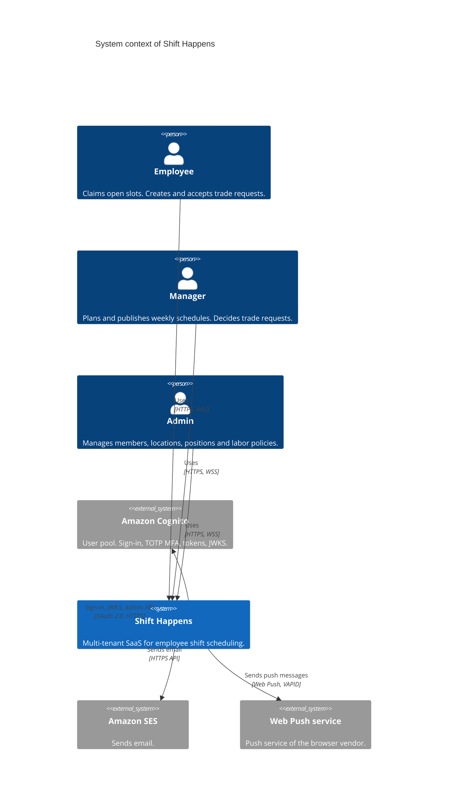
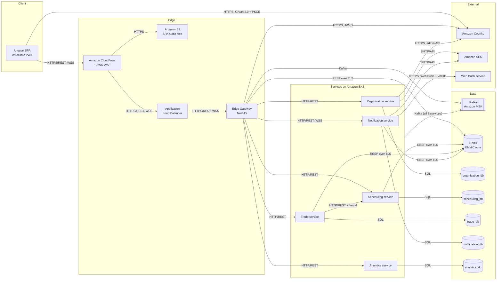
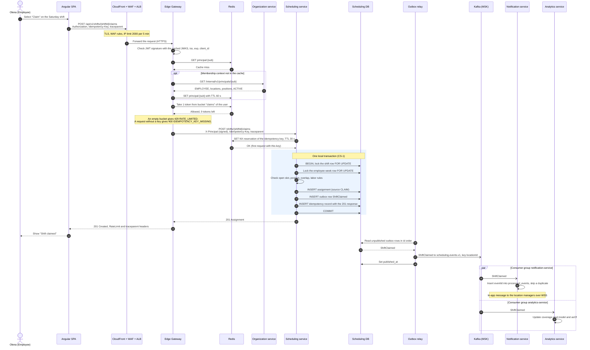

# Shift Happens architecture

| Item | Value |
|---|---|
| Deliverable | 4. Architecture: microservices, SPA, cloud |
| Version | 1.0 |
| Date | 2026-10-29 |
| Authors | Shift Happens team, Faculty of Applied Mathematics and Informatics, Ivan Franko National University of Lviv |
| Architecture decision | [ADR-0001: Architecture style](adr/0001-architecture-style.md) |

**Revision history**

| Version | Date | Author | Change |
|---|---|---|---|
| 1.0 | 2026-10-29 | Shift Happens team | First release for deliverable 4. |

## Contents

1. [Summary](#1-summary)
1. [Architecture drivers](#2-architecture-drivers)
1. [System context](#3-system-context)
1. [Container view](#4-container-view)
1. [Service catalog](#5-service-catalog)
1. [Communication](#6-communication)
1. [Data architecture](#7-data-architecture)
1. [Security architecture overview](#8-security-architecture-overview)
1. [Cross-cutting concerns](#9-cross-cutting-concerns)
1. [AWS mapping](#10-aws-mapping)
1. [Concurrency and resiliency hooks](#11-concurrency-and-resiliency-hooks)
1. [Diagrams as code](#12-diagrams-as-code)
1. [Related documents](#13-related-documents)

## 1. Summary

Shift Happens is an Angular single-page application (SPA) and a set of NestJS microservices on Amazon EKS. The services integrate through Apache Kafka on Amazon MSK. The Edge Gateway is the only entry point for the API. Five domain services own one bounded context and one PostgreSQL database each. The services publish domain events through a transactional outbox, and the Notification service and the Analytics service react to these events. All strong invariants stay in the Scheduling service. Thus one local transaction protects capacity, overlap and labor rules. [ADR-0001](adr/0001-architecture-style.md) records the options that the team compared and the reasons for this style.

### 1.1 Key decisions

| Decision | Choice | Reason | ADR |
|---|---|---|---|
| Architecture style | Angular SPA, microservices, event-driven integration with Kafka, on AWS | Independent scale of the notification fan-out and of the analytics reads. Failure isolation. Material for deliverables 7–12. | [ADR-0001](adr/0001-architecture-style.md) |
| Service boundaries | Edge Gateway and 5 domain services: Organization, Scheduling, Trade, Notification, Analytics | One service per bounded context. No service per entity. | [ADR-0001](adr/0001-architecture-style.md) |
| Place of the strong invariants | Scheduling service only | Capacity, overlap and labor rules need one ACID transaction ([REQ-REL-001](01-srs.md)). | [ADR-0001](adr/0001-architecture-style.md) |
| Swap and cover | One Trade service. One resource `/trade-requests` with the field `type` (`SWAP`, `COVER`). | A trade request lives up to 48 h and has a peer step and a manager step. An orchestrated saga fits this workflow. | [ADR-0001](adr/0001-architecture-style.md) |
| Data | Database per service on Amazon RDS for PostgreSQL | Clear data ownership. PostgreSQL gives row locks and exclusion constraints for CS-1. | [ADR-0001](adr/0001-architecture-style.md) |
| Integration | Kafka, transactional outbox, at-least-once delivery, idempotent consumers | No lost events and no events without a commit. Replay of events for read models. | [ADR-0001](adr/0001-architecture-style.md) |
| Event sourcing | Not used | The invariants need constraints on the current state. Event sourcing adds cost and no benefit for v1. | [ADR-0001](adr/0001-architecture-style.md) |
| API entry point | Own Edge Gateway (NestJS), not Amazon API Gateway | Per-user token buckets with `RateLimit` headers, a membership context per request, problem details for all gateway errors. | — |
| Identity | Amazon Cognito user pool, OAuth 2.0 Authorization Code with PKCE. Memberships in the Organization service. | Managed sign-in and TOTP MFA. Roles per location do not fit into identity provider groups. | — |
| Optimistic concurrency | `version` field in the request body, 409 `VERSION_CONFLICT` | One conflict model for all write operations. No `ETag`, `If-Match`, 412 or 428. | — |
| Error format | RFC 9457 problem details with a stable `code` and a `traceId` | One error contract for the gateway and all services. | — |
| Diagrams | Mermaid code in the Markdown files | GitHub shows the diagrams. Reviewers see diagram changes in the same pull request as the text. | — |

## 2. Architecture drivers

These quality attributes and constraints shaped the design. The full requirement records are in the [SRS](01-srs.md).

### 2.1 Quality attributes

| Driver | Requirement | Target | Architecture response |
|---|---|---|---|
| No double booking | [REQ-REL-001](01-srs.md) | Under concurrent requests, the assigned count never exceeds the capacity. No employee has overlapping active assignments. | The Scheduling service owns all assignments. Row locks in a fixed order and an exclusion constraint protect the invariants (CS-1). |
| Idempotent writes | [REQ-REL-002](01-srs.md) | A retry with the same `Idempotency-Key` within 24 h never creates a second object. | A Redis reservation and a stored response in the service database (CS-4). |
| API latency | [REQ-PERF-001](01-srs.md) | p95 ≤ 300 ms for reads and ≤ 500 ms for writes at 200 requests/s, at the Edge Gateway. | No synchronous fan-out on the read path. Membership cache in Redis. The coverage API reads a read model, not the scheduling database. |
| Notification delivery time | [REQ-PERF-002](01-srs.md) | After the publication of a schedule with 200 affected employees, 95 % of in-app notifications arrive within 60 s. | Kafka topics with 12 partitions. Competing consumers in the Notification service (CS-5). |
| Availability | [REQ-AVAIL-001](01-srs.md) | 99.9 % monthly for the public API. | Minimum 2 replicas per service across 3 Availability Zones. RDS Multi-AZ. MSK with 3 brokers in 3 Availability Zones. |
| Authentication and MFA | [REQ-SEC-001](01-srs.md) | OIDC Authorization Code with PKCE through Cognito. TOTP MFA for every ADMIN. | Cognito managed login. The Organization service rejects admin-only operations without MFA (403 `MFA_REQUIRED`). |
| Tenant isolation | [REQ-SEC-002](01-srs.md) | No API returns or changes data of another organization. Cross-tenant access returns 404. | `org_id` on every row. PostgreSQL row-level security as defense in depth. |
| Audit log | [REQ-SEC-003](01-srs.md) | Security-relevant actions stay in an append-only audit log for 1 year. | Append-only `audit_log` tables. Audit events go through the outbox in the same transaction as the change. |
| Traceability of errors | [REQ-OBS-001](01-srs.md) | Every error response has a `traceId` that finds the request in logs and traces. | OpenTelemetry on every hop. `traceparent` in HTTP headers and in the event envelope. `traceId` in every problem details body. |

### 2.2 Constraints

| Constraint | Effect on the design |
|---|---|
| The course asks for a design. Deliverables 3–6 contain no code. | This document defines containers, contracts, data ownership and flows. Deliverables 7–12 add the data, resiliency, security, deployment, analytics and monitoring models. |
| The client is a browser. There is no mobile app in v1. | One Angular SPA. It is an installable PWA, so it can receive Web Push messages. |
| The team uses TypeScript. | Angular on the client and NestJS on the server. One shared library holds the event envelope, the problem details type and the `X-Principal` verification. |
| The cloud is AWS. | Managed services hold all state: Amazon RDS, Amazon MSK, Amazon ElastiCache, Amazon Cognito, Amazon SES. |
| A small student team operates the system. | No self-hosted databases, brokers or identity providers. |
| The diagrams must be code and must render on GitHub. | Mermaid only ([section 12](#12-diagrams-as-code)). |
| The UI is in English only in v1. | No translation component. |

## 3. System context

The system context shows Shift Happens as one software system, the three human actors and the three external systems.



| Element | Type | Description |
|---|---|---|
| Employee | Person | Works shifts at one or more locations. Claims open slots and creates and accepts trade requests. Persona: Olena Kovalenko. |
| Manager | Person | Plans, publishes and staffs the weekly schedules of the own locations. Decides trade requests. Persona: Iryna Bondar. |
| Admin | Person | Manages the members, locations, positions and labor policies of the organization. Persona: Andrii Shevchenko. |
| Shift Happens | Software system | Multi-tenant SaaS for employee shift scheduling. [Section 4](#4-container-view) shows its containers. |
| Amazon Cognito | External system | The identity provider. It signs users in, enforces TOTP MFA, issues the tokens and publishes the JWKS. The Organization service calls its admin API. |
| Amazon SES | External system | Sends the invitation emails and the email notifications. |
| Web Push service | External system | The push service of the browser vendor. It delivers Web Push messages to the installed PWA. |

The SRS also names a Scheduler actor for time-based jobs. The Scheduler is not an external system: the jobs run inside the services ([section 5](#5-service-catalog)).

## 4. Container view

The container view shows the deployable parts and the data stores. The edge labels give the protocol.



All arrows point from the component that opens the connection. Kafka consumers also open the connection, because they fetch the records. [Section 6.5](#65-kafka-topics) shows which service produces and which service consumes each topic.

| Container | Technology | Responsibility | Data store | Scaling |
|---|---|---|---|---|
| Angular SPA | Angular, TypeScript, service worker (PWA) | UI for all roles. Holds the access token in memory. Receives in-app notifications over WebSocket and Web Push messages through the service worker. | Browser memory, `sessionStorage` for the refresh token | Static files on CloudFront |
| CloudFront + WAF | Amazon CloudFront, AWS WAF | TLS, static file cache, API and WebSocket pass-through, IP rate limit, managed rule groups | Amazon S3 (SPA files) | Managed |
| Application Load Balancer | AWS ALB with the AWS Load Balancer Controller | Routes HTTPS and WebSocket traffic to the Edge Gateway pods | — | Managed |
| Edge Gateway | NestJS | JWT validation, membership context, rate limiting, idempotency key presence check, routing, `X-Principal`, `traceparent` | Redis | HPA on CPU, 2–10 replicas |
| Organization service | NestJS | Organizations, locations, positions, labor policies, memberships, invitations, user lifecycle, Cognito admin calls | `organization_db` | HPA on CPU, 2–4 replicas |
| Scheduling service | NestJS | Schedules, shifts, assignments, claims, labor rule engine, trade locks, trade execution | `scheduling_db`, Redis | HPA on CPU, 2–8 replicas |
| Trade service | NestJS | Trade requests (`SWAP`, `COVER`), saga orchestrator, trade expiry job | `trade_db`, Redis | HPA on CPU, 2–4 replicas |
| Notification service | NestJS | Notifications, preferences, WebSocket connections, Web Push, email, shift reminders job | `notification_db`, Redis | HPA on CPU and on Kafka consumer lag, 2–12 replicas |
| Analytics service | NestJS | Read models for coverage, fill rate and trade rate. Coverage API. Nightly rollups. | `analytics_db` | HPA on CPU, 2–4 replicas |
| Service databases | Amazon RDS for PostgreSQL, Multi-AZ | One database per service | — | Vertical. One Multi-AZ DB instance per service. |
| Cache | Amazon ElastiCache for Redis, cluster mode | Rate limit buckets, idempotency reservations, membership cache, WebSocket presence | — | Shards with one replica each |
| Event broker | Amazon MSK (Apache Kafka) | Domain events, saga commands, dead-letter topics | — | 3 brokers, 12 partitions per topic |

The Notification service scales to a maximum of 12 replicas because each topic has 12 partitions. A consumer group cannot use more consumers than partitions.

## 5. Service catalog

All services are NestJS containers on Amazon EKS with minimum 2 replicas each. The table shows which service implements each functional requirement of the [SRS](01-srs.md).

| Requirement | Title | Owner service | Other services |
|---|---|---|---|
| REQ-FUNC-001 | Invite a member | Organization | Edge Gateway (`invitations` policy) |
| REQ-FUNC-002 | Accept an invitation | Organization | — |
| REQ-FUNC-003 | Change a membership | Organization | Edge Gateway (cache), Scheduling, Notification (replicas) |
| REQ-FUNC-004 | Deactivate a member | Organization | Scheduling, Trade, Notification (cleanup from `MemberDeactivated`) |
| REQ-FUNC-005 | Manage locations, positions and labor policy | Organization | Scheduling (replicas) |
| REQ-FUNC-006 | Create a weekly draft schedule | Scheduling | — |
| REQ-FUNC-007 | Create and edit shifts | Scheduling | Notification |
| REQ-FUNC-008 | Publish a schedule | Scheduling | Notification, Analytics |
| REQ-FUNC-009 | Assign an employee to a shift | Scheduling | Notification, Analytics |
| REQ-FUNC-010 | Claim an open shift | Scheduling | Notification, Analytics |
| REQ-FUNC-011 | Request a shift swap | Trade | Scheduling (trade lock) |
| REQ-FUNC-012 | Request a shift cover | Trade | Scheduling (trade lock) |
| REQ-FUNC-013 | Accept a trade request | Trade | Scheduling (validate trade) |
| REQ-FUNC-014 | Approve or reject a trade request | Trade | Scheduling (trade execution) |
| REQ-FUNC-015 | Expire stale trade requests | Trade | Scheduling (lock release) |
| REQ-FUNC-016 | Detect scheduling conflicts and labor rule violations | Scheduling | Trade (through validate trade) |
| REQ-FUNC-017 | Notify members about changes | Notification | All event producers |
| REQ-FUNC-018 | Show coverage analytics | Analytics | Scheduling, Trade (events) |

### 5.1 Edge Gateway

Kubernetes name: `edge-gateway`.

**Responsibility.** The Edge Gateway is the only entry point for API and WebSocket traffic. For each request, it does these steps:

1. It validates the Cognito access token: signature against the cached JWKS, `iss`, `exp`, `client_id` and `token_use = access`.
1. It loads the membership context of `sub` from Redis. On a cache miss, it calls the Organization service and caches the result for 60 s.
1. It rejects a member with the status `DEACTIVATED` with 401 `AUTHENTICATION_REQUIRED`.
1. It takes one token from the rate limit bucket of the route ([section 9.3](#93-rate-limiting)).
1. It rejects API-08 and API-09 without an `Idempotency-Key` header (400 `IDEMPOTENCY_KEY_MISSING`).
1. It removes any `X-Principal` header from the client and adds a new signed `X-Principal` header ([section 8.2](#82-the-x-principal-header)).
1. It continues the trace from the `traceparent` of the request, or starts a new trace.
1. It routes the request to the service by the path.

**Owned data.** No database. The Edge Gateway keeps the membership cache and the rate limit buckets in Redis.

**Routes.**

| Path under `/api/v1` | Service |
|---|---|
| `/orgs/**`, `/invitations/**`, `/me`, `/locations/{locationId}/positions` | Organization service |
| `/locations/{locationId}/schedules`, `/schedules/**`, `/shifts/**`, `/assignments/**` | Scheduling service |
| `/trade-requests/**` | Trade service |
| `/me/notifications`, `/me/notification-preferences`, `/me/push-subscriptions`, and `/ws` (outside `/api/v1`) | Notification service |
| `/locations/{locationId}/analytics/**` | Analytics service |

The gateway does not route `/internal/**` paths. A request to such a path from the internet gets 404 `RESOURCE_NOT_FOUND`.

**Events consumed.** `MembershipChanged` and `MemberDeactivated` from `organization.events.v1`. The gateway deletes the cached membership context of the member, so the change applies to the next request.

**Background jobs.** None.

**Scaling and failure.**

- The Edge Gateway is stateless. The HPA scales it on CPU from 2 to 10 replicas.
- If Redis is not available, the gateway calls the Organization service on each request and uses an in-memory token bucket per replica. The AWS WAF IP limit stays active.
- If the Organization service is not available and the cache has no entry, the gateway returns 503 `SERVICE_UNAVAILABLE` with `Retry-After`.

### 5.2 Organization service

Kubernetes name: `organization-service`. Database: `organization_db`.

**Responsibility.** Organizations, locations, positions, labor policies, memberships and invitations. The service runs the user lifecycle (joiner, mover, leaver) and makes all Cognito admin calls. It rejects admin-only operations with 403 `MFA_REQUIRED` when the Cognito user has no TOTP MFA. It sends the invitation emails through Amazon SES itself, because the raw invitation token must not appear in Kafka events.

**Owned data (main tables).**

| Table | Content |
|---|---|
| `organizations` | Tenants |
| `locations` | Name and IANA time zone, for example `Europe/Kyiv` |
| `positions` | Job types per location, for example Barista |
| `labor_policies` | Organization defaults and per-location values of `minRestHours`, `maxWeeklyHours`, `maxShiftHours`, `tradeCutoffHours`, `tradeTtlHours` |
| `memberships` | `user_id` (Cognito `sub`), role, location IDs, qualified position IDs, status |
| `invitations` | Email, role, locations, positions, SHA-256 hash of the token, `expires_at` (7 days), status |
| `audit_log` | Append-only audit records |
| `outbox` | Events that wait for the relay |

**Public endpoints.**

| ID | Method and path | Purpose |
|---|---|---|
| API-01 | `POST /orgs/{orgId}/invitations` | Invite a member (REQ-FUNC-001) |
| API-02 | `POST /invitations/accept` | Accept an invitation (REQ-FUNC-002) |
| API-03 | `POST /orgs/{orgId}/members/{userId}/deactivate` | Deactivate a member (REQ-FUNC-004) |
| — | `GET /me` | Membership context of the caller for the SPA |
| — | `PATCH /orgs/{orgId}/members/{userId}` | Change the role, locations or positions of a member (REQ-FUNC-003) |
| — | `POST /orgs/{orgId}/locations` | Create a location (REQ-FUNC-005) |
| — | `POST /locations/{locationId}/positions` | Create a position at a location (REQ-FUNC-005) |
| — | `PUT /orgs/{orgId}/labor-policy` | Set the labor policy of the organization or of one location (REQ-FUNC-005) |

**Internal endpoints.**

| Method and path | Caller | Purpose |
|---|---|---|
| `GET /internal/v1/principals/{sub}` | Edge Gateway | Returns the membership context: `orgId`, role, location IDs, position IDs, status |

**Events produced** on `organization.events.v1`: `MemberInvited`, `MemberJoined`, `MembershipChanged`, `MemberDeactivated`, `LaborPolicyChanged`, `LocationChanged`, `PositionChanged`.

**Events consumed.** None.

**Background jobs.**

- Outbox relay ([section 6.3](#63-transactional-outbox-and-relay)).
- Cognito retry job: it repeats a failed `AdminDisableUser` or `AdminUserGlobalSignOut` call every 60 s until it succeeds.

**Scaling and failure.**

- The HPA scales the service on CPU from 2 to 4 replicas. The traffic is low.
- On a deactivation, the service sets the status `DEACTIVATED` first. Then it calls Cognito. If Cognito is not available, the status alone blocks the member within the 60 s cache TTL.
- An outage of the service stops the organization administration. It also stops the requests of members whose membership context is not in the gateway cache. Scheduling and Trade continue to work with their local data.

### 5.3 Scheduling service

Kubernetes name: `scheduling-service`. Database: `scheduling_db`.

**Responsibility.** Schedules, shifts, assignments and claims. The service contains the labor rule engine (`MIN_REST`, `MAX_WEEKLY_HOURS`, `MAX_SHIFT_HOURS`) and the overlap check. It places and releases trade locks, and it executes trades. The trade execution is the pivot transaction of the trade saga. The service owns REQ-REL-001: all checks and changes of assignments happen in its local transactions.

**Owned data (main tables).**

| Table | Content |
|---|---|
| `schedules` | Location, `week_start`, status (`DRAFT`, `PUBLISHED`), `version` |
| `shifts` | Schedule, position, `starts_at`, `ends_at`, `capacity`, `assigned_count`, `note`, `version` |
| `assignments` | Shift, employee, status (`ACTIVE`, `CANCELLED`), source, `overridden`, `trade_lock`, `trade_lock_expires_at`, `period` (`tstzrange`). An exclusion constraint on `(employee_id, period)` for active rows blocks overlaps. |
| `employee_weeks` | One row per employee and schedule week with the assigned hours. CS-1 locks this row after the shift row. |
| `member_replica`, `location_replica`, `position_replica`, `labor_policy_replica` | Local copies of Organization data from `organization.events.v1` |
| `idempotency_records` | Stored responses for API-08 (and API-04 with a key) for 24 h |
| `audit_log`, `outbox`, `processed_events` | Audit records, events to publish, IDs of consumed events |

**Public endpoints.**

| ID | Method and path | Purpose |
|---|---|---|
| API-04 | `POST /locations/{locationId}/schedules` | Create a weekly draft schedule (REQ-FUNC-006) |
| API-05 | `PATCH /shifts/{shiftId}` | Edit a shift (REQ-FUNC-007) |
| API-06 | `POST /schedules/{scheduleId}/publish` | Publish a schedule (REQ-FUNC-008) |
| API-07 | `POST /shifts/{shiftId}/assignments` | Assign an employee (REQ-FUNC-009) |
| API-08 | `POST /shifts/{shiftId}/claims` | Claim an open slot (REQ-FUNC-010) |
| — | `GET /locations/{locationId}/schedules?weekStart=` | Find the schedule of a location for a week |
| — | `GET /schedules/{scheduleId}` | Read a schedule with its shifts |
| — | `POST /schedules/{scheduleId}/shifts` | Add a shift to a schedule (REQ-FUNC-007) |
| — | `DELETE /assignments/{assignmentId}` | Cancel an assignment. The slot becomes open. |

**Internal endpoints.** Only the Trade service calls these endpoints. Each call has a timeout of 2 s ([section 6.2](#62-timeouts-retries-and-circuit-breakers)).

| Purpose | Method and path | Behavior |
|---|---|---|
| Verify assignment | `GET /internal/v1/assignments/{assignmentId}` | Returns the owner, status, shift times, position, location and trade lock of the assignment. |
| Place trade lock | `PUT /internal/v1/assignments/{assignmentId}/trade-lock` | Body `{ "tradeRequestId", "expiresAt" }`. Idempotent for the same `tradeRequestId`. Returns 409 `ASSIGNMENT_LOCKED` when another trade request holds the lock. |
| Release trade lock | `DELETE /internal/v1/assignments/{assignmentId}/trade-lock?tradeRequestId=` | Idempotent. The Trade service uses it only when a request fails after the lock placement. All other releases use the `ReleaseTradeLocks` command. |
| Validate trade | `POST /internal/v1/trade-validations` | Checks positions, qualifications, trade cutoff and labor rules for the new owners. Returns the violations. Changes nothing. |

**Events produced** on `scheduling.events.v1`: `ScheduleCreated`, `SchedulePublished`, `ShiftChanged`, `AssignmentCreated`, `AssignmentCancelled`, `ShiftClaimed`, `TradeExecuted`, `TradeExecutionFailed`, `TradeLocksReleased`.

**Events and commands consumed.**

- `organization.events.v1`: `MemberJoined`, `MembershipChanged`, `LaborPolicyChanged`, `LocationChanged` and `PositionChanged` update the local replicas. `MemberDeactivated` cancels the future assignments of the member, so their slots become open.
- `trade.commands.v1`: `ExecuteTrade` runs the pivot transaction. `ReleaseTradeLocks` releases the trade locks of a trade request (compensation).

**Background jobs.** Outbox relay. Daily cleanup of `idempotency_records` older than 24 h.

**Scaling and failure.**

- The HPA scales the service on CPU from 2 to 8 replicas.
- The service has no synchronous dependency on another service. It reads Organization data from local replicas.
- If Kafka is not available, writes still succeed. The outbox keeps the events until the relay can publish them.
- A trade lock has an expiry time equal to the `expiresAt` of its trade request. The service ignores an expired lock. Thus a lost release cannot block an assignment for longer than the trade TTL.

### 5.4 Trade service

Kubernetes name: `trade-service`. Database: `trade_db`.

**Responsibility.** Trade requests of the type `SWAP` or `COVER` and their state machine (`PENDING_PEER`, `PENDING_MANAGER`, `EXECUTING`, `APPROVED`, `REJECTED`, `CANCELLED`, `EXPIRED`, `FAILED`). The service is the orchestrator of the trade saga (CS-3). It runs the trade expiry job (CS-6).

**Owned data (main tables).**

| Table | Content |
|---|---|
| `trade_requests` | Type, status, requester, offered and requested assignments, target employee, `accepted_by`, location, shift start, `expires_at`, `version` |
| `trade_request_transitions` | History of the status changes with the actor and the time |
| `idempotency_records` | Stored responses for API-09 for 24 h |
| `job_runs` | Fencing tokens of the trade expiry job |
| `audit_log`, `outbox`, `processed_events` | Audit records, events and commands to publish, IDs of consumed events |

**Public endpoints.**

| ID | Method and path | Purpose |
|---|---|---|
| API-09 | `POST /trade-requests` | Create a swap or cover request (REQ-FUNC-011, REQ-FUNC-012) |
| API-10 | `POST /trade-requests/{tradeRequestId}/accept` | Accept a trade request (REQ-FUNC-013) |
| API-11 | `POST /trade-requests/{tradeRequestId}/decision` | Approve or reject a trade request (REQ-FUNC-014) |
| — | `GET /trade-requests` | List the trade requests that the caller can see |
| — | `POST /trade-requests/{tradeRequestId}/decline` | The target declines the trade request |
| — | `POST /trade-requests/{tradeRequestId}/cancel` | The requester cancels the trade request |

**Internal endpoints.** None. The Trade service is a client of the internal API of the Scheduling service.

**Events and commands produced.**

- `trade.events.v1`: `TradeRequested`, `TradeAccepted`, `TradeApproved`, `TradeRejected`, `TradeCancelled`, `TradeExpired`, `TradeFailed`.
- `trade.commands.v1`: `ExecuteTrade`, `ReleaseTradeLocks`.

**Events consumed.**

- `scheduling.events.v1`: `TradeExecuted` moves a trade request from `EXECUTING` to `APPROVED`. `TradeExecutionFailed` moves it to `FAILED` and sends `ReleaseTradeLocks`. `TradeLocksReleased` closes the compensation step in `trade_request_transitions`. `AssignmentCancelled` cancels the pending trade requests of the cancelled assignment.
- `organization.events.v1`: `MemberDeactivated` cancels the pending trade requests of the member.

**Background jobs.**

- Trade expiry job: every 60 s, it moves pending trade requests after `expires_at` to `EXPIRED` and sends `ReleaseTradeLocks`. One replica runs it at a time (Kubernetes Lease and fencing token, CS-6).
- Outbox relay.

**Scaling and failure.**

- The HPA scales the service on CPU from 2 to 4 replicas.
- If the Scheduling service does not answer or its circuit breaker is open, API-09, API-10 and API-11 return 503 `SERVICE_UNAVAILABLE`. The Trade service does all synchronous checks before it writes, so a failed call leaves no partial state.
- A trade request stays in `EXECUTING` until the Scheduling service answers through Kafka. A trade request in `EXECUTING` for more than 5 min raises an alert (deliverable 12).

### 5.5 Notification service

Kubernetes name: `notification-service`. Database: `notification_db`.

**Responsibility.** Notifications on three channels: `IN_APP` (WebSocket and stored list), `WEB_PUSH` (VAPID, through the Web Push service) and `EMAIL` (Amazon SES). The service stores preferences and push subscriptions. It holds the WebSocket connections of the SPA and runs the shift reminders job.

**Owned data (main tables).**

| Table | Content |
|---|---|
| `notifications` | Recipient, type, text data, `read_at` |
| `deliveries` | One row per notification and channel, with status and attempts. A unique key on `(event_id, recipient_id, channel)` blocks duplicates (CS-5). |
| `notification_preferences` | Channels per notification type and member |
| `push_subscriptions` | Push endpoint and keys of each browser of a member |
| `recipients` | Local copy of members: email, role, locations, positions, status |
| `upcoming_assignments` | Local copy of future assignments for the reminders job |
| `job_runs` | Fencing tokens of the shift reminders job |

**Public endpoints.**

| Method and path | Purpose |
|---|---|
| `GET /me/notifications` | List the notifications of the caller |
| `PUT /me/notification-preferences` | Set the channels per notification type |
| `PUT /me/push-subscriptions` | Store the Web Push subscription of the browser |
| `wss://api.shifthappens.example/ws` | Real-time in-app notifications |

**Internal endpoints.** None.

**Events consumed.** All events of `organization.events.v1`, `scheduling.events.v1` and `trade.events.v1`. For example, `SchedulePublished` creates one notification for each affected employee, and `TradeRequested` informs the target or the qualified colleagues.

**Events produced.** None.

**WebSocket delivery.** A member can have connections on any replica. Each replica writes the presence of its connections to Redis (`ws:presence:{userId}`). The consumer that creates an in-app notification reads the presence and publishes the message on the Redis channel of the replica that holds the connection. That replica sends the message over the WebSocket.

**Background jobs.** Shift reminders job: it sends a reminder before the shift start. One replica runs it at a time (Kubernetes Lease and fencing token, CS-6).

**Scaling and failure.**

- The HPA scales the service on CPU and on Kafka consumer lag from 2 to 12 replicas.
- If SES or the Web Push service fails, the consumer retries with backoff. A circuit breaker per channel stops the calls during an outage. After 5 attempts, the message goes to the dead-letter topic.
- The service deletes a push subscription when the Web Push service returns 404 or 410.
- If Redis is not available, in-app notifications stay in `notifications`. The SPA reads them with `GET /me/notifications` after it connects again.

### 5.6 Analytics service

Kubernetes name: `analytics-service`. Database: `analytics_db`.

**Responsibility.** Read models for coverage rate, fill rate, unfilled shifts and trade rate. The coverage API (API-12). Nightly rollups.

**Owned data (main tables).**

| Table | Content |
|---|---|
| `shift_facts` | One row per published shift: location, position, start, capacity, assigned count |
| `coverage_daily` | Required slots, filled slots, coverage rate and unfilled shifts per location and local day |
| `coverage_weekly` | The same values per location and schedule week |
| `trade_facts` | One row per trade request: type, final status, creation and decision times |
| `location_watermarks` | The `asOf` value per location |
| `location_replica` | Location time zones for the local day boundaries |
| `job_runs`, `processed_events` | Fencing tokens of the rollup job, IDs of consumed events |

**Public endpoints.**

| ID | Method and path | Purpose |
|---|---|---|
| API-12 | `GET /locations/{locationId}/analytics/coverage` | Coverage of a location for a date range (REQ-FUNC-018) |

**Internal endpoints.** None.

**Events consumed.** `scheduling.events.v1` (`SchedulePublished`, `ShiftChanged`, `AssignmentCreated`, `AssignmentCancelled`, `ShiftClaimed`, `TradeExecuted`), all events of `trade.events.v1`, and `LocationChanged` from `organization.events.v1`.

**Events produced.** None.

**Background jobs.** Nightly rollup job: it runs every hour. For each location where the local time is between 02:00 and 03:00, it recomputes the rollup rows of the previous local day. One replica runs it at a time (Kubernetes Lease and fencing token, CS-6).

**Scaling and failure.**

- The HPA scales the service on CPU from 2 to 4 replicas. Analytics queries never touch `scheduling_db`.
- If the consumer lag grows, API-12 still answers. The `asOf` value shows the age of the data, and the SPA shows it next to the chart.
- A replay from Kafka repairs the last 7 days. Older rows are final, because a shift cannot change after its start.

## 6. Communication

### 6.1 Rules for synchronous and asynchronous calls

| Interaction | Style | Rule |
|---|---|---|
| SPA → services | Synchronous REST through CloudFront, the ALB and the Edge Gateway | JSON over HTTPS, base path `/api/v1` |
| SPA ↔ Notification service | WebSocket through the Edge Gateway | The server pushes in-app notifications. The SPA sends only heartbeats. |
| Service → service, the user waits for the result | Synchronous internal REST | Only Trade → Scheduling (verify assignment, place or release trade lock, validate trade) and Edge Gateway → Organization (membership context on a cache miss) |
| Service → service, the user does not wait | Kafka events through the outbox | The default for all other integration |
| Saga commands | Kafka topic `trade.commands.v1` through the outbox | Trade → Scheduling only |

The services obey these rules:

1. A service never reads or writes the database of another service.
1. No service calls the Notification service or the Analytics service synchronously.
1. A synchronous call only reads data or places a reversible mark (a trade lock). Business changes across services go through Kafka.
1. Every event and every command goes through the outbox of its producer.
1. Every consumer is idempotent.

### 6.2 Timeouts, retries and circuit breakers

| Call | Timeout | Retries | Circuit breaker | Result for the client |
|---|---|---|---|---|
| Edge Gateway → service | 10 s | 1 retry for `GET` only. No automatic retry of a write. | One per upstream service | 503 `SERVICE_UNAVAILABLE` with `Retry-After` |
| Edge Gateway → Organization service (membership context) | 2 s | 1 | Yes | 503 `SERVICE_UNAVAILABLE` |
| Trade → Scheduling (internal) | 2 s | 1, after 100 ms with jitter | Opens at 50 % failures in the last 20 calls. Half-open after 30 s. | 503 `SERVICE_UNAVAILABLE` with `Retry-After: 30` |
| Notification → SES or Web Push service | 5 s | Consumer retries | One per channel | None (asynchronous) |
| Kafka consumer, processing of one message | — | 5 attempts with backoff of 1 s, 2 s, 4 s and 8 s, then the dead-letter topic | — | None (asynchronous) |

A retry of "place trade lock" is safe, because the call is idempotent for the same `tradeRequestId`. Deliverable 8 (resiliency model) gives the final values and the retry budgets.

### 6.3 Transactional outbox and relay

The Organization service, the Scheduling service and the Trade service each have an `outbox` table. A service writes the business change and the event row in one local transaction. Thus an event exists if and only if the change exists.

The relay works as follows:

1. Each of these services runs one outbox relay. One replica of the service holds the relay at a time (Kubernetes Lease, the same mechanism as CS-6).
1. The relay reads unpublished rows in the order of their `id`, at most 500 rows every 200 ms.
1. The relay sends the rows to Kafka with `acks=all` and the idempotent producer. The record key is the topic key (`orgId` or `locationId`).
1. After Kafka confirms the batch, the relay sets `published_at` on the rows.
1. A daily cleanup deletes published rows older than 7 days.

If the relay stops after the send and before the update, it sends the rows again. Thus delivery is at-least-once, and every consumer must be idempotent. If the outbox insert fails, the whole transaction fails and the API returns 503 `SERVICE_UNAVAILABLE` (CS-5). The age of the oldest unpublished row is the outbox lag metric.

### 6.4 Idempotent consumers

Each service reads with its own consumer group. The group name is the Kubernetes name of the service, for example `notification-service`. The consumer processes an event in one database transaction:

1. It inserts the `eventId` into `processed_events` with `ON CONFLICT DO NOTHING`.
1. If the insert adds no row, the event is a duplicate. The consumer skips it.
1. Otherwise the consumer applies the change.
1. The consumer commits the transaction, then commits the Kafka offset.

The Notification service uses a stricter key: the unique key `(event_id, recipient_id, channel)` on `deliveries`. Thus a restart in the middle of a fan-out to 200 employees sends no second message to an employee who already has one (CS-5).

A message that fails 5 times goes to the dead-letter topic `<topic>.dlq`. The dead-letter topic raises an alert. Operators replay the message after the fix.

### 6.5 Kafka topics

| Topic | Producer | Key | Events or commands | Consumers |
|---|---|---|---|---|
| `organization.events.v1` | Organization service | `orgId` | `MemberInvited`, `MemberJoined`, `MembershipChanged`, `MemberDeactivated`, `LaborPolicyChanged`, `LocationChanged`, `PositionChanged` | Edge Gateway (cache), Scheduling, Trade, Notification, Analytics |
| `scheduling.events.v1` | Scheduling service | `locationId` | `ScheduleCreated`, `SchedulePublished`, `ShiftChanged`, `AssignmentCreated`, `AssignmentCancelled`, `ShiftClaimed`, `TradeExecuted`, `TradeExecutionFailed`, `TradeLocksReleased` | Trade, Notification, Analytics |
| `trade.events.v1` | Trade service | `locationId` | `TradeRequested`, `TradeAccepted`, `TradeApproved`, `TradeRejected`, `TradeCancelled`, `TradeExpired`, `TradeFailed` | Notification, Analytics |
| `trade.commands.v1` | Trade service | `locationId` | `ExecuteTrade`, `ReleaseTradeLocks` | Scheduling |
| `<topic>.dlq` | Any consumer | Same as the source topic | Poison messages after 5 attempts | Operators (alert) |

Topic settings:

- 12 partitions per topic. The key keeps all events of one location (or one organization) in one partition, so consumers see them in order.
- Replication factor 3, `min.insync.replicas=2`. Producers use `acks=all` and the idempotent producer.
- Retention: 7 days for event and command topics, 14 days for dead-letter topics.

### 6.6 Event envelope

Every event and command uses the same envelope. The example shows the event of the claim in [section 6.7](#67-request-lifecycle).

```json
{
  "eventId": "01a1aafc-97f0-7c3e-9a5d-2f8b6e4c1a07",
  "type": "ShiftClaimed",
  "schemaVersion": 1,
  "occurredAt": "2026-11-05T09:14:03.120Z",
  "orgId": "0b9f5c3e-2d1a-4f6b-8c7d-9e0a1b2c3d4e",
  "locationId": "7d3e2f1a-4b5c-4d6e-9f8a-0b1c2d3e4f5a",
  "aggregateId": "d5e6f7a8-b9c0-4d1e-8f2a-3b4c5d6e7f80",
  "payload": {
    "shiftId": "d5e6f7a8-b9c0-4d1e-8f2a-3b4c5d6e7f80",
    "scheduleId": "c4d5e6f7-a8b9-4c0d-9e1f-2a3b4c5d6e7f",
    "assignmentId": "9c0d1e2f-3a4b-4c5d-8e6f-7a8b9c0d1e2f",
    "employeeId": "5b1e6c2a-8f3d-4a7e-9c1b-2d4f6a8e0c13",
    "positionId": "a1b2c3d4-e5f6-4a7b-8c9d-0e1f2a3b4c5d",
    "startsAt": "2026-11-07T08:00:00+02:00",
    "endsAt": "2026-11-07T16:00:00+02:00",
    "capacity": 2,
    "assignedCount": 2
  },
  "traceparent": "00-4bf92f3577b34da6a3ce929d0e0e4736-00f067aa0ba902b7-01"
}
```

| Field | Meaning |
|---|---|
| `eventId` | UUID v7. The time-ordered ID is also the deduplication key of the consumers. |
| `type` | Event or command name |
| `schemaVersion` | Version of the `payload` schema. Changes inside a version are additive only. |
| `occurredAt` | Time of the business change (the commit time of the transaction) |
| `orgId` | Tenant. Consumers use it for row-level security. |
| `locationId` | Location, when the event applies to one location |
| `aggregateId` | ID of the changed aggregate (here the shift) |
| `payload` | Event data |
| `traceparent` | W3C trace context of the request that caused the event. The relay also copies it into a Kafka record header. |

### 6.7 Request lifecycle

The diagram shows one write from end to end: Olena claims the Saturday Barista shift (API-08, `shiftId` `d5e6f7a8-b9c0-4d1e-8f2a-3b4c5d6e7f80`). The shift has capacity 2 and one open slot.



Notes to the steps:

- Steps 2–3: CloudFront and the ALB terminate TLS and forward the request. AWS WAF blocks an IP address above 2000 requests in 5 min.
- Steps 4–9: the Edge Gateway does not call Cognito for each request. It validates the token locally with the cached JWKS. The Organization service call happens only on a cache miss.
- Steps 10–11: the `claims` policy allows 10 requests per 60 s. The response carries the `RateLimit-Policy` and `RateLimit` headers.
- Steps 13–14: the Redis reservation stops a second request with the same key while the first one runs (409 `IDEMPOTENCY_REQUEST_IN_PROGRESS`).
- Steps 15–21: one transaction holds the business change, the event and the stored response. If another employee takes the last slot first, the transaction ends with 409 `SLOT_FILLED`. [Concurrency patterns](04-concurrency.md) shows this race in CS-1.
- Steps 25–28: the relay publishes after the commit. The API response does not wait for Kafka.
- Steps 29–32: both consumer groups receive the event independently. The Analytics service updates the read model, normally within 5 s.

## 7. Data architecture

The full data model with all tables, columns, indexes and partitions is deliverable 7. This section gives the ownership and the consistency rules.

### 7.1 Database per service

| Database | Owner | Main tables | How other services get the data |
|---|---|---|---|
| `organization_db` | Organization service | `organizations`, `locations`, `positions`, `labor_policies`, `memberships`, `invitations`, `audit_log`, `outbox` | Events on `organization.events.v1`. Membership context through the internal API (Edge Gateway only). |
| `scheduling_db` | Scheduling service | `schedules`, `shifts`, `assignments`, `employee_weeks`, replicas, `idempotency_records`, `audit_log`, `outbox`, `processed_events` | Events on `scheduling.events.v1`. Internal API for the Trade service. |
| `trade_db` | Trade service | `trade_requests`, `trade_request_transitions`, `idempotency_records`, `job_runs`, `audit_log`, `outbox`, `processed_events` | Events on `trade.events.v1` |
| `notification_db` | Notification service | `notifications`, `deliveries`, `notification_preferences`, `push_subscriptions`, `recipients`, `upcoming_assignments`, `job_runs` | Public API of the caller only |
| `analytics_db` | Analytics service | `shift_facts`, `coverage_daily`, `coverage_weekly`, `trade_facts`, `location_watermarks`, `job_runs`, `processed_events` | API-12 |

Each service connects with its own database user. That user has no access to another database. Each database is on its own RDS Multi-AZ DB instance, so a heavy analytics query cannot slow down a claim.

### 7.2 Multi-tenancy

Shift Happens uses a shared schema: one set of tables for all organizations.

1. Every row has `org_id`. Every query filters by the `orgId` of the `X-Principal` header.
1. PostgreSQL row-level security is the second line of defense. If the code forgets a filter, the query still returns no rows of another organization.
1. At the start of each transaction, the service sets the tenant: `SET LOCAL app.org_id = '<orgId>'`. A Kafka consumer takes the value from the `orgId` of the envelope.
1. The service database user does not own the tables and does not have the `BYPASSRLS` attribute. Background jobs that work across organizations use a separate database user.
1. A row of another organization is invisible. Thus the API returns 404 `RESOURCE_NOT_FOUND` and does not disclose that the row exists (REQ-SEC-002).

```sql
ALTER TABLE assignments ENABLE ROW LEVEL SECURITY;

CREATE POLICY tenant_isolation ON assignments
  USING (org_id = current_setting('app.org_id')::uuid)
  WITH CHECK (org_id = current_setting('app.org_id')::uuid);
```

### 7.3 Consistency model

| Scope | Model | Mechanism |
|---|---|---|
| Assignments, capacity, overlap, labor rules | Strong | One Scheduling transaction at `READ COMMITTED` with `SELECT … FOR UPDATE` in a fixed lock order, and an exclusion constraint on `(employee_id, period)` (CS-1) |
| Schedule and shift edits | Strong, optimistic | `UPDATE … WHERE id = $1 AND version = $2`. A mismatch gives 409 `VERSION_CONFLICT` (CS-2). |
| Trade request status | Strong inside the Trade service | Conditional update on the expected status. A mismatch gives 409 `TRADE_NOT_PENDING`. |
| Trade across services | Eventual, with a semantic lock | Saga with trade locks and compensation (CS-3) |
| Replicas of Organization data in other services | Eventual | Events on `organization.events.v1`, normally within 5 s |
| Membership context in the Edge Gateway | Eventual, at most 60 s | Cache TTL 60 s, deleted earlier by `MembershipChanged` and `MemberDeactivated` |
| Analytics read models | Eventual, with a watermark | API-12 returns `asOf`. The normal lag is less than 5 s. |
| SPA after a write | Read-your-writes | Each write response returns the changed object. The SPA updates its state from the response, not from a read model. |

### 7.4 Redis

Redis holds only data that the system can lose or rebuild. No business fact exists only in Redis.

| Key pattern | Owner | Content | TTL |
|---|---|---|---|
| `rl:{policy}:{userId}` | Edge Gateway | Token bucket of one user and one rate limit policy | Window of the policy |
| `rl:invitations-org:{orgId}` | Edge Gateway | Daily invitation quota of one organization (200 per day) | 1 day |
| `principal:{sub}` | Edge Gateway | Membership context of one user | 60 s |
| `idem:{service}:{userId}:{key}` | Scheduling service, Trade service | Reservation of an idempotency key while the request runs | 30 s |
| `ws:presence:{userId}` | Notification service | Replicas that hold a WebSocket connection of the member | 90 s, renewed every 30 s |

The stored responses of idempotent requests are in PostgreSQL (`idempotency_records`), in the same transaction as the business change. Thus a Redis failover cannot cause a second object.

### 7.5 Retention

| Data | Retention |
|---|---|
| `audit_log` | 1 year (REQ-SEC-003) |
| `idempotency_records` | 24 h (REQ-REL-002) |
| Published `outbox` rows | 7 days |
| `processed_events` | 30 days |
| Kafka event and command topics | 7 days |
| Kafka dead-letter topics | 14 days |

## 8. Security architecture overview

The [SRS](01-srs.md) defines identity and access management in detail: roles, permissions, MFA and the joiner, mover and leaver flows. The threat model is deliverable 9. This section shows where the controls are in the architecture.

### 8.1 Identity flow

1. The SPA sends the user to the Cognito managed login with OAuth 2.0 Authorization Code and PKCE.
1. Cognito returns an access token (15 min), an ID token (15 min) and a refresh token (30 days, with rotation).
1. The SPA keeps the access token in memory and the refresh token in `sessionStorage`. Sign-out revokes the refresh token.
1. The SPA sends `Authorization: Bearer <access token>` on every API call.
1. The Edge Gateway validates the token and adds the membership context. The `userId` of a member is the Cognito `sub`.
1. Each service enforces the permissions for its own resources from the `X-Principal` header.

A Backend-for-Frontend (BFF) with `HttpOnly` cookies is a future option. Deliverable 9 compares it with the in-memory token.

### 8.2 The X-Principal header

The Edge Gateway signs the membership context as a JWS (ES256) with a lifetime of 30 s. Only the gateway has the private key. The services verify the signature with the public key, and they check `aud`. A service rejects a request without a valid `X-Principal`. The gateway deletes any `X-Principal` header that comes from the internet.

```json
{
  "iss": "edge-gateway",
  "aud": "scheduling-service",
  "sub": "5b1e6c2a-8f3d-4a7e-9c1b-2d4f6a8e0c13",
  "orgId": "0b9f5c3e-2d1a-4f6b-8c7d-9e0a1b2c3d4e",
  "role": "EMPLOYEE",
  "locationIds": ["7d3e2f1a-4b5c-4d6e-9f8a-0b1c2d3e4f5a"],
  "positionIds": ["a1b2c3d4-e5f6-4a7b-8c9d-0e1f2a3b4c5d"],
  "iat": 1793870043,
  "exp": 1793870073
}
```

### 8.3 Service-to-service trust

| Path | Control in v1 | Later |
|---|---|---|
| Edge Gateway → services | Kubernetes NetworkPolicy: default deny, allow only the gateway. Signed `X-Principal`. | mTLS through a service mesh (planned for deliverable 9) |
| Trade → Scheduling internal API | NetworkPolicy allows only the Trade service on `/internal/**`. The gateway never routes `/internal/**`. | mTLS (planned for deliverable 9) |
| Services → Kafka | TLS and MSK IAM access control. Each service can write only to its own topics and read only the topics that it consumes. | — |
| Services → RDS, ElastiCache | TLS. Security groups allow connections only from the EKS nodes. One database user per service. | — |
| Services → AWS APIs (Cognito, SES, Secrets Manager) | IAM role per service account (EKS Pod Identity) with least privilege | — |

Traffic inside the cluster uses plain HTTP in v1. The NetworkPolicy rules and the signed `X-Principal` limit the risk until the service mesh is in place.

### 8.4 Secrets and keys

- AWS Secrets Manager holds the database credentials (automatic rotation), the `X-Principal` signing key, the VAPID private key and the Redis AUTH token.
- The Secrets Store CSI driver gives the secrets to the pods as files. No secret is in an image, in Git or in a ConfigMap.
- AWS KMS keys encrypt RDS, MSK, ElastiCache, S3 and Secrets Manager at rest.

### 8.5 Edge protection

- AWS WAF on both CloudFront distributions: AWS managed rule groups (core rule set, known bad inputs, IP reputation) and a rate rule of 2000 requests per 5 min per IP address.
- CloudFront allows TLS 1.2 or later and adds HSTS and a Content Security Policy to the SPA files.
- The Edge Gateway allows CORS only for the SPA origin `https://app.shifthappens.example`.
- A browser cannot set an `Authorization` header on a WebSocket. The SPA sends the access token in the `Sec-WebSocket-Protocol` header, and the gateway validates it before the upgrade. The gateway closes the connection when the token expires, and the SPA connects again with a new token.

## 9. Cross-cutting concerns

### 9.1 Error contract

The Edge Gateway and all services return errors as RFC 9457 problem details (`application/problem+json`). Each body has the fields `type`, `title`, `status`, `detail`, `instance`, `code` and `traceId`. Clients switch on `code`. A shared NestJS exception filter maps domain errors to codes, so all services use the same format. Error bodies contain no stack traces, SQL text or internal host names. [Error handling design](03-error-handling.md) gives the catalogue of codes and the client reactions, and the [OpenAPI specification](api/openapi.yaml) documents all 12 operations.

### 9.2 Idempotency

| Operation | `Idempotency-Key` |
|---|---|
| API-08 `claimShift`, API-09 `createTradeRequest` | Required |
| API-01 `inviteMember`, API-04 `createSchedule` | Optional |
| All other writes | Not used. A repeated request fails on the state (for example a second publish gives 409 `SCHEDULE_ALREADY_PUBLISHED`) or on the `version` check. |

The mechanism:

1. The Edge Gateway checks that the key is present on API-08 and API-09.
1. The service reserves the key in Redis with `SET NX` and a TTL of 30 s. The scope of the key is the user.
1. The service computes the request fingerprint: SHA-256 of method, path and body.
1. The service stores the response in `idempotency_records` for 24 h, in the same transaction as the business change.
1. A retry with the same key and fingerprint returns the stored response with the header `Idempotent-Replayed: true`.
1. A retry with the same key and another fingerprint returns 422 `IDEMPOTENCY_KEY_REUSED`. A retry while the first request runs returns 409 `IDEMPOTENCY_REQUEST_IN_PROGRESS`.

[Concurrency patterns](04-concurrency.md) shows the flow as CS-4.

### 9.3 Rate limiting

The Edge Gateway uses token buckets in Redis. The bucket key is the `userId` and the policy name.

| Policy | Limit | Operations |
|---|---|---|
| `claims` | 10 requests / 60 s | API-08 |
| `trades` | 20 requests / 60 s | API-09, API-10, decline, cancel |
| `invitations` | 20 requests / 3600 s per user, plus 200 per day per organization | API-01 |
| `analytics` | 30 requests / 60 s | API-12 |
| `default` | 100 requests / 60 s | API-02, API-04 and all `GET` operations |

- An empty user bucket gives 429 `RATE_LIMITED`. An exhausted organization quota gives 429 `INVITATION_QUOTA_EXCEEDED`.
- A 429 response has the headers `Retry-After`, `RateLimit-Policy` and `RateLimit`, for example `RateLimit-Policy: "claims";q=10;w=60` and `RateLimit: "claims";r=0;t=17`.
- Manager and admin write operations (API-03, API-05, API-06, API-07, API-11) have no per-user policy in v1. They need the MANAGER or ADMIN role, and the AWS WAF IP limit protects them.
- AWS WAF adds an IP-based limit of 2000 requests / 5 min in front of all policies.

### 9.4 Observability

| Signal | Implementation |
|---|---|
| Traces | OpenTelemetry SDK in each NestJS service. W3C `traceparent` on every HTTP call, in the event envelope and in the Kafka record headers. The AWS Distro for OpenTelemetry (ADOT) collector sends the traces to AWS X-Ray. |
| Logs | Structured JSON lines on `stdout`, with `traceId` and `spanId` in each line. Fluent Bit sends them to Amazon CloudWatch Logs. No email addresses, tokens or invitation tokens in logs. |
| Metrics | OpenTelemetry metrics go to Amazon CloudWatch. API metrics: latency per route, error rate per `code`, 409 rate on claims, 429 rate. Pipeline metrics: outbox lag, consumer lag, dead-letter topic depth. Health metrics: circuit breaker state, leader changes of the jobs. |
| Error correlation | The `traceId` in every problem details body is the trace ID of the request (REQ-OBS-001). Support uses it to find the logs and the trace. |

Example log line of the claim in [section 6.7](#67-request-lifecycle):

```json
{
  "time": "2026-11-05T09:14:03.118Z",
  "level": "info",
  "service": "scheduling-service",
  "traceId": "4bf92f3577b34da6a3ce929d0e0e4736",
  "spanId": "00f067aa0ba902b7",
  "orgId": "0b9f5c3e-2d1a-4f6b-8c7d-9e0a1b2c3d4e",
  "userId": "5b1e6c2a-8f3d-4a7e-9c1b-2d4f6a8e0c13",
  "operationId": "claimShift",
  "status": 201,
  "durationMs": 42,
  "message": "Shift claimed"
}
```

Deliverable 12 (monitoring and alerting model) defines the dashboards, the alert thresholds and the business metrics.

### 9.5 Configuration

- Kubernetes ConfigMaps give non-secret settings to the pods as environment variables: timeouts, rate limit policies, topic names.
- AWS Secrets Manager gives the secrets ([section 8.4](#84-secrets-and-keys)).
- Labor policies are business data in `organization_db`, not configuration. Admins change them through the API.
- The same container image runs in all environments. Only the configuration changes.

### 9.6 API versioning

- The major version is in the path: `/api/v1`.
- Inside v1, the team makes only additive changes: new optional fields, new endpoints, new error codes. Clients must ignore unknown fields. A client that gets an unknown `code` must react on the HTTP status.
- A breaking change creates `/api/v2`. Both versions run for at least 6 months. Responses of a deprecated version have the `Deprecation` and `Sunset` headers.
- Events follow the same rule: additive changes increase `schemaVersion`. A breaking change creates a new topic with the suffix `.v2`.

## 10. AWS mapping

The deployment model with networks, subnets, resource types and sizes is deliverable 10. This table maps the logical components to AWS services. v1 uses one AWS Region (`eu-central-1`) with 3 Availability Zones.

| Logical component | AWS service | Notes |
|---|---|---|
| SPA hosting | Amazon S3 + Amazon CloudFront | Private bucket with origin access control. Distribution `app.shifthappens.example`. File names with content hashes allow a long cache. `index.html` has no cache. |
| API and WebSocket edge | Amazon CloudFront | Distribution `api.shifthappens.example`, no cache, WebSocket support, origin is the ALB |
| Edge protection | AWS WAF | Managed rule groups and the IP rate rule (2000 requests / 5 min) on both distributions |
| Load balancer | Application Load Balancer | TLS certificate from AWS Certificate Manager. IP targets through the AWS Load Balancer Controller. |
| Container platform | Amazon EKS | Managed node groups in 3 Availability Zones. Minimum 2 replicas per service, spread across zones. A PodDisruptionBudget per service. |
| Service databases | Amazon RDS for PostgreSQL, Multi-AZ | One DB instance per service database. Extension `btree_gist` for the exclusion constraint. Automated backups with point-in-time recovery. |
| Event broker | Amazon MSK | 3 brokers in 3 Availability Zones. TLS and IAM access control. 12 partitions per topic, replication factor 3, `min.insync.replicas=2`. |
| Cache | Amazon ElastiCache for Redis | Cluster mode enabled. One replica per shard in another Availability Zone. Automatic failover. TLS and AUTH. |
| Identity | Amazon Cognito user pool | Managed login, public app client with PKCE, TOTP MFA, refresh token rotation |
| Email | Amazon SES | Verified domain `shifthappens.example` with DKIM. A configuration set reports bounces and complaints. |
| Secrets | AWS Secrets Manager | Database credentials with rotation, signing keys, VAPID key |
| Encryption keys | AWS KMS | Keys for RDS, MSK, ElastiCache, S3 and Secrets Manager |
| Logs and metrics | Amazon CloudWatch | Logs, metrics and alarms |
| Traces | AWS X-Ray | Receives traces from the ADOT collector |
| Container images | Amazon ECR | Image scan on push, immutable tags |
| DNS | Amazon Route 53 | Records for `app.` and `api.shifthappens.example` |

The Web Push service is not an AWS service. It is the push service of each browser vendor.

## 11. Concurrency and resiliency hooks

[Concurrency patterns](04-concurrency.md) describes six scenarios with sequence diagrams. This table shows where each scenario lives in the architecture.

| ID | Scenario | Where in the architecture |
|---|---|---|
| CS-1 | Two employees claim the last open slot | Scheduling service and `scheduling_db`: row locks in a fixed order and the exclusion constraint on `assignments` ([section 5.3](#53-scheduling-service)) |
| CS-2 | Two managers edit the same draft schedule | `version` columns on `schedules` and `shifts`. 409 `VERSION_CONFLICT`. |
| CS-3 | Swap across services | Trade service as the saga orchestrator, trade locks in the Scheduling service, `trade.commands.v1` ([section 5.4](#54-trade-service)) |
| CS-4 | Client retries a POST after a timeout | Edge Gateway (key presence), Redis reservation, `idempotency_records` ([section 9.2](#92-idempotency)) |
| CS-5 | Publish a schedule and notify 200 employees | Outbox and relay, Kafka partitions by `locationId`, competing consumers, `deliveries` unique key ([section 6.3](#63-transactional-outbox-and-relay)) |
| CS-6 | Background jobs run exactly once on N replicas | Kubernetes Lease and fencing tokens in `job_runs` for the trade expiry, shift reminders and nightly rollup jobs |

Deliverable 8 (resiliency model) will give the details for these items:

- final timeouts, retry budgets and backoff values for each dependency;
- circuit breaker settings and bulkheads (connection pools per dependency);
- the replay procedure for dead-letter topics;
- the behavior during an RDS Multi-AZ failover, an MSK broker loss and an ElastiCache failover;
- the recovery time objective (RTO) and the recovery point objective (RPO);
- load shedding at the Edge Gateway, and failure tests.

## 12. Diagrams as code

All diagrams in the Shift Happens documents are Mermaid code in fenced code blocks with the language `mermaid`. The team selected Mermaid for these reasons:

- GitHub renders Mermaid in Markdown files and in pull requests. Reviewers see a diagram change in the same diff as the text.
- The diagram is text in the same file as the description, so the version history of both is the same.
- One tool covers all diagram types of the course: sequence, C4, flowchart, class, state and use case (`usecase-beta`).
- Mermaid and its command-line tool are free (MIT license).

| Tool | GitHub rendering | Diagram types | Decision |
|---|---|---|---|
| Mermaid | Yes, in Markdown | Sequence, C4, flowchart, class, state, use case and more | Used for all diagrams |
| WebSequenceDiagrams | No. Only exported images. | Sequence only | Not used. Parallel blocks and automatic step numbers need the paid plan, and the concurrency flows need both. |
| diagrams (mingrammer) | No. The team must commit the generated images. | Infrastructure pictures with cloud icons | Not used in deliverables 3–6. It needs Python and Graphviz. It is an option for the deployment diagram in deliverable 10. |

The command `npm run docs:check:mermaid` renders every Mermaid block with Mermaid 12, the version that GitHub uses. A diagram that does not render fails the check. The GitHub Actions workflow runs the same check on every pull request.

## 13. Related documents

| Document | Content |
|---|---|
| [Software requirements specification](01-srs.md) | Deliverable 3: actors, functional and non-functional requirements, identity and access management, UML |
| [ADR-0001: Architecture style](adr/0001-architecture-style.md) | The compared architecture options and the decision |
| [Error handling design](03-error-handling.md) | Deliverable 5: error codes and client reactions |
| [OpenAPI specification](api/openapi.yaml) | Deliverable 5: the 12 operations with all error responses |
| [Concurrency patterns](04-concurrency.md) | Deliverable 6: scenarios CS-1 to CS-6 |
| [Documentation index](README.md) | All deliverables and the checks |
