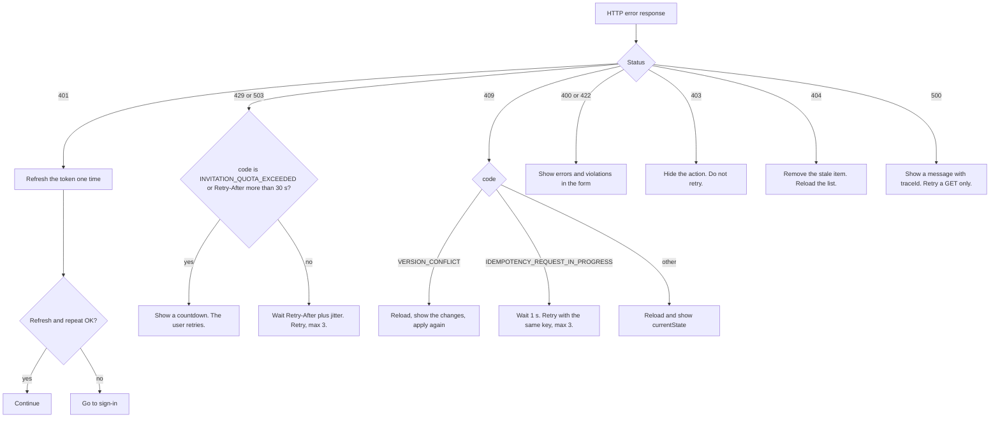

# Error handling design

| Item | Value |
|---|---|
| Project | Shift Happens |
| Deliverable | 5. Error handling design |
| Document version | 1.0 |
| Date | 2026-10-29 |
| Authors | Shift Happens team, Faculty of Applied Mathematics and Informatics, Ivan Franko National University of Lviv |
| Machine-readable contract | [api/openapi.yaml](api/openapi.yaml) (OpenAPI 3.1.0) |

**Revision history**

| Version | Date | Change |
|---|---|---|
| 1.0 | 2026-10-29 | First version. |

**Contents**

1. [Purpose and scope](#1-purpose-and-scope)
1. [Design principles](#2-design-principles)
1. [Error response format](#3-error-response-format)
1. [Status code semantics](#4-status-code-semantics)
1. [Error code catalogue](#5-error-code-catalogue)
1. [Client reaction design for the Angular SPA](#6-client-reaction-design-for-the-angular-spa)
1. [Rate limiting](#7-rate-limiting)
1. [Idempotency](#8-idempotency)
1. [API error reference](#9-api-error-reference)
1. [Comparison with the reference example](#10-comparison-with-the-reference-example)

## 1. Purpose and scope

This document is deliverable 5 of the course: the error handling design of the Shift Happens API. It answers these requirements of the course:

- The design uses OpenAPI. The specification [api/openapi.yaml](api/openapi.yaml) describes 12 operations (API-01 to API-12). The course asks for 10 operations or more.
- Each operation has examples of the errors 400, 403, 404, 409, 422 and 429 where they apply. All 12 operations together use each of these six status codes many times (see the matrix in [section 9](#9-api-error-reference)).
- Each operation has a request example, and each error has a detailed problem body and the reaction of the client.

The OpenAPI file is the source of truth. The team wrote it by hand before the code (spec-first). [Section 9](#9-api-error-reference) of this document copies all its examples without changes.

To view the specification as a web page, use one of these methods:

1. Run `npm run docs:build:api` in the repository root. Then open `dist/api.html` in a browser. The page uses Redoc.
1. Copy the content of `docs/api/openapi.yaml` into the online editor <https://editor.swagger.io>.

The command `npm run docs:lint:api` checks the file with Redocly CLI. The configuration `redocly.yaml` makes these rules errors:

- Every 4xx response must use the media type `application/problem+json` with the members `type` and `title`.
- Every example must agree with its schema. An example must not have a member that the schema does not declare.
- Every operation must have an `operationId`, a summary and a description.

**In scope:** the 12 public operations, the error format, the status codes, the error code catalogue, the client reactions, rate limits and idempotency.

**Out of scope:**

- The other public endpoints (for example `GET /me` and `GET /trade-requests`). They are in the service catalog of the [architecture document](02-architecture.md). They use the same error format and the same codes.
- Errors of internal calls between services and of Kafka consumers. The resiliency model (deliverable 8) will describe them.
- The threat model of the API. The security model (deliverable 9) will describe it.

Related documents: [Software requirements specification](01-srs.md) (REQ-FUNC-001 to REQ-FUNC-018, REQ-SEC-002, REQ-REL-002, REQ-OBS-001), [Architecture](02-architecture.md) and [Concurrency patterns](04-concurrency.md) (CS-1 to CS-6).

## 2. Design principles

1. **One format for all errors.** Every 4xx and 5xx response of the Edge Gateway and of all services uses RFC 9457 problem details with the media type `application/problem+json`. The Angular SPA has one parser for all errors.
1. **Stable machine codes.** Each problem has a `code` from the catalogue in [section 5](#5-error-code-catalogue). The client switches on `code`. The members `title` and `detail` are for humans, and the client does not parse them. The team can add a code in a later version, but it does not change or remove a code in version 1.
1. **No internal details.** An error body never contains a stack trace, SQL text, an internal host name or the text of an exception. The services write these details to the logs with the `traceId`.
1. **Traceability.** Every problem has a `traceId`: the W3C trace ID of the request. The SPA shows it in the error message. Support uses it to find the request in Amazon CloudWatch and AWS X-Ray (REQ-OBS-001).
1. **Tenant isolation through 404.** A request for a resource of another organization gets 404 `RESOURCE_NOT_FOUND`, not 403. The caller cannot find out that the resource exists (REQ-SEC-002). A 403 code tells a caller of the same organization why the action is not permitted.
1. **Enough data for the next step.** A problem has the data that the client needs to react: field errors, labor rule violations, the current version, the current state or the time to wait. The client does not need a second request to understand the error.
1. **Safe retries.** API-08 and API-09 require an `Idempotency-Key`, and API-01 and API-04 accept one. A retry with the same key never creates a second object (REQ-REL-002). The other write operations use `version` or a state check, so a repeat cannot apply a change two times.
1. **One result for one request.** The server checks a request in a fixed order ([section 4.2](#42-order-of-checks)). A request with two problems always gets the same error.

## 3. Error response format

### 3.1 Media type and headers

All error responses have the header `Content-Type: application/problem+json`. All success responses use `application/json`.

| Header | Responses | Example | Meaning |
|---|---|---|---|
| `traceparent` | All | `00-4bf92f3577b34da6a3ce929d0e0e4736-00f067aa0ba902b7-01` | W3C Trace Context. The second part is the same value as `traceId`. |
| `WWW-Authenticate` | 401 | `Bearer error="invalid_token", error_description="The access token expired"` | The bearer token challenge of RFC 6750. |
| `Retry-After` | 429, 503 | `17` | The number of seconds to wait. The same value as `retryAfterSeconds`. |
| `RateLimit-Policy` | 429 | `"claims";q=10;w=60` | The policy: quota `q` in the window `w` (seconds). |
| `RateLimit` | 429 | `"claims";r=0;t=17` | The state: remaining quota `r`, seconds `t` until the reset. |
| `Idempotent-Replayed` | 201 of API-01, API-04, API-08, API-09 | `true` | The response is the stored response of an earlier request with the same `Idempotency-Key`. |

The rate limit headers come from the IETF draft `draft-ietf-httpapi-ratelimit-headers`. The draft is not an RFC yet, so the team keeps the header format in one place: the Edge Gateway.

### 3.2 Members

| Member | Type | Always | Meaning |
|---|---|---|---|
| `type` | URI | Yes | `https://docs.shifthappens.example/problems/<kebab-case-of-code>`, for example `https://docs.shifthappens.example/problems/slot-filled`. |
| `title` | string | Yes | A short, stable, human-readable summary of the type. |
| `status` | integer | Yes | The HTTP status. It is always the same as the status of the response. |
| `detail` | string | Yes | An explanation of this occurrence for a human. |
| `instance` | string | Yes | The path of the request, for example `/api/v1/shifts/d5e6f7a8-b9c0-4d1e-8f2a-3b4c5d6e7f80/claims`. |
| `code` | string | Yes | The stable machine code ([section 5](#5-error-code-catalogue)). Clients switch on `code`, not on `title`. |
| `traceId` | string | Yes | The W3C trace ID (32 hexadecimal characters). Support uses it to find the logs. |
| `errors[]` | array | 400 and some 422 | Field errors: `{ "pointer": "/email", "code": "INVALID_FORMAT", "message": "..." }`. `pointer` is a JSON Pointer (RFC 6901). |
| `violations[]` | array | `LABOR_RULE_VIOLATION` | `{ "rule": "MIN_REST", "limit": 11, "actual": 8, "unit": "HOURS", "employeeId": "...", "conflictingAssignmentId": "..." }`. `conflictingAssignmentId` is optional. |
| `overridable` | boolean | `LABOR_RULE_VIOLATION` | True only when the caller can send the request again with `override.reason`. |
| `currentVersion` | integer | `VERSION_CONFLICT` | The version on the server now. |
| `currentState` | object | Most 409 codes | The current values that block the request, for example `{ "capacity": 2, "assignedCount": 2 }` or `{ "status": "PENDING_MANAGER" }`. |
| `resource` | object | 404 | `{ "type": "Shift", "id": "..." }`. `id` is absent when the request identifies the resource with a secret token (API-02). |
| `retryAfterSeconds` | integer | 429, 503 | The same value as `Retry-After`, for clients that cannot read the headers. |

Rules for `errors[].pointer`:

- For a field of the request body, `pointer` is a JSON Pointer to the field, for example `/override/reason`.
- For a query parameter, `pointer` is `/` and the name of the parameter, for example `/from`.
- For `SCHEDULE_NOT_PUBLISHABLE`, `pointer` points into the schedule resource, for example `/shifts/3/positionId`. The request body of API-06 has only `version`.

The field error codes in `errors[].code` are stable too:

| Field error code | Meaning |
|---|---|
| `REQUIRED` | The field is missing. |
| `INVALID_FORMAT` | The value does not have the correct format (email, date, UUID, token). |
| `INVALID_TYPE` | The value has a wrong JSON type, for example a string instead of an integer. |
| `INVALID_VALUE` | The value is not one of the permitted values. |
| `NOT_ALLOWED` | The body has a field that the schema does not declare. |
| `TOO_SHORT`, `TOO_LONG` | The text is shorter or longer than the limits. |
| `OUT_OF_RANGE` | The number is outside the limits, for example a capacity of 0. |
| `NOT_A_MONDAY`, `IN_THE_PAST` | The date is not a Monday, or the date is in the past. |
| `END_NOT_AFTER_START`, `OUTSIDE_SCHEDULE_WEEK` | The time range of a shift is not valid. |
| `BEFORE_FROM`, `RANGE_TOO_LONG` | The date range of a query is not valid. |
| `NO_SHIFTS`, `POSITION_INACTIVE`, `SHIFT_TOO_LONG` | A problem of a schedule that blocks the publication. |

### 3.3 Problem schemas

The OpenAPI file has one base schema and six extension schemas. Each extension schema uses `allOf` with `Problem` and limits `code` to the codes that use it.

| Schema | Adds | Codes |
|---|---|---|
| `Problem` | The base members: `type`, `title`, `status`, `detail`, `instance`, `code`, `traceId` | All codes. Codes without extension members use only this schema. |
| `ValidationProblem` | `errors[]` of `FieldError` | `VALIDATION_FAILED`, `INVALID_TIME_RANGE`, `INVALID_WEEK_START`, `SCHEDULE_NOT_PUBLISHABLE`, `INVALID_TRADE_TARGET`, `EFFECTIVE_DATE_IN_PAST`, `INVALID_DATE_RANGE` |
| `LaborRuleProblem` | `violations[]` of `LaborRuleViolation`, `overridable` | `LABOR_RULE_VIOLATION` |
| `VersionConflictProblem` | `currentVersion` | `VERSION_CONFLICT` |
| `ConflictProblem` | `currentState` | All other 409 codes except `IDEMPOTENCY_REQUEST_IN_PROGRESS` |
| `NotFoundProblem` | `resource` | `RESOURCE_NOT_FOUND` |
| `RateLimitProblem` | `retryAfterSeconds` | `RATE_LIMITED`, `INVITATION_QUOTA_EXCEEDED`, `SERVICE_UNAVAILABLE` |

When one status of an operation has codes with different schemas, the response schema is `anyOf` of these schemas. For example, the 409 response of API-05 is `anyOf: [VersionConflictProblem, ConflictProblem]`.

### 3.4 Full example

Iryna Bondar (MANAGER) approves the swap of Olena Kovalenko and Taras Melnyk (API-11). After Taras accepted, Andrii Shevchenko assigned him to a Wednesday shift until 24:00. With the swap, Taras starts the Thursday shift at 08:00, so his rest is 8 h. The labor policy of Lviv Coffee Co. requires 11 h.

```http
HTTP/1.1 422 Unprocessable Content
Content-Type: application/problem+json
traceparent: 00-4bf92f3577b34da6a3ce929d0e0e4736-00f067aa0ba902b7-01
```

```json
{
  "type": "https://docs.shifthappens.example/problems/labor-rule-violation",
  "title": "Labor rule violation",
  "status": 422,
  "detail": "The trade breaks 1 labor rule. You can approve it with an override.",
  "instance": "/api/v1/trade-requests/1a2b3c4d-5e6f-4a7b-8c9d-0e1f2a3b4c5e/decision",
  "code": "LABOR_RULE_VIOLATION",
  "traceId": "4bf92f3577b34da6a3ce929d0e0e4736",
  "violations": [
    {
      "rule": "MIN_REST",
      "limit": 11,
      "actual": 8,
      "unit": "HOURS",
      "employeeId": "6c2f7d3b-9a4e-4b8f-8d2c-3e5a7b9f1d24",
      "conflictingAssignmentId": "0c1d2e3f-4a5b-4c6d-8e7f-9a0b1c2d3e4f"
    }
  ],
  "overridable": true
}
```

The SPA reads the body in this order:

1. `code` is `LABOR_RULE_VIOLATION`, so the SPA shows the dialog for labor rules.
1. For each item of `violations[]`, the dialog shows one line: "Taras Melnyk: minimum rest 8 h, the policy requires 11 h". It links to the Wednesday assignment from `conflictingAssignmentId`.
1. `overridable` is true, so the dialog shows the button "Approve with override" and a reason field (10 to 500 characters).
1. The SPA sends the decision again with `override.reason`. The server writes the override to the audit log. An employee never gets `overridable: true`.

## 4. Status code semantics

### 4.1 Use of each status code

| Status | Use when | Do not use when | Retry |
|---|---|---|---|
| 400 Bad Request | The request does not agree with the OpenAPI schema: the body is not JSON, a field is missing, a type or a format is wrong, an enum value is not known, or a required header is missing. | The request agrees with the schema but breaks a business rule. Use 422. | No. The same request gets the same result. Exception: after `IDEMPOTENCY_KEY_MISSING`, add a key and send again. |
| 401 Unauthorized | The request has no access token, the signature is not valid, or the token expired. The Edge Gateway returns it. | The identity is known, but the caller cannot do the action. Use 403. | One time, after a token refresh. |
| 403 Forbidden | The caller is a member of the organization, but the role, the location scope, the ownership or MFA does not permit the action. | The resource is in another organization or is not visible to the caller. Use 404. | No. RFC 9110 says: do not repeat with the same credentials. Exception: `MFA_REQUIRED` after the MFA setup. |
| 404 Not Found | The resource does not exist, is in another organization, or is not visible yet (a draft shift for an employee). | The caller can see the resource but cannot do the action. Use 403. | No. |
| 409 Conflict | The current state of the resource blocks the request: a version mismatch, a filled slot, a status of a state machine, a duplicate, or a request with the same idempotency key in progress. A reload shows the user why. | The request itself breaks a rule, and it fails in every state of the resource. Use 422. | Only `IDEMPOTENCY_REQUEST_IN_PROGRESS`, with the same key. For the other codes, reload first. |
| 422 Unprocessable Content | The request agrees with the schema, but a business rule rejects it: labor rules, qualification, time range, week start, trade cutoff, or a reused idempotency key. The user must change the request. | The cause is a concurrent change of the state. Use 409. The cause is a schema error. Use 400. | No. Exception: `LABOR_RULE_VIOLATION` with `overridable: true` permits a new request with `override.reason`. |
| 429 Too Many Requests | A token bucket of the caller is empty, or the organization used its daily invitation quota. | — | Yes, after `Retry-After`. The server did not process the request. The SPA retries automatically only a wait of 30 s or less ([section 6.4](#64-retry-policy)). |
| 500 Internal Server Error | An unexpected error occurred. | An expected business error. A business error always has its own 4xx code. | A GET only. A write can be partly done, so the user decides. |
| 503 Service Unavailable | A dependency is down, a circuit breaker is open, or the outbox write failed. | — | Yes, after `Retry-After`, max 3 times. The server did not apply the change. |

Three decisions need an explanation:

- **400 or 422.** The OpenAPI schema is the border. If a JSON Schema validator can find the problem with the request alone, the status is 400. If the server needs data from the database or a business rule (the time zone of the location, the labor policy, the qualifications), the status is 422. For example, `"weekStart": "02.11.2026"` is 400 `VALIDATION_FAILED`, but `"weekStart": "2026-11-03"` (a Tuesday) is 422 `INVALID_WEEK_START`.
- **409 or 422.** A 409 code depends on a state that another actor can change: a reload shows a new state, and the same request can succeed later. A 422 code rejects the request itself: the user must ask for something different. `SHIFT_ALREADY_STARTED` is 409, because the state of the shift changed. `TRADE_CUTOFF_PASSED` is 422, because the request breaks the policy rule `tradeCutoffHours`. `LABOR_RULE_VIOLATION` is 422, because the user must choose another shift or send an override.
- **409 and not 412 for a version mismatch.** RFC 9110 uses 412 for a failed `If-Match` header. The team does not use `ETag` and `If-Match`. The client sends `version` in the body, and the server compares it in the `UPDATE … WHERE id = $1 AND version = $2` statement (CS-2). RFC 9110 names a version conflict as a typical cause of 409.

### 4.2 Order of checks

The server checks a request in this order. The first failed check gives the response. Steps 6 to 9 follow the access rules of the [SRS](01-srs.md) (tenant isolation).

1. **Authentication (401).** The Edge Gateway validates the JWT against the Cognito JWKS.
1. **Rate limit (429).** The Edge Gateway takes a token from the bucket of the user and the policy.
1. **Required headers (400).** The Edge Gateway rejects API-08 and API-09 without `Idempotency-Key`: `IDEMPOTENCY_KEY_MISSING`.
1. **Schema (400).** The service validates the body and the query: `MALFORMED_REQUEST`, `VALIDATION_FAILED`.
1. **Idempotency (replay, 409, 422).** The service reserves the key: a stored response, `IDEMPOTENCY_REQUEST_IN_PROGRESS` or `IDEMPOTENCY_KEY_REUSED`.
1. **Visibility (404).** The service reads the resource with the `org_id` of the caller: `RESOURCE_NOT_FOUND`.
1. **Role (403).** `ROLE_NOT_ALLOWED` and `MFA_REQUIRED`. This step also has the role checks that need the body, for example a MANAGER who invites a MANAGER.
1. **Scope (403).** `LOCATION_SCOPE_DENIED`.
1. **Ownership (403).** `NOT_RESOURCE_OWNER`, `NOT_TRADE_TARGET`, `INVITATION_EMAIL_MISMATCH`.
1. **State (409).** The service locks or compares the current state: version, capacity, status, duplicates.
1. **Business rules (422).** The labor rule engine, qualification, time ranges and the trade cutoff.

This order has two effects:

- A caller from another organization never learns that a resource exists. Steps 1 to 5 do not read the resource, and step 6 returns 404 before the role, scope and ownership checks.
- A request with a stale `version` and a labor rule violation gets 409 `VERSION_CONFLICT`. After the reload, the user sees the new state, and the labor rules run on the new state.

## 5. Error code catalogue

The catalogue has 43 codes. The column "APIs" shows the operations that document the code with an example in [section 9](#9-api-error-reference).

| Status | Code | Title | When | Extension members | APIs | Client reaction |
|---|---|---|---|---|---|---|
| 400 | `MALFORMED_REQUEST` | Malformed request body | The body is not valid JSON. | — | All with a body | This is a bug in the client. Log it, show a generic error and do not retry. |
| 400 | `VALIDATION_FAILED` | Request validation failed | The body, a query parameter or a header does not agree with the schema: a missing field, a wrong type, a wrong format, an unknown enum value, or a `SWAP` without `requestedAssignmentId`. | `errors[]` | API-01, API-02, API-03, API-04, API-05, API-06, API-07, API-09, API-11, API-12 | Show `errors[]` next to the fields. Do not retry without a change. |
| 400 | `IDEMPOTENCY_KEY_MISSING` | Idempotency key missing | A request to API-08 or API-09 has no `Idempotency-Key` header. | — | API-08, API-09 | This is a bug in the client. Generate a key and send the request again. |
| 401 | `AUTHENTICATION_REQUIRED` | Authentication required | The request has no token, the signature is not valid, or the token expired. | — | All (shared) | Refresh the token one time and repeat the request. If it fails again, go to the sign-in page. |
| 403 | `ROLE_NOT_ALLOWED` | Role not allowed | The role of the caller cannot do the action. | — | API-01, API-03, API-04, API-11, API-12 | Hide or disable the action. Do not retry. |
| 403 | `LOCATION_SCOPE_DENIED` | Location not in scope | The location is not in the scope of the caller. | — | API-01, API-04, API-05, API-06, API-07, API-08, API-11, API-12 | Do not retry. Reload the membership context (`GET /me`). |
| 403 | `NOT_RESOURCE_OWNER` | Not the resource owner | The caller does not own the assignment or the trade request. | — | API-09 | Do not retry. Refresh the view. |
| 403 | `NOT_TRADE_TARGET` | Not the trade target | The caller is not the target of the trade request. | — | API-10 | Do not retry. Remove the item from the inbox. |
| 403 | `MFA_REQUIRED` | MFA required | An admin action comes from an account without TOTP MFA. | — | API-03 | Send the admin to the MFA setup page. Retry after the setup. |
| 403 | `INVITATION_EMAIL_MISMATCH` | Invitation email mismatch | The email of the signed-in user is not the invited email. | — | API-02 | Tell the user to sign in with the invited email. |
| 404 | `RESOURCE_NOT_FOUND` | Resource not found | The resource does not exist, is in another organization, or is not published yet. | `resource` | API-01, API-02, API-03, API-04, API-05, API-06, API-07, API-08, API-09, API-10, API-11, API-12 | Remove the stale item and reload the list. Do not retry. |
| 409 | `VERSION_CONFLICT` | Version conflict | `version` in the body is not the current version. | `currentVersion` | API-05, API-06 | Reload the object, show what changed and let the user apply the change again with the new version. |
| 409 | `SLOT_FILLED` | No open slot | The shift has no open slot. | `currentState` | API-07, API-08 | Reload the shift, show "Taken" and offer other open shifts. |
| 409 | `ASSIGNMENT_OVERLAP` | Overlapping assignment | The employee has an overlapping active assignment. | `currentState` | API-07, API-08 | Show the conflicting assignment. Do not retry. |
| 409 | `ALREADY_ASSIGNED` | Employee already assigned | The employee already has an assignment on this shift. | `currentState` | API-07 | Reload. No action is necessary. |
| 409 | `CAPACITY_BELOW_ASSIGNED` | Capacity below assigned count | The new capacity is less than the number of assigned employees. | `currentState` | API-05 | Show the count. The manager must remove assignments first. |
| 409 | `SHIFT_ALREADY_STARTED` | Shift already started | The shift started already. | `currentState` | API-05, API-08 | Reload. The action is not possible any more. |
| 409 | `SCHEDULE_ALREADY_EXISTS` | Schedule already exists | A schedule for this location and week exists (`currentState.scheduleId`). | `currentState` | API-04 | Open the existing schedule. |
| 409 | `SCHEDULE_ALREADY_PUBLISHED` | Schedule already published | The schedule is published already. | `currentState` | API-06 | Reload. No action is necessary. |
| 409 | `ASSIGNMENT_LOCKED` | Assignment locked by a trade request | The assignment has a trade lock of another pending trade request. | `currentState` | API-09, API-10 | Show the pending trade request. Retry after it closes. |
| 409 | `TRADE_NOT_PENDING` | Trade request not pending | The trade request is not in the status that the action needs (`currentState.status`). | `currentState` | API-10, API-11 | Reload the trade request and show its current status. |
| 409 | `ALREADY_MEMBER` | Already a member | The email belongs to an active member. | `currentState` | API-01 | Show the member. Do not retry. |
| 409 | `INVITATION_ALREADY_PENDING` | Invitation already pending | A pending invitation for this email exists. | `currentState` | API-01 | Offer "Resend". Do not create a second invitation. |
| 409 | `INVITATION_ALREADY_USED` | Invitation already used | The invitation was accepted before. | `currentState` | API-02 | Go to the app home page. |
| 409 | `MEMBER_ALREADY_DEACTIVATED` | Member already deactivated | The member is deactivated already. | `currentState` | API-03 | Reload. No action is necessary. |
| 409 | `LAST_ADMIN` | Last active admin | The request deactivates the last active admin. | `currentState` | API-03 | Tell the admin to give the role ADMIN to another member first. |
| 409 | `IDEMPOTENCY_REQUEST_IN_PROGRESS` | Request in progress | A request with the same key is still in progress. | — | API-08, API-09 | Wait 1 s and retry with the SAME key (max 3 times). |
| 422 | `LABOR_RULE_VIOLATION` | Labor rule violation | One or more labor rules fail. | `violations[]`, `overridable` | API-05, API-07, API-08, API-10, API-11 | Show each violation. If `overridable` is true, offer "Override" with a reason. If not, the user must choose another shift. |
| 422 | `POSITION_NOT_QUALIFIED` | Employee not qualified for the position | The employee is not qualified for the position of the shift. | — | API-07, API-08, API-10 | Show the message. Do not retry. |
| 422 | `INVALID_TIME_RANGE` | Invalid time range | `endsAt` is not later than `startsAt`, or the shift is outside the schedule week. | `errors[]` | API-05 | Show the field error. |
| 422 | `INVALID_WEEK_START` | Invalid week start | `weekStart` is not a Monday in the time zone of the location, or is in the past. | `errors[]` | API-04 | Show the field error. |
| 422 | `SCHEDULE_NOT_PUBLISHABLE` | Schedule not publishable | The schedule has no shifts, or has shifts that are not valid. | `errors[]` | API-06 | Show the list of problems. |
| 422 | `TRADE_CUTOFF_PASSED` | Trade cutoff passed | The shift starts in less than `tradeCutoffHours` (24 h). | — | API-09, API-10, API-11 | Tell the user to contact the manager. |
| 422 | `TRADE_POSITION_MISMATCH` | Trade position mismatch | A `SWAP` of shifts with different positions, or the colleague is not qualified for the position. | — | API-09 | Show the message. |
| 422 | `INVALID_TRADE_TARGET` | Invalid trade target | The target is the requester, a deactivated employee or an employee of another organization. | `errors[]` | API-09 | Show the field error. |
| 422 | `INVITATION_EXPIRED` | Invitation expired | The invitation is older than 7 days. | — | API-02 | Ask the admin or the manager for a new invitation. |
| 422 | `EFFECTIVE_DATE_IN_PAST` | Effective date in the past | `effectiveAt` is earlier than now minus 5 min. | `errors[]` | API-03 | Show the field error. |
| 422 | `INVALID_DATE_RANGE` | Invalid date range | `from` is later than `to`, or the range is longer than 92 days. | `errors[]` | API-12 | Show the field error. |
| 422 | `IDEMPOTENCY_KEY_REUSED` | Idempotency key reused | The same key comes with a different method, path or body. | — | API-08, API-09 | This is a bug in the client. Generate a new key for a new request. |
| 429 | `RATE_LIMITED` | Too many requests | The token bucket of the caller is empty. | `retryAfterSeconds` | API-01, API-02, API-04, API-08, API-09, API-10, API-12 | Wait `Retry-After` seconds and disable the button with a countdown. Then retry with exponential backoff and jitter. |
| 429 | `INVITATION_QUOTA_EXCEEDED` | Invitation quota exceeded | The organization sent 200 invitations today (UTC day). | `retryAfterSeconds` | API-01 | Show the time when the quota resets. Do not retry automatically. |
| 500 | `INTERNAL_ERROR` | Internal error | An unexpected error occurred. | — | All (shared) | Show a generic error with the `traceId`. Retry a GET only. |
| 503 | `SERVICE_UNAVAILABLE` | Service unavailable | A dependency is down, or a circuit breaker is open. | `retryAfterSeconds` | All (shared) | Retry after `Retry-After` seconds with backoff (max 3 times). |

## 6. Client reaction design for the Angular SPA

### 6.1 Decision table

| Status | Codes | What the SPA does | Automatic retry |
|---|---|---|---|
| 400 | `VALIDATION_FAILED` | Shows each item of `errors[]` next to its form field. If the field is not in the form, logs a client bug with the `traceId`. | No |
| 400 | `MALFORMED_REQUEST`, `IDEMPOTENCY_KEY_MISSING` | Logs a client bug and shows a generic message. | No |
| 401 | `AUTHENTICATION_REQUIRED` | Refreshes the access token one time and repeats the request. If the refresh or the repeat fails, goes to the sign-in page and keeps the form data. | One time |
| 403 | All 403 codes | Hides or disables the action. For `LOCATION_SCOPE_DENIED`, reloads `GET /me`. For `MFA_REQUIRED`, opens the MFA setup page. | No |
| 404 | `RESOURCE_NOT_FOUND` | Removes the stale item from the list and reloads the list. | No |
| 409 | `VERSION_CONFLICT` | Reloads the object, shows the differences and lets the user apply the change again with `currentVersion`. | No |
| 409 | `IDEMPOTENCY_REQUEST_IN_PROGRESS` | Waits 1 s and sends the same request with the same key. | Yes, max 3 |
| 409 | Other 409 codes | Reloads the object and shows `currentState` in words, for example "Taken" or "The trade request expired". | No |
| 422 | `LABOR_RULE_VIOLATION` | Shows each violation. If `overridable` is true, offers "Override" with a reason. | No |
| 422 | Other 422 codes | Shows the field error or the message. The user changes the request. | No |
| 429 | `RATE_LIMITED` | Disables the button with a countdown of `Retry-After` seconds. Retries a wait of 30 s or less automatically. | Yes, max 3 |
| 429 | `INVITATION_QUOTA_EXCEEDED` | Shows the time when the quota resets. | No |
| 500 | `INTERNAL_ERROR` | Shows a generic message with the `traceId`. | GET only |
| 503 | `SERVICE_UNAVAILABLE` | Waits `Retry-After` seconds, then retries with backoff. After 3 failures, shows a message with the `traceId`. | Yes, max 3 |

### 6.2 Decision flow



### 6.3 HTTP interceptor

The SPA registers one functional interceptor: `provideHttpClient(withInterceptors([authInterceptor, problemInterceptor]))`. The `authInterceptor` adds the access token from memory. The `problemInterceptor` below does the cross-cutting reactions. `Problem` is a TypeScript interface that the team generates from the OpenAPI schemas.

```typescript
import { HttpErrorResponse, HttpEvent, HttpInterceptorFn, HttpRequest } from '@angular/common/http';
import { inject } from '@angular/core';
import { Observable, catchError, retry, switchMap, throwError, timeout, timer } from 'rxjs';
import { AuthService } from './auth.service';
import { Problem } from './problem.model';
import { ProblemUiService } from './problem-ui.service';

const MAX_RETRIES = 3;
const MAX_AUTO_WAIT_S = 30;
const backoffMs = (attempt: number) => Math.random() * Math.min(30_000, 1_000 * 2 ** attempt); // full jitter

/** The wait before an automatic retry, or null when the SPA must not retry automatically. */
function retryDelayMs(req: HttpRequest<unknown>, error: unknown, attempt: number): number | null {
  const replaySafe = req.method === 'GET' || req.headers.has('Idempotency-Key');
  if (!(error instanceof HttpErrorResponse)) return replaySafe ? backoffMs(attempt) : null; // timeout
  const problem = error.error as Problem | null;
  if (error.status === 0) return replaySafe ? backoffMs(attempt) : null; // network error
  if (problem?.code === 'IDEMPOTENCY_REQUEST_IN_PROGRESS') return 1_000; // same key, same body
  if (error.status === 500) return req.method === 'GET' ? backoffMs(attempt) : null;
  if ((error.status === 429 || error.status === 503) && problem?.code !== 'INVITATION_QUOTA_EXCEEDED') {
    const seconds = Number(error.headers.get('Retry-After') ?? problem?.retryAfterSeconds ?? 1);
    return seconds <= MAX_AUTO_WAIT_S ? seconds * 1_000 + backoffMs(attempt) : null;
  }
  return null; // 400, 403, 404, other 409 and 422: the same request gets the same result
}

export const problemInterceptor: HttpInterceptorFn = (req, next) => {
  const auth = inject(AuthService);
  const ui = inject(ProblemUiService);

  const send = (r: HttpRequest<unknown>, refreshed: boolean): Observable<HttpEvent<unknown>> =>
    next(r).pipe(
      timeout(15_000), // per attempt; retry() sends the same Idempotency-Key again
      retry({
        count: MAX_RETRIES,
        delay: (error, attempt) => {
          const ms = retryDelayMs(r, error, attempt);
          if (ms === null) return throwError(() => error);
          if (error instanceof HttpErrorResponse && error.status === 429) ui.startCountdown(Math.ceil(ms / 1_000));
          return timer(ms);
        },
      }),
      catchError((error: unknown) => {
        if (!(error instanceof HttpErrorResponse)) return throwError(() => error);
        const problem = error.error as Problem | null;
        if (error.status === 401 && !refreshed) {
          // One refresh for all parallel 401 responses. refreshOnce() goes to sign-in when it fails.
          return auth.refreshOnce().pipe(
            switchMap((token) => send(r.clone({ setHeaders: { Authorization: `Bearer ${token}` } }), true)),
          );
        }
        if (error.status === 401) auth.goToSignIn();
        else if (problem?.code === 'VERSION_CONFLICT') ui.reloadAfterConflict(r.url, problem.currentVersion);
        else if (problem?.errors || problem?.violations) ui.showInForm(problem); // 400 and 422
        else if (error.status === 429) ui.startCountdown(problem?.retryAfterSeconds ?? 1);
        else if (error.status >= 500 || error.status === 0) ui.showError(problem); // with the traceId
        return throwError(() => error); // the component handles 403, 404 and the other 409 codes
      }),
    );

  return send(req, false);
};
```

How the interceptor applies the rules:

- **401.** The interceptor calls `refreshOnce()` and repeats the request one time with the new token. `refreshOnce()` shares one refresh between all parallel requests, so a page with five requests does not rotate the refresh token five times. A second 401 goes to the sign-in page.
- **429 and 503.** The interceptor reads `Retry-After` first and `retryAfterSeconds` second. It starts the countdown on the button and retries automatically only when the wait is 30 s or less. The server did not process the first request, so the retry is safe for all methods.
- **409 `VERSION_CONFLICT`.** The interceptor gives the URL and `currentVersion` to `reloadAfterConflict()`. The form reloads the object and shows the changes. It never sends the old change again without the user.
- **400 and 422 with `errors[]` or `violations[]`.** `showInForm()` maps each `pointer` to a form control and each violation to a line in the dialog.
- **`IDEMPOTENCY_REQUEST_IN_PROGRESS` and timeouts of API-08 and API-09.** `retry()` sends the same `HttpRequest` object again, so the same `Idempotency-Key` goes to the server. The server returns the stored response, or 409 while the first request still runs.
- **Other errors.** The interceptor rethrows the error. The component handles the reactions that need the page context: for example, the open shift list removes a shift on 404 and shows "Taken" on `SLOT_FILLED`.

### 6.4 Retry policy

| Situation | Automatic retry | Max attempts | Delay before a retry |
|---|---|---|---|
| Timeout (15 s) or network error of a GET or of a request with `Idempotency-Key` | Yes, same key | 3 | Full jitter: random value from 0 to min(30 s, 1 s × 2^attempt) |
| Timeout or network error of a write without a key | No | — | The user decides. The table below shows why a repeat is harmless. |
| 409 `IDEMPOTENCY_REQUEST_IN_PROGRESS` | Yes, same key | 3 | 1 s |
| 429 `RATE_LIMITED` with `Retry-After` of 30 s or less | Yes | 3 | `Retry-After` plus full jitter |
| 429 with a longer wait, or `INVITATION_QUOTA_EXCEEDED` | No | — | Countdown on the button. The user sends again. |
| 503 `SERVICE_UNAVAILABLE` | Yes | 3 | `Retry-After` plus full jitter |
| 500 `INTERNAL_ERROR` | GET only | 3 | Full jitter |
| 401 `AUTHENTICATION_REQUIRED` | After one token refresh | 1 | None |
| 400, 403, 404, 422, other 409 codes | No | — | — |

The SPA retries writes automatically only when a key protects them. The other writes are also safe to repeat after a lost response, because the server detects the repeat:

| API | Method | Protection against a second execution | Result of a repeat after a lost response |
|---|---|---|---|
| API-01 | POST | Optional `Idempotency-Key`; unique pending invitation per email | With a key: the stored 201. Without a key: 409 `INVITATION_ALREADY_PENDING`. |
| API-02 | POST | The invitation status | 409 `INVITATION_ALREADY_USED`. The SPA goes to the home page. |
| API-03 | POST | The membership status | 409 `MEMBER_ALREADY_DEACTIVATED`. |
| API-04 | POST | Optional `Idempotency-Key`; one schedule per location and week | With a key: the stored 201. Without a key: 409 `SCHEDULE_ALREADY_EXISTS`. |
| API-05 | PATCH | `version` | 409 `VERSION_CONFLICT`. The reload shows that the change is applied. |
| API-06 | POST | `version` and the schedule status | 409 `SCHEDULE_ALREADY_PUBLISHED`. |
| API-07 | POST | One active assignment per employee and shift | 409 `ALREADY_ASSIGNED`. |
| API-08 | POST | Required `Idempotency-Key` | The stored 201 with `Idempotent-Replayed: true`. |
| API-09 | POST | Required `Idempotency-Key` | The stored 201 with `Idempotent-Replayed: true`. |
| API-10 | POST | The trade request status | 409 `TRADE_NOT_PENDING` with `currentState.status` = `PENDING_MANAGER`. |
| API-11 | POST | The trade request status | 409 `TRADE_NOT_PENDING` with the status after the decision. |
| API-12 | GET | Safe method | The same data or newer data. |

## 7. Rate limiting

The Edge Gateway limits the requests of each user with a token bucket in Amazon ElastiCache for Redis. The key of a bucket is the `userId` and the policy name. The gateway updates a bucket in one atomic Redis operation, so two gateway replicas cannot take the same token.

| Policy | Limit | Key | Operations | Code |
|---|---|---|---|---|
| `invitations` | 20 requests per 3600 s | `userId` | API-01 | `RATE_LIMITED` |
| `invitations-org` | 200 invitations per day (00:00 to 24:00 UTC) | `orgId` | API-01 | `INVITATION_QUOTA_EXCEEDED` |
| `claims` | 10 requests per 60 s | `userId` | API-08 | `RATE_LIMITED` |
| `trades` | 20 requests per 60 s | `userId` | API-09, API-10 and the decline and cancel endpoints | `RATE_LIMITED` |
| `analytics` | 30 requests per 60 s | `userId` | API-12 | `RATE_LIMITED` |
| `default` | 100 requests per 60 s | `userId` | API-02, API-04 and the other `GET` endpoints | `RATE_LIMITED` |
| AWS WAF rule | 2000 requests per 5 min | Client IP address | All requests through Amazon CloudFront | — |

The `invitations` policy has two buckets: one per user and one per organization. The write operations of managers and admins (API-03, API-05, API-06, API-07 and API-11) have no per-user policy in version 1. Only users with the role MANAGER or ADMIN can call them, and the AWS WAF rule protects them. The AWS WAF rule stops floods from one IP address before they reach the Edge Gateway. A normal client never reaches this limit.

A 429 response has three headers. Example for API-08:

```http
HTTP/1.1 429 Too Many Requests
Content-Type: application/problem+json
Retry-After: 17
RateLimit-Policy: "claims";q=10;w=60
RateLimit: "claims";r=0;t=17
```

Rules for the headers:

- `Retry-After` and the body member `retryAfterSeconds` always have the same value.
- `Retry-After` has priority over `RateLimit` when the client calculates the wait. The IETF draft gives the same rule.
- `RateLimit-Policy` lists all policies of the operation. API-01 has two: `"invitations";q=20;w=3600, "invitations-org";q=200;w=86400`. `RateLimit` names the policy that stopped the request.
- The client must not send the request again before `Retry-After` expires. A retry before that time takes no token and gets 429 again.

## 8. Idempotency

The `Idempotency-Key` header follows the IETF draft `draft-ietf-httpapi-idempotency-key-header`. The sequence diagram and the storage design are in [Concurrency patterns](04-concurrency.md), scenario CS-4.

Rules:

1. **Operations.** API-08 (claim) and API-09 (create trade request) require the key. The Edge Gateway rejects a request without it. API-01 (invite) and API-04 (create schedule) accept an optional key. Other operations ignore the header.
1. **Key format.** The key is a UUID (version 4). The SPA generates one key for one user action, for example one tap on "Claim". The SPA sends the same key with each retry of this action. A new action gets a new key.
1. **Scope.** The server stores the key together with the `userId`. A key of one user never matches a request of another user.
1. **Fingerprint.** The server calculates a SHA-256 fingerprint of the method, the path and the body. A request with a known key and a different fingerprint is a reuse.
1. **Reservation.** The service reserves the key with Redis `SET NX` and a TTL of 30 s. A second request with the same key in this time gets 409 `IDEMPOTENCY_REQUEST_IN_PROGRESS`.
1. **Stored response.** The service stores the status code and the body in the table `idempotency_records` of its database, in the same transaction as the business change. It keeps the record for 24 h or more. A daily cleanup deletes older records.
1. **Stored results.** The service stores only 2xx results. A 4xx or 5xx result changes nothing, so a retry with the same key runs the operation again.
1. **Replay.** A replay returns the stored status and body with the header `Idempotent-Replayed: true`. The server does not run the operation again.

| Situation | Response |
|---|---|
| First request with a new key | The server runs the operation and stores the response. |
| Retry after the first request finished, same fingerprint | The stored response with `Idempotent-Replayed: true`. |
| Retry while the first request still runs | 409 `IDEMPOTENCY_REQUEST_IN_PROGRESS`. Wait 1 s and retry with the same key. |
| Same key, different fingerprint | 422 `IDEMPOTENCY_KEY_REUSED`. This is a client bug. |
| No key on API-08 or API-09 | 400 `IDEMPOTENCY_KEY_MISSING`. This is a client bug. |
| Retry after the cleanup deleted the record (24 h or more) | The server treats the request as a new request. |

## 9. API error reference

This section copies every named example of [openapi.yaml](api/openapi.yaml) without changes. Each JSON body here is the same as the `value` of the named example in the YAML file.

The examples use the fixtures of the project: the organization Lviv Coffee Co., the location Rynok Square (`Europe/Kyiv`, UTC+02:00 in November), the Saturday Barista shift of 2026-11-07 and the personas Olena Kovalenko (EMPLOYEE), Taras Melnyk (EMPLOYEE), Iryna Bondar (MANAGER) and Andrii Shevchenko (ADMIN). All examples use the same `traceId` so that a reader can compare them.

The matrix shows the error codes of each operation. All operations also have the shared responses in [section 9.1](#91-shared-responses).

| API | 400 | 403 | 404 | 409 | 422 | 429 |
|---|---|---|---|---|---|---|
| [API-01](#92-api-01-invite-a-member) | `VALIDATION_FAILED` | `ROLE_NOT_ALLOWED`<br/>`LOCATION_SCOPE_DENIED` | `RESOURCE_NOT_FOUND` | `ALREADY_MEMBER`<br/>`INVITATION_ALREADY_PENDING` | — | `INVITATION_QUOTA_EXCEEDED`<br/>`RATE_LIMITED` |
| [API-02](#93-api-02-accept-an-invitation) | `VALIDATION_FAILED` | `INVITATION_EMAIL_MISMATCH` | `RESOURCE_NOT_FOUND` | `INVITATION_ALREADY_USED` | `INVITATION_EXPIRED` | `RATE_LIMITED` (shared, policy `default`) |
| [API-03](#94-api-03-deactivate-a-member) | `VALIDATION_FAILED` | `ROLE_NOT_ALLOWED`<br/>`MFA_REQUIRED` | `RESOURCE_NOT_FOUND` | `MEMBER_ALREADY_DEACTIVATED`<br/>`LAST_ADMIN` | `EFFECTIVE_DATE_IN_PAST` | — |
| [API-04](#95-api-04-create-a-weekly-draft-schedule) | `VALIDATION_FAILED` | `ROLE_NOT_ALLOWED`<br/>`LOCATION_SCOPE_DENIED` | `RESOURCE_NOT_FOUND` | `SCHEDULE_ALREADY_EXISTS` | `INVALID_WEEK_START` | `RATE_LIMITED` (shared, policy `default`) |
| [API-05](#96-api-05-change-a-shift) | `VALIDATION_FAILED` | `LOCATION_SCOPE_DENIED` | `RESOURCE_NOT_FOUND` | `VERSION_CONFLICT`<br/>`CAPACITY_BELOW_ASSIGNED`<br/>`SHIFT_ALREADY_STARTED` | `INVALID_TIME_RANGE`<br/>`LABOR_RULE_VIOLATION` | — |
| [API-06](#97-api-06-publish-a-schedule) | `VALIDATION_FAILED` | `LOCATION_SCOPE_DENIED` | `RESOURCE_NOT_FOUND` | `VERSION_CONFLICT`<br/>`SCHEDULE_ALREADY_PUBLISHED` | `SCHEDULE_NOT_PUBLISHABLE` | — |
| [API-07](#98-api-07-assign-an-employee-to-a-shift) | `VALIDATION_FAILED` | `LOCATION_SCOPE_DENIED` | `RESOURCE_NOT_FOUND` | `SLOT_FILLED`<br/>`ASSIGNMENT_OVERLAP`<br/>`ALREADY_ASSIGNED` | `LABOR_RULE_VIOLATION`<br/>`POSITION_NOT_QUALIFIED` | — |
| [API-08](#99-api-08-claim-an-open-shift) | `IDEMPOTENCY_KEY_MISSING` | `LOCATION_SCOPE_DENIED` | `RESOURCE_NOT_FOUND` | `SLOT_FILLED`<br/>`ASSIGNMENT_OVERLAP`<br/>`SHIFT_ALREADY_STARTED`<br/>`IDEMPOTENCY_REQUEST_IN_PROGRESS` | `LABOR_RULE_VIOLATION`<br/>`POSITION_NOT_QUALIFIED`<br/>`IDEMPOTENCY_KEY_REUSED` | `RATE_LIMITED` |
| [API-09](#910-api-09-create-a-trade-request-swap-or-cover) | `VALIDATION_FAILED`<br/>`IDEMPOTENCY_KEY_MISSING` | `NOT_RESOURCE_OWNER` | `RESOURCE_NOT_FOUND` | `ASSIGNMENT_LOCKED`<br/>`IDEMPOTENCY_REQUEST_IN_PROGRESS` | `TRADE_CUTOFF_PASSED`<br/>`TRADE_POSITION_MISMATCH`<br/>`INVALID_TRADE_TARGET`<br/>`IDEMPOTENCY_KEY_REUSED` | `RATE_LIMITED` |
| [API-10](#911-api-10-accept-a-trade-request) | — | `NOT_TRADE_TARGET` | `RESOURCE_NOT_FOUND` | `TRADE_NOT_PENDING`<br/>`ASSIGNMENT_LOCKED` | `LABOR_RULE_VIOLATION`<br/>`POSITION_NOT_QUALIFIED`<br/>`TRADE_CUTOFF_PASSED` | `RATE_LIMITED` |
| [API-11](#912-api-11-approve-or-reject-a-trade-request) | `VALIDATION_FAILED` | `ROLE_NOT_ALLOWED`<br/>`LOCATION_SCOPE_DENIED` | `RESOURCE_NOT_FOUND` | `TRADE_NOT_PENDING` | `LABOR_RULE_VIOLATION`<br/>`TRADE_CUTOFF_PASSED` | — |
| [API-12](#913-api-12-get-the-coverage-of-a-location) | `VALIDATION_FAILED` | `ROLE_NOT_ALLOWED`<br/>`LOCATION_SCOPE_DENIED` | `RESOURCE_NOT_FOUND` | — | `INVALID_DATE_RANGE` | `RATE_LIMITED` |

### 9.1 Shared responses

Every operation can return these responses. The Edge Gateway or the service returns the same body for each operation; only `instance` changes. The shared 429 response is for the `default` rate limit policy of API-02 and API-04. API-01, API-08, API-09, API-10 and API-12 have their own 429 examples with their own policies ([section 7](#7-rate-limiting)).

#### 401 `AUTHENTICATION_REQUIRED`

**Cause:** Olena Kovalenko claims a shift (API-08) 16 min after the last token refresh. The access token is valid for 15 min. Other operations return the same body with their own `instance`.

```http
HTTP/1.1 401 Unauthorized
Content-Type: application/problem+json
WWW-Authenticate: Bearer error="invalid_token", error_description="The access token expired"
```

```json
{
  "type": "https://docs.shifthappens.example/problems/authentication-required",
  "title": "Authentication required",
  "status": 401,
  "detail": "The access token expired.",
  "instance": "/api/v1/shifts/d5e6f7a8-b9c0-4d1e-8f2a-3b4c5d6e7f80/claims",
  "code": "AUTHENTICATION_REQUIRED",
  "traceId": "4bf92f3577b34da6a3ce929d0e0e4736"
}
```

**Client reaction:** Refresh the token one time and repeat the request; if it fails again, go to the sign-in page.

#### 429 `RATE_LIMITED`

**Cause:** A browser script of Iryna Bondar repeats the request to create a schedule (API-04), more than 100 times in 60 s. API-02 returns the same body with its own `instance`; there the limit also stops scripts that try many invitation tokens.

```http
HTTP/1.1 429 Too Many Requests
Content-Type: application/problem+json
Retry-After: 23
RateLimit-Policy: "default";q=100;w=60
RateLimit: "default";r=0;t=23
```

```json
{
  "type": "https://docs.shifthappens.example/problems/rate-limited",
  "title": "Too many requests",
  "status": 429,
  "detail": "You sent more than 100 requests in 60 s. Wait 23 s.",
  "instance": "/api/v1/locations/7d3e2f1a-4b5c-4d6e-9f8a-0b1c2d3e4f5a/schedules",
  "code": "RATE_LIMITED",
  "traceId": "4bf92f3577b34da6a3ce929d0e0e4736",
  "retryAfterSeconds": 23
}
```

**Client reaction:** Wait `Retry-After` seconds with a countdown on the button, then retry with exponential backoff and jitter.

#### 500 `INTERNAL_ERROR`

**Cause:** The Analytics service has an unexpected error while it reads the coverage (API-12). Other operations return the same body with their own `instance`.

```json
{
  "type": "https://docs.shifthappens.example/problems/internal-error",
  "title": "Internal error",
  "status": 500,
  "detail": "An unexpected error occurred. Give the trace ID to support.",
  "instance": "/api/v1/locations/7d3e2f1a-4b5c-4d6e-9f8a-0b1c2d3e4f5a/analytics/coverage",
  "code": "INTERNAL_ERROR",
  "traceId": "4bf92f3577b34da6a3ce929d0e0e4736"
}
```

**Client reaction:** Show a generic error with the `traceId`; retry a GET only.

#### 503 `SERVICE_UNAVAILABLE`

**Cause:** Iryna Bondar publishes a schedule (API-06), but the outbox write fails and the transaction rolls back (CS-5). Other operations return the same body with their own `instance`.

```http
HTTP/1.1 503 Service Unavailable
Content-Type: application/problem+json
Retry-After: 5
```

```json
{
  "type": "https://docs.shifthappens.example/problems/service-unavailable",
  "title": "Service unavailable",
  "status": 503,
  "detail": "The service is not available now. Try again after 5 s.",
  "instance": "/api/v1/schedules/c4d5e6f7-a8b9-4c0d-9e1f-2a3b4c5d6e7f/publish",
  "code": "SERVICE_UNAVAILABLE",
  "traceId": "4bf92f3577b34da6a3ce929d0e0e4736",
  "retryAfterSeconds": 5
}
```

**Client reaction:** Retry after `Retry-After` seconds with exponential backoff (max 3 times); then show the error with the `traceId`.

### 9.2 API-01: Invite a member

| Item | Value |
|---|---|
| Method and path | `POST /orgs/{orgId}/invitations` |
| operationId | `inviteMember` |
| Service | Organization service (`organization-service`) |
| Roles | ADMIN (any role, any location). MANAGER (role EMPLOYEE, own locations only). |
| Requirements | REQ-FUNC-001 |
| Concurrency | CS-4. The `Idempotency-Key` header is optional. With a key, a retry after a timeout does not send a second invitation. |
| `Idempotency-Key` | Optional |

Creates an invitation to join the organization with a role, locations and positions. The Organization service sends the invitation email through Amazon SES. The invitation expires after 7 days. One organization can send 200 invitations per day.

**Request**

```http
POST /api/v1/orgs/0b9f5c3e-2d1a-4f6b-8c7d-9e0a1b2c3d4e/invitations HTTP/1.1
Host: api.shifthappens.example
Authorization: Bearer <token>
Content-Type: application/json
Idempotency-Key: 0f8d6c1e-3b5a-4e7d-9c2b-6a4f8e1d3c57

{
  "email": "taras.melnyk@example.com",
  "role": "EMPLOYEE",
  "locationIds": [
    "7d3e2f1a-4b5c-4d6e-9f8a-0b1c2d3e4f5a"
  ],
  "positionIds": [
    "a1b2c3d4-e5f6-4a7b-8c9d-0e1f2a3b4c5d"
  ]
}
```

**Success response**

`201 Created`: The invitation is created and the invitation email is queued.

```json
{
  "id": "2b3c4d5e-6f7a-4b8c-9d0e-1f2a3b4c5d6f",
  "orgId": "0b9f5c3e-2d1a-4f6b-8c7d-9e0a1b2c3d4e",
  "email": "taras.melnyk@example.com",
  "role": "EMPLOYEE",
  "locationIds": [
    "7d3e2f1a-4b5c-4d6e-9f8a-0b1c2d3e4f5a"
  ],
  "positionIds": [
    "a1b2c3d4-e5f6-4a7b-8c9d-0e1f2a3b4c5d"
  ],
  "status": "PENDING",
  "expiresAt": "2026-11-05T10:30:00+02:00",
  "createdAt": "2026-10-29T10:30:00+02:00"
}
```

**Errors**

#### 400 `VALIDATION_FAILED`

**Cause:** Iryna Bondar sends `"email": "taras.melnyk@"`.

```json
{
  "type": "https://docs.shifthappens.example/problems/validation-failed",
  "title": "Request validation failed",
  "status": 400,
  "detail": "The request body has 1 field error.",
  "instance": "/api/v1/orgs/0b9f5c3e-2d1a-4f6b-8c7d-9e0a1b2c3d4e/invitations",
  "code": "VALIDATION_FAILED",
  "traceId": "4bf92f3577b34da6a3ce929d0e0e4736",
  "errors": [
    {
      "pointer": "/email",
      "code": "INVALID_FORMAT",
      "message": "Must be a valid email address."
    }
  ]
}
```

**Client reaction:** Show the message next to the email field and do not retry without a change.

#### 403 `ROLE_NOT_ALLOWED`

**Cause:** Iryna Bondar (MANAGER) sends `"role": "MANAGER"`.

```json
{
  "type": "https://docs.shifthappens.example/problems/role-not-allowed",
  "title": "Role not allowed",
  "status": 403,
  "detail": "A MANAGER can invite members with the role EMPLOYEE only.",
  "instance": "/api/v1/orgs/0b9f5c3e-2d1a-4f6b-8c7d-9e0a1b2c3d4e/invitations",
  "code": "ROLE_NOT_ALLOWED",
  "traceId": "4bf92f3577b34da6a3ce929d0e0e4736"
}
```

**Client reaction:** Show only the role EMPLOYEE in the invitation form of a manager and do not retry.

#### 403 `LOCATION_SCOPE_DENIED`

**Cause:** A manager of another location sends the Rynok Square location in `locationIds`.

```json
{
  "type": "https://docs.shifthappens.example/problems/location-scope-denied",
  "title": "Location not in scope",
  "status": 403,
  "detail": "Location 7d3e2f1a-4b5c-4d6e-9f8a-0b1c2d3e4f5a is not in your scope.",
  "instance": "/api/v1/orgs/0b9f5c3e-2d1a-4f6b-8c7d-9e0a1b2c3d4e/invitations",
  "code": "LOCATION_SCOPE_DENIED",
  "traceId": "4bf92f3577b34da6a3ce929d0e0e4736"
}
```

**Client reaction:** Do not retry, reload the membership context with `GET /me` and show only the locations from it.

#### 404 `RESOURCE_NOT_FOUND`

**Cause:** Iryna Bondar sends a location ID that Lviv Coffee Co. does not have.

```json
{
  "type": "https://docs.shifthappens.example/problems/resource-not-found",
  "title": "Resource not found",
  "status": 404,
  "detail": "Location 5f6a7b8c-9d0e-4f1a-8b2c-3d4e5f6a7b8c was not found.",
  "instance": "/api/v1/orgs/0b9f5c3e-2d1a-4f6b-8c7d-9e0a1b2c3d4e/invitations",
  "code": "RESOURCE_NOT_FOUND",
  "traceId": "4bf92f3577b34da6a3ce929d0e0e4736",
  "resource": {
    "type": "Location",
    "id": "5f6a7b8c-9d0e-4f1a-8b2c-3d4e5f6a7b8c"
  }
}
```

**Client reaction:** Remove the location from the form, reload the list of locations and do not retry.

#### 409 `ALREADY_MEMBER`

**Cause:** Iryna Bondar invites `olena.kovalenko@example.com`, the email of an active member.

```json
{
  "type": "https://docs.shifthappens.example/problems/already-member",
  "title": "Already a member",
  "status": 409,
  "detail": "The email olena.kovalenko@example.com belongs to an active member.",
  "instance": "/api/v1/orgs/0b9f5c3e-2d1a-4f6b-8c7d-9e0a1b2c3d4e/invitations",
  "code": "ALREADY_MEMBER",
  "traceId": "4bf92f3577b34da6a3ce929d0e0e4736",
  "currentState": {
    "userId": "5b1e6c2a-8f3d-4a7e-9c1b-2d4f6a8e0c13",
    "status": "ACTIVE"
  }
}
```

**Client reaction:** Show the profile of the member from `currentState.userId` and do not retry.

#### 409 `INVITATION_ALREADY_PENDING`

**Cause:** Iryna Bondar invites `taras.melnyk@example.com` a second time on the same day.

```json
{
  "type": "https://docs.shifthappens.example/problems/invitation-already-pending",
  "title": "Invitation already pending",
  "status": 409,
  "detail": "A pending invitation for taras.melnyk@example.com exists. It expires at 2026-11-05T10:30:00+02:00.",
  "instance": "/api/v1/orgs/0b9f5c3e-2d1a-4f6b-8c7d-9e0a1b2c3d4e/invitations",
  "code": "INVITATION_ALREADY_PENDING",
  "traceId": "4bf92f3577b34da6a3ce929d0e0e4736",
  "currentState": {
    "invitationId": "2b3c4d5e-6f7a-4b8c-9d0e-1f2a3b4c5d6f",
    "status": "PENDING",
    "expiresAt": "2026-11-05T10:30:00+02:00"
  }
}
```

**Client reaction:** Offer "Resend invitation" for `currentState.invitationId` and do not create a second invitation.

#### 429 `INVITATION_QUOTA_EXCEEDED`

**Cause:** Lviv Coffee Co. sent 200 invitations on 2026-10-29 (UTC). The request comes at 08:30 UTC.

```http
HTTP/1.1 429 Too Many Requests
Content-Type: application/problem+json
Retry-After: 55800
RateLimit-Policy: "invitations";q=20;w=3600, "invitations-org";q=200;w=86400
RateLimit: "invitations-org";r=0;t=55800
```

```json
{
  "type": "https://docs.shifthappens.example/problems/invitation-quota-exceeded",
  "title": "Invitation quota exceeded",
  "status": 429,
  "detail": "Lviv Coffee Co. sent 200 invitations today. The quota resets at 2026-10-30T00:00:00Z.",
  "instance": "/api/v1/orgs/0b9f5c3e-2d1a-4f6b-8c7d-9e0a1b2c3d4e/invitations",
  "code": "INVITATION_QUOTA_EXCEEDED",
  "traceId": "4bf92f3577b34da6a3ce929d0e0e4736",
  "retryAfterSeconds": 55800
}
```

**Client reaction:** Show the time when the quota resets (now plus `retryAfterSeconds`) and do not retry automatically.

#### 429 `RATE_LIMITED`

**Cause:** Iryna Bondar sent 20 invitations in the last 3600 s.

```http
HTTP/1.1 429 Too Many Requests
Content-Type: application/problem+json
Retry-After: 180
RateLimit-Policy: "invitations";q=20;w=3600, "invitations-org";q=200;w=86400
RateLimit: "invitations";r=0;t=180
```

```json
{
  "type": "https://docs.shifthappens.example/problems/rate-limited",
  "title": "Too many requests",
  "status": 429,
  "detail": "You sent 20 invitations in 3600 s. Wait 180 s.",
  "instance": "/api/v1/orgs/0b9f5c3e-2d1a-4f6b-8c7d-9e0a1b2c3d4e/invitations",
  "code": "RATE_LIMITED",
  "traceId": "4bf92f3577b34da6a3ce929d0e0e4736",
  "retryAfterSeconds": 180
}
```

**Client reaction:** Disable the Invite button with a countdown of `Retry-After` seconds, then let the user send again.

The shared responses 401, 500 and 503 also apply.

### 9.3 API-02: Accept an invitation

| Item | Value |
|---|---|
| Method and path | `POST /invitations/accept` |
| operationId | `acceptInvitation` |
| Service | Organization service (`organization-service`) |
| Roles | Any signed-in user who received the invitation. The user does not need a membership yet. |
| Requirements | REQ-FUNC-002 |
| Concurrency | None. A second accept of the same invitation returns 409 `INVITATION_ALREADY_USED`. |
| `Idempotency-Key` | Not used |

Accepts an invitation and creates an `ACTIVE` membership for the signed-in user (joiner flow). The token comes from the invitation email. It is in the body and not in the path, so it does not appear in access logs. The email of the Cognito user must be the invited email.

**Request**

```http
POST /api/v1/invitations/accept HTTP/1.1
Host: api.shifthappens.example
Authorization: Bearer <token>
Content-Type: application/json

{
  "token": "5azWI546XhqexM0bBUFYryBRp6-ykIPBG_n8lZKO8aU"
}
```

**Success response**

`200 OK`: The membership is active.

```json
{
  "orgId": "0b9f5c3e-2d1a-4f6b-8c7d-9e0a1b2c3d4e",
  "userId": "6c2f7d3b-9a4e-4b8f-8d2c-3e5a7b9f1d24",
  "role": "EMPLOYEE",
  "locationIds": [
    "7d3e2f1a-4b5c-4d6e-9f8a-0b1c2d3e4f5a"
  ],
  "positionIds": [
    "a1b2c3d4-e5f6-4a7b-8c9d-0e1f2a3b4c5d"
  ],
  "status": "ACTIVE",
  "joinedAt": "2026-10-31T09:15:00+02:00"
}
```

**Errors**

#### 400 `VALIDATION_FAILED`

**Cause:** The user copied only a part of the link, and the SPA sends `"token": "5azWI546Xhqex"`.

```json
{
  "type": "https://docs.shifthappens.example/problems/validation-failed",
  "title": "Request validation failed",
  "status": 400,
  "detail": "The request body has 1 field error.",
  "instance": "/api/v1/invitations/accept",
  "code": "VALIDATION_FAILED",
  "traceId": "4bf92f3577b34da6a3ce929d0e0e4736",
  "errors": [
    {
      "pointer": "/token",
      "code": "INVALID_FORMAT",
      "message": "Must be 43 characters from the base64url alphabet."
    }
  ]
}
```

**Client reaction:** Tell the user to open the link from the invitation email again and do not retry.

#### 403 `INVITATION_EMAIL_MISMATCH`

**Cause:** Taras Melnyk signs in with a personal email, but the invitation is for `taras.melnyk@example.com`.

```json
{
  "type": "https://docs.shifthappens.example/problems/invitation-email-mismatch",
  "title": "Invitation email mismatch",
  "status": 403,
  "detail": "The email of your account is not the email of the invitation.",
  "instance": "/api/v1/invitations/accept",
  "code": "INVITATION_EMAIL_MISMATCH",
  "traceId": "4bf92f3577b34da6a3ce929d0e0e4736"
}
```

**Client reaction:** Tell the user to sign out and sign in with the email that received the invitation.

#### 404 `RESOURCE_NOT_FOUND`

**Cause:** The token has the correct format, but no invitation has it. The problem does not repeat the token, because the token is a secret.

```json
{
  "type": "https://docs.shifthappens.example/problems/resource-not-found",
  "title": "Resource not found",
  "status": 404,
  "detail": "No invitation has this token.",
  "instance": "/api/v1/invitations/accept",
  "code": "RESOURCE_NOT_FOUND",
  "traceId": "4bf92f3577b34da6a3ce929d0e0e4736",
  "resource": {
    "type": "Invitation"
  }
}
```

**Client reaction:** Show "The invitation link is not valid", tell the user to ask for a new invitation and do not retry.

#### 409 `INVITATION_ALREADY_USED`

**Cause:** Taras Melnyk opens the invitation link a second time after he accepted it.

```json
{
  "type": "https://docs.shifthappens.example/problems/invitation-already-used",
  "title": "Invitation already used",
  "status": 409,
  "detail": "The invitation was accepted at 2026-10-31T09:15:00+02:00.",
  "instance": "/api/v1/invitations/accept",
  "code": "INVITATION_ALREADY_USED",
  "traceId": "4bf92f3577b34da6a3ce929d0e0e4736",
  "currentState": {
    "status": "ACCEPTED"
  }
}
```

**Client reaction:** Go to the app home page.

#### 422 `INVITATION_EXPIRED`

**Cause:** Taras Melnyk opens the link on 2026-11-06, 8 days after the invitation.

```json
{
  "type": "https://docs.shifthappens.example/problems/invitation-expired",
  "title": "Invitation expired",
  "status": 422,
  "detail": "The invitation expired at 2026-11-05T10:30:00+02:00. An invitation is valid for 7 days.",
  "instance": "/api/v1/invitations/accept",
  "code": "INVITATION_EXPIRED",
  "traceId": "4bf92f3577b34da6a3ce929d0e0e4736"
}
```

**Client reaction:** Tell the user to ask the admin or the manager for a new invitation.

#### 429 `RATE_LIMITED`

The shared response of [section 9.1](#91-shared-responses) applies (policy `default`). The body is the same, with the `instance` of this operation.

The shared responses 401, 500 and 503 also apply.

### 9.4 API-03: Deactivate a member

| Item | Value |
|---|---|
| Method and path | `POST /orgs/{orgId}/members/{userId}/deactivate` |
| operationId | `deactivateMember` |
| Service | Organization service (`organization-service`) |
| Roles | ADMIN with TOTP MFA. |
| Requirements | REQ-FUNC-004 |
| Concurrency | None. A second deactivation returns 409 `MEMBER_ALREADY_DEACTIVATED`. |
| `Idempotency-Key` | Not used |

Deactivates a member (leaver flow). The membership status changes to `DEACTIVATED` first. Every request checks the status, so unexpired access tokens become invalid within the 60 s cache TTL of the Edge Gateway. Then the Organization service calls Cognito `AdminDisableUser` and `AdminUserGlobalSignOut`. The event `MemberDeactivated` starts the cleanup in other services: the Scheduling service cancels future assignments and the Trade service cancels pending trade requests. The cleanup is asynchronous.

**Request**

```http
POST /api/v1/orgs/0b9f5c3e-2d1a-4f6b-8c7d-9e0a1b2c3d4e/members/6c2f7d3b-9a4e-4b8f-8d2c-3e5a7b9f1d24/deactivate HTTP/1.1
Host: api.shifthappens.example
Authorization: Bearer <token>
Content-Type: application/json

{
  "reason": "Contract ended"
}
```

**Success response**

`200 OK`: The member is deactivated. The cleanup in other services continues asynchronously.

```json
{
  "userId": "6c2f7d3b-9a4e-4b8f-8d2c-3e5a7b9f1d24",
  "orgId": "0b9f5c3e-2d1a-4f6b-8c7d-9e0a1b2c3d4e",
  "status": "DEACTIVATED",
  "deactivatedAt": "2026-11-09T11:00:00+02:00"
}
```

**Errors**

#### 400 `VALIDATION_FAILED`

**Cause:** Andrii Shevchenko sends the body `{}`.

```json
{
  "type": "https://docs.shifthappens.example/problems/validation-failed",
  "title": "Request validation failed",
  "status": 400,
  "detail": "The request body has 1 field error.",
  "instance": "/api/v1/orgs/0b9f5c3e-2d1a-4f6b-8c7d-9e0a1b2c3d4e/members/6c2f7d3b-9a4e-4b8f-8d2c-3e5a7b9f1d24/deactivate",
  "code": "VALIDATION_FAILED",
  "traceId": "4bf92f3577b34da6a3ce929d0e0e4736",
  "errors": [
    {
      "pointer": "/reason",
      "code": "REQUIRED",
      "message": "Is required."
    }
  ]
}
```

**Client reaction:** Show the message next to the reason field and do not retry without a change.

#### 403 `ROLE_NOT_ALLOWED`

**Cause:** Iryna Bondar (MANAGER) sends the request.

```json
{
  "type": "https://docs.shifthappens.example/problems/role-not-allowed",
  "title": "Role not allowed",
  "status": 403,
  "detail": "Only an ADMIN can deactivate a member.",
  "instance": "/api/v1/orgs/0b9f5c3e-2d1a-4f6b-8c7d-9e0a1b2c3d4e/members/6c2f7d3b-9a4e-4b8f-8d2c-3e5a7b9f1d24/deactivate",
  "code": "ROLE_NOT_ALLOWED",
  "traceId": "4bf92f3577b34da6a3ce929d0e0e4736"
}
```

**Client reaction:** Hide the Deactivate action for managers and do not retry.

#### 403 `MFA_REQUIRED`

**Cause:** Andrii Shevchenko (ADMIN) has no TOTP MFA in Cognito.

```json
{
  "type": "https://docs.shifthappens.example/problems/mfa-required",
  "title": "MFA required",
  "status": 403,
  "detail": "This action needs TOTP MFA. Set up MFA for your account first.",
  "instance": "/api/v1/orgs/0b9f5c3e-2d1a-4f6b-8c7d-9e0a1b2c3d4e/members/6c2f7d3b-9a4e-4b8f-8d2c-3e5a7b9f1d24/deactivate",
  "code": "MFA_REQUIRED",
  "traceId": "4bf92f3577b34da6a3ce929d0e0e4736"
}
```

**Client reaction:** Send the admin to the MFA setup page, then retry after the setup.

#### 404 `RESOURCE_NOT_FOUND`

**Cause:** The path has a user ID that is not a member of Lviv Coffee Co.

```json
{
  "type": "https://docs.shifthappens.example/problems/resource-not-found",
  "title": "Resource not found",
  "status": 404,
  "detail": "Member 2a3b4c5d-6e7f-4a8b-9c0d-1e2f3a4b5c6d was not found.",
  "instance": "/api/v1/orgs/0b9f5c3e-2d1a-4f6b-8c7d-9e0a1b2c3d4e/members/2a3b4c5d-6e7f-4a8b-9c0d-1e2f3a4b5c6d/deactivate",
  "code": "RESOURCE_NOT_FOUND",
  "traceId": "4bf92f3577b34da6a3ce929d0e0e4736",
  "resource": {
    "type": "Member",
    "id": "2a3b4c5d-6e7f-4a8b-9c0d-1e2f3a4b5c6d"
  }
}
```

**Client reaction:** Remove the member from the list, reload the list and do not retry.

#### 409 `MEMBER_ALREADY_DEACTIVATED`

**Cause:** A second admin deactivated Taras Melnyk a short time before.

```json
{
  "type": "https://docs.shifthappens.example/problems/member-already-deactivated",
  "title": "Member already deactivated",
  "status": 409,
  "detail": "Member 6c2f7d3b-9a4e-4b8f-8d2c-3e5a7b9f1d24 was deactivated at 2026-11-09T11:00:00+02:00.",
  "instance": "/api/v1/orgs/0b9f5c3e-2d1a-4f6b-8c7d-9e0a1b2c3d4e/members/6c2f7d3b-9a4e-4b8f-8d2c-3e5a7b9f1d24/deactivate",
  "code": "MEMBER_ALREADY_DEACTIVATED",
  "traceId": "4bf92f3577b34da6a3ce929d0e0e4736",
  "currentState": {
    "status": "DEACTIVATED",
    "deactivatedAt": "2026-11-09T11:00:00+02:00"
  }
}
```

**Client reaction:** Reload the member; no action is necessary.

#### 409 `LAST_ADMIN`

**Cause:** Andrii Shevchenko tries to deactivate his own membership. He is the only active ADMIN.

```json
{
  "type": "https://docs.shifthappens.example/problems/last-admin",
  "title": "Last active admin",
  "status": 409,
  "detail": "Member 8e4b9f5d-1c6a-4d0b-8f4e-5a7c9d1b3f46 is the last active ADMIN of the organization.",
  "instance": "/api/v1/orgs/0b9f5c3e-2d1a-4f6b-8c7d-9e0a1b2c3d4e/members/8e4b9f5d-1c6a-4d0b-8f4e-5a7c9d1b3f46/deactivate",
  "code": "LAST_ADMIN",
  "traceId": "4bf92f3577b34da6a3ce929d0e0e4736",
  "currentState": {
    "activeAdminCount": 1
  }
}
```

**Client reaction:** Tell the admin to give the role ADMIN to another member first.

#### 422 `EFFECTIVE_DATE_IN_PAST`

**Cause:** At 11:00 on 2026-11-09, Andrii Shevchenko sends `"effectiveAt": "2026-11-09T10:00:00+02:00"`, 1 h in the past.

```json
{
  "type": "https://docs.shifthappens.example/problems/effective-date-in-past",
  "title": "Effective date in the past",
  "status": 422,
  "detail": "The deactivation cannot start in the past.",
  "instance": "/api/v1/orgs/0b9f5c3e-2d1a-4f6b-8c7d-9e0a1b2c3d4e/members/6c2f7d3b-9a4e-4b8f-8d2c-3e5a7b9f1d24/deactivate",
  "code": "EFFECTIVE_DATE_IN_PAST",
  "traceId": "4bf92f3577b34da6a3ce929d0e0e4736",
  "errors": [
    {
      "pointer": "/effectiveAt",
      "code": "IN_THE_PAST",
      "message": "Must not be earlier than now minus 5 min."
    }
  ]
}
```

**Client reaction:** Show the message next to the effectiveAt field.

The shared responses 401, 500 and 503 also apply.

### 9.5 API-04: Create a weekly draft schedule

| Item | Value |
|---|---|
| Method and path | `POST /locations/{locationId}/schedules` |
| operationId | `createSchedule` |
| Service | Scheduling service (`scheduling-service`) |
| Roles | MANAGER (own locations), ADMIN. |
| Requirements | REQ-FUNC-006 |
| Concurrency | None. The `Idempotency-Key` header is optional (CS-4). Without a key, a second request returns 409 `SCHEDULE_ALREADY_EXISTS`. |
| `Idempotency-Key` | Optional |

Creates an empty `DRAFT` schedule for one location and one week. The week starts on Monday at 00:00 in the time zone of the location. A location has one schedule per week.

**Request**

```http
POST /api/v1/locations/7d3e2f1a-4b5c-4d6e-9f8a-0b1c2d3e4f5a/schedules HTTP/1.1
Host: api.shifthappens.example
Authorization: Bearer <token>
Content-Type: application/json
Idempotency-Key: 0f8d6c1e-3b5a-4e7d-9c2b-6a4f8e1d3c57

{
  "weekStart": "2026-11-02"
}
```

**Success response**

`201 Created`: The draft schedule is created.

```json
{
  "id": "c4d5e6f7-a8b9-4c0d-9e1f-2a3b4c5d6e7f",
  "locationId": "7d3e2f1a-4b5c-4d6e-9f8a-0b1c2d3e4f5a",
  "weekStart": "2026-11-02",
  "status": "DRAFT",
  "version": 1,
  "shifts": [],
  "createdAt": "2026-10-29T09:00:00+02:00"
}
```

**Errors**

#### 400 `VALIDATION_FAILED`

**Cause:** Iryna Bondar sends `"weekStart": "02.11.2026"`.

```json
{
  "type": "https://docs.shifthappens.example/problems/validation-failed",
  "title": "Request validation failed",
  "status": 400,
  "detail": "The request body has 1 field error.",
  "instance": "/api/v1/locations/7d3e2f1a-4b5c-4d6e-9f8a-0b1c2d3e4f5a/schedules",
  "code": "VALIDATION_FAILED",
  "traceId": "4bf92f3577b34da6a3ce929d0e0e4736",
  "errors": [
    {
      "pointer": "/weekStart",
      "code": "INVALID_FORMAT",
      "message": "Must be a date in the format YYYY-MM-DD."
    }
  ]
}
```

**Client reaction:** Show the message next to the week field and do not retry without a change.

#### 403 `ROLE_NOT_ALLOWED`

**Cause:** Olena Kovalenko (EMPLOYEE) sends the request.

```json
{
  "type": "https://docs.shifthappens.example/problems/role-not-allowed",
  "title": "Role not allowed",
  "status": 403,
  "detail": "The role EMPLOYEE cannot create schedules.",
  "instance": "/api/v1/locations/7d3e2f1a-4b5c-4d6e-9f8a-0b1c2d3e4f5a/schedules",
  "code": "ROLE_NOT_ALLOWED",
  "traceId": "4bf92f3577b34da6a3ce929d0e0e4736"
}
```

**Client reaction:** Hide the Create schedule action for employees and do not retry.

#### 403 `LOCATION_SCOPE_DENIED`

**Cause:** A manager of another location of Lviv Coffee Co. sends the request for Rynok Square.

```json
{
  "type": "https://docs.shifthappens.example/problems/location-scope-denied",
  "title": "Location not in scope",
  "status": 403,
  "detail": "Location 7d3e2f1a-4b5c-4d6e-9f8a-0b1c2d3e4f5a is not in your scope.",
  "instance": "/api/v1/locations/7d3e2f1a-4b5c-4d6e-9f8a-0b1c2d3e4f5a/schedules",
  "code": "LOCATION_SCOPE_DENIED",
  "traceId": "4bf92f3577b34da6a3ce929d0e0e4736"
}
```

**Client reaction:** Do not retry, reload the membership context with `GET /me` and show only the locations from it.

#### 404 `RESOURCE_NOT_FOUND`

**Cause:** A manager of another organization sends the request for Rynok Square. Tenant isolation hides the location.

```json
{
  "type": "https://docs.shifthappens.example/problems/resource-not-found",
  "title": "Resource not found",
  "status": 404,
  "detail": "Location 7d3e2f1a-4b5c-4d6e-9f8a-0b1c2d3e4f5a was not found.",
  "instance": "/api/v1/locations/7d3e2f1a-4b5c-4d6e-9f8a-0b1c2d3e4f5a/schedules",
  "code": "RESOURCE_NOT_FOUND",
  "traceId": "4bf92f3577b34da6a3ce929d0e0e4736",
  "resource": {
    "type": "Location",
    "id": "7d3e2f1a-4b5c-4d6e-9f8a-0b1c2d3e4f5a"
  }
}
```

**Client reaction:** Remove the stale location, reload the list of locations and do not retry.

#### 409 `SCHEDULE_ALREADY_EXISTS`

**Cause:** Iryna Bondar and Andrii Shevchenko both create the schedule for the week of 2026-11-02. Andrii was first.

```json
{
  "type": "https://docs.shifthappens.example/problems/schedule-already-exists",
  "title": "Schedule already exists",
  "status": 409,
  "detail": "A schedule for location 7d3e2f1a-4b5c-4d6e-9f8a-0b1c2d3e4f5a and the week of 2026-11-02 exists.",
  "instance": "/api/v1/locations/7d3e2f1a-4b5c-4d6e-9f8a-0b1c2d3e4f5a/schedules",
  "code": "SCHEDULE_ALREADY_EXISTS",
  "traceId": "4bf92f3577b34da6a3ce929d0e0e4736",
  "currentState": {
    "scheduleId": "c4d5e6f7-a8b9-4c0d-9e1f-2a3b4c5d6e7f",
    "status": "DRAFT",
    "version": 1
  }
}
```

**Client reaction:** Open the existing schedule from `currentState.scheduleId`.

#### 422 `INVALID_WEEK_START`

**Cause:** Iryna Bondar sends `"weekStart": "2026-11-03"`, a Tuesday.

```json
{
  "type": "https://docs.shifthappens.example/problems/invalid-week-start",
  "title": "Invalid week start",
  "status": 422,
  "detail": "weekStart must be a Monday in the time zone of the location (Europe/Kyiv).",
  "instance": "/api/v1/locations/7d3e2f1a-4b5c-4d6e-9f8a-0b1c2d3e4f5a/schedules",
  "code": "INVALID_WEEK_START",
  "traceId": "4bf92f3577b34da6a3ce929d0e0e4736",
  "errors": [
    {
      "pointer": "/weekStart",
      "code": "NOT_A_MONDAY",
      "message": "2026-11-03 is a Tuesday. Use a Monday."
    }
  ]
}
```

**Client reaction:** Show the message next to the week field.

#### 429 `RATE_LIMITED`

The shared response of [section 9.1](#91-shared-responses) applies (policy `default`). The body is the same, with the `instance` of this operation.

The shared responses 401, 500 and 503 also apply.

### 9.6 API-05: Change a shift

| Item | Value |
|---|---|
| Method and path | `PATCH /shifts/{shiftId}` |
| operationId | `updateShift` |
| Service | Scheduling service (`scheduling-service`) |
| Roles | MANAGER (own locations), ADMIN. |
| Requirements | REQ-FUNC-007, REQ-FUNC-016 |
| Concurrency | CS-2 (optimistic concurrency control with `version`). |
| `Idempotency-Key` | Not used |

Changes one shift. The body has the `version` that the client read and one or more fields to change. The server applies the change only when `version` is the current version of the shift (`UPDATE … WHERE id = $1 AND version = $2`). Each change increments the version of the shift and of its schedule. The server checks the labor rules again for all assigned employees.

A shift of a published schedule can change until the shift starts. Each change of a published shift emits `ShiftChanged`, and the assigned employees get a notification.

**Request**

```http
PATCH /api/v1/shifts/d5e6f7a8-b9c0-4d1e-8f2a-3b4c5d6e7f80 HTTP/1.1
Host: api.shifthappens.example
Authorization: Bearer <token>
Content-Type: application/json

{
  "version": 3,
  "capacity": 3
}
```

**Success response**

`200 OK`: The shift is changed. `version` is incremented.

```json
{
  "id": "d5e6f7a8-b9c0-4d1e-8f2a-3b4c5d6e7f80",
  "scheduleId": "c4d5e6f7-a8b9-4c0d-9e1f-2a3b4c5d6e7f",
  "locationId": "7d3e2f1a-4b5c-4d6e-9f8a-0b1c2d3e4f5a",
  "positionId": "a1b2c3d4-e5f6-4a7b-8c9d-0e1f2a3b4c5d",
  "startsAt": "2026-11-07T08:00:00+02:00",
  "endsAt": "2026-11-07T16:00:00+02:00",
  "capacity": 3,
  "assignedCount": 2,
  "openSlots": 1,
  "note": null,
  "version": 4,
  "updatedAt": "2026-10-30T12:12:00+02:00"
}
```

**Errors**

#### 400 `VALIDATION_FAILED`

**Cause:** The SPA sends `{"capacity": 3}` without `version`.

```json
{
  "type": "https://docs.shifthappens.example/problems/validation-failed",
  "title": "Request validation failed",
  "status": 400,
  "detail": "The request body has 1 field error.",
  "instance": "/api/v1/shifts/d5e6f7a8-b9c0-4d1e-8f2a-3b4c5d6e7f80",
  "code": "VALIDATION_FAILED",
  "traceId": "4bf92f3577b34da6a3ce929d0e0e4736",
  "errors": [
    {
      "pointer": "/version",
      "code": "REQUIRED",
      "message": "Is required."
    }
  ]
}
```

**Client reaction:** This is a bug in the client: log it, show a generic error and always send the version that the form read.

#### 403 `LOCATION_SCOPE_DENIED`

**Cause:** A manager of another location of Lviv Coffee Co. changes the Rynok Square shift.

```json
{
  "type": "https://docs.shifthappens.example/problems/location-scope-denied",
  "title": "Location not in scope",
  "status": 403,
  "detail": "Location 7d3e2f1a-4b5c-4d6e-9f8a-0b1c2d3e4f5a is not in your scope.",
  "instance": "/api/v1/shifts/d5e6f7a8-b9c0-4d1e-8f2a-3b4c5d6e7f80",
  "code": "LOCATION_SCOPE_DENIED",
  "traceId": "4bf92f3577b34da6a3ce929d0e0e4736"
}
```

**Client reaction:** Do not retry, reload the membership context with `GET /me` and refresh the view.

#### 404 `RESOURCE_NOT_FOUND`

**Cause:** A manager of another organization sends the request. Tenant isolation hides the shift.

```json
{
  "type": "https://docs.shifthappens.example/problems/resource-not-found",
  "title": "Resource not found",
  "status": 404,
  "detail": "Shift d5e6f7a8-b9c0-4d1e-8f2a-3b4c5d6e7f80 was not found.",
  "instance": "/api/v1/shifts/d5e6f7a8-b9c0-4d1e-8f2a-3b4c5d6e7f80",
  "code": "RESOURCE_NOT_FOUND",
  "traceId": "4bf92f3577b34da6a3ce929d0e0e4736",
  "resource": {
    "type": "Shift",
    "id": "d5e6f7a8-b9c0-4d1e-8f2a-3b4c5d6e7f80"
  }
}
```

**Client reaction:** Remove the stale shift, reload the schedule and do not retry.

#### 409 `VERSION_CONFLICT`

**Cause:** Iryna Bondar sends a note with `version` 3. Andrii Shevchenko saved a note on the same shift a moment before her, so the version is 4 now (CS-2).

```json
{
  "type": "https://docs.shifthappens.example/problems/version-conflict",
  "title": "Version conflict",
  "status": 409,
  "detail": "Shift d5e6f7a8-b9c0-4d1e-8f2a-3b4c5d6e7f80 has version 4. Your change is based on version 3.",
  "instance": "/api/v1/shifts/d5e6f7a8-b9c0-4d1e-8f2a-3b4c5d6e7f80",
  "code": "VERSION_CONFLICT",
  "traceId": "4bf92f3577b34da6a3ce929d0e0e4736",
  "currentVersion": 4
}
```

**Client reaction:** Reload the shift, show what changed and let the user apply the change again with version 4.

#### 409 `CAPACITY_BELOW_ASSIGNED`

**Cause:** Iryna Bondar sends `{"version": 3, "capacity": 1}`. Two employees are assigned to the shift.

```json
{
  "type": "https://docs.shifthappens.example/problems/capacity-below-assigned",
  "title": "Capacity below assigned count",
  "status": 409,
  "detail": "The shift has 2 assigned employees. The capacity cannot be 1.",
  "instance": "/api/v1/shifts/d5e6f7a8-b9c0-4d1e-8f2a-3b4c5d6e7f80",
  "code": "CAPACITY_BELOW_ASSIGNED",
  "traceId": "4bf92f3577b34da6a3ce929d0e0e4736",
  "currentState": {
    "capacity": 2,
    "assignedCount": 2
  }
}
```

**Client reaction:** Show the assigned count; the manager must remove assignments first.

#### 409 `SHIFT_ALREADY_STARTED`

**Cause:** Iryna Bondar sends the change on 2026-11-07 at 08:30, after the shift start.

```json
{
  "type": "https://docs.shifthappens.example/problems/shift-already-started",
  "title": "Shift already started",
  "status": 409,
  "detail": "The shift started at 2026-11-07T08:00:00+02:00. You cannot change it now.",
  "instance": "/api/v1/shifts/d5e6f7a8-b9c0-4d1e-8f2a-3b4c5d6e7f80",
  "code": "SHIFT_ALREADY_STARTED",
  "traceId": "4bf92f3577b34da6a3ce929d0e0e4736",
  "currentState": {
    "startsAt": "2026-11-07T08:00:00+02:00"
  }
}
```

**Client reaction:** Reload the shift; the change is not possible any more.

#### 422 `INVALID_TIME_RANGE`

**Cause:** Iryna Bondar sends `{"version": 3, "endsAt": "2026-11-07T07:00:00+02:00"}`.

```json
{
  "type": "https://docs.shifthappens.example/problems/invalid-time-range",
  "title": "Invalid time range",
  "status": 422,
  "detail": "endsAt must be later than startsAt.",
  "instance": "/api/v1/shifts/d5e6f7a8-b9c0-4d1e-8f2a-3b4c5d6e7f80",
  "code": "INVALID_TIME_RANGE",
  "traceId": "4bf92f3577b34da6a3ce929d0e0e4736",
  "errors": [
    {
      "pointer": "/endsAt",
      "code": "END_NOT_AFTER_START",
      "message": "Must be later than startsAt 2026-11-07T08:00:00+02:00."
    }
  ]
}
```

**Client reaction:** Show the message next to the end time field.

#### 422 `LABOR_RULE_VIOLATION`

**Cause:** Iryna Bondar sends `{"version": 3, "startsAt": "2026-11-07T06:00:00+02:00"}`. Taras Melnyk is assigned to the shift and works until 20:00 on Friday, so his rest becomes 10 h.

```json
{
  "type": "https://docs.shifthappens.example/problems/labor-rule-violation",
  "title": "Labor rule violation",
  "status": 422,
  "detail": "The change breaks 1 labor rule for an assigned employee.",
  "instance": "/api/v1/shifts/d5e6f7a8-b9c0-4d1e-8f2a-3b4c5d6e7f80",
  "code": "LABOR_RULE_VIOLATION",
  "traceId": "4bf92f3577b34da6a3ce929d0e0e4736",
  "violations": [
    {
      "rule": "MIN_REST",
      "limit": 11,
      "actual": 10,
      "unit": "HOURS",
      "employeeId": "6c2f7d3b-9a4e-4b8f-8d2c-3e5a7b9f1d24",
      "conflictingAssignmentId": "f7a8b9c0-d1e2-4f3a-8b4c-5d6e7f809102"
    }
  ],
  "overridable": false
}
```

**Client reaction:** Show each violation; the manager must reassign the employee or choose another time, because an override is not possible here.

The shared responses 401, 500 and 503 also apply.

### 9.7 API-06: Publish a schedule

| Item | Value |
|---|---|
| Method and path | `POST /schedules/{scheduleId}/publish` |
| operationId | `publishSchedule` |
| Service | Scheduling service (`scheduling-service`) |
| Roles | MANAGER (own locations), ADMIN. |
| Requirements | REQ-FUNC-008 |
| Concurrency | CS-2 (optimistic concurrency control with `version`), CS-5 (transactional outbox and Kafka). |
| `Idempotency-Key` | Not used |

Publishes a draft schedule. The server checks `version` (CS-2) and validates all shifts. In the same transaction, it writes the event `SchedulePublished` to the outbox (CS-5). The Notification service then informs all employees of the location. Publication is one way: a published schedule cannot go back to `DRAFT`. If the outbox write fails, the transaction rolls back and the server returns 503 `SERVICE_UNAVAILABLE`.

**Request**

```http
POST /api/v1/schedules/c4d5e6f7-a8b9-4c0d-9e1f-2a3b4c5d6e7f/publish HTTP/1.1
Host: api.shifthappens.example
Authorization: Bearer <token>
Content-Type: application/json

{
  "version": 12
}
```

**Success response**

`200 OK`: The schedule is published. The response shows one of the shifts.

```json
{
  "id": "c4d5e6f7-a8b9-4c0d-9e1f-2a3b4c5d6e7f",
  "locationId": "7d3e2f1a-4b5c-4d6e-9f8a-0b1c2d3e4f5a",
  "weekStart": "2026-11-02",
  "status": "PUBLISHED",
  "version": 13,
  "shifts": [
    {
      "id": "d5e6f7a8-b9c0-4d1e-8f2a-3b4c5d6e7f80",
      "scheduleId": "c4d5e6f7-a8b9-4c0d-9e1f-2a3b4c5d6e7f",
      "locationId": "7d3e2f1a-4b5c-4d6e-9f8a-0b1c2d3e4f5a",
      "positionId": "a1b2c3d4-e5f6-4a7b-8c9d-0e1f2a3b4c5d",
      "startsAt": "2026-11-07T08:00:00+02:00",
      "endsAt": "2026-11-07T16:00:00+02:00",
      "capacity": 2,
      "assignedCount": 1,
      "openSlots": 1,
      "note": "Bean delivery at 07:30. Open the back door. Latte art training at 09:00.",
      "version": 5,
      "updatedAt": "2026-10-29T16:20:00+02:00"
    }
  ],
  "createdAt": "2026-10-29T09:00:00+02:00",
  "publishedAt": "2026-10-29T18:00:00+02:00"
}
```

**Errors**

#### 400 `VALIDATION_FAILED`

**Cause:** The SPA sends `{"version": "12"}`.

```json
{
  "type": "https://docs.shifthappens.example/problems/validation-failed",
  "title": "Request validation failed",
  "status": 400,
  "detail": "The request body has 1 field error.",
  "instance": "/api/v1/schedules/c4d5e6f7-a8b9-4c0d-9e1f-2a3b4c5d6e7f/publish",
  "code": "VALIDATION_FAILED",
  "traceId": "4bf92f3577b34da6a3ce929d0e0e4736",
  "errors": [
    {
      "pointer": "/version",
      "code": "INVALID_TYPE",
      "message": "Must be an integer."
    }
  ]
}
```

**Client reaction:** This is a bug in the client: log it, show a generic error and do not retry without a change.

#### 403 `LOCATION_SCOPE_DENIED`

**Cause:** A manager of another location of Lviv Coffee Co. publishes the Rynok Square schedule.

```json
{
  "type": "https://docs.shifthappens.example/problems/location-scope-denied",
  "title": "Location not in scope",
  "status": 403,
  "detail": "Location 7d3e2f1a-4b5c-4d6e-9f8a-0b1c2d3e4f5a is not in your scope.",
  "instance": "/api/v1/schedules/c4d5e6f7-a8b9-4c0d-9e1f-2a3b4c5d6e7f/publish",
  "code": "LOCATION_SCOPE_DENIED",
  "traceId": "4bf92f3577b34da6a3ce929d0e0e4736"
}
```

**Client reaction:** Do not retry, reload the membership context with `GET /me` and refresh the view.

#### 404 `RESOURCE_NOT_FOUND`

**Cause:** A manager of another organization sends the request. Tenant isolation hides the schedule.

```json
{
  "type": "https://docs.shifthappens.example/problems/resource-not-found",
  "title": "Resource not found",
  "status": 404,
  "detail": "Schedule c4d5e6f7-a8b9-4c0d-9e1f-2a3b4c5d6e7f was not found.",
  "instance": "/api/v1/schedules/c4d5e6f7-a8b9-4c0d-9e1f-2a3b4c5d6e7f/publish",
  "code": "RESOURCE_NOT_FOUND",
  "traceId": "4bf92f3577b34da6a3ce929d0e0e4736",
  "resource": {
    "type": "Schedule",
    "id": "c4d5e6f7-a8b9-4c0d-9e1f-2a3b4c5d6e7f"
  }
}
```

**Client reaction:** Remove the stale schedule, reload the list of schedules and do not retry.

#### 409 `VERSION_CONFLICT`

**Cause:** Iryna Bondar sends `{"version": 11}`, the version that she reviewed. Then Andrii Shevchenko changed the capacity of the Sunday shift, so the version is 12 now (CS-2).

```json
{
  "type": "https://docs.shifthappens.example/problems/version-conflict",
  "title": "Version conflict",
  "status": 409,
  "detail": "Schedule c4d5e6f7-a8b9-4c0d-9e1f-2a3b4c5d6e7f has version 12. You reviewed version 11.",
  "instance": "/api/v1/schedules/c4d5e6f7-a8b9-4c0d-9e1f-2a3b4c5d6e7f/publish",
  "code": "VERSION_CONFLICT",
  "traceId": "4bf92f3577b34da6a3ce929d0e0e4736",
  "currentVersion": 12
}
```

**Client reaction:** Reload the schedule, mark the changed shifts and ask the user to confirm the publication again with version 12.

#### 409 `SCHEDULE_ALREADY_PUBLISHED`

**Cause:** Andrii Shevchenko published the schedule a short time before Iryna Bondar.

```json
{
  "type": "https://docs.shifthappens.example/problems/schedule-already-published",
  "title": "Schedule already published",
  "status": 409,
  "detail": "Schedule c4d5e6f7-a8b9-4c0d-9e1f-2a3b4c5d6e7f was published at 2026-10-29T18:00:00+02:00.",
  "instance": "/api/v1/schedules/c4d5e6f7-a8b9-4c0d-9e1f-2a3b4c5d6e7f/publish",
  "code": "SCHEDULE_ALREADY_PUBLISHED",
  "traceId": "4bf92f3577b34da6a3ce929d0e0e4736",
  "currentState": {
    "status": "PUBLISHED",
    "publishedAt": "2026-10-29T18:00:00+02:00",
    "version": 13
  }
}
```

**Client reaction:** Reload the schedule; no action is necessary.

#### 422 `SCHEDULE_NOT_PUBLISHABLE`

**Cause:** Iryna Bondar publishes a schedule without shifts. The `pointer` refers to the schedule resource, not to the request body.

```json
{
  "type": "https://docs.shifthappens.example/problems/schedule-not-publishable",
  "title": "Schedule not publishable",
  "status": 422,
  "detail": "The schedule cannot be published. It has 1 problem.",
  "instance": "/api/v1/schedules/c4d5e6f7-a8b9-4c0d-9e1f-2a3b4c5d6e7f/publish",
  "code": "SCHEDULE_NOT_PUBLISHABLE",
  "traceId": "4bf92f3577b34da6a3ce929d0e0e4736",
  "errors": [
    {
      "pointer": "/shifts",
      "code": "NO_SHIFTS",
      "message": "The schedule has no shifts. Add one shift or more."
    }
  ]
}
```

**Client reaction:** Show the list of problems and open the schedule editor at each pointer.

The shared responses 401, 500 and 503 also apply.

### 9.8 API-07: Assign an employee to a shift

| Item | Value |
|---|---|
| Method and path | `POST /shifts/{shiftId}/assignments` |
| operationId | `assignEmployee` |
| Service | Scheduling service (`scheduling-service`) |
| Roles | MANAGER (own locations), ADMIN. |
| Requirements | REQ-FUNC-009, REQ-FUNC-016 |
| Concurrency | CS-1 (pessimistic locking and exclusion constraint). |
| `Idempotency-Key` | Not used |

A manager assigns an employee to a shift. The Scheduling service locks the shift row and then the employee-week row (`SELECT … FOR UPDATE`, fixed lock order). Then it checks capacity, overlaps, qualification and labor rules, and inserts the assignment. A PostgreSQL exclusion constraint on the employee and the time range is the last defense against overlaps.

A manager can accept a labor rule violation: send the request again with `override.reason`. The override goes to the audit log, and the assignment gets `overridden: true`.

**Request**

Iryna Bondar assigns Olena Kovalenko:

```http
POST /api/v1/shifts/d5e6f7a8-b9c0-4d1e-8f2a-3b4c5d6e7f80/assignments HTTP/1.1
Host: api.shifthappens.example
Authorization: Bearer <token>
Content-Type: application/json

{
  "employeeId": "5b1e6c2a-8f3d-4a7e-9c1b-2d4f6a8e0c13"
}
```

Iryna Bondar assigns Olena Kovalenko and overrides the maximum weekly hours:

```http
POST /api/v1/shifts/d5e6f7a8-b9c0-4d1e-8f2a-3b4c5d6e7f80/assignments HTTP/1.1
Host: api.shifthappens.example
Authorization: Bearer <token>
Content-Type: application/json

{
  "employeeId": "5b1e6c2a-8f3d-4a7e-9c1b-2d4f6a8e0c13",
  "override": {
    "reason": "Two baristas are sick and Olena agreed"
  }
}
```

**Success response**

`201 Created`: The assignment is created.

The new assignment without a violation:

```json
{
  "id": "8f9a0b1c-2d3e-4f4a-9b5c-6d7e8f9a0b1c",
  "shiftId": "d5e6f7a8-b9c0-4d1e-8f2a-3b4c5d6e7f80",
  "employeeId": "5b1e6c2a-8f3d-4a7e-9c1b-2d4f6a8e0c13",
  "status": "ACTIVE",
  "source": "MANAGER",
  "overridden": false,
  "tradeLock": null,
  "createdAt": "2026-10-29T17:20:00+02:00"
}
```

The new assignment after an override:

```json
{
  "id": "8f9a0b1c-2d3e-4f4a-9b5c-6d7e8f9a0b1c",
  "shiftId": "d5e6f7a8-b9c0-4d1e-8f2a-3b4c5d6e7f80",
  "employeeId": "5b1e6c2a-8f3d-4a7e-9c1b-2d4f6a8e0c13",
  "status": "ACTIVE",
  "source": "MANAGER",
  "overridden": true,
  "tradeLock": null,
  "createdAt": "2026-10-29T17:20:00+02:00"
}
```

**Errors**

#### 400 `VALIDATION_FAILED`

**Cause:** Iryna Bondar sends `"override": {"reason": "ok"}`.

```json
{
  "type": "https://docs.shifthappens.example/problems/validation-failed",
  "title": "Request validation failed",
  "status": 400,
  "detail": "The request body has 1 field error.",
  "instance": "/api/v1/shifts/d5e6f7a8-b9c0-4d1e-8f2a-3b4c5d6e7f80/assignments",
  "code": "VALIDATION_FAILED",
  "traceId": "4bf92f3577b34da6a3ce929d0e0e4736",
  "errors": [
    {
      "pointer": "/override/reason",
      "code": "TOO_SHORT",
      "message": "Must have 10 to 500 characters."
    }
  ]
}
```

**Client reaction:** Show the message next to the reason field and do not retry without a change.

#### 403 `LOCATION_SCOPE_DENIED`

**Cause:** A manager of another location of Lviv Coffee Co. assigns an employee to the Rynok Square shift.

```json
{
  "type": "https://docs.shifthappens.example/problems/location-scope-denied",
  "title": "Location not in scope",
  "status": 403,
  "detail": "Location 7d3e2f1a-4b5c-4d6e-9f8a-0b1c2d3e4f5a is not in your scope.",
  "instance": "/api/v1/shifts/d5e6f7a8-b9c0-4d1e-8f2a-3b4c5d6e7f80/assignments",
  "code": "LOCATION_SCOPE_DENIED",
  "traceId": "4bf92f3577b34da6a3ce929d0e0e4736"
}
```

**Client reaction:** Do not retry, reload the membership context with `GET /me` and refresh the view.

#### 404 `RESOURCE_NOT_FOUND`

**Cause:** Iryna Bondar sends an `employeeId` that is not a member of Lviv Coffee Co. An unknown shift gives the same code with `resource.type` = `Shift`.

```json
{
  "type": "https://docs.shifthappens.example/problems/resource-not-found",
  "title": "Resource not found",
  "status": 404,
  "detail": "Member 2a3b4c5d-6e7f-4a8b-9c0d-1e2f3a4b5c6d was not found.",
  "instance": "/api/v1/shifts/d5e6f7a8-b9c0-4d1e-8f2a-3b4c5d6e7f80/assignments",
  "code": "RESOURCE_NOT_FOUND",
  "traceId": "4bf92f3577b34da6a3ce929d0e0e4736",
  "resource": {
    "type": "Member",
    "id": "2a3b4c5d-6e7f-4a8b-9c0d-1e2f3a4b5c6d"
  }
}
```

**Client reaction:** Remove the stale employee from the list, reload the list and do not retry.

#### 409 `SLOT_FILLED`

**Cause:** An employee claimed the last slot while Iryna Bondar filled in the form.

```json
{
  "type": "https://docs.shifthappens.example/problems/slot-filled",
  "title": "No open slot",
  "status": 409,
  "detail": "Shift d5e6f7a8-b9c0-4d1e-8f2a-3b4c5d6e7f80 has no open slot. All 2 slots are filled.",
  "instance": "/api/v1/shifts/d5e6f7a8-b9c0-4d1e-8f2a-3b4c5d6e7f80/assignments",
  "code": "SLOT_FILLED",
  "traceId": "4bf92f3577b34da6a3ce929d0e0e4736",
  "currentState": {
    "capacity": 2,
    "assignedCount": 2,
    "openSlots": 0
  }
}
```

**Client reaction:** Reload the shift, show that it is full and offer to increase the capacity.

#### 409 `ASSIGNMENT_OVERLAP`

**Cause:** Iryna Bondar assigns Olena Kovalenko. Olena already works from 12:00 to 20:00 on 2026-11-07.

```json
{
  "type": "https://docs.shifthappens.example/problems/assignment-overlap",
  "title": "Overlapping assignment",
  "status": 409,
  "detail": "Employee 5b1e6c2a-8f3d-4a7e-9c1b-2d4f6a8e0c13 has an active assignment from 12:00 to 20:00 on 2026-11-07.",
  "instance": "/api/v1/shifts/d5e6f7a8-b9c0-4d1e-8f2a-3b4c5d6e7f80/assignments",
  "code": "ASSIGNMENT_OVERLAP",
  "traceId": "4bf92f3577b34da6a3ce929d0e0e4736",
  "currentState": {
    "conflictingAssignmentId": "4d5e6f7a-8b9c-4d0e-9f1a-2b3c4d5e6f70",
    "startsAt": "2026-11-07T12:00:00+02:00",
    "endsAt": "2026-11-07T20:00:00+02:00"
  }
}
```

**Client reaction:** Show the conflicting assignment from `currentState` and do not retry.

#### 409 `ALREADY_ASSIGNED`

**Cause:** Iryna Bondar assigns Olena Kovalenko, who claimed this shift before.

```json
{
  "type": "https://docs.shifthappens.example/problems/already-assigned",
  "title": "Employee already assigned",
  "status": 409,
  "detail": "Employee 5b1e6c2a-8f3d-4a7e-9c1b-2d4f6a8e0c13 is already assigned to this shift.",
  "instance": "/api/v1/shifts/d5e6f7a8-b9c0-4d1e-8f2a-3b4c5d6e7f80/assignments",
  "code": "ALREADY_ASSIGNED",
  "traceId": "4bf92f3577b34da6a3ce929d0e0e4736",
  "currentState": {
    "assignmentId": "9c0d1e2f-3a4b-4c5d-8e6f-7a8b9c0d1e2f",
    "employeeId": "5b1e6c2a-8f3d-4a7e-9c1b-2d4f6a8e0c13"
  }
}
```

**Client reaction:** Reload the shift; no action is necessary.

#### 422 `LABOR_RULE_VIOLATION`

**Cause:** Iryna Bondar assigns Olena Kovalenko without an override. Olena has 36 h in the week of 2026-11-02, and the Saturday shift adds 8 h.

```json
{
  "type": "https://docs.shifthappens.example/problems/labor-rule-violation",
  "title": "Labor rule violation",
  "status": 422,
  "detail": "The assignment breaks 1 labor rule. You can override it with a reason.",
  "instance": "/api/v1/shifts/d5e6f7a8-b9c0-4d1e-8f2a-3b4c5d6e7f80/assignments",
  "code": "LABOR_RULE_VIOLATION",
  "traceId": "4bf92f3577b34da6a3ce929d0e0e4736",
  "violations": [
    {
      "rule": "MAX_WEEKLY_HOURS",
      "limit": 40,
      "actual": 44,
      "unit": "HOURS",
      "employeeId": "5b1e6c2a-8f3d-4a7e-9c1b-2d4f6a8e0c13"
    }
  ],
  "overridable": true
}
```

**Client reaction:** Show each violation and offer "Override" with a reason; the next request has `override.reason`.

#### 422 `POSITION_NOT_QUALIFIED`

**Cause:** Iryna Bondar assigns a cashier who does not have the position Barista.

```json
{
  "type": "https://docs.shifthappens.example/problems/position-not-qualified",
  "title": "Employee not qualified for the position",
  "status": 422,
  "detail": "Employee 9f5c0a6e-2d7b-4e1c-8a5f-6b8d0e2c4a57 is not qualified for the position Barista.",
  "instance": "/api/v1/shifts/d5e6f7a8-b9c0-4d1e-8f2a-3b4c5d6e7f80/assignments",
  "code": "POSITION_NOT_QUALIFIED",
  "traceId": "4bf92f3577b34da6a3ce929d0e0e4736"
}
```

**Client reaction:** Show the message, let the manager choose a qualified employee and do not retry.

The shared responses 401, 500 and 503 also apply.

### 9.9 API-08: Claim an open shift

| Item | Value |
|---|---|
| Method and path | `POST /shifts/{shiftId}/claims` |
| operationId | `claimShift` |
| Service | Scheduling service (`scheduling-service`) |
| Roles | EMPLOYEE (own locations, qualified positions). |
| Requirements | REQ-FUNC-010, REQ-FUNC-016 |
| Concurrency | CS-1 (pessimistic locking and exclusion constraint), CS-4 (idempotency key). |
| `Idempotency-Key` | Required |

An employee claims an open slot of a published shift. No approval is necessary. The request has no body: the caller is the employee from the access token.

Two employees can claim the last slot at the same time. The Scheduling service locks the shift row and then the employee-week row (`SELECT … FOR UPDATE`), so only one claim wins (CS-1). The `Idempotency-Key` header is required. A retry after a timeout returns the stored response with `Idempotent-Replayed: true` and does not create a second assignment (CS-4).

**Request**

The request has no body.

```http
POST /api/v1/shifts/d5e6f7a8-b9c0-4d1e-8f2a-3b4c5d6e7f80/claims HTTP/1.1
Host: api.shifthappens.example
Authorization: Bearer <token>
Idempotency-Key: 0f8d6c1e-3b5a-4e7d-9c2b-6a4f8e1d3c57
```

**Success response**

`201 Created`: The claim is accepted and the assignment is created. A replay returns the same body with `Idempotent-Replayed`.

```json
{
  "id": "9c0d1e2f-3a4b-4c5d-8e6f-7a8b9c0d1e2f",
  "shiftId": "d5e6f7a8-b9c0-4d1e-8f2a-3b4c5d6e7f80",
  "employeeId": "5b1e6c2a-8f3d-4a7e-9c1b-2d4f6a8e0c13",
  "status": "ACTIVE",
  "source": "CLAIM",
  "overridden": false,
  "tradeLock": null,
  "createdAt": "2026-11-03T09:14:03+02:00"
}
```

**Errors**

#### 400 `IDEMPOTENCY_KEY_MISSING`

**Cause:** A new version of the SPA forgot to add the `Idempotency-Key` header.

```json
{
  "type": "https://docs.shifthappens.example/problems/idempotency-key-missing",
  "title": "Idempotency key missing",
  "status": 400,
  "detail": "The header Idempotency-Key is required for this operation.",
  "instance": "/api/v1/shifts/d5e6f7a8-b9c0-4d1e-8f2a-3b4c5d6e7f80/claims",
  "code": "IDEMPOTENCY_KEY_MISSING",
  "traceId": "4bf92f3577b34da6a3ce929d0e0e4736"
}
```

**Client reaction:** This is a bug in the client: generate a UUID key and send the request again.

#### 403 `LOCATION_SCOPE_DENIED`

**Cause:** An employee of another location of Lviv Coffee Co. claims the Rynok Square shift.

```json
{
  "type": "https://docs.shifthappens.example/problems/location-scope-denied",
  "title": "Location not in scope",
  "status": 403,
  "detail": "Location 7d3e2f1a-4b5c-4d6e-9f8a-0b1c2d3e4f5a is not in your scope.",
  "instance": "/api/v1/shifts/d5e6f7a8-b9c0-4d1e-8f2a-3b4c5d6e7f80/claims",
  "code": "LOCATION_SCOPE_DENIED",
  "traceId": "4bf92f3577b34da6a3ce929d0e0e4736"
}
```

**Client reaction:** Do not retry, reload the membership context with `GET /me` and show only shifts of own locations.

#### 404 `RESOURCE_NOT_FOUND`

**Cause:** Olena Kovalenko claims the shift before Iryna Bondar publishes the schedule. Employees cannot see draft shifts.

```json
{
  "type": "https://docs.shifthappens.example/problems/resource-not-found",
  "title": "Resource not found",
  "status": 404,
  "detail": "Shift d5e6f7a8-b9c0-4d1e-8f2a-3b4c5d6e7f80 was not found.",
  "instance": "/api/v1/shifts/d5e6f7a8-b9c0-4d1e-8f2a-3b4c5d6e7f80/claims",
  "code": "RESOURCE_NOT_FOUND",
  "traceId": "4bf92f3577b34da6a3ce929d0e0e4736",
  "resource": {
    "type": "Shift",
    "id": "d5e6f7a8-b9c0-4d1e-8f2a-3b4c5d6e7f80"
  }
}
```

**Client reaction:** Remove the stale shift, reload the list of open shifts and do not retry.

#### 409 `SLOT_FILLED`

**Cause:** Olena Kovalenko and Taras Melnyk claim the last slot at the same time (CS-1). Olena gets the row lock first. Taras gets this response.

```json
{
  "type": "https://docs.shifthappens.example/problems/slot-filled",
  "title": "No open slot",
  "status": 409,
  "detail": "Shift d5e6f7a8-b9c0-4d1e-8f2a-3b4c5d6e7f80 has no open slot. Another employee took the last slot.",
  "instance": "/api/v1/shifts/d5e6f7a8-b9c0-4d1e-8f2a-3b4c5d6e7f80/claims",
  "code": "SLOT_FILLED",
  "traceId": "4bf92f3577b34da6a3ce929d0e0e4736",
  "currentState": {
    "capacity": 2,
    "assignedCount": 2,
    "openSlots": 0
  }
}
```

**Client reaction:** Reload the shift, show "Taken" and offer other open shifts.

#### 409 `ASSIGNMENT_OVERLAP`

**Cause:** Olena Kovalenko already works from 12:00 to 20:00 on 2026-11-07.

```json
{
  "type": "https://docs.shifthappens.example/problems/assignment-overlap",
  "title": "Overlapping assignment",
  "status": 409,
  "detail": "You have an active assignment from 12:00 to 20:00 on 2026-11-07.",
  "instance": "/api/v1/shifts/d5e6f7a8-b9c0-4d1e-8f2a-3b4c5d6e7f80/claims",
  "code": "ASSIGNMENT_OVERLAP",
  "traceId": "4bf92f3577b34da6a3ce929d0e0e4736",
  "currentState": {
    "conflictingAssignmentId": "4d5e6f7a-8b9c-4d0e-9f1a-2b3c4d5e6f70",
    "startsAt": "2026-11-07T12:00:00+02:00",
    "endsAt": "2026-11-07T20:00:00+02:00"
  }
}
```

**Client reaction:** Show the conflicting assignment from `currentState` and do not retry.

#### 409 `SHIFT_ALREADY_STARTED`

**Cause:** Olena Kovalenko claims the shift at 08:05 on 2026-11-07, after the shift start.

```json
{
  "type": "https://docs.shifthappens.example/problems/shift-already-started",
  "title": "Shift already started",
  "status": 409,
  "detail": "The shift started at 2026-11-07T08:00:00+02:00.",
  "instance": "/api/v1/shifts/d5e6f7a8-b9c0-4d1e-8f2a-3b4c5d6e7f80/claims",
  "code": "SHIFT_ALREADY_STARTED",
  "traceId": "4bf92f3577b34da6a3ce929d0e0e4736",
  "currentState": {
    "startsAt": "2026-11-07T08:00:00+02:00"
  }
}
```

**Client reaction:** Reload the list; the claim is not possible any more.

#### 409 `IDEMPOTENCY_REQUEST_IN_PROGRESS`

**Cause:** The first claim timed out in the SPA after 15 s. The SPA retries with the same key while the server still processes the first request.

```json
{
  "type": "https://docs.shifthappens.example/problems/idempotency-request-in-progress",
  "title": "Request in progress",
  "status": 409,
  "detail": "A request with the idempotency key 0f8d6c1e-3b5a-4e7d-9c2b-6a4f8e1d3c57 is still in progress.",
  "instance": "/api/v1/shifts/d5e6f7a8-b9c0-4d1e-8f2a-3b4c5d6e7f80/claims",
  "code": "IDEMPOTENCY_REQUEST_IN_PROGRESS",
  "traceId": "4bf92f3577b34da6a3ce929d0e0e4736"
}
```

**Client reaction:** Wait 1 s and send the request again with the SAME key (max 3 times).

#### 422 `LABOR_RULE_VIOLATION`

**Cause:** Olena Kovalenko claims the shift. She works on Friday until 24:00 (`2026-11-07T00:00:00+02:00`), so her rest before 08:00 on Saturday is 8 h.

```json
{
  "type": "https://docs.shifthappens.example/problems/labor-rule-violation",
  "title": "Labor rule violation",
  "status": 422,
  "detail": "The claim breaks 1 labor rule.",
  "instance": "/api/v1/shifts/d5e6f7a8-b9c0-4d1e-8f2a-3b4c5d6e7f80/claims",
  "code": "LABOR_RULE_VIOLATION",
  "traceId": "4bf92f3577b34da6a3ce929d0e0e4736",
  "violations": [
    {
      "rule": "MIN_REST",
      "limit": 11,
      "actual": 8,
      "unit": "HOURS",
      "employeeId": "5b1e6c2a-8f3d-4a7e-9c1b-2d4f6a8e0c13",
      "conflictingAssignmentId": "3e4f5a6b-7c8d-4e9f-8a0b-1c2d3e4f5a6b"
    }
  ],
  "overridable": false
}
```

**Client reaction:** Show each violation and suggest another shift, because employees cannot override.

#### 422 `POSITION_NOT_QUALIFIED`

**Cause:** A cashier of Rynok Square claims the Barista shift from a list that is not current.

```json
{
  "type": "https://docs.shifthappens.example/problems/position-not-qualified",
  "title": "Employee not qualified for the position",
  "status": 422,
  "detail": "You are not qualified for the position Barista.",
  "instance": "/api/v1/shifts/d5e6f7a8-b9c0-4d1e-8f2a-3b4c5d6e7f80/claims",
  "code": "POSITION_NOT_QUALIFIED",
  "traceId": "4bf92f3577b34da6a3ce929d0e0e4736"
}
```

**Client reaction:** Show the message and do not retry.

#### 422 `IDEMPOTENCY_KEY_REUSED`

**Cause:** The SPA sends the key 0f8d6c1e-3b5a-4e7d-9c2b-6a4f8e1d3c57 again for a claim of another shift.

```json
{
  "type": "https://docs.shifthappens.example/problems/idempotency-key-reused",
  "title": "Idempotency key reused",
  "status": 422,
  "detail": "The idempotency key 0f8d6c1e-3b5a-4e7d-9c2b-6a4f8e1d3c57 belongs to a different request.",
  "instance": "/api/v1/shifts/d5e6f7a8-b9c0-4d1e-8f2a-3b4c5d6e7f80/claims",
  "code": "IDEMPOTENCY_KEY_REUSED",
  "traceId": "4bf92f3577b34da6a3ce929d0e0e4736"
}
```

**Client reaction:** This is a bug in the client: generate a new key for each new user action.

#### 429 `RATE_LIMITED`

**Cause:** Olena Kovalenko taps "Claim" on many open shifts. She sends 10 claims in 60 s.

```http
HTTP/1.1 429 Too Many Requests
Content-Type: application/problem+json
Retry-After: 17
RateLimit-Policy: "claims";q=10;w=60
RateLimit: "claims";r=0;t=17
```

```json
{
  "type": "https://docs.shifthappens.example/problems/rate-limited",
  "title": "Too many requests",
  "status": 429,
  "detail": "You sent 10 claim requests in 60 s. Wait 17 s.",
  "instance": "/api/v1/shifts/d5e6f7a8-b9c0-4d1e-8f2a-3b4c5d6e7f80/claims",
  "code": "RATE_LIMITED",
  "traceId": "4bf92f3577b34da6a3ce929d0e0e4736",
  "retryAfterSeconds": 17
}
```

**Client reaction:** Disable the Claim buttons with a countdown of `Retry-After` seconds, then retry with exponential backoff and jitter.

The shared responses 401, 500 and 503 also apply.

### 9.10 API-09: Create a trade request (swap or cover)

| Item | Value |
|---|---|
| Method and path | `POST /trade-requests` |
| operationId | `createTradeRequest` |
| Service | Trade service (`trade-service`) |
| Roles | EMPLOYEE (own active assignments). |
| Requirements | REQ-FUNC-011, REQ-FUNC-012 |
| Concurrency | CS-3 (orchestrated saga and trade lock), CS-4 (idempotency key). |
| `Idempotency-Key` | Required |

An employee creates a trade request for an own active assignment. A `SWAP` exchanges the assignment with the assignment of a colleague. A `COVER` gives the assignment to a colleague. A `COVER` without `targetEmployeeId` is open to all qualified colleagues of the location.

The Trade service starts the trade saga (CS-3). It calls the Scheduling service to verify the assignment and to place a trade lock on the offered assignment. The trade request expires 48 h after creation or at the trade cutoff (24 h before the shift start), whichever is earlier. The `Idempotency-Key` header is required (CS-4).

**Request**

Olena Kovalenko asks Taras Melnyk to swap the Thursday shift for his Friday shift:

```http
POST /api/v1/trade-requests HTTP/1.1
Host: api.shifthappens.example
Authorization: Bearer <token>
Content-Type: application/json
Idempotency-Key: 0f8d6c1e-3b5a-4e7d-9c2b-6a4f8e1d3c57

{
  "type": "SWAP",
  "offeredAssignmentId": "e6f7a8b9-c0d1-4e2f-9a3b-4c5d6e7f8091",
  "requestedAssignmentId": "f7a8b9c0-d1e2-4f3a-8b4c-5d6e7f809102",
  "message": "Can we swap? I have a doctor appointment on Thursday morning."
}
```

Olena Kovalenko asks Taras Melnyk to cover the Thursday shift:

```http
POST /api/v1/trade-requests HTTP/1.1
Host: api.shifthappens.example
Authorization: Bearer <token>
Content-Type: application/json
Idempotency-Key: 0f8d6c1e-3b5a-4e7d-9c2b-6a4f8e1d3c57

{
  "type": "COVER",
  "offeredAssignmentId": "e6f7a8b9-c0d1-4e2f-9a3b-4c5d6e7f8091",
  "targetEmployeeId": "6c2f7d3b-9a4e-4b8f-8d2c-3e5a7b9f1d24",
  "message": "Can you take my Thursday shift?"
}
```

**Success response**

`201 Created`: The trade request is created and waits for the colleague. A replay returns the same body with `Idempotent-Replayed`.

```json
{
  "id": "1a2b3c4d-5e6f-4a7b-8c9d-0e1f2a3b4c5e",
  "type": "SWAP",
  "status": "PENDING_PEER",
  "requesterId": "5b1e6c2a-8f3d-4a7e-9c1b-2d4f6a8e0c13",
  "offeredAssignmentId": "e6f7a8b9-c0d1-4e2f-9a3b-4c5d6e7f8091",
  "requestedAssignmentId": "f7a8b9c0-d1e2-4f3a-8b4c-5d6e7f809102",
  "targetEmployeeId": "6c2f7d3b-9a4e-4b8f-8d2c-3e5a7b9f1d24",
  "acceptedBy": null,
  "message": "Can we swap? I have a doctor appointment on Thursday morning.",
  "expiresAt": "2026-11-04T08:00:00+02:00",
  "createdAt": "2026-11-02T10:00:00+02:00",
  "version": 1
}
```

**Errors**

#### 400 `VALIDATION_FAILED`

**Cause:** Olena Kovalenko sends `{"type": "SWAP", "offeredAssignmentId": "e6f7a8b9-c0d1-4e2f-9a3b-4c5d6e7f8091"}`.

```json
{
  "type": "https://docs.shifthappens.example/problems/validation-failed",
  "title": "Request validation failed",
  "status": 400,
  "detail": "The request body has 1 field error.",
  "instance": "/api/v1/trade-requests",
  "code": "VALIDATION_FAILED",
  "traceId": "4bf92f3577b34da6a3ce929d0e0e4736",
  "errors": [
    {
      "pointer": "/requestedAssignmentId",
      "code": "REQUIRED",
      "message": "Is required when type is SWAP."
    }
  ]
}
```

**Client reaction:** Show the message next to the field of the colleague's shift and do not retry without a change.

#### 400 `IDEMPOTENCY_KEY_MISSING`

**Cause:** The SPA sends the request without the `Idempotency-Key` header.

```json
{
  "type": "https://docs.shifthappens.example/problems/idempotency-key-missing",
  "title": "Idempotency key missing",
  "status": 400,
  "detail": "The header Idempotency-Key is required for this operation.",
  "instance": "/api/v1/trade-requests",
  "code": "IDEMPOTENCY_KEY_MISSING",
  "traceId": "4bf92f3577b34da6a3ce929d0e0e4736"
}
```

**Client reaction:** This is a bug in the client: generate a UUID key and send the request again.

#### 403 `NOT_RESOURCE_OWNER`

**Cause:** Olena Kovalenko sends the assignment of Taras Melnyk as `offeredAssignmentId`.

```json
{
  "type": "https://docs.shifthappens.example/problems/not-resource-owner",
  "title": "Not the resource owner",
  "status": 403,
  "detail": "You do not own assignment f7a8b9c0-d1e2-4f3a-8b4c-5d6e7f809102.",
  "instance": "/api/v1/trade-requests",
  "code": "NOT_RESOURCE_OWNER",
  "traceId": "4bf92f3577b34da6a3ce929d0e0e4736"
}
```

**Client reaction:** Do not retry and refresh the list of own assignments.

#### 404 `RESOURCE_NOT_FOUND`

**Cause:** Olena Kovalenko sends a `requestedAssignmentId` that does not exist in Lviv Coffee Co.

```json
{
  "type": "https://docs.shifthappens.example/problems/resource-not-found",
  "title": "Resource not found",
  "status": 404,
  "detail": "Assignment b8c9d0e1-f2a3-4b4c-9d5e-6f7a8b9c0d1e was not found.",
  "instance": "/api/v1/trade-requests",
  "code": "RESOURCE_NOT_FOUND",
  "traceId": "4bf92f3577b34da6a3ce929d0e0e4736",
  "resource": {
    "type": "Assignment",
    "id": "b8c9d0e1-f2a3-4b4c-9d5e-6f7a8b9c0d1e"
  }
}
```

**Client reaction:** Remove the stale assignment, reload the schedule and do not retry.

#### 409 `ASSIGNMENT_LOCKED`

**Cause:** Olena Kovalenko creates a cover request for the Thursday shift. Her swap request for the same assignment is still pending.

```json
{
  "type": "https://docs.shifthappens.example/problems/assignment-locked",
  "title": "Assignment locked by a trade request",
  "status": 409,
  "detail": "Assignment e6f7a8b9-c0d1-4e2f-9a3b-4c5d6e7f8091 has a trade lock of the pending trade request 1a2b3c4d-5e6f-4a7b-8c9d-0e1f2a3b4c5e.",
  "instance": "/api/v1/trade-requests",
  "code": "ASSIGNMENT_LOCKED",
  "traceId": "4bf92f3577b34da6a3ce929d0e0e4736",
  "currentState": {
    "assignmentId": "e6f7a8b9-c0d1-4e2f-9a3b-4c5d6e7f8091",
    "tradeLock": "1a2b3c4d-5e6f-4a7b-8c9d-0e1f2a3b4c5e"
  }
}
```

**Client reaction:** Show the pending trade request from `currentState.tradeLock` and retry after it closes.

#### 409 `IDEMPOTENCY_REQUEST_IN_PROGRESS`

**Cause:** The SPA retries after a timeout while the Trade service still waits for the Scheduling service.

```json
{
  "type": "https://docs.shifthappens.example/problems/idempotency-request-in-progress",
  "title": "Request in progress",
  "status": 409,
  "detail": "A request with the idempotency key 0f8d6c1e-3b5a-4e7d-9c2b-6a4f8e1d3c57 is still in progress.",
  "instance": "/api/v1/trade-requests",
  "code": "IDEMPOTENCY_REQUEST_IN_PROGRESS",
  "traceId": "4bf92f3577b34da6a3ce929d0e0e4736"
}
```

**Client reaction:** Wait 1 s and send the request again with the SAME key (max 3 times).

#### 422 `TRADE_CUTOFF_PASSED`

**Cause:** Olena Kovalenko creates the request at 10:00 on 2026-11-04. Her shift starts at 08:00 on 2026-11-05.

```json
{
  "type": "https://docs.shifthappens.example/problems/trade-cutoff-passed",
  "title": "Trade cutoff passed",
  "status": 422,
  "detail": "The shift starts at 2026-11-05T08:00:00+02:00. The trade cutoff was 2026-11-04T08:00:00+02:00.",
  "instance": "/api/v1/trade-requests",
  "code": "TRADE_CUTOFF_PASSED",
  "traceId": "4bf92f3577b34da6a3ce929d0e0e4736"
}
```

**Client reaction:** Tell the user to contact the manager.

#### 422 `TRADE_POSITION_MISMATCH`

**Cause:** Olena Kovalenko sends a cover request to a cashier who does not have the position Barista.

```json
{
  "type": "https://docs.shifthappens.example/problems/trade-position-mismatch",
  "title": "Trade position mismatch",
  "status": 422,
  "detail": "Employee 9f5c0a6e-2d7b-4e1c-8a5f-6b8d0e2c4a57 is not qualified for the position Barista of the offered shift.",
  "instance": "/api/v1/trade-requests",
  "code": "TRADE_POSITION_MISMATCH",
  "traceId": "4bf92f3577b34da6a3ce929d0e0e4736"
}
```

**Client reaction:** Show the message and let the user choose a qualified colleague.

#### 422 `INVALID_TRADE_TARGET`

**Cause:** Olena Kovalenko sends a cover request with her own user ID in `targetEmployeeId`.

```json
{
  "type": "https://docs.shifthappens.example/problems/invalid-trade-target",
  "title": "Invalid trade target",
  "status": 422,
  "detail": "You cannot send a trade request to yourself.",
  "instance": "/api/v1/trade-requests",
  "code": "INVALID_TRADE_TARGET",
  "traceId": "4bf92f3577b34da6a3ce929d0e0e4736",
  "errors": [
    {
      "pointer": "/targetEmployeeId",
      "code": "INVALID_VALUE",
      "message": "Must not be the requester."
    }
  ]
}
```

**Client reaction:** Show the message next to the colleague field.

#### 422 `IDEMPOTENCY_KEY_REUSED`

**Cause:** The SPA uses the key of the swap request again for a new cover request with a different body.

```json
{
  "type": "https://docs.shifthappens.example/problems/idempotency-key-reused",
  "title": "Idempotency key reused",
  "status": 422,
  "detail": "The idempotency key 0f8d6c1e-3b5a-4e7d-9c2b-6a4f8e1d3c57 belongs to a different request.",
  "instance": "/api/v1/trade-requests",
  "code": "IDEMPOTENCY_KEY_REUSED",
  "traceId": "4bf92f3577b34da6a3ce929d0e0e4736"
}
```

**Client reaction:** This is a bug in the client: generate a new key for each new user action.

#### 429 `RATE_LIMITED`

**Cause:** A script sends trade requests for the account of Olena Kovalenko, 20 requests in 60 s.

```http
HTTP/1.1 429 Too Many Requests
Content-Type: application/problem+json
Retry-After: 9
RateLimit-Policy: "trades";q=20;w=60
RateLimit: "trades";r=0;t=9
```

```json
{
  "type": "https://docs.shifthappens.example/problems/rate-limited",
  "title": "Too many requests",
  "status": 429,
  "detail": "You sent 20 trade requests in 60 s. Wait 9 s.",
  "instance": "/api/v1/trade-requests",
  "code": "RATE_LIMITED",
  "traceId": "4bf92f3577b34da6a3ce929d0e0e4736",
  "retryAfterSeconds": 9
}
```

**Client reaction:** Disable the Send button with a countdown of `Retry-After` seconds, then retry with the same key, exponential backoff and jitter.

The shared responses 401, 500 and 503 also apply.

### 9.11 API-10: Accept a trade request

| Item | Value |
|---|---|
| Method and path | `POST /trade-requests/{tradeRequestId}/accept` |
| operationId | `acceptTradeRequest` |
| Service | Trade service (`trade-service`) |
| Roles | EMPLOYEE (the target of the trade request, or a qualified colleague for an open cover). |
| Requirements | REQ-FUNC-013 |
| Concurrency | CS-3 (orchestrated saga and trade lock). |
| `Idempotency-Key` | Not used |

The target employee accepts a trade request. For a `COVER` without a target, any active employee of the location who is qualified for the position can accept. The first accept wins, and the others get 409 `TRADE_NOT_PENDING`.

The Trade service calls the Scheduling service. The Scheduling service checks the labor rules for the new owners and, for a `SWAP`, places a trade lock on the requested assignment (CS-3). The status changes from `PENDING_PEER` to `PENDING_MANAGER`. The request has no body.

**Request**

The request has no body.

```http
POST /api/v1/trade-requests/1a2b3c4d-5e6f-4a7b-8c9d-0e1f2a3b4c5e/accept HTTP/1.1
Host: api.shifthappens.example
Authorization: Bearer <token>
```

**Success response**

`200 OK`: The trade request is accepted and waits for the decision of a manager.

```json
{
  "id": "1a2b3c4d-5e6f-4a7b-8c9d-0e1f2a3b4c5e",
  "type": "SWAP",
  "status": "PENDING_MANAGER",
  "requesterId": "5b1e6c2a-8f3d-4a7e-9c1b-2d4f6a8e0c13",
  "offeredAssignmentId": "e6f7a8b9-c0d1-4e2f-9a3b-4c5d6e7f8091",
  "requestedAssignmentId": "f7a8b9c0-d1e2-4f3a-8b4c-5d6e7f809102",
  "targetEmployeeId": "6c2f7d3b-9a4e-4b8f-8d2c-3e5a7b9f1d24",
  "acceptedBy": "6c2f7d3b-9a4e-4b8f-8d2c-3e5a7b9f1d24",
  "message": "Can we swap? I have a doctor appointment on Thursday morning.",
  "expiresAt": "2026-11-04T08:00:00+02:00",
  "createdAt": "2026-11-02T10:00:00+02:00",
  "version": 2
}
```

**Errors**

#### 403 `NOT_TRADE_TARGET`

**Cause:** A barista of Rynok Square who is not Taras Melnyk accepts the swap request.

```json
{
  "type": "https://docs.shifthappens.example/problems/not-trade-target",
  "title": "Not the trade target",
  "status": 403,
  "detail": "You are not the target of trade request 1a2b3c4d-5e6f-4a7b-8c9d-0e1f2a3b4c5e.",
  "instance": "/api/v1/trade-requests/1a2b3c4d-5e6f-4a7b-8c9d-0e1f2a3b4c5e/accept",
  "code": "NOT_TRADE_TARGET",
  "traceId": "4bf92f3577b34da6a3ce929d0e0e4736"
}
```

**Client reaction:** Do not retry and remove the item from the inbox.

#### 404 `RESOURCE_NOT_FOUND`

**Cause:** An employee of another organization sends the request. Tenant isolation hides the trade request.

```json
{
  "type": "https://docs.shifthappens.example/problems/resource-not-found",
  "title": "Resource not found",
  "status": 404,
  "detail": "Trade request 1a2b3c4d-5e6f-4a7b-8c9d-0e1f2a3b4c5e was not found.",
  "instance": "/api/v1/trade-requests/1a2b3c4d-5e6f-4a7b-8c9d-0e1f2a3b4c5e/accept",
  "code": "RESOURCE_NOT_FOUND",
  "traceId": "4bf92f3577b34da6a3ce929d0e0e4736",
  "resource": {
    "type": "TradeRequest",
    "id": "1a2b3c4d-5e6f-4a7b-8c9d-0e1f2a3b4c5e"
  }
}
```

**Client reaction:** Remove the stale item from the inbox, reload the inbox and do not retry.

#### 409 `TRADE_NOT_PENDING`

**Cause:** Taras Melnyk taps "Accept" on his phone and on his laptop. The first request changed the status to `PENDING_MANAGER`.

```json
{
  "type": "https://docs.shifthappens.example/problems/trade-not-pending",
  "title": "Trade request not pending",
  "status": 409,
  "detail": "Trade request 1a2b3c4d-5e6f-4a7b-8c9d-0e1f2a3b4c5e is PENDING_MANAGER. Only a PENDING_PEER trade request can be accepted.",
  "instance": "/api/v1/trade-requests/1a2b3c4d-5e6f-4a7b-8c9d-0e1f2a3b4c5e/accept",
  "code": "TRADE_NOT_PENDING",
  "traceId": "4bf92f3577b34da6a3ce929d0e0e4736",
  "currentState": {
    "status": "PENDING_MANAGER"
  }
}
```

**Client reaction:** Reload the trade request and show its current status.

#### 409 `ASSIGNMENT_LOCKED`

**Cause:** Taras Melnyk has a pending cover request for his Friday shift. The swap needs the same assignment.

```json
{
  "type": "https://docs.shifthappens.example/problems/assignment-locked",
  "title": "Assignment locked by a trade request",
  "status": 409,
  "detail": "Assignment f7a8b9c0-d1e2-4f3a-8b4c-5d6e7f809102 has a trade lock of the pending trade request 7b8c9d0e-1f2a-4b3c-8d4e-5f6a7b8c9d0e.",
  "instance": "/api/v1/trade-requests/1a2b3c4d-5e6f-4a7b-8c9d-0e1f2a3b4c5e/accept",
  "code": "ASSIGNMENT_LOCKED",
  "traceId": "4bf92f3577b34da6a3ce929d0e0e4736",
  "currentState": {
    "assignmentId": "f7a8b9c0-d1e2-4f3a-8b4c-5d6e7f809102",
    "tradeLock": "7b8c9d0e-1f2a-4b3c-8d4e-5f6a7b8c9d0e"
  }
}
```

**Client reaction:** Show the pending trade request from `currentState.tradeLock` and retry after it closes.

#### 422 `LABOR_RULE_VIOLATION`

**Cause:** Taras Melnyk works on Wednesday until 24:00. With the Thursday shift from 08:00, his rest is 8 h.

```json
{
  "type": "https://docs.shifthappens.example/problems/labor-rule-violation",
  "title": "Labor rule violation",
  "status": 422,
  "detail": "The trade breaks 1 labor rule for you.",
  "instance": "/api/v1/trade-requests/1a2b3c4d-5e6f-4a7b-8c9d-0e1f2a3b4c5e/accept",
  "code": "LABOR_RULE_VIOLATION",
  "traceId": "4bf92f3577b34da6a3ce929d0e0e4736",
  "violations": [
    {
      "rule": "MIN_REST",
      "limit": 11,
      "actual": 8,
      "unit": "HOURS",
      "employeeId": "6c2f7d3b-9a4e-4b8f-8d2c-3e5a7b9f1d24",
      "conflictingAssignmentId": "0c1d2e3f-4a5b-4c6d-8e7f-9a0b1c2d3e4f"
    }
  ],
  "overridable": false
}
```

**Client reaction:** Show each violation and offer to decline the trade request, because employees cannot override.

#### 422 `POSITION_NOT_QUALIFIED`

**Cause:** After the trade request was created, the admin removed the position Barista from the membership of Taras Melnyk.

```json
{
  "type": "https://docs.shifthappens.example/problems/position-not-qualified",
  "title": "Employee not qualified for the position",
  "status": 422,
  "detail": "You are not qualified for the position Barista of the offered shift.",
  "instance": "/api/v1/trade-requests/1a2b3c4d-5e6f-4a7b-8c9d-0e1f2a3b4c5e/accept",
  "code": "POSITION_NOT_QUALIFIED",
  "traceId": "4bf92f3577b34da6a3ce929d0e0e4736"
}
```

**Client reaction:** Show the message and do not retry.

#### 422 `TRADE_CUTOFF_PASSED`

**Cause:** Taras Melnyk accepts 30 s after the cutoff. The expiry job did not close the request yet, but the server checks the time itself.

```json
{
  "type": "https://docs.shifthappens.example/problems/trade-cutoff-passed",
  "title": "Trade cutoff passed",
  "status": 422,
  "detail": "The trade cutoff of this trade request passed at 2026-11-04T08:00:00+02:00.",
  "instance": "/api/v1/trade-requests/1a2b3c4d-5e6f-4a7b-8c9d-0e1f2a3b4c5e/accept",
  "code": "TRADE_CUTOFF_PASSED",
  "traceId": "4bf92f3577b34da6a3ce929d0e0e4736"
}
```

**Client reaction:** Tell the user to contact the manager.

#### 429 `RATE_LIMITED`

**Cause:** Taras Melnyk sent 20 trade actions in 60 s.

```http
HTTP/1.1 429 Too Many Requests
Content-Type: application/problem+json
Retry-After: 14
RateLimit-Policy: "trades";q=20;w=60
RateLimit: "trades";r=0;t=14
```

```json
{
  "type": "https://docs.shifthappens.example/problems/rate-limited",
  "title": "Too many requests",
  "status": 429,
  "detail": "You sent 20 trade requests in 60 s. Wait 14 s.",
  "instance": "/api/v1/trade-requests/1a2b3c4d-5e6f-4a7b-8c9d-0e1f2a3b4c5e/accept",
  "code": "RATE_LIMITED",
  "traceId": "4bf92f3577b34da6a3ce929d0e0e4736",
  "retryAfterSeconds": 14
}
```

**Client reaction:** Disable the Accept button with a countdown of `Retry-After` seconds, then retry with exponential backoff and jitter.

The shared responses 401, 500 and 503 also apply.

### 9.12 API-11: Approve or reject a trade request

| Item | Value |
|---|---|
| Method and path | `POST /trade-requests/{tradeRequestId}/decision` |
| operationId | `decideTradeRequest` |
| Service | Trade service (`trade-service`) |
| Roles | MANAGER (own locations), ADMIN. |
| Requirements | REQ-FUNC-014, REQ-FUNC-016 |
| Concurrency | CS-3 (orchestrated saga, pivot transaction and compensation). |
| `Idempotency-Key` | Not used |

A manager approves or rejects a trade request in the status `PENDING_MANAGER`. Before the decision, the Trade service asks the Scheduling service to validate the trade again.

`APPROVE` returns 202 with the status `EXECUTING`. The Trade service sends the command `ExecuteTrade`, and the Scheduling service moves the assignments and releases the trade locks in one local transaction (the pivot of the saga, CS-3). The final status (`APPROVED` or `FAILED`) comes as a notification. `REJECT` returns 200 with the status `REJECTED` and releases the trade locks (compensation). The server accepts `override` only with `APPROVE`.

**Request**

Iryna Bondar approves the swap:

```http
POST /api/v1/trade-requests/1a2b3c4d-5e6f-4a7b-8c9d-0e1f2a3b4c5e/decision HTTP/1.1
Host: api.shifthappens.example
Authorization: Bearer <token>
Content-Type: application/json

{
  "decision": "APPROVE",
  "comment": "Approved. Both shifts stay covered."
}
```

Iryna Bondar approves the swap and overrides the minimum rest:

```http
POST /api/v1/trade-requests/1a2b3c4d-5e6f-4a7b-8c9d-0e1f2a3b4c5e/decision HTTP/1.1
Host: api.shifthappens.example
Authorization: Bearer <token>
Content-Type: application/json

{
  "decision": "APPROVE",
  "comment": "Approved with an override.",
  "override": {
    "reason": "Taras agreed to the short rest before the Thursday shift."
  }
}
```

Iryna Bondar rejects the swap:

```http
POST /api/v1/trade-requests/1a2b3c4d-5e6f-4a7b-8c9d-0e1f2a3b4c5e/decision HTTP/1.1
Host: api.shifthappens.example
Authorization: Bearer <token>
Content-Type: application/json

{
  "decision": "REJECT",
  "comment": "Taras works late on Wednesday. Ask another colleague."
}
```

**Success response**

`200 OK`: The trade request is rejected. The trade locks are released.

```json
{
  "id": "1a2b3c4d-5e6f-4a7b-8c9d-0e1f2a3b4c5e",
  "type": "SWAP",
  "status": "REJECTED",
  "requesterId": "5b1e6c2a-8f3d-4a7e-9c1b-2d4f6a8e0c13",
  "offeredAssignmentId": "e6f7a8b9-c0d1-4e2f-9a3b-4c5d6e7f8091",
  "requestedAssignmentId": "f7a8b9c0-d1e2-4f3a-8b4c-5d6e7f809102",
  "targetEmployeeId": "6c2f7d3b-9a4e-4b8f-8d2c-3e5a7b9f1d24",
  "acceptedBy": "6c2f7d3b-9a4e-4b8f-8d2c-3e5a7b9f1d24",
  "message": "Can we swap? I have a doctor appointment on Thursday morning.",
  "expiresAt": "2026-11-04T08:00:00+02:00",
  "createdAt": "2026-11-02T10:00:00+02:00",
  "version": 3
}
```

`202 Accepted`: The trade request is approved and the Scheduling service executes it. The final status comes as a notification.

```json
{
  "id": "1a2b3c4d-5e6f-4a7b-8c9d-0e1f2a3b4c5e",
  "type": "SWAP",
  "status": "EXECUTING",
  "requesterId": "5b1e6c2a-8f3d-4a7e-9c1b-2d4f6a8e0c13",
  "offeredAssignmentId": "e6f7a8b9-c0d1-4e2f-9a3b-4c5d6e7f8091",
  "requestedAssignmentId": "f7a8b9c0-d1e2-4f3a-8b4c-5d6e7f809102",
  "targetEmployeeId": "6c2f7d3b-9a4e-4b8f-8d2c-3e5a7b9f1d24",
  "acceptedBy": "6c2f7d3b-9a4e-4b8f-8d2c-3e5a7b9f1d24",
  "message": "Can we swap? I have a doctor appointment on Thursday morning.",
  "expiresAt": "2026-11-04T08:00:00+02:00",
  "createdAt": "2026-11-02T10:00:00+02:00",
  "version": 3
}
```

**Errors**

#### 400 `VALIDATION_FAILED`

**Cause:** The SPA sends `{"decision": "ACCEPT"}`.

```json
{
  "type": "https://docs.shifthappens.example/problems/validation-failed",
  "title": "Request validation failed",
  "status": 400,
  "detail": "The request body has 1 field error.",
  "instance": "/api/v1/trade-requests/1a2b3c4d-5e6f-4a7b-8c9d-0e1f2a3b4c5e/decision",
  "code": "VALIDATION_FAILED",
  "traceId": "4bf92f3577b34da6a3ce929d0e0e4736",
  "errors": [
    {
      "pointer": "/decision",
      "code": "INVALID_VALUE",
      "message": "Must be APPROVE or REJECT."
    }
  ]
}
```

**Client reaction:** This is a bug in the client: log it, show a generic error and do not retry without a change.

#### 403 `ROLE_NOT_ALLOWED`

**Cause:** Olena Kovalenko (EMPLOYEE) sends a decision for her own trade request.

```json
{
  "type": "https://docs.shifthappens.example/problems/role-not-allowed",
  "title": "Role not allowed",
  "status": 403,
  "detail": "The role EMPLOYEE cannot decide trade requests.",
  "instance": "/api/v1/trade-requests/1a2b3c4d-5e6f-4a7b-8c9d-0e1f2a3b4c5e/decision",
  "code": "ROLE_NOT_ALLOWED",
  "traceId": "4bf92f3577b34da6a3ce929d0e0e4736"
}
```

**Client reaction:** Hide the Approve and Reject actions for employees and do not retry.

#### 403 `LOCATION_SCOPE_DENIED`

**Cause:** A manager of another location of Lviv Coffee Co. decides the Rynok Square trade request.

```json
{
  "type": "https://docs.shifthappens.example/problems/location-scope-denied",
  "title": "Location not in scope",
  "status": 403,
  "detail": "Location 7d3e2f1a-4b5c-4d6e-9f8a-0b1c2d3e4f5a is not in your scope.",
  "instance": "/api/v1/trade-requests/1a2b3c4d-5e6f-4a7b-8c9d-0e1f2a3b4c5e/decision",
  "code": "LOCATION_SCOPE_DENIED",
  "traceId": "4bf92f3577b34da6a3ce929d0e0e4736"
}
```

**Client reaction:** Do not retry, reload the membership context with `GET /me` and refresh the view.

#### 404 `RESOURCE_NOT_FOUND`

**Cause:** A manager of another organization sends the request. Tenant isolation hides the trade request.

```json
{
  "type": "https://docs.shifthappens.example/problems/resource-not-found",
  "title": "Resource not found",
  "status": 404,
  "detail": "Trade request 1a2b3c4d-5e6f-4a7b-8c9d-0e1f2a3b4c5e was not found.",
  "instance": "/api/v1/trade-requests/1a2b3c4d-5e6f-4a7b-8c9d-0e1f2a3b4c5e/decision",
  "code": "RESOURCE_NOT_FOUND",
  "traceId": "4bf92f3577b34da6a3ce929d0e0e4736",
  "resource": {
    "type": "TradeRequest",
    "id": "1a2b3c4d-5e6f-4a7b-8c9d-0e1f2a3b4c5e"
  }
}
```

**Client reaction:** Remove the stale item from the approval list, reload the list and do not retry.

#### 409 `TRADE_NOT_PENDING`

**Cause:** The trade expiry job (CS-6) closed the request at 08:00 on 2026-11-04. Iryna Bondar decides 5 min later.

```json
{
  "type": "https://docs.shifthappens.example/problems/trade-not-pending",
  "title": "Trade request not pending",
  "status": 409,
  "detail": "Trade request 1a2b3c4d-5e6f-4a7b-8c9d-0e1f2a3b4c5e is EXPIRED. Only a PENDING_MANAGER trade request can be decided.",
  "instance": "/api/v1/trade-requests/1a2b3c4d-5e6f-4a7b-8c9d-0e1f2a3b4c5e/decision",
  "code": "TRADE_NOT_PENDING",
  "traceId": "4bf92f3577b34da6a3ce929d0e0e4736",
  "currentState": {
    "status": "EXPIRED"
  }
}
```

**Client reaction:** Reload the trade request and show its current status.

#### 422 `LABOR_RULE_VIOLATION`

**Cause:** After Taras Melnyk accepted, Andrii Shevchenko assigned him to a Wednesday shift until 24:00. With the Thursday shift from 08:00, his rest is 8 h.

```json
{
  "type": "https://docs.shifthappens.example/problems/labor-rule-violation",
  "title": "Labor rule violation",
  "status": 422,
  "detail": "The trade breaks 1 labor rule. You can approve it with an override.",
  "instance": "/api/v1/trade-requests/1a2b3c4d-5e6f-4a7b-8c9d-0e1f2a3b4c5e/decision",
  "code": "LABOR_RULE_VIOLATION",
  "traceId": "4bf92f3577b34da6a3ce929d0e0e4736",
  "violations": [
    {
      "rule": "MIN_REST",
      "limit": 11,
      "actual": 8,
      "unit": "HOURS",
      "employeeId": "6c2f7d3b-9a4e-4b8f-8d2c-3e5a7b9f1d24",
      "conflictingAssignmentId": "0c1d2e3f-4a5b-4c6d-8e7f-9a0b1c2d3e4f"
    }
  ],
  "overridable": true
}
```

**Client reaction:** Show each violation and offer "Approve with override" with a reason, or reject the trade request.

#### 422 `TRADE_CUTOFF_PASSED`

**Cause:** Iryna Bondar decides 20 s after the cutoff (08:00 on 2026-11-04). The expiry job did not close the request yet, but the server checks the time itself.

```json
{
  "type": "https://docs.shifthappens.example/problems/trade-cutoff-passed",
  "title": "Trade cutoff passed",
  "status": 422,
  "detail": "The trade cutoff of this trade request passed at 2026-11-04T08:00:00+02:00.",
  "instance": "/api/v1/trade-requests/1a2b3c4d-5e6f-4a7b-8c9d-0e1f2a3b4c5e/decision",
  "code": "TRADE_CUTOFF_PASSED",
  "traceId": "4bf92f3577b34da6a3ce929d0e0e4736"
}
```

**Client reaction:** Tell the manager to change the assignments directly in the schedule.

The shared responses 401, 500 and 503 also apply.

### 9.13 API-12: Get the coverage of a location

| Item | Value |
|---|---|
| Method and path | `GET /locations/{locationId}/analytics/coverage` |
| operationId | `getLocationCoverage` |
| Service | Analytics service (`analytics-service`) |
| Roles | MANAGER (own locations), ADMIN. |
| Requirements | REQ-FUNC-018 |
| Concurrency | None. The operation is a safe GET, and the client can retry it. |
| `Idempotency-Key` | Not used |

Returns the coverage of a location for a date range: required slots, filled slots, coverage rate and unfilled shifts, per day or per week. The data comes from a read model of the Analytics service, which consumes the Kafka events of the Scheduling service. The read model is eventually consistent: `asOf` shows its freshness, and the normal lag is less than 5 s.

**Request**

The request has no body.

```http
GET /api/v1/locations/7d3e2f1a-4b5c-4d6e-9f8a-0b1c2d3e4f5a/analytics/coverage?from=2026-11-02&to=2026-11-08&granularity=DAY HTTP/1.1
Host: api.shifthappens.example
Authorization: Bearer <token>
```

**Success response**

`200 OK`: The coverage of the location.

The coverage of Rynok Square for the week of 2026-11-02, per day:

```json
{
  "locationId": "7d3e2f1a-4b5c-4d6e-9f8a-0b1c2d3e4f5a",
  "from": "2026-11-02",
  "to": "2026-11-08",
  "granularity": "DAY",
  "asOf": "2026-11-09T09:15:03+02:00",
  "totals": {
    "requiredSlots": 120,
    "filledSlots": 114,
    "coverageRate": 0.95,
    "unfilledShifts": 5
  },
  "items": [
    {
      "periodStart": "2026-11-02",
      "requiredSlots": 16,
      "filledSlots": 16,
      "coverageRate": 1,
      "unfilledShifts": 0
    },
    {
      "periodStart": "2026-11-03",
      "requiredSlots": 16,
      "filledSlots": 15,
      "coverageRate": 0.9375,
      "unfilledShifts": 1
    },
    {
      "periodStart": "2026-11-04",
      "requiredSlots": 16,
      "filledSlots": 16,
      "coverageRate": 1,
      "unfilledShifts": 0
    },
    {
      "periodStart": "2026-11-05",
      "requiredSlots": 18,
      "filledSlots": 17,
      "coverageRate": 0.9444,
      "unfilledShifts": 1
    },
    {
      "periodStart": "2026-11-06",
      "requiredSlots": 18,
      "filledSlots": 18,
      "coverageRate": 1,
      "unfilledShifts": 0
    },
    {
      "periodStart": "2026-11-07",
      "requiredSlots": 20,
      "filledSlots": 18,
      "coverageRate": 0.9,
      "unfilledShifts": 2
    },
    {
      "periodStart": "2026-11-08",
      "requiredSlots": 16,
      "filledSlots": 14,
      "coverageRate": 0.875,
      "unfilledShifts": 1
    }
  ]
}
```

The same week with `granularity=WEEK`:

```json
{
  "locationId": "7d3e2f1a-4b5c-4d6e-9f8a-0b1c2d3e4f5a",
  "from": "2026-11-02",
  "to": "2026-11-08",
  "granularity": "WEEK",
  "asOf": "2026-11-09T09:15:03+02:00",
  "totals": {
    "requiredSlots": 120,
    "filledSlots": 114,
    "coverageRate": 0.95,
    "unfilledShifts": 5
  },
  "items": [
    {
      "periodStart": "2026-11-02",
      "requiredSlots": 120,
      "filledSlots": 114,
      "coverageRate": 0.95,
      "unfilledShifts": 5
    }
  ]
}
```

**Errors**

#### 400 `VALIDATION_FAILED`

**Cause:** Iryna Bondar sends `from=02.11.2026`.

```json
{
  "type": "https://docs.shifthappens.example/problems/validation-failed",
  "title": "Request validation failed",
  "status": 400,
  "detail": "The query has 1 parameter error.",
  "instance": "/api/v1/locations/7d3e2f1a-4b5c-4d6e-9f8a-0b1c2d3e4f5a/analytics/coverage",
  "code": "VALIDATION_FAILED",
  "traceId": "4bf92f3577b34da6a3ce929d0e0e4736",
  "errors": [
    {
      "pointer": "/from",
      "code": "INVALID_FORMAT",
      "message": "Must be a date in the format YYYY-MM-DD."
    }
  ]
}
```

**Client reaction:** Show the message next to the date field and do not retry without a change.

#### 403 `ROLE_NOT_ALLOWED`

**Cause:** Olena Kovalenko (EMPLOYEE) sends the request.

```json
{
  "type": "https://docs.shifthappens.example/problems/role-not-allowed",
  "title": "Role not allowed",
  "status": 403,
  "detail": "The role EMPLOYEE cannot view coverage analytics.",
  "instance": "/api/v1/locations/7d3e2f1a-4b5c-4d6e-9f8a-0b1c2d3e4f5a/analytics/coverage",
  "code": "ROLE_NOT_ALLOWED",
  "traceId": "4bf92f3577b34da6a3ce929d0e0e4736"
}
```

**Client reaction:** Hide the Analytics menu item for employees and do not retry.

#### 403 `LOCATION_SCOPE_DENIED`

**Cause:** A manager of another location of Lviv Coffee Co. opens the Rynok Square analytics.

```json
{
  "type": "https://docs.shifthappens.example/problems/location-scope-denied",
  "title": "Location not in scope",
  "status": 403,
  "detail": "Location 7d3e2f1a-4b5c-4d6e-9f8a-0b1c2d3e4f5a is not in your scope.",
  "instance": "/api/v1/locations/7d3e2f1a-4b5c-4d6e-9f8a-0b1c2d3e4f5a/analytics/coverage",
  "code": "LOCATION_SCOPE_DENIED",
  "traceId": "4bf92f3577b34da6a3ce929d0e0e4736"
}
```

**Client reaction:** Do not retry, reload the membership context with `GET /me` and show only the locations from it.

#### 404 `RESOURCE_NOT_FOUND`

**Cause:** A manager of another organization sends the request. Tenant isolation hides the location.

```json
{
  "type": "https://docs.shifthappens.example/problems/resource-not-found",
  "title": "Resource not found",
  "status": 404,
  "detail": "Location 7d3e2f1a-4b5c-4d6e-9f8a-0b1c2d3e4f5a was not found.",
  "instance": "/api/v1/locations/7d3e2f1a-4b5c-4d6e-9f8a-0b1c2d3e4f5a/analytics/coverage",
  "code": "RESOURCE_NOT_FOUND",
  "traceId": "4bf92f3577b34da6a3ce929d0e0e4736",
  "resource": {
    "type": "Location",
    "id": "7d3e2f1a-4b5c-4d6e-9f8a-0b1c2d3e4f5a"
  }
}
```

**Client reaction:** Remove the stale location, reload the list of locations and do not retry.

#### 422 `INVALID_DATE_RANGE`

**Cause:** Iryna Bondar sends `from=2026-11-08&to=2026-11-02`.

```json
{
  "type": "https://docs.shifthappens.example/problems/invalid-date-range",
  "title": "Invalid date range",
  "status": 422,
  "detail": "from must not be later than to, and the range must not be longer than 92 days.",
  "instance": "/api/v1/locations/7d3e2f1a-4b5c-4d6e-9f8a-0b1c2d3e4f5a/analytics/coverage",
  "code": "INVALID_DATE_RANGE",
  "traceId": "4bf92f3577b34da6a3ce929d0e0e4736",
  "errors": [
    {
      "pointer": "/to",
      "code": "BEFORE_FROM",
      "message": "Must not be earlier than from (2026-11-08)."
    }
  ]
}
```

**Client reaction:** Show the message next to the date fields.

#### 429 `RATE_LIMITED`

**Cause:** The dashboard of Iryna Bondar reloads the coverage for many date ranges, 30 requests in 60 s.

```http
HTTP/1.1 429 Too Many Requests
Content-Type: application/problem+json
Retry-After: 8
RateLimit-Policy: "analytics";q=30;w=60
RateLimit: "analytics";r=0;t=8
```

```json
{
  "type": "https://docs.shifthappens.example/problems/rate-limited",
  "title": "Too many requests",
  "status": 429,
  "detail": "You sent 30 analytics requests in 60 s. Wait 8 s.",
  "instance": "/api/v1/locations/7d3e2f1a-4b5c-4d6e-9f8a-0b1c2d3e4f5a/analytics/coverage",
  "code": "RATE_LIMITED",
  "traceId": "4bf92f3577b34da6a3ce929d0e0e4736",
  "retryAfterSeconds": 8
}
```

**Client reaction:** Show a countdown of `Retry-After` seconds, then retry the GET with exponential backoff and jitter.

The shared responses 401, 500 and 503 also apply.

## 10. Comparison with the reference example

The course gives [ContosoPizzaWebApiDemo](https://github.com/kathleenwest/ContosoPizzaWebApiDemo) as the example. It is an ASP.NET Core 6 CRUD API. Swashbuckle generates its OpenAPI 3.0.1 file from attributes and XML comments.

What the example does:

- The `[ApiController]` attribute changes error results such as `NotFound()` into `ProblemDetails` bodies.
- `[ProducesResponseType]` declares 200, 400 and 404 for each action, so Swagger UI shows these statuses.
- An `ErrorController` with `UseExceptionHandler("/error")` hides exception details outside the Development environment. The user gets a general error with an identifier, and support finds the details in the logs.

What this design adds:

| Topic | ContosoPizzaWebApiDemo | Shift Happens |
|---|---|---|
| API description | Code-first, generated OpenAPI 3.0.1 | Spec-first, hand-written OpenAPI 3.1.0, checked by Redocly in CI |
| Error format | `ProblemDetails` with the media type `application/json` | RFC 9457 with `application/problem+json`, plus `code` and `traceId` in every body |
| Status codes | 400, 404 and a 500 demo | 400, 401, 403, 404, 409, 422, 429, 500 and 503 |
| Examples | No request or error examples | A request example for each operation and a named example for each error (95 error examples) |
| Error codes | None: the client sees only the status | 43 stable codes and 17 field error codes |
| Client reaction | Not documented | A reaction for each code, a retry policy and an Angular interceptor |
| Authorization errors | No authentication | 401 from Cognito tokens, 403 for role, scope, ownership and MFA, 404 for tenant isolation |
| Concurrency errors | No concurrency control (a static list) | 409 for versions, slots and state machines, linked to CS-1 to CS-6 |
| Rate limits | None | Token bucket policies, 429 with `Retry-After`, `RateLimit-Policy` and `RateLimit` |
| Safe retries | Not covered | `Idempotency-Key` with replay, 400, 409 and 422 codes |

This design keeps the good ideas of the example: one central error format, no internal details in responses, an identifier for support (`traceId`), and stable `operationId` values for generated clients.
