# Shift Happens: concurrency patterns

| Field | Value |
|---|---|
| Deliverable | 6. Concurrency patterns usage |
| Version | 1.0 |
| Date | 2026-10-29 |
| Authors | Shift Happens team, Faculty of Applied Mathematics and Informatics, Ivan Franko National University of Lviv |
| Related documents | [Software requirements specification](01-srs.md), [Architecture](02-architecture.md), [ADR-0001](adr/0001-architecture-style.md), [Error handling design](03-error-handling.md), [OpenAPI specification](api/openapi.yaml) |

## Revision history

| Version | Date | Author | Change |
|---|---|---|---|
| 1.0 | 2026-10-29 | Shift Happens team | First version: six concurrency scenarios CS-1 to CS-6. |

## Contents

1. [Purpose and scope](#1-purpose-and-scope)
1. [Concurrency model](#2-concurrency-model)
1. [Scenario summary](#3-scenario-summary)
1. [CS-1: two employees claim the last open slot](#4-cs-1-two-employees-claim-the-last-open-slot)
1. [CS-2: two managers edit the same draft schedule](#5-cs-2-two-managers-edit-the-same-draft-schedule)
1. [CS-3: swap across services](#6-cs-3-swap-across-services)
1. [CS-4: client retries a POST after a timeout](#7-cs-4-client-retries-a-post-after-a-timeout)
1. [CS-5: publish a schedule and notify 200 employees](#8-cs-5-publish-a-schedule-and-notify-200-employees)
1. [CS-6: background jobs run exactly once on N replicas](#9-cs-6-background-jobs-run-exactly-once-on-n-replicas)
1. [Traceability](#10-traceability)
1. [References](#11-references)

## 1. Purpose and scope

Item 6 of the course task asks for at least five concurrency flows. Each flow is a use case where the system applies a concurrency pattern or a distributed pattern. Each flow needs a sequence diagram and an explanation of the pattern.

This document describes six scenarios, CS-1 to CS-6. Each scenario has these parts:

- the use case, with the fixture data of the SRS (Olena, Taras, Iryna, Andrii, the Rynok Square location);
- the race or the failure that occurs without the pattern;
- the pattern, with a reference to a known source;
- the application in Shift Happens: SQL statements, constraints, Redis keys, Kafka topics, leases and state transitions;
- a Mermaid sequence diagram;
- the edge cases, the client view and the alternatives that the team rejected.

Related documents:

- The [SRS](01-srs.md) defines the requirements REQ-FUNC-001 to REQ-FUNC-018 and the non-functional requirements, for example REQ-REL-001 (no double booking).
- The [architecture document](02-architecture.md) defines the services, the databases, the Kafka topics and the internal endpoints that this document uses.
- The [error handling design](03-error-handling.md) gives the full problem details body and the client reaction for each error code in this document. The [OpenAPI specification](api/openapi.yaml) documents API-01 to API-12.

Scope: this document shows only the tables, columns and settings that the patterns need. These models are planned: data (deliverable 7), resiliency (deliverable 8), security (deliverable 9), deployment (deliverable 10), analytics (deliverable 11) and monitoring (deliverable 12).

## 2. Concurrency model

### 2.1 Consistency boundaries

Shift Happens uses one rule: an invariant that a user must never see broken stays inside one service database and one local transaction. All other data is eventually consistent.

The Scheduling service owns all assignments. Thus the capacity rule, the overlap rule and the labor rules are checked in one ACID transaction in `scheduling_db`. No invariant of this type crosses a service boundary. The trade request is the only business flow that changes data in two services. CS-3 handles it with a saga.

| Data or invariant | Owner | Consistency | Mechanism | Scenario |
|---|---|---|---|---|
| Assigned count never exceeds the capacity | Scheduling service | Strong | Row lock on the shift, conditional update, `CHECK` constraint | CS-1 |
| No overlapping active assignments of one employee | Scheduling service | Strong | Row lock on the employee week, exclusion constraint | CS-1 |
| Labor rules `MIN_REST` and `MAX_WEEKLY_HOURS` | Scheduling service | Strong | Row lock on the employee week | CS-1, CS-3 |
| Shift and schedule edits | Scheduling service | Strong, optimistic | `version` column and conditional update | CS-2 |
| Status of a trade request | Trade service | Strong inside the Trade service | Conditional update on the expected status | CS-3, CS-6 |
| Assignments and trade request status together | Trade service and Scheduling service | Eventual | Saga, trade lock, compensation | CS-3 |
| Notifications | Notification service | Eventual, seconds | Outbox, Kafka, idempotent consumer | CS-5 |
| Coverage analytics | Analytics service | Eventual, normal lag less than 5 s, shown as `asOf` | Kafka projections, hourly rollup | CS-5, CS-6 |
| Membership context in the Edge Gateway | Edge Gateway | Eventual, at most 60 s | Redis cache, invalidation events | — |

### 2.2 Isolation level

All services use the PostgreSQL isolation level `READ COMMITTED`, which is the PostgreSQL default. Explicit locks and constraints give the guarantees:

- `SELECT … FOR UPDATE` row locks (CS-1, the pivot of CS-3);
- conditional updates, for example `UPDATE … WHERE id = $1 AND version = $2` or `WHERE status = 'PENDING_PEER'` (CS-2, CS-3, CS-6);
- constraints: the exclusion constraint, `CHECK` constraints and primary keys (CS-1, CS-4, CS-5).

`READ COMMITTED` is correct for these patterns because each statement takes a new snapshot. After a transaction waits for a row lock, `SELECT … FOR UPDATE` and `UPDATE` use the newest committed version of the row. The next statements of the transaction also see all rows that the other transaction committed. Thus a check after a lock always uses current data.

The team does not use `SERIALIZABLE` for all transactions. These are the reasons:

1. `SERIALIZABLE` does not wait. It aborts one of two transactions that conflict, with SQLSTATE `40001`. Then each write path needs a retry loop. On a popular open shift, the abort rate increases with the number of claimants.
1. `SERIALIZABLE` tracks reads with predicate locks. A predicate lock can cover a full page or table, so PostgreSQL can abort transactions that have no business conflict.
1. Explicit locks make the critical sections visible in the code, in the tests and in the diagrams of this document.
1. `REPEATABLE READ` is also not a fit. After a lock wait on a changed row, the update fails with a serialization error. The service cannot re-check the row.

### 2.3 Lock order and timeouts

A transaction in `scheduling_db` takes row locks only in this order. It takes only the locks that it needs, but it never takes them in a different order. Thus a cycle of waits cannot occur, and no deadlock can occur.

| Order | Row | Sort inside the level | Transactions that take the lock |
|---|---|---|---|
| 1 | `schedules` | — | API-05, API-06, API-07 on a draft schedule |
| 2 | `shifts` | Ascending `id` | API-05, API-07, API-08, member deactivation |
| 3 | `assignments` | Ascending `id` | Trade lock, trade pivot, API-05 when shift times change |
| 4 | `employee_weeks` | Ascending `employee_id`, then `week_start` | API-07, API-08, trade pivot, API-05 when shift times change |

Each write transaction sets these limits:

- `SET LOCAL lock_timeout = '2s'`. A longer lock wait cancels the statement with SQLSTATE `55P03`. The service returns 503 `SERVICE_UNAVAILABLE` with `Retry-After: 1`.
- `idle_in_transaction_session_timeout = '10s'` for the database role of the service. A pod that hangs in an open transaction cannot hold its locks for a longer time.
- PostgreSQL detects a deadlock after `deadlock_timeout` (1 s) and aborts one transaction with SQLSTATE `40P01`. With the fixed lock order, a deadlock is a bug. The service returns 503 `SERVICE_UNAVAILABLE` and logs an error with the `traceId`.

The design target for the claim transaction is 20 ms. A transaction that waits for a lock normally waits 10–50 ms.

### 2.4 Delivery guarantees

- Each service writes its events and saga commands to its `outbox` table in the same transaction as the business change (CS-5). The relay publishes them to Kafka. Delivery is at-least-once.
- Producers use `acks=all` and the idempotent producer. This removes duplicates that producer retries cause. It does not remove duplicates after a relay crash.
- A consumer inserts the `eventId` into `processed_events` in the same transaction as its effect. It commits the Kafka offset after the database commit. A redelivered event finds its `eventId` and the consumer skips it. The result is effectively-once processing.
- `processed_events` rows stay for 30 days. Kafka keeps events for 7 days, so a redelivery cannot find an expired row.
- Kafka keeps the order of records inside a partition [R25]. The record key is `locationId`, so the events of one location keep their order. CS-5 explains the limits of this order.

### 2.5 Time

- Storage: PostgreSQL `timestamptz` (UTC). API: ISO 8601 with an offset, for example `2026-11-07T08:00:00+02:00`.
- A schedule week is Monday 00:00 to Sunday 24:00 in the time zone of the location. The service computes `week_start = date_trunc('week', starts_at AT TIME ZONE 'Europe/Kyiv')::date`.
- The labor rules use real durations of `tstzrange` values. A week with a daylight saving time change has 167 or 169 hours. The rules count real hours, not wall-clock hours.
- The services compare deadlines (`expires_at`, shift start, trade cutoff) with the database clock `now()`, not with the clock of a pod. Thus all replicas use one clock.
- The leader election of CS-6 measures the lease duration with a local monotonic timer. It does not compare wall-clock values of different nodes.

### 2.6 How to read the diagrams

| Element | Meaning |
|---|---|
| `->>` | Synchronous request |
| `-->>` | Response |
| `-)` | Asynchronous message (Kafka event or command, push message) |
| `--x` | Lost response |
| `par` / `and` | Requests that run at the same time (the race) |
| `critical` / `option` | A section that holds a lock, and the result if the lock is not available |
| `alt` / `else` | Possible outcomes |
| `rect` (colored box) | Scope of one database transaction |
| `Note over` | Name of the pattern step |
| Step numbers | `autonumber` gives each message a number |

## 3. Scenario summary

| CS ID | Scenario | Pattern(s) | Services | API | Error codes | Requirements |
|---|---|---|---|---|---|---|
| [CS-1](#4-cs-1-two-employees-claim-the-last-open-slot) | Two employees claim the last open slot | Pessimistic locking (`SELECT … FOR UPDATE` in a fixed lock order: shift row, then employee-week row) + PostgreSQL exclusion constraint | Edge Gateway, Scheduling service, Scheduling DB | API-08, API-07 | 409 `SLOT_FILLED`, 409 `ASSIGNMENT_OVERLAP`, 422 `LABOR_RULE_VIOLATION` | REQ-FUNC-009, REQ-FUNC-010, REQ-FUNC-016, REQ-REL-001 |
| [CS-2](#5-cs-2-two-managers-edit-the-same-draft-schedule) | Two managers edit the same draft schedule | Optimistic concurrency control with a `version` column | Scheduling service | API-05, API-06 | 409 `VERSION_CONFLICT` | REQ-FUNC-007, REQ-FUNC-008 |
| [CS-3](#6-cs-3-swap-across-services) | Swap across services | Orchestrated saga + semantic lock (trade lock) + compensating actions + pivot transaction | Trade service, Scheduling service, Kafka, Notification service | API-09, API-10, API-11 | 409 `ASSIGNMENT_LOCKED`, 409 `TRADE_NOT_PENDING`, 422 `LABOR_RULE_VIOLATION` | REQ-FUNC-011, REQ-FUNC-012, REQ-FUNC-013, REQ-FUNC-014, REQ-REL-001 |
| [CS-4](#7-cs-4-client-retries-a-post-after-a-timeout) | Client retries a POST after a timeout | Idempotency key (Redis `SET NX` reservation + stored response in PostgreSQL + request fingerprint) | Edge Gateway, Scheduling service, Trade service, Redis | API-08, API-09 (API-01, API-04 optional) | 400 `IDEMPOTENCY_KEY_MISSING`, 409 `IDEMPOTENCY_REQUEST_IN_PROGRESS`, 422 `IDEMPOTENCY_KEY_REUSED` | REQ-FUNC-001, REQ-FUNC-006, REQ-FUNC-010, REQ-FUNC-011, REQ-FUNC-012, REQ-REL-002 |
| [CS-5](#8-cs-5-publish-a-schedule-and-notify-200-employees) | Publish a schedule and notify 200 employees | Transactional outbox + publish-subscribe + competing consumers + idempotent consumer + dead-letter topic | Scheduling service, outbox relay, Kafka, Notification service, Analytics service | API-06 | None (internal). 503 `SERVICE_UNAVAILABLE` if the outbox write fails | REQ-FUNC-008, REQ-FUNC-017 |
| [CS-6](#9-cs-6-background-jobs-run-exactly-once-on-n-replicas) | Background jobs run exactly once on N replicas | Leader election with a Kubernetes Lease + fencing token + idempotent conditional updates | Trade service, Notification service, Analytics service | — (job). Later API-10 and API-11 | 409 `TRADE_NOT_PENDING` | REQ-FUNC-015, REQ-FUNC-017 |

## 4. CS-1: two employees claim the last open slot

### Use case

The Saturday Barista shift at Rynok Square starts at `2026-11-07T08:00:00+02:00` and stops at `2026-11-07T16:00:00+02:00`. Its shiftId is `d5e6f7a8-b9c0-4d1e-8f2a-3b4c5d6e7f80` and its capacity is 2. One slot is filled. The schedule for the week of 2026-11-02 is published, so the SPA shows "1 open slot" to all qualified baristas.

- **Variant A (race for the capacity).** On 2026-11-03 at 09:14:03, Olena and Taras tap "Claim" (API-08) at the same time.
- **Variant B (race for the rules of one employee).** Iryna assigns Olena (API-07) to the Sunday Barista shift (2026-11-08, 08:00–16:00). At the same time, Olena claims the Saturday shift (API-08). Olena has 4 assignments of 8 h in this week (32 h). The labor policy sets `maxWeeklyHours` to 40.

### Problem without the pattern

**Variant A: overbooking and a lost update.** A naive service reads the shift, checks the free slot and writes. Both requests read `assigned_count = 1`. Both see a free slot. Both insert an assignment and write `assigned_count = 2`. The shift has 3 active assignments for capacity 2, and the counter shows 2. This breaks REQ-REL-001.

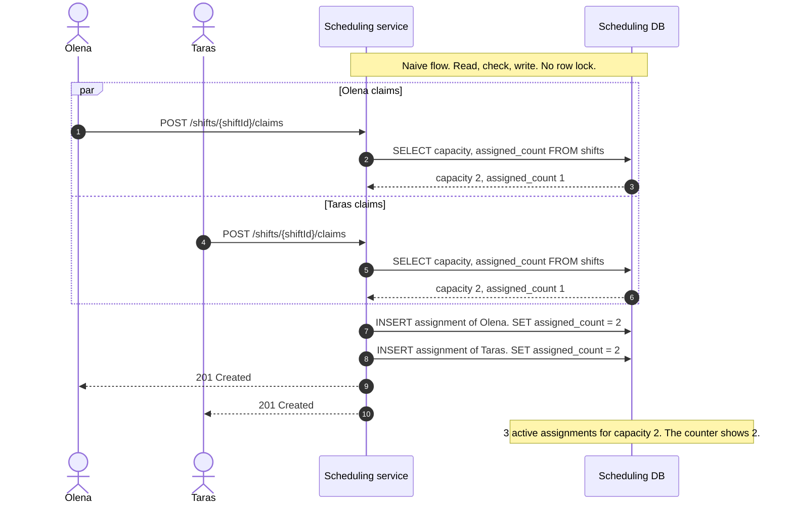

**Variant B: write skew.** Each transaction reads the hours of Olena (32 h), adds 8 h and gets 40 h. 40 h is not more than the limit, so both transactions commit. Olena then has 48 h. The two transactions insert different rows, so no row conflict occurs. Only a lock on a shared object can stop this race.

| Time | Transaction 1: Iryna assigns Sunday (API-07) | Transaction 2: Olena claims Saturday (API-08) |
|---|---|---|
| t1 | Reads the hours of Olena: 32 h | — |
| t2 | — | Reads the hours of Olena: 32 h |
| t3 | 32 h + 8 h = 40 h, allowed. Inserts the Sunday assignment. | — |
| t4 | — | 32 h + 8 h = 40 h, allowed. Inserts the Saturday assignment. |
| t5 | COMMIT | COMMIT. Olena has 48 h, the limit is 40 h. |

### Pattern

**Pessimistic locking with a fixed lock order, plus a database constraint as the last defense.** A transaction locks the rows that its decision depends on before it reads them for the decision. Other transactions that need the same rows wait until the first transaction commits or rolls back. A fixed lock order prevents deadlocks. A rule over a set of rows has no single row to lock. An example is the sum of the hours of one employee in one week. The design adds a row for the set and locks this row. Martin Kleppmann calls this technique "materializing conflicts". A database constraint rejects a bad row even when the application code has a bug.

Sources: PostgreSQL documentation, "Explicit Locking" and "The Locking Clause" of `SELECT` [R1, R2]; PostgreSQL documentation, "Constraints on Ranges" [R3]; M. Kleppmann, *Designing Data-Intensive Applications*, chapter 7, write skew [R4].

### How Shift Happens applies it

**Lock objects and constraints in `scheduling_db`.**

```sql
CREATE EXTENSION IF NOT EXISTS btree_gist;

-- Last defense for the capacity rule.
ALTER TABLE shifts
  ADD CONSTRAINT shift_capacity_check CHECK (assigned_count BETWEEN 0 AND capacity);

-- One row per employee and schedule week. It is the lock object for the
-- rules of one employee, and it stores the sum of the assigned minutes.
CREATE TABLE employee_weeks (
  org_id           uuid    NOT NULL,
  employee_id      uuid    NOT NULL,
  week_start       date    NOT NULL,          -- Monday in the time zone of the location
  assigned_minutes integer NOT NULL DEFAULT 0,
  PRIMARY KEY (org_id, employee_id, week_start)
);

-- Last defense for the overlap rule. period = tstzrange(starts_at, ends_at, '[)').
ALTER TABLE assignments
  ADD CONSTRAINT assignment_no_overlap
  EXCLUDE USING gist (employee_id WITH =, period WITH &&)
  WHERE (status = 'ACTIVE')
  DEFERRABLE INITIALLY IMMEDIATE;
```

Notes:

- `btree_gist` lets one GiST index combine `=` on a UUID with `&&` (overlap) on a range.
- The range is half-open (`'[)'`). A shift that stops at 16:00 and a shift that starts at 16:00 do not overlap.
- The partial constraint (`WHERE status = 'ACTIVE'`) ignores cancelled assignments.
- `DEFERRABLE INITIALLY IMMEDIATE` keeps the immediate check for all transactions. Only the trade pivot of CS-3 defers the check to the commit.

**Claim transaction (API-08).** API-07 uses the same transaction with `source = 'MANAGER'`. In a draft schedule, API-07 first increments `schedules.version` (lock level 1, see CS-2).

```sql
BEGIN;                                   -- READ COMMITTED
SET LOCAL lock_timeout = '2s';

-- Lock 1: the shift row.
SELECT s.capacity, s.assigned_count, s.starts_at, s.ends_at, s.position_id, sc.status
FROM shifts s
JOIN schedules sc ON sc.id = s.schedule_id
WHERE s.id = $1 AND s.org_id = $2
FOR UPDATE OF s;
-- No row, or sc.status = 'DRAFT'  -> 404 RESOURCE_NOT_FOUND
-- now() >= starts_at              -> 409 SHIFT_ALREADY_STARTED
-- assigned_count >= capacity      -> 409 SLOT_FILLED

-- Lock 2: the employee-week row. Create it on first use.
INSERT INTO employee_weeks (org_id, employee_id, week_start)
VALUES ($2, $3, $4)
ON CONFLICT (org_id, employee_id, week_start) DO NOTHING;

SELECT assigned_minutes
FROM employee_weeks
WHERE org_id = $2 AND employee_id = $3 AND week_start = $4
FOR UPDATE;

-- Checks under both locks. Each statement sees all committed rows.
SELECT id, period
FROM assignments
WHERE employee_id = $3 AND status = 'ACTIVE'
  AND period && tstzrange($5 - interval '11 hours', $6 + interval '11 hours', '[)');
-- Same shift                         -> 409 ALREADY_ASSIGNED
-- Overlap with [starts_at, ends_at)  -> 409 ASSIGNMENT_OVERLAP
-- Rest less than minRestHours (11)   -> 422 LABOR_RULE_VIOLATION, rule MIN_REST
-- assigned_minutes + 480 > 40 * 60   -> 422 LABOR_RULE_VIOLATION, rule MAX_WEEKLY_HOURS

-- Conditional writes.
UPDATE shifts
SET assigned_count = assigned_count + 1
WHERE id = $1 AND assigned_count < capacity;      -- 0 rows -> 409 SLOT_FILLED

INSERT INTO assignments (id, org_id, shift_id, employee_id, status, source, period)
VALUES ($7, $2, $1, $3, 'ACTIVE', 'CLAIM', tstzrange($5, $6, '[)'));
-- SQLSTATE 23P01 (exclusion_violation) -> 409 ASSIGNMENT_OVERLAP

UPDATE employee_weeks
SET assigned_minutes = assigned_minutes + 480     -- length of the shift in minutes
WHERE org_id = $2 AND employee_id = $3 AND week_start = $4;

INSERT INTO outbox (id, aggregate_id, event_type, payload)
VALUES ($8, $1, 'ShiftClaimed', $9);
-- CS-4: the same transaction stores the response in idempotency_records.
COMMIT;
```

The `11 hours` and the `40 * 60` minutes come from the labor policy of the location (`minRestHours`, `maxWeeklyHours`).

**Which guard protects which invariant.**

| Invariant | Primary guard | Last defense |
|---|---|---|
| `assigned_count` never exceeds `capacity` | Lock on the shift row, conditional update | `shift_capacity_check` |
| No overlapping active assignments of one employee | Lock on the employee-week row, overlap query | `assignment_no_overlap` exclusion constraint |
| `MIN_REST`, `MAX_WEEKLY_HOURS` | Lock on the employee-week row | None. A constraint cannot sum hours, and the rules can differ per location. |
| One assignment per employee and shift | Lock on the shift row, `ALREADY_ASSIGNED` check | `assignment_no_overlap` (the same range overlaps) |

The second claimant waits for the lock and does not fail at once. The team rejected `NOWAIT`: a wait of 10–50 ms gives a better user experience than an error.

### Sequence diagram

Variant A: two claims for the last open slot.

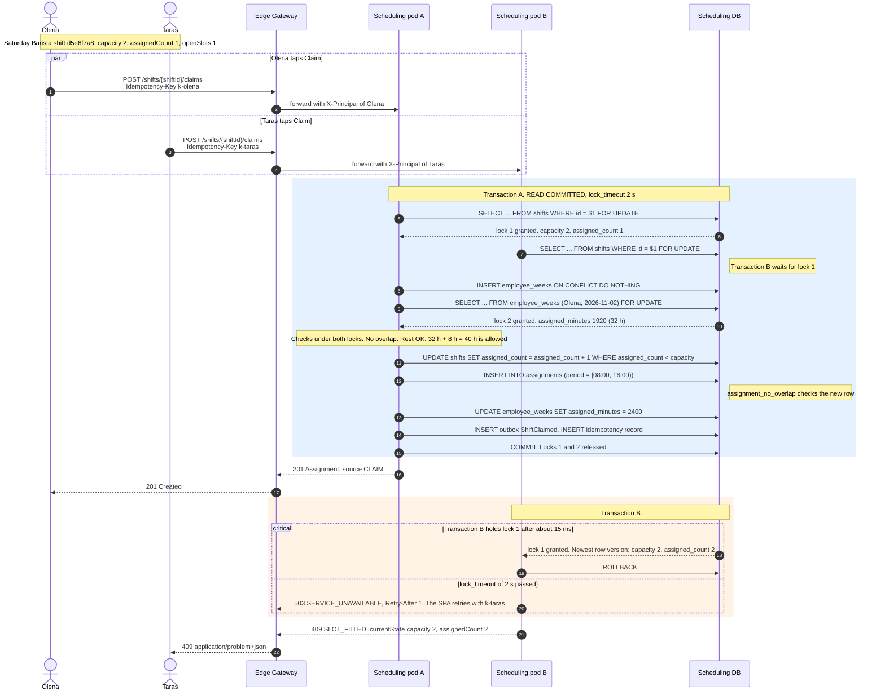

Variant B: a manager assignment and a claim for the same employee.

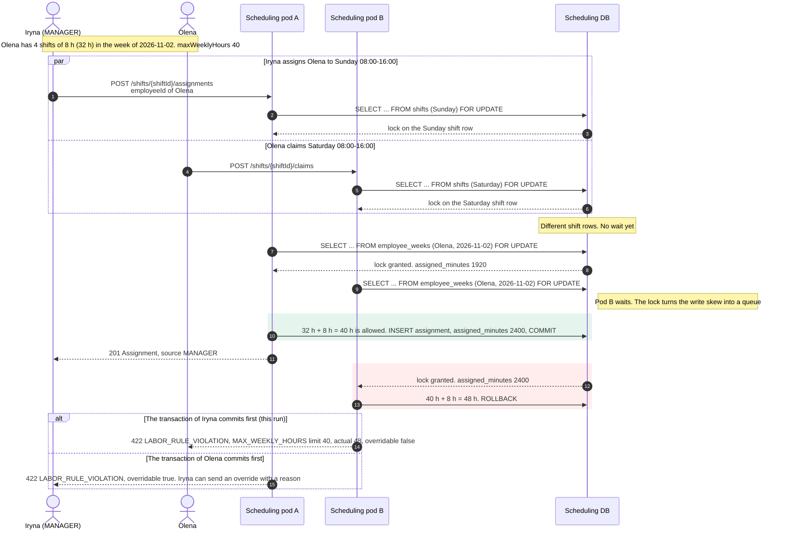

### Edge cases and failure handling

1. **Deadlock.** All transactions take locks in the order of [section 2.3](#23-lock-order-and-timeouts). A claim takes the shift row, then one or two employee-week rows in ascending `week_start` order. If a deadlock still occurs, PostgreSQL aborts one transaction after 1 s. The service returns 503 `SERVICE_UNAVAILABLE` and logs an error.
1. **Lock timeout.** If a lock wait is longer than `lock_timeout` (2 s), the service returns 503 `SERVICE_UNAVAILABLE` with `Retry-After: 1`. The SPA retries with the same `Idempotency-Key` (CS-4), so a retry cannot create a second assignment.
1. **Burst of claims on one popular shift.** All requests queue on the shift row. Before the transaction, the service reads `assigned_count` and `capacity` without a lock. If no slot is open, it returns 409 `SLOT_FILLED` at once, and the request does not queue. The locked check stays the decision point. The `claims` rate limit policy (10 requests / 60 s per user) limits each user.
1. **No employee-week row yet.** `INSERT … ON CONFLICT DO NOTHING` creates the row. If two transactions insert the same key at the same time, the second waits for the first, then does nothing. Then both lock the row with `FOR UPDATE`.
1. **Rest across the week boundary.** A claim of a Sunday evening shift must check the Monday of the next week. The transaction locks both employee-week rows in ascending `week_start` order.
1. **Manager reduces the capacity during a claim.** API-05 uses `UPDATE shifts … WHERE id = $1 AND version = $2 AND assigned_count <= $capacity`. The claim and the update lock the same shift row, so they run one after the other. The update checks its `WHERE` clause again on the newest row. If the claim was first, the update returns 409 `CAPACITY_BELOW_ASSIGNED`.
1. **Pod crash in the transaction.** PostgreSQL rolls back the transaction when the connection closes, and it releases the locks. No partial assignment stays. The client retries with the same `Idempotency-Key`.
1. **Exclusion constraint fires.** This happens only if a code path did not take the employee-week lock. The service maps SQLSTATE `23P01` to 409 `ASSIGNMENT_OVERLAP` and logs an error, because it is a bug signal.

### What the client sees

[Error handling design](03-error-handling.md) gives the full bodies and the client reactions.

| Case | Status and code | SPA reaction |
|---|---|---|
| Winner of Variant A | 201 `Assignment` with `source: "CLAIM"` | Show "You work on Saturday, 08:00–16:00". |
| Loser of Variant A | 409 `SLOT_FILLED` with `currentState` | Reload the shift. Show "taken". Offer other open shifts. |
| Variant B, the claim is second | 422 `LABOR_RULE_VIOLATION`, `overridable: false` | Show each violation. The employee must choose another shift. |
| Variant B, the assignment is second | 422 `LABOR_RULE_VIOLATION`, `overridable: true` | Show the violations. Offer "Override" with a reason (10–500 characters). |
| Overlap | 409 `ASSIGNMENT_OVERLAP` | Show the conflicting assignment. Do not retry. |
| Lock timeout | 503 `SERVICE_UNAVAILABLE`, `Retry-After: 1` | Retry with the same key, with backoff, at most 3 times. |

Excerpt of the 409 body for Taras (the full body also has `title` and `detail`):

```json
{
  "type": "https://docs.shifthappens.example/problems/slot-filled",
  "status": 409,
  "code": "SLOT_FILLED",
  "instance": "/api/v1/shifts/d5e6f7a8-b9c0-4d1e-8f2a-3b4c5d6e7f80/claims",
  "currentState": { "capacity": 2, "assignedCount": 2 },
  "traceId": "4bf92f3577b34da6a3ce929d0e0e4736"
}
```

Excerpt of the 422 body for Olena in Variant B:

```json
{
  "type": "https://docs.shifthappens.example/problems/labor-rule-violation",
  "status": 422,
  "code": "LABOR_RULE_VIOLATION",
  "overridable": false,
  "violations": [
    {
      "rule": "MAX_WEEKLY_HOURS",
      "limit": 40,
      "actual": 48,
      "unit": "HOURS",
      "employeeId": "5b1e6c2a-8f3d-4a7e-9c1b-2d4f6a8e0c13"
    }
  ],
  "traceId": "4bf92f3577b34da6a3ce929d0e0e4736"
}
```

### Alternatives considered

| Alternative | Why the team did not choose it |
|---|---|
| `NOWAIT` (fail at once if the row is locked) | The second claimant gets an error after 0 ms instead of a correct answer after 10–50 ms. A wait gives a better user experience. |
| `SERIALIZABLE` with a retry loop | Aborts under contention, retry loops in each write path, aborts without a business conflict ([section 2.2](#22-isolation-level)). |
| Only an atomic conditional update on the shift | It protects the capacity, but not the rules of one employee (Variant B). |
| Optimistic `version` on the shift | A popular shift has high contention. Most claimants get a conflict and retry. A lock puts them in a queue. |
| Advisory lock per employee (`pg_advisory_xact_lock`) | It works, but the lock key is a hash outside the schema. The employee-week row is also useful for the sum of hours. |
| Lock in Redis | The data is in PostgreSQL. A lock outside the database needs fencing tokens (CS-6) and adds one more failure point. |
| Exclusion constraint on ranges that include the rest time | `minRestHours` can differ per location, and a constraint cannot sum hours for `MAX_WEEKLY_HOURS`. |

## 5. CS-2: two managers edit the same draft schedule

### Use case

On Thursday 2026-10-29, Iryna plans the week of 2026-11-02 for Rynok Square. The schedule `c4d5e6f7-a8b9-4c0d-9e1f-2a3b4c5d6e7f` has the status `DRAFT` and `version` 9. Andrii (ADMIN, he can edit the schedules of all locations) opens the same draft. Both see the Saturday Barista shift with `version` 3.

- **Part A (same shift).** Andrii adds a note to the Saturday shift. A few seconds later, Iryna adds a different note from her old view.
- **Part B (publish).** Iryna opens the publish dialog and reviews `version` 11. At the same time, Andrii changes the capacity of the Sunday shift. Then Iryna clicks "Publish".

### Problem without the pattern

PATCH sends only the changed fields. Thus changes of different fields do not overwrite each other. Two failures can still occur:

- **Lost update.** Both managers change the same field. The last write wins, and nobody gets an error. In Part A, the note of Andrii disappears.
- **Publish of a state that nobody reviewed.** Iryna publishes a schedule that contains a change that she did not see. 200 employees get notifications about it (CS-5), and the publish cannot be undone.

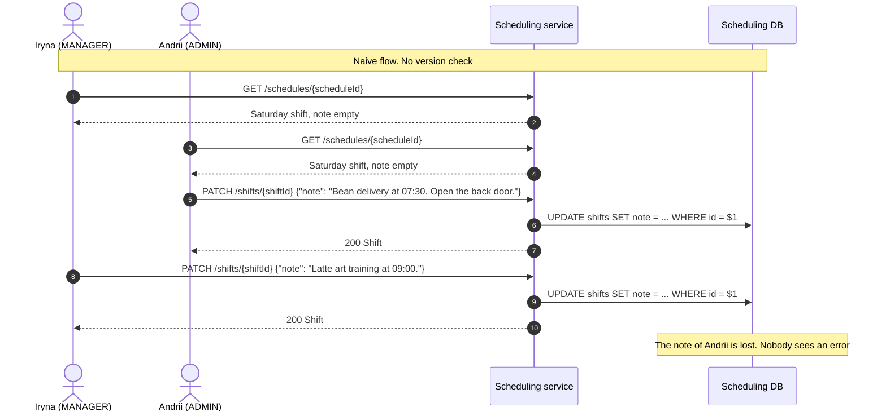

### Pattern

**Optimistic concurrency control (optimistic offline lock).** Each row has a version number. The client sends the version that it read. The server changes the row only if the version is still the same, and it increments the version in the same statement. If another writer was first, the statement changes 0 rows, and the client must reload and merge. The server holds no lock between two requests.

Sources: M. Fowler, *Patterns of Enterprise Application Architecture*, "Optimistic Offline Lock" [R5]; PostgreSQL documentation, "Transaction Isolation", behavior of `UPDATE` in `READ COMMITTED` [R6].

The team uses an optimistic lock here and a pessimistic lock in CS-1 for these reasons:

- **Long think time.** A manager edits a shift for seconds or minutes. A pessimistic lock would stay over the think time of the user. A database transaction cannot stay open across HTTP requests, and an application lock needs a TTL and a "break lock" function.
- **Low contention.** At most 2 or 3 people edit the schedule of one location: the location manager and an admin. Conflicts are rare, so a reload is a small cost.
- **No blocked users.** Nobody waits for another manager, and a closed browser tab leaves no lock.

CS-1 has the opposite profile: many writers on one row and a transaction of a few milliseconds.

### How Shift Happens applies it

**Version rules.**

| Column | Increments when | Does not increment when |
|---|---|---|
| `shifts.version` | Any change of the shift (API-05) | A claim, an assignment or a trade. `assigned_count` is a derived value. |
| `schedules.version` | Any change of the schedule or of its shifts (API-05, API-06, `POST /schedules/{scheduleId}/shifts`). In a `DRAFT` schedule, also a manager assignment (API-07) and `DELETE /assignments/{assignmentId}`. | A claim. Claims are possible only in a published schedule. |

Thus the publish dialog can check all changes since the review with one number.

**API-05: edit a shift.** The request body carries the version, for example `{ "version": 3, "note": "Latte art training at 09:00." }`.

```sql
BEGIN;
SET LOCAL lock_timeout = '2s';

-- Lock order level 1: the schedule row.
UPDATE schedules
SET version = version + 1, updated_at = now()
WHERE id = $schedule_id AND org_id = $org_id
RETURNING status, version;

-- Lock order level 2: the shift row, with the optimistic check.
UPDATE shifts
SET note = $note, version = version + 1, updated_at = now()
WHERE id = $1 AND org_id = $org_id AND version = $2
RETURNING version;
-- 1 row  -> COMMIT. 200 with the new version.
-- 0 rows -> ROLLBACK (this also undoes the schedule increment), then:
SELECT version, assigned_count FROM shifts WHERE id = $1 AND org_id = $org_id;
-- No row                    -> 404 RESOURCE_NOT_FOUND
-- version <> $2             -> 409 VERSION_CONFLICT, currentVersion = version
-- A capacity change fails   -> 409 CAPACITY_BELOW_ASSIGNED
```

When the request changes the capacity, the update also has `AND assigned_count <= $capacity`. If the schedule is `PUBLISHED`, the same transaction writes `ShiftChanged` to the outbox.

**API-06: publish.** The request body is `{ "version": 12 }`.

```sql
UPDATE schedules
SET status = 'PUBLISHED', published_at = now(), version = version + 1
WHERE id = $1 AND org_id = $2 AND version = $3 AND status = 'DRAFT'
RETURNING version;
-- 0 rows -> SELECT status, version FROM schedules WHERE id = $1 AND org_id = $2:
--   no row               -> 404 RESOURCE_NOT_FOUND
--   status = 'PUBLISHED' -> 409 SCHEDULE_ALREADY_PUBLISHED
--   other version        -> 409 VERSION_CONFLICT, currentVersion = version
```

The same transaction validates the shifts (422 `SCHEDULE_NOT_PUBLISHABLE`) and writes `SchedulePublished` to the outbox (CS-5). A shift change must first lock the schedule row (lock level 1). Thus no shift can change between the validation and the commit of the publish.

**Merge flow in the SPA.**

1. On 409 `VERSION_CONFLICT`, the SPA keeps the input of the user and the base values that it loaded.
1. The SPA loads `GET /schedules/{scheduleId}`.
1. The SPA compares three values per field: base, server and user.
1. If only the user changed a field, the SPA keeps the value of the user.
1. If only the server changed a field, the SPA shows the server value and marks it as "changed by another user".
1. If both changed the same field, the SPA shows both values. The user chooses a value or edits it.
1. The SPA sends the PATCH again with `version` equal to `currentVersion`. It never sends the PATCH again without a confirmation of the user.

For a publish conflict, the SPA reloads the schedule, marks the shifts that changed since the reviewed version, and asks for a new confirmation.

### Sequence diagram

Part A: two edits of the same shift.

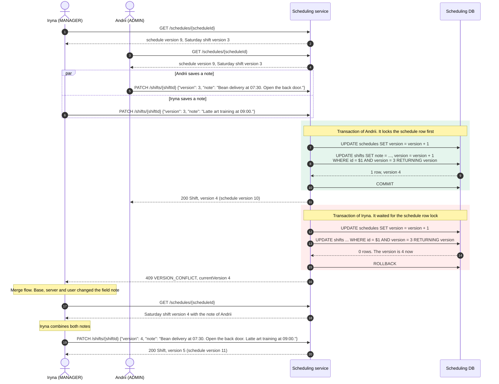

Part B: the schedule changes after the review.

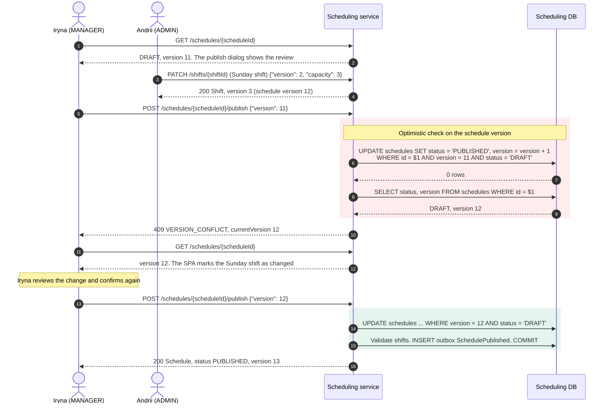

### Edge cases and failure handling

1. **Double click on "Publish".** The second request has `version` 12 and finds the status `PUBLISHED`. The server checks the status before the version, so the result is 409 `SCHEDULE_ALREADY_PUBLISHED`. The SPA reloads, and no action is necessary.
1. **Edit of a published shift during a claim.** A claim does not change `shifts.version`. Thus a claim does not cause a `VERSION_CONFLICT` for a manager who edits the note. A capacity change and a claim lock the same shift row and run one after the other (CS-1, edge case 6).
1. **Request without `version`.** The server returns 400 `VALIDATION_FAILED` with the pointer `/version`. It never applies a write without a version.
1. **Two managers edit different shifts of one draft.** Both edits succeed. They wait a few milliseconds for each other on the schedule row. Only a publish with an old schedule version fails.
1. **Blind retry with `currentVersion`.** The SPA must not send the old input again with `currentVersion` and without the merge flow. That is "last write wins" again. The client rule in [error handling design](03-error-handling.md) forbids it.
1. **Conflict loop.** Under high contention, a manager can get a conflict several times. With 2 or 3 editors per location this is rare. Each conflict shows the new changes, so the user always sees the current state.

### What the client sees

| Case | Status and code | SPA reaction |
|---|---|---|
| Edit with the current version | 200 `Shift` with the new `version` | Update the local state from the response. |
| Edit with an old version | 409 `VERSION_CONFLICT` with `currentVersion` | Reload, show the changes, let the user apply the change again with the new version. |
| Publish with an old version | 409 `VERSION_CONFLICT` with `currentVersion` | Reload, mark the changed shifts, ask for a new confirmation. |
| Publish of a published schedule | 409 `SCHEDULE_ALREADY_PUBLISHED` | Reload. No action is necessary. |

Excerpt of the 409 body for Iryna in Part A:

```json
{
  "type": "https://docs.shifthappens.example/problems/version-conflict",
  "status": 409,
  "code": "VERSION_CONFLICT",
  "instance": "/api/v1/shifts/d5e6f7a8-b9c0-4d1e-8f2a-3b4c5d6e7f80",
  "currentVersion": 4,
  "traceId": "4bf92f3577b34da6a3ce929d0e0e4736"
}
```

### Alternatives considered

| Alternative | Why the team did not choose it |
|---|---|
| Pessimistic edit lock ("check-out" of the schedule) | Locks over user think time, a TTL, a "break lock" function and blocked managers. |
| `ETag`, `If-Match`, 412 and 428 (RFC 9110 conditional requests) | It is the HTTP-native form of the same pattern. The team chose `version` in the body and 409. All conflicts then use one error format (problem details with `currentVersion`). No `ETag` header must pass CORS. The SPA already has the version in the JSON. |
| Last write wins with an audit log | The data loss is silent. The audit log shows it only later. |
| Real-time co-editing (CRDT or operational transformation) | Too complex for 2 or 3 editors per location. |
| A version per field | More precise, but more storage and a more complex API. The three-way merge in the SPA gives the same result for the user. |

## 6. CS-3: swap across services

### Use case

Olena has the Thursday Barista shift (2026-11-05, 08:00–16:00, assignmentId `e6f7a8b9-c0d1-4e2f-9a3b-4c5d6e7f8091`). Taras has the Friday Barista shift (2026-11-06, 12:00–20:00, assignmentId `f7a8b9c0-d1e2-4f3a-8b4c-5d6e7f809102`).

1. On Monday 2026-11-02 at 10:00, Olena asks Taras for a swap (API-09). The Trade service creates the trade request `1a2b3c4d-5e6f-4a7b-8c9d-0e1f2a3b4c5e` of the type `SWAP`.
1. On the same evening, Taras accepts (API-10).
1. On Tuesday 2026-11-03 at 09:00, Iryna approves (API-11).

The trade request expires at `2026-11-04T08:00:00+02:00`. This is the earlier of two times: 48 h after the creation (`tradeTtlHours`), and 24 h before the Thursday shift (`tradeCutoffHours`).

### Problem without the pattern

The trade request is in `trade_db`. The assignments are in `scheduling_db`. No ACID transaction covers both databases. Two-phase commit is not available across Kafka and two RDS instances, and it blocks all participants when the coordinator fails. Without a saga, these failures occur:

- **Partial failure.** The Trade service sets the status to approved, and then the call to the Scheduling service fails. The trade request says "approved", but the schedule did not change.
- **No isolation between the steps.** A trade can stay open for up to 48 h. In that time, other requests change the same assignments.

| Time | Event | Result without a trade lock and without a re-check |
|---|---|---|
| Mon 10:00 | Olena offers her Thursday shift to Taras (SWAP). | — |
| Mon 11:00 | Olena also offers the same Thursday shift to all colleagues (COVER). A colleague accepts. | Two pending trade requests for one assignment. |
| Mon 18:30 | Taras accepts the swap. | — |
| Tue 09:00 | Iryna approves both trade requests. | The second execution moves an assignment that Olena does not own any more. |
| Tue 09:01 | Andrii assigns Taras to a Wednesday shift 14:00–22:00 before the swap executes. | After the swap, Taras has 10 h of rest before Thursday 08:00. The limit is 11 h. |

### Pattern

**Orchestrated saga with a semantic lock, compensating actions and a pivot transaction.** A saga is a sequence of local transactions. Each local transaction publishes a message that starts the next step. If a step fails, compensating transactions undo the effects of the earlier steps. In an orchestrated saga, one orchestrator tells the participants what to do and keeps the state of the saga. A saga has no isolation, so the design adds countermeasures:

- **Semantic lock:** an application-level flag marks a record as part of an open saga. Other transactions check the flag.
- **Reread values:** the pivot step reads the data again and checks it again before it changes it.
- **Pivot transaction:** the go or no-go step. The steps before it can be compensated. The steps after it can only be retried, and they always succeed.

Sources: H. Garcia-Molina and K. Salem, "Sagas" [R7]; C. Richardson, microservices.io, "Pattern: Saga" [R8]; Microsoft Azure Architecture Center, "Saga distributed transactions pattern" and "Compensating Transaction pattern" [R9, R10].

**Orchestration or choreography.** The team chose orchestration.

| Criterion | Orchestration (chosen) | Choreography |
|---|---|---|
| Place of the state machine | One table in the Trade service (`trade_requests.status`) | Spread over event handlers in the Trade service and the Scheduling service |
| Human steps and TTL | Natural: `PENDING_PEER`, `PENDING_MANAGER` and the expiry job (CS-6) | It is not clear which service owns the timeout. |
| Coupling | The Trade service knows two commands of the Scheduling service. | A cycle of event dependencies between the Trade service and the Scheduling service |
| Operations | One query finds stuck sagas (`EXECUTING` for more than 5 min). | Operators must correlate events of two services. |

### How Shift Happens applies it

**State machine of the trade request.** All final states except `APPROVED` start the compensation `ReleaseTradeLocks`. For `APPROVED`, the pivot releases the locks in its own transaction.

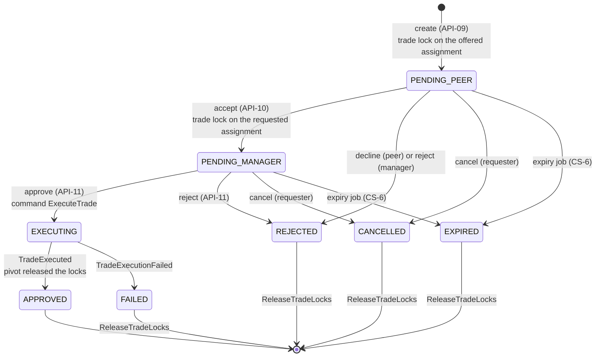

**Saga steps.**

| Step | Trigger | Participant and local transaction | Type | Compensation |
|---|---|---|---|---|
| 1. Create | API-09 by Olena | Scheduling service: trade lock on the offered assignment (internal call). Trade service: `INSERT` trade request `PENDING_PEER` + outbox `TradeRequested`. | Compensatable | `ReleaseTradeLocks` |
| 2. Accept | API-10 by Taras | Scheduling service: validate the trade, and for a SWAP place a trade lock on the requested assignment (internal calls). Trade service: `PENDING_PEER` → `PENDING_MANAGER` + outbox `TradeAccepted`. | Compensatable | `ReleaseTradeLocks` |
| 3. Approve | API-11 by Iryna | Scheduling service: pre-validation (internal call). Trade service: `PENDING_MANAGER` → `EXECUTING` + outbox `ExecuteTrade`. | Compensatable | `FAILED` and `ReleaseTradeLocks` |
| 4. Execute | `ExecuteTrade` on `trade.commands.v1` | Scheduling service: lock the rows, check the rules again, move the assignments, clear the trade locks, outbox `TradeExecuted` or `TradeExecutionFailed`. | Pivot | — |
| 5. Close | `TradeExecuted` or `TradeExecutionFailed` | Trade service: `EXECUTING` → `APPROVED` + outbox `TradeApproved`, or `EXECUTING` → `FAILED` + outbox `TradeFailed` and `ReleaseTradeLocks` | Retriable | — |
| 6. Notify | Events on `trade.events.v1` | Notification service: in-app, Web Push and email messages | Retriable | — |

**Internal calls (Trade service → Scheduling service).** The calls use the internal endpoints of the [architecture document](02-architecture.md). Each call has a timeout of 2 s, one retry and a circuit breaker.

| Purpose | Endpoint |
|---|---|
| Verify an assignment | `GET /internal/v1/assignments/{assignmentId}` |
| Place a trade lock | `PUT /internal/v1/assignments/{assignmentId}/trade-lock` with `{ "tradeRequestId", "expiresAt" }` |
| Release one trade lock after a failed step | `DELETE /internal/v1/assignments/{assignmentId}/trade-lock?tradeRequestId=` |
| Validate a trade | `POST /internal/v1/trade-validations` |

**Semantic lock (trade lock).** The Scheduling service places the trade lock with a conditional update:

```sql
UPDATE assignments
SET trade_lock = $2, trade_lock_expires_at = $3          -- $3 = expiresAt of the trade request
WHERE id = $1
  AND employee_id = $4                                   -- expected owner
  AND status = 'ACTIVE'
  AND (trade_lock IS NULL OR trade_lock = $2 OR trade_lock_expires_at < now())
RETURNING id;
-- 0 rows: no row -> 404, other owner -> 403 NOT_RESOURCE_OWNER,
-- lock of another trade request -> 409 ASSIGNMENT_LOCKED

-- Compensation (command ReleaseTradeLocks). Idempotent.
UPDATE assignments
SET trade_lock = NULL, trade_lock_expires_at = NULL
WHERE trade_lock = $1;
```

These operations check the trade lock:

- API-09 and API-10 return 409 `ASSIGNMENT_LOCKED` when another trade request holds the lock.
- The pivot moves an assignment only if `trade_lock` equals the trade request ID.
- A manager is not blocked by a trade lock. `DELETE /assignments/{assignmentId}` and the member deactivation cancel the assignment. The Scheduling service emits `AssignmentCancelled`, and the Trade service cancels the trade request (`CANCELLED` and `ReleaseTradeLocks`).

The Scheduling service locks the requested assignment only at acceptance. Before acceptance, Taras did not agree to the trade. Thus one employee cannot block the shifts of colleagues with trade requests.

**Pivot transaction (Scheduling service, consumer of `ExecuteTrade`).**

```sql
BEGIN;
SET LOCAL lock_timeout = '2s';
SET CONSTRAINTS assignment_no_overlap DEFERRED;   -- a swap of two overlapping shifts is valid

INSERT INTO processed_events (event_id) VALUES ($event_id)
ON CONFLICT DO NOTHING RETURNING event_id;        -- 0 rows: duplicate command, COMMIT and skip

-- Lock order level 3, then level 4.
SELECT id, employee_id, status, trade_lock, period
FROM assignments
WHERE id IN ($thursday_assignment, $friday_assignment)
ORDER BY id
FOR UPDATE;
-- Both ACTIVE, both trade_lock = $trade_request_id, both shifts not started.

SELECT employee_id, week_start, assigned_minutes
FROM employee_weeks
WHERE org_id = $org_id AND employee_id IN ($olena, $taras) AND week_start = $week_start
ORDER BY employee_id, week_start
FOR UPDATE;

-- Reread values: overlap, MIN_REST and MAX_WEEKLY_HOURS for the new owners.

UPDATE assignments
SET employee_id = CASE id WHEN $thursday_assignment THEN $taras ELSE $olena END,
    trade_lock = NULL, trade_lock_expires_at = NULL
WHERE id IN ($thursday_assignment, $friday_assignment);

-- Move the minutes in employee_weeks. INSERT outbox TradeExecuted.
COMMIT;                                           -- the deferred constraint is checked here
```

If a check fails, the service rolls back the transaction. Then, in a new transaction, it inserts the `event_id` into `processed_events` and writes `TradeExecutionFailed` with a `reason` and `violations[]` to the outbox. The `reason` uses the error codes: `LABOR_RULE_VIOLATION`, `ASSIGNMENT_OVERLAP`, `SHIFT_ALREADY_STARTED` or `ASSIGNMENT_LOCKED`. `ASSIGNMENT_LOCKED` means that an assignment has no trade lock of this trade request, for example after a cancellation.

If Iryna sent an override with the approval, the command carries it. Then labor rule violations do not stop the pivot, and the audit log records the override. An overlap always stops the pivot.

**Idempotent command and event handlers.**

| Handler | Idempotency |
|---|---|
| Place a trade lock | `trade_lock = $2` is allowed, so a retry with the same `tradeRequestId` succeeds. |
| `ExecuteTrade` | `processed_events` in the pivot transaction. |
| `ReleaseTradeLocks` | `WHERE trade_lock = $1`. A second run changes 0 rows. |
| `TradeExecuted`, `TradeExecutionFailed` in the Trade service | `UPDATE trade_requests … WHERE id = $1 AND status = 'EXECUTING'`. A duplicate changes 0 rows and emits no second event. |

Order: the Trade service sends all commands to `trade.commands.v1` with the key `locationId`. Thus all commands of one trade request go to one partition and keep their order.

`ExecuteTrade` command (envelope):

```json
{
  "eventId": "01a1a035-2d50-7b2a-9d4f-1e2a3b4c5d6e",
  "type": "ExecuteTrade",
  "schemaVersion": 1,
  "occurredAt": "2026-11-03T07:00:02Z",
  "orgId": "0b9f5c3e-2d1a-4f6b-8c7d-9e0a1b2c3d4e",
  "locationId": "7d3e2f1a-4b5c-4d6e-9f8a-0b1c2d3e4f5a",
  "aggregateId": "1a2b3c4d-5e6f-4a7b-8c9d-0e1f2a3b4c5e",
  "payload": {
    "tradeRequestId": "1a2b3c4d-5e6f-4a7b-8c9d-0e1f2a3b4c5e",
    "type": "SWAP",
    "requesterId": "5b1e6c2a-8f3d-4a7e-9c1b-2d4f6a8e0c13",
    "acceptedBy": "6c2f7d3b-9a4e-4b8f-8d2c-3e5a7b9f1d24",
    "offeredAssignmentId": "e6f7a8b9-c0d1-4e2f-9a3b-4c5d6e7f8091",
    "requestedAssignmentId": "f7a8b9c0-d1e2-4f3a-8b4c-5d6e7f809102",
    "decidedBy": "7d3a8e4c-0b5f-4c9a-9e3d-4f6b8c0a2e35",
    "override": null
  },
  "traceparent": "00-4bf92f3577b34da6a3ce929d0e0e4736-00f067aa0ba902b7-01"
}
```

### Sequence diagram

Normal flow: create, accept, approve, pivot.

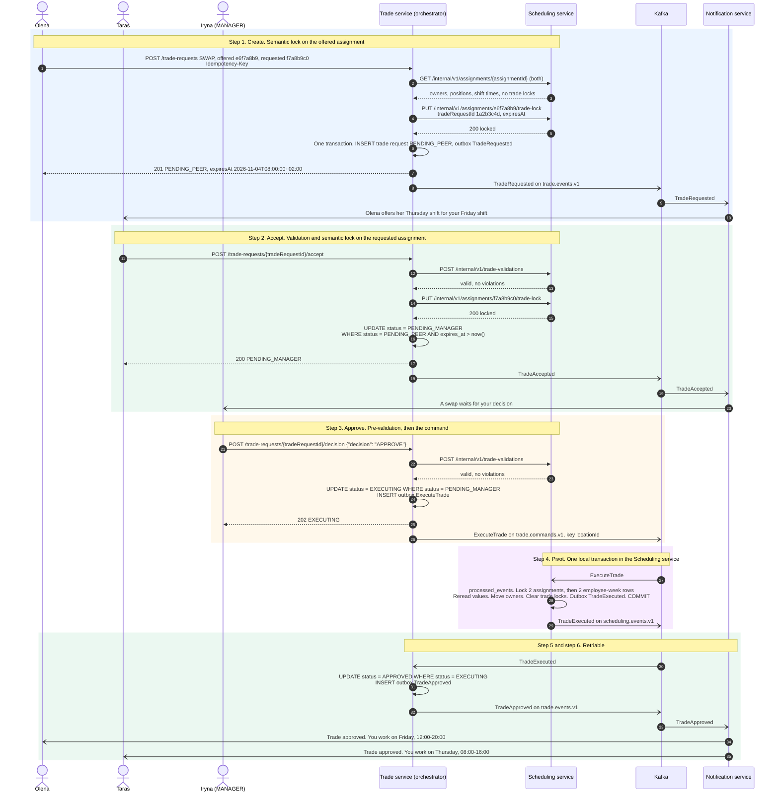

Conflicts and compensation: a second trade request on a locked assignment, an approval and a cancel at the same time, and a failed pivot.

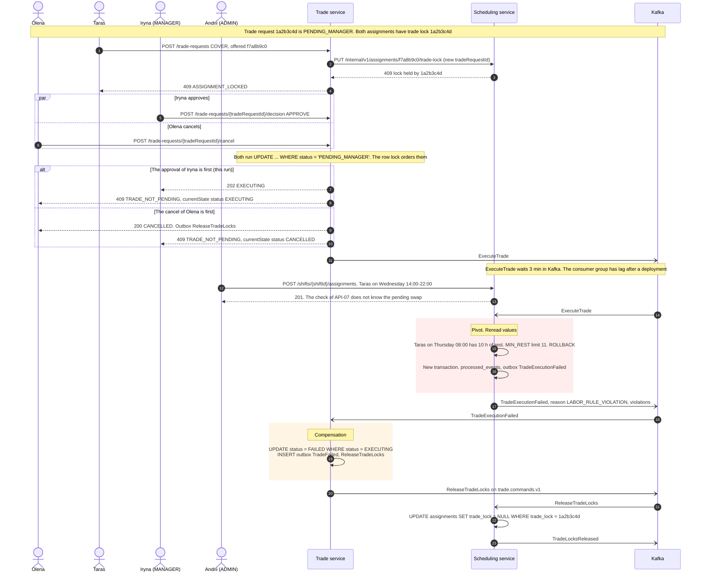

### Edge cases and failure handling

1. **Second trade request on a locked assignment.** The lock placement returns 409. API-09 returns 409 `ASSIGNMENT_LOCKED`. The SPA shows the pending trade request.
1. **Two decisions at the same time.** Both decisions use a conditional update on `status = 'PENDING_MANAGER'`. The second decision changes 0 rows and gets 409 `TRADE_NOT_PENDING` with `currentState.status`.
1. **Open cover request, several colleagues accept.** For a COVER without `targetEmployeeId`, any qualified colleague can accept. A COVER has no requested assignment, so the acceptance places no new trade lock. The first conditional update wins. The other colleagues get 409 `TRADE_NOT_PENDING`.
1. **SWAP acceptance after a cancel or the expiry.** The acceptance places the trade lock on the requested assignment before its conditional update. If the update then changes 0 rows, the Trade service releases this lock with `DELETE /internal/v1/assignments/{assignmentId}/trade-lock?tradeRequestId=` and returns 409 `TRADE_NOT_PENDING`. CS-6 shows this race.
1. **Change between the pre-validation and the pivot.** The window is normally less than 1 s. It grows when the consumer group of the Scheduling service has lag. The pivot reads the rows again, finds the violation and emits `TradeExecutionFailed`. The compensation releases the locks, and all three people get a notification.
1. **Duplicate command or event.** `processed_events` and the conditional updates on the status make each handler idempotent (see the table above).
1. **Crash between the lock and the insert.** The Trade service places the trade lock first and inserts the trade request second. If the pod crashes between the two steps, the lock has no trade request. The client retries with the same `Idempotency-Key` (CS-4), and the retry completes the request. If the client does not retry, the lock stops to count at `trade_lock_expires_at`. Thus no orphan lock blocks an assignment for longer than the trade TTL.
1. **Scheduling service not available during API-09, API-10 or API-11.** The internal call times out after 2 s and retries once. Then the circuit breaker opens. The API returns 503 `SERVICE_UNAVAILABLE` with `Retry-After: 30`. The Trade service makes all synchronous checks before its own write, so no partial state stays.
1. **Scheduling service not available during the pivot.** `ExecuteTrade` waits in Kafka (retention 7 days). The trade request stays `EXECUTING`. After 5 min in `EXECUTING`, an alert starts. If the shift starts before the execution, the pivot fails with the reason `SHIFT_ALREADY_STARTED`.
1. **Cancel during `EXECUTING`.** `POST /trade-requests/{tradeRequestId}/cancel` needs `PENDING_PEER` or `PENDING_MANAGER`. During `EXECUTING`, it returns 409 `TRADE_NOT_PENDING`.

### What the client sees

| Case | Status and code | SPA reaction |
|---|---|---|
| Create (API-09) | 201 `TradeRequest`, `PENDING_PEER` | Show the request with its `expiresAt`. |
| Offered assignment is locked | 409 `ASSIGNMENT_LOCKED` | Show the pending trade request. Retry after it closes. |
| Accept (API-10) after a cancel, a rejection or the expiry | 409 `TRADE_NOT_PENDING` with `currentState.status` | Reload the trade request and show its status. |
| Labor rules fail for the new owner at acceptance | 422 `LABOR_RULE_VIOLATION`, `overridable: false` | Show each violation. The employee cannot override. |
| Labor rules fail at approval | 422 `LABOR_RULE_VIOLATION`, `overridable: true` | Show the violations. Offer "Override" with a reason. |
| Approve (API-11) | 202 `TradeRequest`, `EXECUTING` | Show "in progress". The final state comes as a notification and in `GET /trade-requests`. |
| Pivot fails | Notification about `TradeFailed` | Show the reason and the violations. The assignments stay with the old owners. |
| Scheduling service not available | 503 `SERVICE_UNAVAILABLE`, `Retry-After: 30` | Retry after 30 s with backoff, at most 3 times. |

### Alternatives considered

| Alternative | Why the team did not choose it |
|---|---|
| Choreography | No single owner of the state machine and the timeout. See the comparison above. |
| Two-phase commit (XA) | Kafka and the separate RDS databases do not support it together. A failed coordinator blocks all participants. |
| Trades inside the Scheduling service (one local transaction) | Simpler, but the trade workflow has its own lifecycle, TTL, notifications and analytics. [ADR-0001](adr/0001-architecture-style.md) keeps it in the Trade service. |
| No trade lock, only a re-check at the pivot | Many trades would fail after both employees and the manager agreed. The lock shows the conflict at the start. |
| Lock both assignments at creation | Taras did not agree yet. One employee could block the shifts of many colleagues with trade requests. |

## 7. CS-4: client retries a POST after a timeout

### Use case

Olena uses a phone browser on a weak mobile network. She taps "Claim" on the Saturday Barista shift. The SPA sends API-08 with `Idempotency-Key: 0f8d6c1e-3b5a-4e7d-9c2b-6a4f8e1d3c57`. The Scheduling service commits the assignment, but the response does not reach the phone. After the client timeout of 10 s, the SPA sends the request again.

Two other cases use the same mechanism:

- Olena has the app open in two browser tabs and taps "Claim" in both tabs.
- A bug in the SPA sends the key of an old trade request (API-09) with a different body.

### Problem without the pattern

POST is not idempotent (RFC 9110 [R23]). Without an idempotency key, a retry is a new request:

- For a claim, the business check returns 409 `ALREADY_ASSIGNED`. Olena sees an error, but the first claim succeeded.
- For a trade request, the retry gets 409 `ASSIGNMENT_LOCKED`, because the first request holds the lock. Olena sees an error for her own request.
- If the SPA does not retry, Olena does not know the result.

### Pattern

**Idempotency key with a request fingerprint.** The client generates a unique key for each user intent and sends it in the `Idempotency-Key` header. The server stores the result of the first request under the key. For a retry with the same key, the server returns the stored result and does not run the operation again. A fingerprint of the request detects the use of one key for a different request.

The IETF draft `draft-ietf-httpapi-idempotency-key-header-08` defines the header and three errors. The server returns 400 if a required key is not in the request. It returns 422 for a known key with a different payload, and 409 for a retry while the first request still runs. The draft also requires that the server publishes its expiry policy for keys.

Sources: IETF draft `draft-ietf-httpapi-idempotency-key-header-08` [R11]; Stripe API, "Idempotent requests" [R12].

### How Shift Happens applies it

**Policy.**

| Item | Value |
|---|---|
| Operations | API-08 and API-09: key required. API-01 and API-04: key optional. |
| Key format | UUID. The SPA uses `crypto.randomUUID()`. |
| Scope | One user in one service. Redis key `idem:{service}:{userId}:{key}`, primary key `(user_id, key)`. |
| Fingerprint | SHA-256 of the method, the path and the body, separated by a line feed. The body is in canonical JSON (RFC 8785 [R24]). API-08 has an empty body. |
| Reservation while the request runs | Redis `SET … NX EX 30` |
| Stored response | Table `idempotency_records` in the database of the service, in the same transaction as the business change |
| Expiry policy | At least 24 h (REQ-REL-002). A daily cleanup deletes records older than 24 h, so a record lives at most 48 h. |
| Stored results | 2xx and 4xx results of the operation. After a 5xx result, the transaction rolled back, so the service stores nothing and a retry runs the operation again. |
| Replay | The stored status and body, with the header `Idempotent-Replayed: true` |

Fingerprint of the claim of Olena:

```text
SHA-256("POST\n/api/v1/shifts/d5e6f7a8-b9c0-4d1e-8f2a-3b4c5d6e7f80/claims\n")
  = 66ea32fef05cb2e67004807f922de9e0f2432bf843cc60df070471a45695c000
```

**Table.**

```sql
CREATE TABLE idempotency_records (
  user_id       uuid        NOT NULL,
  key           uuid        NOT NULL,
  fingerprint   char(64)    NOT NULL,          -- SHA-256, hex
  status_code   smallint,                      -- set by the last statement of the transaction
  response_body jsonb,
  created_at    timestamptz NOT NULL DEFAULT now(),
  PRIMARY KEY (user_id, key)
);
```

**Algorithm.**

1. The Edge Gateway rejects API-08 and API-09 without the header: 400 `IDEMPOTENCY_KEY_MISSING`.
1. The service computes the fingerprint.
1. The service reserves the key: `SET idem:scheduling:{userId}:{key} '{"fingerprint":"66ea…","startedAt":"…"}' NX EX 30`.
1. If the reservation fails, another request with this key runs now. The service reads the value:
   - another fingerprint: 422 `IDEMPOTENCY_KEY_REUSED`;
   - the same fingerprint: the service reads `idempotency_records`. If a record exists, the service replays it. If not, it returns 409 `IDEMPOTENCY_REQUEST_IN_PROGRESS`.
1. If the reservation succeeds, the service reads `idempotency_records` for `(user_id, key)`:
   - a record with the same fingerprint: replay the stored response;
   - a record with another fingerprint: 422 `IDEMPOTENCY_KEY_REUSED`;
   - no record: continue with step 6.
1. The service runs the business transaction. Its first statement is `INSERT INTO idempotency_records (user_id, key, fingerprint) … ON CONFLICT DO NOTHING RETURNING key`. Its last statement stores `status_code` and `response_body`. If the insert returns no row, a parallel request committed first: the service rolls back and replays the stored response.
1. If the operation ends with a 4xx code (for example 409 `SLOT_FILLED`), the service rolls back to a savepoint after the first statement. Thus the business change disappears. The service stores the 4xx response in the record and commits. After a 5xx code, it rolls back the whole transaction.
1. After the commit or the rollback, the service deletes its own reservation (compare-and-delete in a Lua script).

**Why Redis and PostgreSQL.** Redis answers a parallel duplicate in less than 1 ms and holds no database connection. PostgreSQL stores the response atomically with the business change: either both exist or neither exists. The primary key of `idempotency_records` is the guarantee. Redis only makes the answer fast. If Redis is not available, the service skips steps 3, 4 and 8. A parallel duplicate then waits on the primary key and gets the replay.

**Retry policy of the SPA.**

| Result of an attempt | SPA action |
|---|---|
| Network error, or no response after 10 s | Retry with the same key and the same body. |
| 503 `SERVICE_UNAVAILABLE` | Wait `Retry-After`, then retry with the same key. |
| 429 `RATE_LIMITED` | Wait `Retry-After`. Show a countdown on the button. Then retry with the same key. |
| 409 `IDEMPOTENCY_REQUEST_IN_PROGRESS` | Wait 1 s, then retry with the same key. |
| Any other 4xx, or 500 | Stop. Show the result. A new user action gets a new key. |

The SPA waits with exponential backoff and full jitter: `delay = random(0, min(30 s, 1 s × 2^attempt))`. After a 429 or a 503, it waits `Retry-After` plus full jitter. The SPA makes at most 3 retries. The SPA generates the key when the user taps the button. It keeps the key in memory and in `sessionStorage` until a final result, so a page reload keeps the key. The button stays disabled while a request runs.

### Sequence diagram

Retry after a lost response.

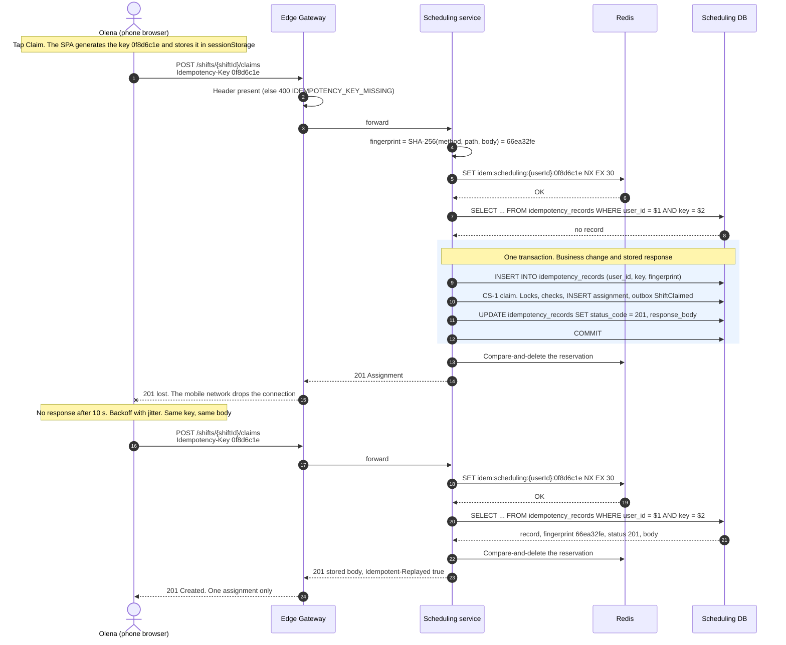

Parallel duplicate, reuse of a key and a missing key (API-09).

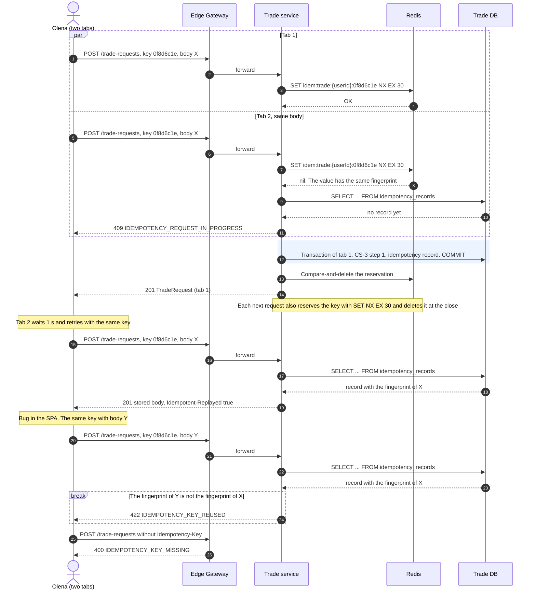

### Edge cases and failure handling

1. **Crash after the reservation, before the commit.** Nothing is committed. The reservation expires after 30 s. A retry within 30 s gets 409 `IDEMPOTENCY_REQUEST_IN_PROGRESS`, and the SPA retries. After the reservation expires, the retry runs the operation.
1. **Crash after the commit, before the deletion of the reservation.** The record exists in PostgreSQL. A retry finds the reservation, reads the record and replays the response at once (step 4).
1. **Retries exhausted.** After 3 retries, the SPA stops and reloads the data of the screen. Olena sees the current state of the shift.
1. **Redis failover loses the reservation.** Two duplicates can both pass step 3. The primary key of `idempotency_records` serializes them, and the second one gets the replay.
1. **Key reused after the expiry (more than 24 h).** The server treats the request as new. The business checks still stop a duplicate: 409 `ALREADY_ASSIGNED` for a claim, 409 `ASSIGNMENT_LOCKED` for a trade request.
1. **Same key from two users.** The scope includes the `userId`. A user never gets the stored response of another user. This follows the security considerations of the draft.
1. **Replay after a later change.** The replay returns the stored 201 of the first request, not the current state. The SPA updates its view from the next `GET`.

### What the client sees

| Case | Status and code | SPA reaction |
|---|---|---|
| First request | 201 | Show the result. Delete the key from `sessionStorage`. |
| Retry after success | 201 with `Idempotent-Replayed: true` | The same as the first request. |
| Retry after a stored 4xx result | The same 4xx with `Idempotent-Replayed: true`, for example 409 `SLOT_FILLED` | The same reaction as for the first 4xx response. |
| Parallel duplicate | 409 `IDEMPOTENCY_REQUEST_IN_PROGRESS` | Wait 1 s, retry with the same key, at most 3 times. |
| Same key, different request | 422 `IDEMPOTENCY_KEY_REUSED` | Client bug. Log it. Generate a new key for a new request. |
| No key on API-08 or API-09 | 400 `IDEMPOTENCY_KEY_MISSING` | Client bug. Generate a key and send again. |

[Error handling design](03-error-handling.md) gives the full bodies of these errors.

### Alternatives considered

| Alternative | Why the team did not choose it |
|---|---|
| Only business checks (natural keys) | The retry returns an error (`ALREADY_ASSIGNED`, `ASSIGNMENT_LOCKED`) although the first request succeeded. |
| Only PostgreSQL | Correct, but a parallel duplicate holds a database connection and waits for the lock. Redis answers it at once. |
| Only Redis | The response and the business change are not atomic. A Redis failover can lose the result. |
| Response cache in the Edge Gateway | The gateway cannot write the record in the business transaction of the service. |
| `PUT` with an ID that the client generates | Idempotent by HTTP semantics, but it changes the public API. The team keeps `POST` and the header, as the IETF draft describes. |

## 8. CS-5: publish a schedule and notify 200 employees

### Use case

On Thursday 2026-10-29 at 18:00, Iryna publishes the schedule of Rynok Square for the week of 2026-11-02 (API-06, `{ "version": 12 }`, the result of CS-2). REQ-PERF-002 defines the load case: a schedule with 200 affected employees. Each employee gets an in-app notification. Each employee also gets a Web Push message and an email if the preferences allow them. The Analytics service updates the coverage read model.

### Problem without the pattern

- **Dual write.** The service commits the schedule and then sends the event to Kafka. A crash between the two steps loses the event, and no employee gets a notification. The reverse order sends an event for a publish that rolled back.
- **Fan-out in the request.** 200 employees × 3 channels in the HTTP request take seconds or minutes. The request times out, and an SES failure fails the publish.
- **Duplicates.** Kafka delivers at least once. After a consumer crash, a naive consumer sends the same Web Push message twice.
- **Burst.** 200 emails at once can exceed the SES send rate of the account. SES then rejects messages.

### Pattern

- **Transactional outbox.** The service writes the event into an `outbox` table in the same local transaction as the business change. A relay reads the table and publishes the events to the broker. The polling publisher is one form of the relay [R13, R14].
- **Publish-subscribe.** One event goes to all subscribers. In Kafka, each consumer group gets its own copy [R15].
- **Competing consumers.** The consumers of one group share the messages, and each message goes to one consumer [R16].
- **Idempotent consumer.** The consumer records the IDs of processed messages and skips duplicates [R17].
- **Dead-letter topic.** A message that fails 5 times goes to a separate topic for the operators.
- **Rate limiting (client side).** The Notification service limits its own calls to SES [R18].
- **Batching.** The relay sends up to 500 events in one batch.

### How Shift Happens applies it

**Outbox table and relay (Scheduling service).**

```sql
CREATE TABLE outbox (
  id           uuid        PRIMARY KEY,   -- eventId, UUID v7 (time ordered)
  aggregate_id uuid        NOT NULL,
  event_type   text        NOT NULL,      -- for example 'SchedulePublished'
  payload      jsonb       NOT NULL,      -- full event envelope
  created_at   timestamptz NOT NULL DEFAULT clock_timestamp(),
  published_at timestamptz
);
CREATE INDEX outbox_unpublished ON outbox (id) WHERE published_at IS NULL;

-- Relay: one poll, every 200 ms, or at once when the last batch was full.
BEGIN;
SELECT id, event_type, payload
FROM outbox
WHERE published_at IS NULL
ORDER BY id
LIMIT 500
FOR UPDATE SKIP LOCKED;
-- Send the batch to Kafka (acks=all, idempotent producer). Wait for all acks.
UPDATE outbox SET published_at = now() WHERE id = ANY($1::uuid[]);
COMMIT;
```

- The relay maps `event_type` to the topic (`scheduling.events.v1`) and uses `locationId` from the envelope as the record key.
- One replica of the Scheduling service holds the relay at a time. It uses a Kubernetes Lease (`scheduling-outbox-relay-leader`), the same mechanism as CS-6.
- `FOR UPDATE SKIP LOCKED` protects the short overlap when the relay holder changes. A new holder never sends rows that are still in a batch of the old holder.
- A daily cleanup deletes published rows older than 7 days.

`SchedulePublished` event (envelope; the load case has 200 IDs in `affectedEmployeeIds`):

```json
{
  "eventId": "01a18863-bd9c-7e41-8c2d-5f6a7b8c9d0e",
  "type": "SchedulePublished",
  "schemaVersion": 1,
  "occurredAt": "2026-10-29T16:00:00.412Z",
  "orgId": "0b9f5c3e-2d1a-4f6b-8c7d-9e0a1b2c3d4e",
  "locationId": "7d3e2f1a-4b5c-4d6e-9f8a-0b1c2d3e4f5a",
  "aggregateId": "c4d5e6f7-a8b9-4c0d-9e1f-2a3b4c5d6e7f",
  "payload": {
    "scheduleId": "c4d5e6f7-a8b9-4c0d-9e1f-2a3b4c5d6e7f",
    "weekStart": "2026-11-02",
    "version": 13,
    "publishedBy": "7d3a8e4c-0b5f-4c9a-9e3d-4f6b8c0a2e35",
    "affectedEmployeeIds": [
      "5b1e6c2a-8f3d-4a7e-9c1b-2d4f6a8e0c13",
      "6c2f7d3b-9a4e-4b8f-8d2c-3e5a7b9f1d24"
    ]
  },
  "traceparent": "00-4bf92f3577b34da6a3ce929d0e0e4736-00f067aa0ba902b7-01"
}
```

**Kafka.**

| Item | Value |
|---|---|
| Topic | `scheduling.events.v1` |
| Partitions | 12. The record key is `locationId`, so all events of Rynok Square go to one partition. |
| Producer | `acks=all`, idempotent producer |
| Replication | Factor 3, `min.insync.replicas=2` |
| Retention | 7 days. Dead-letter topic `scheduling.events.v1.dlq`: 14 days. |
| Consumer groups (publish-subscribe) | `notification-service`, `analytics-service`, `trade-service`. Each group gets every event. |
| Consumers in one group (competing consumers) | 2 to 12 pods. Kafka assigns each partition to one pod of the group. |
| Consumer settings | Manual offset commit after the database commit. `session.timeout.ms = 10000`, so a crashed consumer loses its partitions within 10 s. |

**Order.** Kafka keeps the order inside one partition. The relay of the Scheduling service is a single writer. Within one aggregate, the row locks of the business transactions order the outbox rows, and the relay sends them in this order. Each event also carries the aggregate `version`, so a consumer can ignore an event that is older than its stored state.

**Fan-out in the Notification service.** The consumer of the group `notification-service` handles `SchedulePublished` in one transaction:

```sql
BEGIN;
INSERT INTO processed_events (event_id) VALUES ($1)
ON CONFLICT DO NOTHING RETURNING event_id;          -- 0 rows: duplicate, COMMIT and skip

-- One in-app notification per affected employee. Members with status DEACTIVATED are skipped.
INSERT INTO notifications (id, recipient_id, type, data) SELECT ...;

-- One delivery per employee and channel. The unique key blocks duplicates.
-- recipient_channels: a CTE over recipients and notification_preferences
-- (200 employees, enabled channels only).
INSERT INTO deliveries (event_id, recipient_id, channel, status, attempts, next_attempt_at)
SELECT $1, r.recipient_id, r.channel,
       CASE WHEN r.channel = 'IN_APP' THEN 'SENT' ELSE 'PENDING' END, 0, now()
FROM recipient_channels r
ON CONFLICT (event_id, recipient_id, channel) DO NOTHING;
COMMIT;
-- Then commit the Kafka offset.
```

After the commit, the consumer pushes the 200 in-app messages. It reads `ws:presence:{userId}` in Redis and publishes each message on the Redis channel of the replica that holds the WebSocket connection.

The channel senders deliver the `PENDING` Web Push and email rows. The senders run in every replica of the Notification service. They take work with this query:

```sql
SELECT event_id, recipient_id, channel
FROM deliveries
WHERE status = 'PENDING' AND next_attempt_at <= now()
LIMIT 50
FOR UPDATE SKIP LOCKED;
```

Thus the replicas are also competing consumers of the deliveries of one event.

- **Email throttle.** A token bucket in Redis (`throttle:ses`) allows 80 % of the maximum send rate of the SES account. The service reads the rate with the SES `GetAccount` operation [R26]. A sender without a token waits.
- **Retries.** A failed delivery gets `attempts + 1` and `next_attempt_at` with a backoff of 1 s, 2 s, 4 s and 8 s. After 5 attempts, the row gets the status `FAILED`. The sender writes the original event to `scheduling.events.v1.dlq`. Kafka record headers carry the recipient, the channel and the error. An operator alert starts.
- **Replay.** A replay of a dead-letter message sends only the deliveries that are not `SENT`, because of the unique key.

The consumer of the group `analytics-service` uses `processed_events` in the same transaction as the update of the coverage read model. It sets the `asOf` watermark of the location.

**Time budget for REQ-PERF-002 (in-app notifications).**

| Step | Budget (p95) |
|---|---|
| Publish transaction | 0.1 s |
| Relay poll interval and Kafka send | 0.3 s |
| Consumer lag (normal) | 1 s |
| Fan-out transaction (200 notifications, up to 600 deliveries) | 0.5 s |
| WebSocket push of 200 messages | 1 s |
| Total | about 3 s. The target is 60 s for 95 % of the messages. |

The reserve covers the Thursday evening peak, when many locations publish at the same time, and one consumer failover (10 s). Email is not part of REQ-PERF-002. The SES rate sets its duration.

### Sequence diagram

From the publish to the consumer groups.

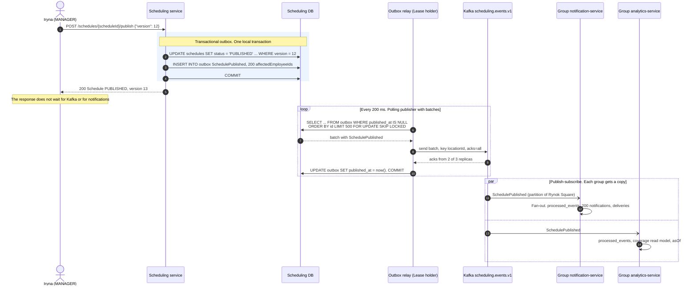

Fan-out, deduplication, delivery and the dead-letter topic.

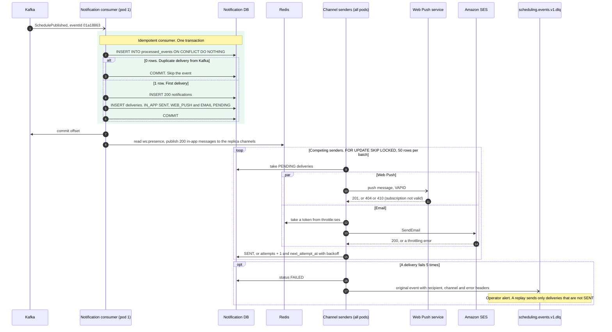

### Edge cases and failure handling

1. **Relay crash after the Kafka ack, before the update of `published_at`.** The transaction of the relay rolls back. The next relay sends the same rows again. The consumers skip the duplicates with `processed_events`.
1. **Kafka not available.** The relay retries. The outbox grows, but API-06 still succeeds, because it does not depend on Kafka. An alert starts when the oldest unpublished row is older than 60 s. No event is lost, but REQ-PERF-002 is at risk during the outage.
1. **Outbox write fails.** The outbox insert is part of the publish transaction, so the whole transaction rolls back. API-06 returns 503 `SERVICE_UNAVAILABLE`. The schedule stays `DRAFT` with `version` 12, so a retry with the same version works.
1. **Consumer crash after the database commit, before the offset commit.** Kafka delivers the event again to another pod. `processed_events` and the unique key of `deliveries` stop duplicate messages.
1. **Poison message.** An example is an event with an unknown `schemaVersion`. The handler fails 5 times, with a backoff of 1 s, 2 s, 4 s and 8 s. Then the message goes to `scheduling.events.v1.dlq`. The consumer commits the offset, so the partition continues.
1. **Outage of the own database.** The cause of this error is not in the message, and every message fails. Thus the consumer pauses the partition and retries until the database is available again. It does not send these messages to the dead-letter topic.
1. **SES throttling.** The token bucket keeps the rate below the quota. If SES still returns a throttling error, the sender retries with backoff. The in-app notification exists already.
1. **Expired push subscription.** The Web Push service returns 404 or 410. The sender deletes the subscription and marks the delivery `FAILED` without a retry.
1. **Member deactivated between the publish and the delivery.** The Notification service keeps a local copy of the members from `organization.events.v1`. It skips recipients with the status `DEACTIVATED`.

### What the client sees

- Iryna gets 200 with `status: "PUBLISHED"` and `version` 13 at once. The response does not wait for the notifications. The errors of API-06 are 409 `VERSION_CONFLICT`, 409 `SCHEDULE_ALREADY_PUBLISHED`, 422 `SCHEDULE_NOT_PUBLISHABLE` and 503 `SERVICE_UNAVAILABLE` ([error handling design](03-error-handling.md)).
- Olena and Taras get an in-app notification within seconds. If the WebSocket is closed, the SPA loads `GET /me/notifications` when it connects again.
- A manager who opens the coverage page (API-12) sees the `asOf` time of the read model. The normal lag is less than 5 s.

### Alternatives considered

| Alternative | Why the team did not choose it |
|---|---|
| Dual write (commit, then send) | Lost events or events without a commit. |
| Change data capture (Debezium on the PostgreSQL WAL) | Lower latency and strict commit order, but it needs a Kafka Connect cluster and logical replication slots on RDS. A stuck slot fills the disk. It is an option if the event volume grows. |
| Notifications in the request | Long requests, and an SES failure fails the publish. |
| Kafka transactions (exactly-once semantics) | They cover read-process-write inside Kafka only. They do not cover PostgreSQL, SES and Web Push. |
| Amazon SNS with Amazon SQS | Managed fan-out and dead-letter queues, but no replay of old events for the read models. The architecture uses Kafka ([architecture document](02-architecture.md)). |
| Relay on all replicas at the same time | Higher throughput, but two batches can arrive in Kafka out of order. One relay per service is enough: one publish creates one event, and the fan-out happens in the consumer. |

## 9. CS-6: background jobs run exactly once on N replicas

### Use case

Each service runs at least 2 replicas. Three jobs must run on one replica at a time:

| Job | Service | Lease | Interval | Effect |
|---|---|---|---|---|
| Trade expiry | Trade service | `trade-expiry-leader` | Every 60 s | Pending trade requests after `expires_at` become `EXPIRED`. The job emits `TradeExpired` and `ReleaseTradeLocks`. |
| Shift reminders | Notification service | `reminder-leader` | Every 5 min | One reminder to each assigned employee 12 h before the shift start |
| Nightly rollup | Analytics service | `analytics-rollup-leader` | Every hour | For each location where the local time is between 02:00 and 03:00, it computes the rollup rows of the previous local day again. |

In this scenario, Taras did not accept the trade request `1a2b3c4d-5e6f-4a7b-8c9d-0e1f2a3b4c5e` on Monday. The request is `PENDING_PEER` and expires at `2026-11-04T08:00:00+02:00`.

### Problem without the pattern

- **Every replica runs the job.** Two replicas expire the same trade requests at the same time. Olena gets "Your trade request expired" twice, Taras gets two reminders for one shift, and two rollups write the same rows.
- **A lease without fencing.** Replica A is the leader. A stop-the-world pause (garbage collection, CPU throttling, a frozen virtual machine) stops it for longer than the lease. Replica B becomes the leader. Then A continues and writes with old data. This is the stalled leader problem that Martin Kleppmann describes.

| Time | Replica A (token 42) | Replica B | Result without fencing |
|---|---|---|---|
| 02:15:00 | Leader. Reads the facts of 2026-11-03 for Rynok Square. | Candidate | — |
| 02:15:01 | Pause of 20 s | — | — |
| 02:15:16 | — | The lease expired. B becomes the leader (token 43). | — |
| 02:15:17 | — | Reads the facts and a late `ShiftClaimed` event. Writes `coverage_daily`. | Correct totals |
| 02:15:21 | Continues. Writes `coverage_daily` with the old totals. | — | The old totals overwrite the correct totals. |

### Pattern

- **Leader election.** The replicas elect one leader. Only the leader runs the job. If the leader fails, another replica takes over. A Kubernetes Lease (`coordination.k8s.io/v1`) is a small object in the Kubernetes API with a holder and a duration. Kubernetes components use the same object for their own leader election [R19, R20].
- **Fencing token.** Each new leader gets a number that is larger than all earlier numbers. The storage rejects a write with a number that is smaller than the largest number that it saw. Thus a stalled leader cannot write after a new leader started [R21].
- **Idempotent conditional update.** The write of the job is safe to repeat. It changes only the rows that are still in the expected state.

### How Shift Happens applies it

**Lease.**

```yaml
apiVersion: coordination.k8s.io/v1
kind: Lease
metadata:
  name: trade-expiry-leader
spec:
  holderIdentity: trade-service-7c9f8d6b5-x2k4p   # pod name of the leader
  leaseDurationSeconds: 15
  acquireTime: "2026-11-04T05:58:41.000000Z"
  renewTime: "2026-11-04T05:59:56.000000Z"
  leaseTransitions: 6
```

| Setting | Value |
|---|---|
| Lease duration | 15 s |
| Renewal by the leader | Every 5 s |
| Renew deadline | 10 s. A leader that cannot renew for 10 s stops the job before its lease expires. |
| Attempts of the candidates | Every 5 s. A candidate takes the lease only after it saw no change of `renewTime` for 15 s. |
| Concurrency of the lease update | The Kubernetes API checks `resourceVersion`. Of two candidates, one gets 409 Conflict and stays a candidate. |
| Access | The deployment manifests create the Lease objects. The service account of the service can only `get` and `update` its own Lease names. |

**Fencing token.** Each service database has a sequence and two tables. The architecture document lists `job_runs`; `job_fences` holds one row per job.

```sql
CREATE SEQUENCE job_fencing_token_seq;

CREATE TABLE job_fences (
  job       text   PRIMARY KEY,            -- 'trade-expiry', 'shift-reminders', 'analytics-rollup'
  max_token bigint NOT NULL DEFAULT 0
);

CREATE TABLE job_runs (
  id            bigint GENERATED ALWAYS AS IDENTITY PRIMARY KEY,
  job           text        NOT NULL REFERENCES job_fences (job),
  fencing_token bigint      NOT NULL,
  holder        text        NOT NULL,      -- pod name
  started_at    timestamptz NOT NULL DEFAULT now(),
  finished_at   timestamptz,
  rows_changed  integer
);

-- When a replica becomes the leader:
SELECT nextval('job_fencing_token_seq');                                   -- for example 43
UPDATE job_fences SET max_token = 43 WHERE job = 'trade-expiry' AND max_token < 43;
```

**One run of the trade expiry job.**

```sql
BEGIN;
-- FOR SHARE blocks the token update of a new leader until this run commits.
SELECT max_token FROM job_fences WHERE job = 'trade-expiry' FOR SHARE;
-- max_token > $1: ROLLBACK, stop the job and give up the leadership.

INSERT INTO job_runs (job, fencing_token, holder) VALUES ('trade-expiry', $1, $2);

UPDATE trade_requests
SET status = 'EXPIRED', version = version + 1, updated_at = now()
WHERE id IN (
        SELECT id FROM trade_requests
        WHERE status IN ('PENDING_PEER', 'PENDING_MANAGER')
          AND expires_at < now()
        ORDER BY expires_at
        LIMIT 500
        FOR UPDATE SKIP LOCKED)
  AND status IN ('PENDING_PEER', 'PENDING_MANAGER')
  AND $1 >= (SELECT max_token FROM job_fences WHERE job = 'trade-expiry')
RETURNING id, location_id;

-- For each returned id: INSERT INTO outbox TradeExpired (trade.events.v1)
-- and ReleaseTradeLocks (trade.commands.v1).
COMMIT;
-- If the batch had 500 rows, run again at once.
```

- The conditional update is idempotent. A second run changes 0 rows and emits no event.
- `SKIP LOCKED` lets the job skip a row that a user request (API-10 or API-11) holds now. The next run handles the row if it is still pending.
- The API applies the same rule: API-10 and API-11 change a trade request only `WHERE … AND expires_at > now()`. If the deadline passed and the job did not run yet, the API expires the request in its own transaction and returns 409 `TRADE_NOT_PENDING`. Thus a delay of the job never lets a user accept an expired trade request.

**The two other jobs use the same fence.**

```sql
-- Shift reminders (notification_db): send only if this insert creates the row.
INSERT INTO reminders_sent (shift_id, employee_id, fencing_token)
SELECT $2, $3, $1
WHERE $1 >= (SELECT max_token FROM job_fences WHERE job = 'shift-reminders')
ON CONFLICT (shift_id, employee_id) DO NOTHING
RETURNING shift_id;

-- Nightly rollup (analytics_db): only the newest leader can overwrite a row.
INSERT INTO coverage_daily (location_id, day, required_slots, filled_slots, unfilled_shifts, fencing_token)
VALUES ($2, $3, $4, $5, $6, $1)
ON CONFLICT (location_id, day) DO UPDATE
SET required_slots  = EXCLUDED.required_slots,
    filled_slots    = EXCLUDED.filled_slots,
    unfilled_shifts = EXCLUDED.unfilled_shifts,
    fencing_token   = EXCLUDED.fencing_token
WHERE $1 >= (SELECT max_token FROM job_fences WHERE job = 'analytics-rollup');
```

| Job | Without fencing, a stalled leader can | Guards |
|---|---|---|
| Trade expiry | Nothing more. The conditional update changes only pending rows. | Conditional update. The fence is a second guard. |
| Shift reminders | Send a reminder twice | Primary key of `reminders_sent`, fence |
| Nightly rollup | Overwrite correct totals with old totals | Fence. Here the fence is necessary. |

Not every job needs a leader. The daily cleanups of `idempotency_records` and `outbox` delete rows with an idempotent `DELETE`, so they can run on all replicas.

### Sequence diagram

Leader failover and fencing.

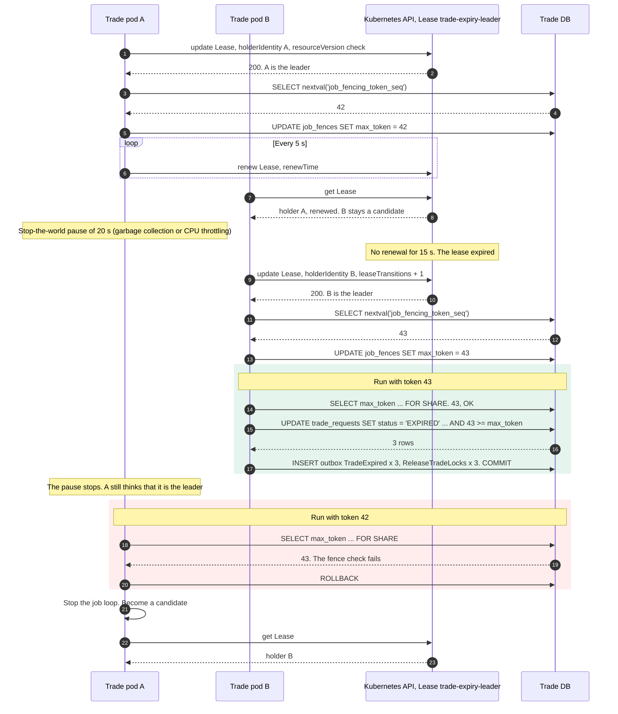

An accept (API-10) and the expiry job at the same time.

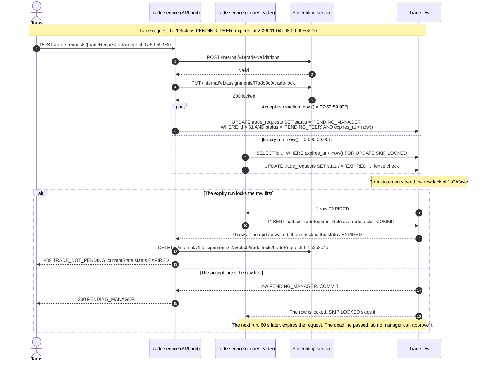

### Edge cases and failure handling

1. **Stalled leader.** A pause longer than 15 s lets another replica take the lease. The fence check of the old leader fails, and it stops its job loop.
1. **Leader crash.** The lease expires after at most 15 s. A candidate takes it within 20 s. The next run finds all overdue rows, because the conditional update selects them by state and time, not by the time of the last run.
1. **Network partition between the leader and the Kubernetes API.** The leader cannot renew. After the renew deadline of 10 s, it stops the job. The lease expires after 15 s, so a 5 s gap separates the old leader and the new leader. The fence covers the case where the gap is not enough.
1. **Clock skew.** A candidate measures the 15 s with its local monotonic timer. The timer starts when the candidate sees the last change of the Lease. The candidate does not compare the `renewTime` value with its own clock. The job compares `expires_at` with the database clock.
1. **Leader that renews but does not work.** If a run does not finish within 120 s, a watchdog in the pod gives up the lease and restarts the job loop. Thus a stuck job loop cannot keep the leadership.
1. **Backlog after an outage.** The job expires at most 500 rows per transaction, in the order of `expires_at`. It runs again at once until no overdue row is left. Short transactions hold the row locks for a short time.
1. **Kubernetes API not available.** No replica can get the lease, so the jobs pause. The API rule `expires_at > now()` keeps the trade requests correct. Reminders are late. An alert starts.

### What the client sees

| Case | Status and code | SPA reaction |
|---|---|---|
| Taras accepts after the expiry | 409 `TRADE_NOT_PENDING`, `currentState: { "status": "EXPIRED" }` | Reload the trade request. Show "expired". |
| Iryna decides after the expiry | 409 `TRADE_NOT_PENDING`, `currentState: { "status": "EXPIRED" }` | Reload the trade request. Show "expired". |
| Olena and Taras after the expiry | Notification about `TradeExpired` | Show "Your trade request expired. Your shift did not change." |
| Reminder | One notification for each shift and employee | — |
| Coverage page | API-12 shows the correct totals and `asOf` | — |

### Alternatives considered

| Alternative | Why the team did not choose it |
|---|---|
| Kubernetes CronJob with `concurrencyPolicy: Forbid` | The Kubernetes documentation says that a CronJob creates a job "approximately once" per schedule, so the jobs must be idempotent anyway [R22]. It also starts a pod for each run and cannot run more often than once per minute. |
| PostgreSQL advisory lock (`pg_try_advisory_lock`) | Simple, but bound to one database session. An RDS failover or a connection pool can lose or pin the session. It is a possible fallback. |
| Lock in Redis (Redlock) | It depends on timing assumptions, and it still needs fencing tokens [R21]. |
| All replicas share the work with `SKIP LOCKED` | Correct for the trade expiry, because the work is row by row. The rollup needs one writer per location and day. The team uses one mechanism for all three jobs. |
| A Kafka topic with one partition as a "leader" signal | The partition assignment is also a lease, with a slower failover (session timeout). It adds a topic only for coordination. |

## 10. Traceability

Scenarios to requirements:

| Scenario | Functional requirements | Non-functional requirements | API |
|---|---|---|---|
| CS-1 | REQ-FUNC-009, REQ-FUNC-010, REQ-FUNC-016 | REQ-REL-001, REQ-PERF-001 (lock waits of 10–50 ms) | API-07, API-08 |
| CS-2 | REQ-FUNC-007, REQ-FUNC-008 | — | API-05, API-06 |
| CS-3 | REQ-FUNC-011, REQ-FUNC-012, REQ-FUNC-013, REQ-FUNC-014 | REQ-REL-001 (the pivot uses the guards of CS-1) | API-09, API-10, API-11 |
| CS-4 | REQ-FUNC-001, REQ-FUNC-006, REQ-FUNC-010, REQ-FUNC-011, REQ-FUNC-012 | REQ-REL-002 | API-08, API-09 (API-01, API-04 optional) |
| CS-5 | REQ-FUNC-008, REQ-FUNC-017 | REQ-PERF-002, REQ-AVAIL-001 (API-06 does not depend on Kafka) | API-06 |
| CS-6 | REQ-FUNC-015, REQ-FUNC-017 (shift reminders) | REQ-AVAIL-001 (job failover within 20 s) | — (job), API-10, API-11 |

Non-functional requirements to scenarios:

| Requirement | Target | Scenarios and mechanism |
|---|---|---|
| REQ-REL-001 No double booking | Under concurrent requests, the assigned count never exceeds the capacity, and no employee has overlapping active assignments. | CS-1: row locks in a fixed order, `shift_capacity_check`, `assignment_no_overlap`. CS-3: the pivot takes the same locks and checks the rules again. |
| REQ-REL-002 Idempotent writes | A retry with the same `Idempotency-Key` within 24 h never creates a second object. | CS-4: Redis reservation, `idempotency_records` in the business transaction, primary key `(user_id, key)`. |
| REQ-PERF-002 Notification delivery time | After the publish of a schedule with 200 affected employees, 95 % of the in-app notifications arrive within 60 s. | CS-5: outbox relay every 200 ms, 12 partitions, competing consumers, fan-out in one transaction. Budget about 3 s. |

## 11. References

1. [R1] PostgreSQL documentation, "Explicit Locking". <https://www.postgresql.org/docs/current/explicit-locking.html>
1. [R2] PostgreSQL documentation, "SELECT: The Locking Clause". <https://www.postgresql.org/docs/current/sql-select.html#SQL-FOR-UPDATE-SHARE>
1. [R3] PostgreSQL documentation, "Range Types: Constraints on Ranges", and the `btree_gist` module. <https://www.postgresql.org/docs/current/rangetypes.html#RANGETYPES-CONSTRAINT>, <https://www.postgresql.org/docs/current/btree-gist.html>
1. [R4] M. Kleppmann, *Designing Data-Intensive Applications*, O'Reilly, 2017, chapter 7 "Transactions" (write skew, materializing conflicts). <https://dataintensive.net/>
1. [R5] M. Fowler, *Patterns of Enterprise Application Architecture*, "Optimistic Offline Lock". <https://martinfowler.com/eaaCatalog/optimisticOfflineLock.html>
1. [R6] PostgreSQL documentation, "Transaction Isolation". <https://www.postgresql.org/docs/current/transaction-iso.html>
1. [R7] H. Garcia-Molina, K. Salem, "Sagas", ACM SIGMOD 1987. <https://dl.acm.org/doi/10.1145/38713.38742>
1. [R8] C. Richardson, microservices.io, "Pattern: Saga". <https://microservices.io/patterns/data/saga.html>
1. [R9] Microsoft Azure Architecture Center, "Saga distributed transactions pattern". <https://learn.microsoft.com/en-us/azure/architecture/patterns/saga>
1. [R10] Microsoft Azure Architecture Center, "Compensating Transaction pattern". <https://learn.microsoft.com/en-us/azure/architecture/patterns/compensating-transaction>
1. [R11] J. Jena, S. Dalal, D. Tishkin, "The Idempotency-Key HTTP Header Field", `draft-ietf-httpapi-idempotency-key-header-08`, 2026. <https://datatracker.ietf.org/doc/draft-ietf-httpapi-idempotency-key-header/>
1. [R12] Stripe API reference, "Idempotent requests". <https://docs.stripe.com/api/idempotent_requests>
1. [R13] C. Richardson, microservices.io, "Pattern: Transactional outbox". <https://microservices.io/patterns/data/transactional-outbox.html>
1. [R14] C. Richardson, microservices.io, "Pattern: Polling publisher". <https://microservices.io/patterns/data/polling-publisher.html>
1. [R15] Microsoft Azure Architecture Center, "Publisher-Subscriber pattern". <https://learn.microsoft.com/en-us/azure/architecture/patterns/publisher-subscriber>
1. [R16] Microsoft Azure Architecture Center, "Competing Consumers pattern". <https://learn.microsoft.com/en-us/azure/architecture/patterns/competing-consumers>
1. [R17] C. Richardson, microservices.io, "Pattern: Idempotent Consumer". <https://microservices.io/patterns/communication-style/idempotent-consumer.html>
1. [R18] Microsoft Azure Architecture Center, "Rate Limiting pattern". <https://learn.microsoft.com/en-us/azure/architecture/patterns/rate-limiting-pattern>
1. [R19] Microsoft Azure Architecture Center, "Leader Election pattern". <https://learn.microsoft.com/en-us/azure/architecture/patterns/leader-election>
1. [R20] Kubernetes documentation, "Leases". <https://kubernetes.io/docs/concepts/architecture/leases/>
1. [R21] M. Kleppmann, "How to do distributed locking", 2016 (fencing tokens). <https://martin.kleppmann.com/2016/02/08/how-to-do-distributed-locking.html>
1. [R22] Kubernetes documentation, "CronJob: CronJob limitations". <https://kubernetes.io/docs/concepts/workloads/controllers/cron-jobs/#cron-job-limitations>
1. [R23] IETF RFC 9110, "HTTP Semantics" (section 9.2.2 idempotent methods, section 13 conditional requests). <https://www.rfc-editor.org/rfc/rfc9110.html>
1. [R24] IETF RFC 8785, "JSON Canonicalization Scheme (JCS)". <https://www.rfc-editor.org/rfc/rfc8785>
1. [R25] Apache Kafka documentation, section "Design" (message delivery semantics, consumer groups, idempotent producer). <https://kafka.apache.org/documentation/>
1. [R26] Amazon SES Developer Guide, "Managing your Amazon SES sending quotas". <https://docs.aws.amazon.com/ses/latest/dg/manage-sending-quotas.html>
