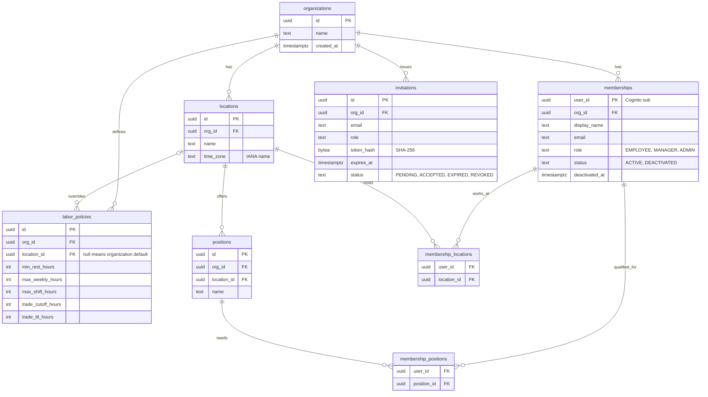
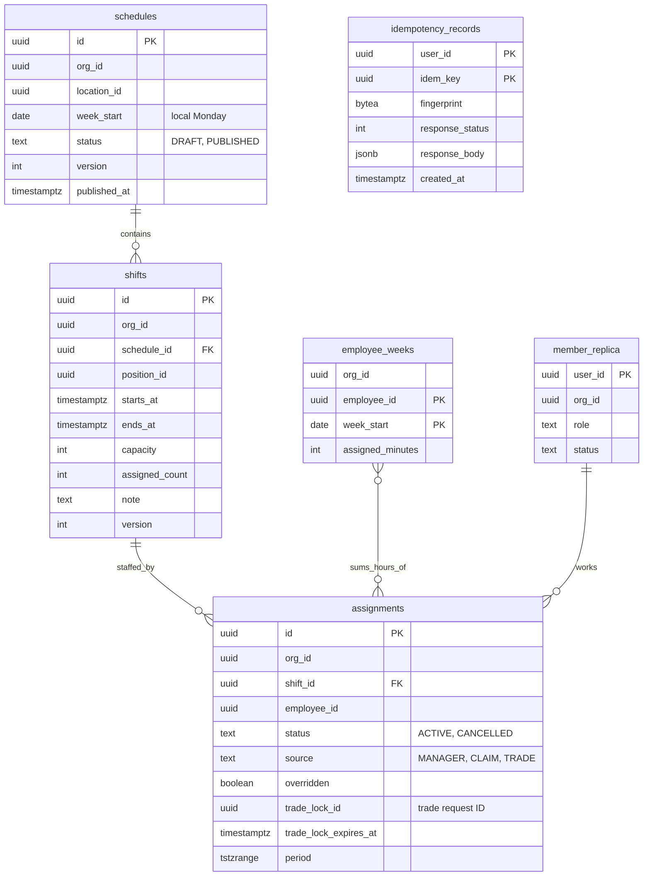
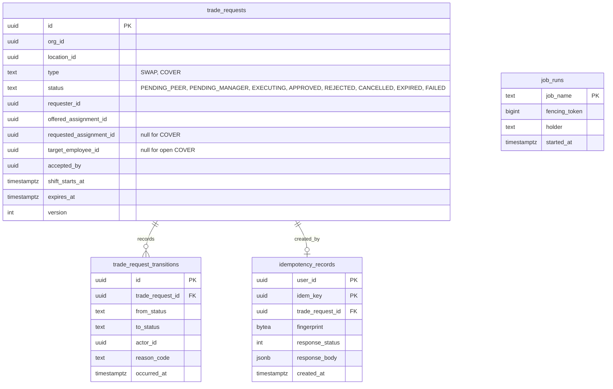
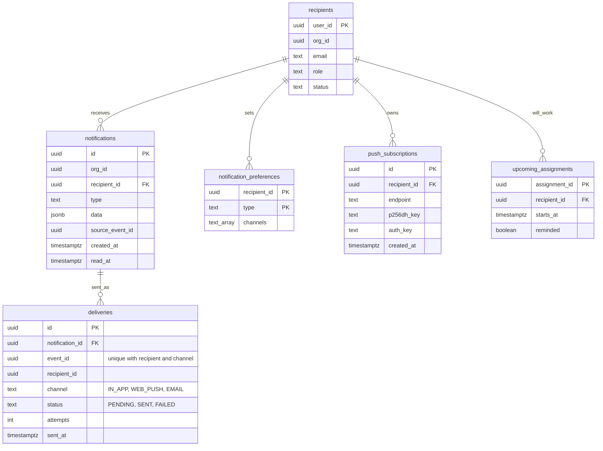
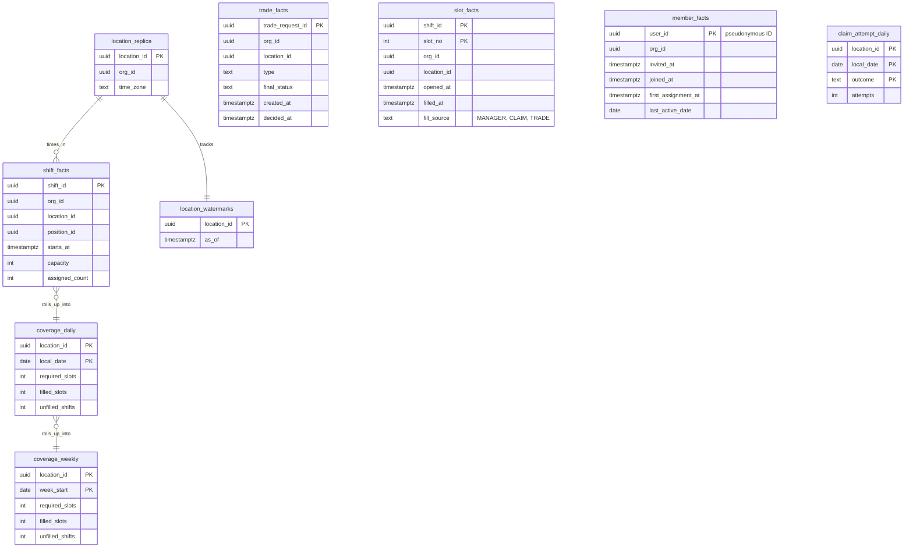

# Shift Happens data model

| Item | Value |
|---|---|
| Deliverable | 7. Data model |
| Version | 1.0 |
| Date | 2026-11-14 |
| Authors | Shift Happens team, Faculty of Applied Mathematics and Informatics, Ivan Franko National University of Lviv |
| Related documents | [Architecture](02-architecture.md), section 7 · [Concurrency patterns](04-concurrency.md) · [SRS](01-srs.md), section 3.4 |

**Revision history**

| Version | Date | Author | Change |
|---|---|---|---|
| 1.0 | 2026-11-14 | Shift Happens team | First release for deliverable 7. |

## Contents

1. [Summary](#1-summary)
1. [Entity-relationship diagrams](#2-entity-relationship-diagrams)
1. [Entity descriptions](#3-entity-descriptions)
1. [Indexes, constraints and partitions](#4-indexes-constraints-and-partitions)
1. [Data classification and retention policy](#5-data-classification-and-retention-policy)
1. [Consistency](#6-consistency)
1. [Consensus](#7-consensus)
1. [Batching](#8-batching)
1. [Streaming](#9-streaming)
1. [Related documents](#10-related-documents)

## 1. Summary

The [architecture](02-architecture.md) gives each service its own PostgreSQL database. This document defines the entities of these databases, their keys and constraints, the data classes with their retention rules, and the data movement rules: consistency, consensus, batching and streaming.

| Item | Value |
|---|---|
| Databases | 5 (`organization_db`, `scheduling_db`, `trade_db`, `notification_db`, `analytics_db`), each on Amazon RDS for PostgreSQL 16, Multi-AZ |
| Entities in this document | 48 tables in 5 databases, grouped in the [ER diagrams](#2-entity-relationship-diagrams) |
| Tenant key | `org_id` on every tenant table, with row-level security ([architecture](02-architecture.md), section 7.2) |
| IDs | UUID v7 (time-ordered). The ID of a member is the Cognito `sub`. |
| Times | `timestamptz` in UTC. A location has an IANA time zone for local days and weeks. |
| Cross-service references | By ID only. No foreign key crosses a database. |
| Messaging | Transactional outbox, Kafka, idempotent consumers ([architecture](02-architecture.md), section 6) |

## 2. Entity-relationship diagrams

The diagrams show the entities of one database each. A line inside a diagram is a foreign key. A reference to a table of another service has no line. The text under each diagram names it.

### 2.1 Organization service (`organization_db`)

The tables `audit_log` and `outbox` also exist in this database. Their columns are the same in all services ([section 3.6](#36-shared-technical-tables)), so the diagram leaves them out.

### 2.2 Scheduling service (`scheduling_db`)

The replicas `location_replica`, `position_replica` and `labor_policy_replica` have the same shape as the source tables in `organization_db`. The tables `audit_log`, `outbox` and `processed_events` are shared technical tables ([section 3.6](#36-shared-technical-tables)).

### 2.3 Trade service (`trade_db`)

### 2.4 Notification service (`notification_db`)

### 2.5 Analytics service (`analytics_db`)

### 2.6 References between databases

The services refer to each other's data by ID. The consumer keeps a local replica when it needs more than the ID.

| From (column) | To | How the service gets the data |
|---|---|---|
| `schedules.location_id`, `shifts.position_id` | `locations`, `positions` in `organization_db` | `location_replica`, `position_replica` |
| `assignments.employee_id` | `memberships.user_id` in `organization_db` | `member_replica` |
| `trade_requests.offered_assignment_id`, `requested_assignment_id` | `assignments.id` in `scheduling_db` | Internal API "verify assignment", then the saga ([concurrency patterns](04-concurrency.md), CS-3) |
| `notifications.recipient_id` | `memberships.user_id` in `organization_db` | `recipients` |
| `upcoming_assignments.assignment_id` | `assignments.id` in `scheduling_db` | Events `AssignmentCreated` and `AssignmentCancelled` |
| `shift_facts.shift_id`, `trade_facts.trade_request_id` | `shifts`, `trade_requests` | Events on `scheduling.events.v1` and `trade.events.v1` |

## 3. Entity descriptions

### 3.1 Organization service

| Entity | Purpose | Key columns and rules |
|---|---|---|
| `organizations` | One tenant. The root of all tenant data. | `id`. `name` is unique per deployment. |
| `locations` | A workplace with a time zone. | `time_zone` is an IANA name. All local days and weeks use it. |
| `positions` | A job type at one location. | Unique on `(location_id, name)`. |
| `labor_policies` | Labor rules of the organization (`location_id` is null) or of one location. | A location row overrides the organization row. Values have checks, for example `min_rest_hours BETWEEN 0 AND 24`. |
| `memberships` | The link between a Cognito user and an organization. | `user_id` is the Cognito `sub`. One role per row. `display_name` and `email` are personal data. |
| `membership_locations`, `membership_positions` | The locations of a member and the positions that the member can work. | Link tables, so queries by location use indexes. |
| `invitations` | An offer to join. | Only the SHA-256 hash of the token is stored. `expires_at` is 7 days after the creation. |

### 3.2 Scheduling service

| Entity | Purpose | Key columns and rules |
|---|---|---|
| `schedules` | The plan of one location for one week. | Unique on `(location_id, week_start)`. `version` for optimistic locking (CS-2). |
| `shifts` | A time interval for one position with a capacity. | Check `ends_at > starts_at` and `assigned_count <= capacity`. `version` for optimistic locking. |
| `assignments` | The link of an employee to a shift. | `period` is `tstzrange(starts_at, ends_at)`. An exclusion constraint blocks overlapping `ACTIVE` rows of one employee (CS-1). `trade_lock_id` and `trade_lock_expires_at` hold the semantic lock of a pending trade. |
| `employee_weeks` | Assigned minutes of one employee in one schedule week. | CS-1 locks this row after the shift row. It makes the weekly hour rule a single-row check. |
| `member_replica`, `location_replica`, `position_replica`, `labor_policy_replica` | Local copies of Organization data. | Updated from `organization.events.v1`. Read only for the rule engine. |
| `idempotency_records` | The stored response of an idempotent request. | Primary key `(user_id, idem_key)`. Deleted after 24 h. |

### 3.3 Trade service

| Entity | Purpose | Key columns and rules |
|---|---|---|
| `trade_requests` | A swap or cover request and its state. | `status` follows the state machine in the [SRS](01-srs.md), appendix B.2. A conditional update on the expected `status` protects each transition. |
| `trade_request_transitions` | History of each status change. | Append only. It holds the actor and the time, and it supports the audit of a trade. |
| `idempotency_records` | The stored response of API-09. | Same shape as in the Scheduling service. |
| `job_runs` | The fencing token of the trade expiry job. | One row per job. The job holder increases `fencing_token` at each start (CS-6). |

### 3.4 Notification service

| Entity | Purpose | Key columns and rules |
|---|---|---|
| `recipients` | Local copy of the members that can get notifications. | Includes the email for the `EMAIL` channel. |
| `notifications` | One message to one member. | `source_event_id` links the message to the event that caused it. |
| `deliveries` | One send attempt record per notification and channel. | Unique key on `(event_id, recipient_id, channel)` blocks a second send after a restart (CS-5). |
| `notification_preferences` | The channels that a member wants for each notification type. | Primary key `(recipient_id, type)`. |
| `push_subscriptions` | The Web Push endpoint and keys of one browser. | The service deletes a row when the Web Push service returns 404 or 410. |
| `upcoming_assignments` | Local copy of future assignments. | The reminders job reads it. No call to the Scheduling service is necessary. |

### 3.5 Analytics service

| Entity | Purpose | Key columns and rules |
|---|---|---|
| `shift_facts` | One row per published shift. | Updated from events. A row is final after `starts_at`. |
| `coverage_daily`, `coverage_weekly` | Rollups of required and filled slots. | The nightly job recomputes the previous local day. Weekly rows are the sum of the daily rows. |
| `trade_facts` | One row per trade request. | Updated from `trade.events.v1`. |
| `location_watermarks` | The freshness (`as_of`) of the data of each location. | API-12 returns this value as `asOf`. |
| `location_replica` | Time zones for local day boundaries. | Updated from `LocationChanged`. |
| `slot_facts` | One row per slot opening and filling. | Supports the metric "time to fill" ([analytics model](09-analytics-model.md), M-05). Updated from `SchedulePublished`, `AssignmentCancelled`, `AssignmentCreated` and `ShiftClaimed`. |
| `member_facts` | One row per member with the key dates of the onboarding. | Pseudonymous ID only. Supports M-15, M-16 and the onboarding funnel. |
| `claim_attempt_daily` | Count of claim attempts per location, local day and outcome code. | Filled by the nightly job from the business counters ([analytics model](09-analytics-model.md), M-06, M-07). |

### 3.6 Shared technical tables

Each service that publishes events or consumes them has these tables with the same columns.

| Table | Columns | Purpose |
|---|---|---|
| `outbox` | `id` (bigint identity), `org_id`, `topic`, `record_key`, `event_id`, `type`, `payload` (jsonb), `traceparent`, `created_at`, `published_at` | Events that wait for the relay. The relay reads rows in the order of `id`. |
| `processed_events` | `event_id` (PK), `consumer`, `processed_at` | Deduplication of consumed events. |
| `audit_log` | `id`, `org_id`, `actor_id`, `action`, `target_type`, `target_id`, `reason`, `trace_id`, `occurred_at` | Append-only security record (REQ-SEC-003). The database user has `INSERT` and `SELECT` only. |

## 4. Indexes, constraints and partitions

| Table | Index or constraint | Reason |
|---|---|---|
| `assignments` | `EXCLUDE USING gist (employee_id WITH =, period WITH &&) WHERE (status = 'ACTIVE')` | Last defense against overlap (extension `btree_gist`) |
| `assignments` | `(shift_id) WHERE status = 'ACTIVE'` | Count and list of active assignments of a shift |
| `assignments` | `(employee_id, period)` GiST | Weekly view of an employee |
| `shifts` | `(schedule_id, starts_at)` | Schedule view in time order |
| `shifts` | `CHECK (assigned_count <= capacity)` | Capacity invariant as a database rule |
| `schedules` | `UNIQUE (location_id, week_start)` | One schedule per location and week |
| `trade_requests` | `(org_id, status, expires_at) WHERE status IN ('PENDING_PEER','PENDING_MANAGER')` | Trade expiry job reads only open requests |
| `trade_requests` | `(requester_id)`, `(target_employee_id)` | "My requests" and "requests for me" lists |
| `deliveries` | `UNIQUE (event_id, recipient_id, channel)` | No duplicate send |
| `notifications` | `(recipient_id, created_at DESC)` | Notification list of a member |
| `outbox` | `(id) WHERE published_at IS NULL` | The relay scans only unpublished rows |
| `invitations` | `UNIQUE (token_hash)` | Lookup at acceptance |
| `memberships` | `(org_id, status)` | Member lists |
| All tenant tables | `(org_id, …)` as the first index column | Row-level security filter and tenant queries |

Partitions:

| Table | Partitioning | Reason |
|---|---|---|
| `audit_log` | Range by `occurred_at`, one partition per month | The team drops a whole partition after 1 year. No slow `DELETE`. |
| `notifications`, `deliveries` | Range by `created_at`, one partition per month | The same cleanup rule. These tables grow fastest. |
| `outbox` | None. Daily `DELETE` of published rows older than 7 days. | The table stays small. |
| `shifts`, `assignments` | None in v1 | A normal organization has far fewer than 10 million rows. The team can partition by `starts_at` later. |

## 5. Data classification and retention policy

### 5.1 Data classes

| Class | Definition | Examples | Protection |
|---|---|---|---|
| **D1 Personal data** | Data that identifies a person | `memberships.display_name`, `email`, `recipients.email`, `invitations.email`, `push_subscriptions` | Encrypted at rest (KMS) and in transit. Never in logs. Access only by the owner service. Deleted or anonymized on request. |
| **D2 Business data** | Tenant data that the organization creates | Schedules, shifts, assignments, trade requests, labor policies, notifications | Tenant isolation (row-level security). Encrypted at rest and in transit. |
| **D3 Security records** | Records that prove who did what | `audit_log`, `trade_request_transitions` | Append only. Encrypted. Longer retention. |
| **D4 Secrets and credentials** | Keys that give access | Database credentials, signing key of `X-Principal`, VAPID private key, `invitations.token_hash` | AWS Secrets Manager. Never in Git, images or logs. Rotation. |
| **D5 Operational data** | Technical data that supports a process | `outbox`, `processed_events`, `idempotency_records`, `job_runs`, Redis keys, Kafka topics | Short retention. No business fact only here. |
| **D6 Derived data** | Data that the system computes from D2 | `shift_facts`, `coverage_*`, `trade_facts` | Rebuildable from events. Contains IDs, not names or emails. |
| **D7 Telemetry** | Logs, metrics and traces | CloudWatch Logs, metrics, X-Ray traces | IDs only. No D1 data. Short retention. |

### 5.2 Retention policy

| Data | Class | Retention | Action at the end | Source of the rule |
|---|---|---|---|---|
| `memberships` (personal columns) of an active member | D1 | While the membership is `ACTIVE` | None | Purpose limitation |
| `memberships` (personal columns) of a deactivated member | D1 | 1 year after `deactivated_at` | Anonymize: set `display_name` to `Former member`, clear `email` | [SRS](01-srs.md), section 3.4 |
| `recipients`, `push_subscriptions` of a deactivated member | D1 | Deleted at the `MemberDeactivated` event | Delete rows | Data minimization |
| `invitations` | D1, D4 | 7 days in `PENDING`, then `EXPIRED`. Rows are deleted 30 days after expiry. | Delete rows | [SRS](01-srs.md), section 3.4 |
| Schedules, shifts, assignments | D2 | 2 years after `starts_at` | Delete (after the analytics facts exist) | Team decision. Longer than payroll disputes in the target market need. |
| Trade requests | D2 | 2 years after the final status | Delete | Team decision |
| Labor policies | D2 | While the organization exists | Delete with the organization | — |
| `notifications` | D2 | 90 days | Drop the monthly partition | Team decision |
| `deliveries` | D5 | 30 days | Drop the monthly partition | Team decision |
| `audit_log`, `trade_request_transitions` (audit part) | D3 | 1 year | Drop the monthly partition | REQ-SEC-003 |
| `idempotency_records` | D5 | 24 h | Daily cleanup | REQ-REL-002 |
| Published `outbox` rows | D5 | 7 days | Daily cleanup | [Architecture](02-architecture.md), section 7.5 |
| `processed_events` | D5 | 30 days | Daily cleanup | [Architecture](02-architecture.md), section 7.5 |
| Kafka event and command topics | D5 | 7 days | Broker retention | [Architecture](02-architecture.md), section 7.5 |
| Kafka dead-letter topics | D5 | 14 days | Broker retention | [Architecture](02-architecture.md), section 7.5 |
| Redis keys | D5 | 30 s to 1 day (see TTL per key) | Key expiry | [Architecture](02-architecture.md), section 7.4 |
| `shift_facts`, `trade_facts` | D6 | 3 years | Delete | Team decision. Longer than D2, because analytics shows trends. |
| `coverage_daily`, `coverage_weekly` | D6 | 3 years | Delete | Same |
| Application logs and traces | D7 | 30 days | CloudWatch retention setting | [SRS](01-srs.md), section 3.4 |
| RDS automated backups | D1 to D6 | 7 days (point-in-time recovery) | Automatic | [Resiliency model](06-resiliency-model.md) |
| Organization after contract end | D1 to D6 | Export for 30 days, then deletion of all rows. Backups expire after 7 more days. | Delete | Team decision |

Deletion on request: support runs the operator runbook of the [SRS](01-srs.md), section 3.4. The runbook removes `display_name` and `email` from `memberships` and `recipients`, deletes `push_subscriptions` and keeps the shift history without personal data. A backup can still hold the personal data for up to 7 days.

## 6. Consistency

The model follows the [architecture](02-architecture.md), section 7.3. This section adds the reason for each choice and the data that each choice covers.

| Rule | Data | Model | Reason |
|---|---|---|---|
| C-1 | `shifts.assigned_count`, `assignments`, `employee_weeks` | Strong (ACID). One local transaction in `scheduling_db`. | The product must not double book (REQ-REL-001). |
| C-2 | `schedules`, `shifts` edits | Strong with optimistic locking (`version`) | Two managers must not overwrite each other silently (CS-2). |
| C-3 | `trade_requests.status` | Strong inside `trade_db`. Conditional update on the expected status. | One state machine, one writer. |
| C-4 | Trade across `trade_db` and `scheduling_db` | Eventual. Saga with trade locks and compensation. | No distributed transaction (CS-3). |
| C-5 | Replicas, notifications, analytics | Eventual. Normal lag under 5 s. | Services stay independent. `asOf` shows the age. |
| C-6 | A write and its event | Atomic through the outbox | The event exists if and only if the change exists. |
| C-7 | Reads after a write in the SPA | Read-your-writes from the write response | The user sees the own change at once. |

**CAP trade-off.** During a network partition, the system prefers consistency for writes in `scheduling_db` (the write fails with 503) and availability for reads of replicas and read models (they serve older data with `asOf`). This is a CP choice for the invariants and an AP choice for the derived views.

**Isolation level.** Writes use `READ COMMITTED` with explicit row locks (`SELECT … FOR UPDATE`) in a fixed lock order. The exclusion constraint closes the gap that row locks cannot close ([concurrency patterns](04-concurrency.md), section 2.2).

## 7. Consensus

The system does not implement a consensus algorithm. It uses managed components that do. The table shows where agreement between nodes happens and what the effect is for Shift Happens.

| Component | Consensus mechanism | What it protects | Effect on the design |
|---|---|---|---|
| Amazon RDS Multi-AZ | Synchronous replication to a standby in another Availability Zone. The service commits only after the standby has the log. | A committed claim survives the loss of one zone. RPO is 0 for committed data. | A failover takes 60 to 120 s. Writes fail with 503 during this time ([resiliency model](06-resiliency-model.md)). |
| Amazon MSK | Partition leader and followers. A record is committed when all in-sync replicas have it. `acks=all` and `min.insync.replicas=2`. The controller quorum uses KRaft, a Raft-based protocol. | An event that the relay marked as published is not lost when one broker fails. | With 3 brokers, the cluster tolerates the loss of one broker for writes. With 2 brokers lost, producers get errors and the outbox holds the events. |
| Amazon ElastiCache for Redis | Primary and replica per shard. Asynchronous replication with automatic failover. | Nothing critical. | A failover can lose the last writes. The design assumes this: Redis holds only rebuildable data ([architecture](02-architecture.md), section 7.4). |
| Kubernetes (Amazon EKS) | The control plane stores state in etcd, a Raft-based store. A Lease object gives a leader. | Exactly one runner for background jobs and for the outbox relay (CS-6). | A Lease can expire in a pause. The job holder must also check its fencing token in the database before each effect. |
| Amazon Cognito | Managed by AWS | Sign-in and tokens | No design choice for the team. |

Leader election for jobs uses two layers. The Lease picks a leader, and the `fencing_token` in `job_runs` rejects a leader that lost its Lease but still runs. A stale leader cannot write, because its token is lower than the current one ([concurrency patterns](04-concurrency.md), CS-6).

## 8. Batching

| Place | Batch | Size and interval | Reason |
|---|---|---|---|
| Outbox relay → Kafka | Read unpublished rows and send them together | At most 500 rows every 200 ms | Fewer round trips. Order stays by `id`. |
| Kafka producer | The client groups records per partition | `linger.ms` 5, `batch.size` 64 KiB, compression `lz4` | Higher throughput at low delay |
| Kafka consumer | One poll returns many records. The service processes them in one database transaction. | `max.poll.records` 200 | One commit per batch lowers the database load. The `processed_events` check stays per event. |
| Notification fan-out | One event creates many notifications | Insert 200 `notifications` rows in one statement, then send per channel | The publication of a schedule is the largest burst (CS-5) |
| Web Push and email | Send in groups per channel | Up to 50 concurrent sends per replica, with the circuit breaker per channel | Do not exceed the limits of SES and the push services |
| Analytics rollup (batch job) | Recompute the previous local day for each location | Hourly job, only locations with local time 02:00 to 03:00 | A full recompute is simple and repeatable. It also repairs late events. |
| Retention cleanup (batch job) | Delete expired rows | Daily at 03:30 UTC. Up to 10 000 rows per statement, or drop a partition. | Short transactions. No long locks. |
| Backup (batch job) | RDS automated snapshot and transaction logs | Daily snapshot, logs every 5 min | Point-in-time recovery |

A batch never crosses the tenant boundary inside one statement without the job database user, because row-level security applies to the normal user.

## 9. Streaming

| Stream | Source | Processing | Target |
|---|---|---|---|
| Domain events | Outbox of the Organization, Scheduling and Trade services | Kafka topics `organization.events.v1`, `scheduling.events.v1`, `trade.events.v1` with the key `orgId` or `locationId`. The key keeps the order inside one location. | Consumers of the next three rows |
| Replicas | `organization.events.v1` | Each consumer applies the events to its replica tables. A new replica starts from the oldest event in the topic, or from a snapshot, then reads the stream. | `member_replica`, `location_replica`, `recipients` and others |
| Notifications | All event topics | The Notification service maps an event to messages, writes `notifications` and `deliveries`, and sends them | WebSocket, Web Push, email |
| Coverage read model | `scheduling.events.v1`, `trade.events.v1` | The Analytics service updates `shift_facts`, the daily rows of today and `location_watermarks` per event (stream processing). The nightly rollup repairs the older days (batch processing). | `analytics_db` |
| Commands | `trade.commands.v1` | The Trade service orchestrates the saga. The Scheduling service executes `ExecuteTrade` and `ReleaseTradeLocks`. | `scheduling_db` |
| Poison messages | Any consumer | After 5 failed attempts, the message goes to `<topic>.dlq` and raises an alert | Operators |

**Replay.** A consumer can replay the last 7 days from Kafka. The analytics read model uses this to repair itself ([architecture](02-architecture.md), section 5.6). For older data, the team rebuilds D6 from `scheduling_db` and `trade_db` with a batch job that runs under the job database user.

**Ordering and duplicates.** Kafka keeps the order inside a partition. Delivery is at-least-once, so every consumer is idempotent through `processed_events` or a unique key. An event that arrives out of order across two topics is safe, because each handler is an upsert on the aggregate ID and checks the aggregate `version` or `occurredAt`.

**Schema evolution.** An event payload changes only by adding optional fields. The `schemaVersion` field tells the consumer which fields to expect ([architecture](02-architecture.md), section 9.6).

## 10. Related documents

| Document | Content |
|---|---|
| [Architecture](02-architecture.md) | Ownership of data, Kafka topics, Redis keys |
| [Concurrency patterns](04-concurrency.md) | Locks, optimistic locking, saga, idempotency, jobs |
| [Resiliency model](06-resiliency-model.md) | Failures of RDS, MSK and Redis |
| [Security model](07-security-model.md) | Protection of D1 and D4 data |
| [Analytics model](09-analytics-model.md) | Metrics built from the D6 data |
| [SRS](01-srs.md) | Requirements and compliance rules |
