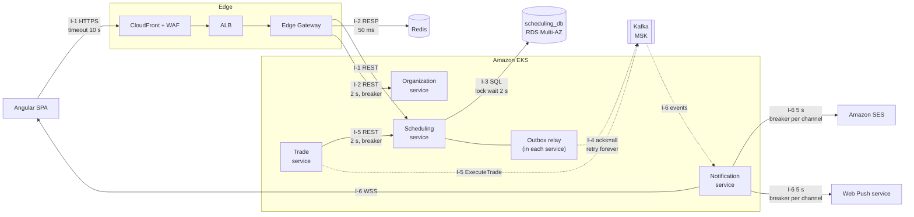
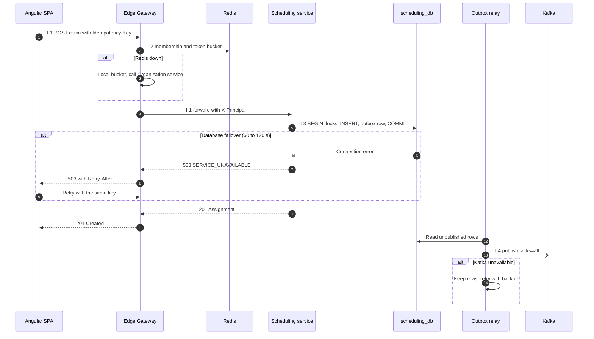

# Shift Happens resiliency model

| Item | Value |
|---|---|
| Deliverable | 8. Resiliency model |
| Version | 1.0 |
| Date | 2026-11-14 |
| Authors | Shift Happens team, Faculty of Applied Mathematics and Informatics, Ivan Franko National University of Lviv |
| Related documents | [Architecture](02-architecture.md), sections 5, 6 and 11 · [Concurrency patterns](04-concurrency.md) · [Error handling design](03-error-handling.md) |

**Revision history**

| Version | Date | Author | Change |
|---|---|---|---|
| 1.0 | 2026-11-14 | Shift Happens team | First release for deliverable 8. |

## Contents

1. [Summary](#1-summary)
1. [Interaction model](#2-interaction-model)
1. [Component interaction diagram](#3-component-interaction-diagram)
1. [Failure model: RMA workbook](#4-failure-model-rma-workbook)
1. [Resiliency settings](#5-resiliency-settings)
1. [Recovery objectives](#6-recovery-objectives)
1. [Recovery procedures](#7-recovery-procedures)
1. [Failure tests](#8-failure-tests)
1. [Related documents](#9-related-documents)

## 1. Summary

The resiliency model answers this question: what happens to the user when a part of the system fails, and how does the system recover? The model has two parts. The interaction model lists the 6 most important interactions between components and the settings that protect them. The failure model is a Resilience Modeling and Analysis (RMA) workbook. It lists 18 failure modes (3 for each interaction) with the effect, the risk, the detection, the mitigation and the recovery.

The design follows five rules:

1. **Do not lose a committed fact.** A change is in PostgreSQL, and the event is in the outbox in the same transaction.
1. **Fail fast and tell the client.** A timeout is short. A failed call returns a problem details body with `Retry-After` ([error handling design](03-error-handling.md)).
1. **Degrade, do not stop.** When a non-critical part fails (notifications, analytics, cache), the core flows (claim, publish, trade) continue.
1. **Make every retry safe.** Writes are idempotent or protected by state checks ([concurrency patterns](04-concurrency.md), CS-4).
1. **Isolate failures.** One database per service, one circuit breaker and one connection pool per dependency.

## 2. Interaction model

Each row is one interaction between two components. The criticality shows what the user loses when the interaction fails: `High` stops a core flow, `Medium` lowers the quality, `Low` has no direct user effect.

| ID | Interaction | From → to | Style | Protocol | Criticality | Timeout | Retry | Circuit breaker | Fallback |
|---|---|---|---|---|---|---|---|---|---|
| I-1 | Authenticated API request | SPA → CloudFront → ALB → Edge Gateway → service | Sync | HTTPS/REST | High | 10 s at the gateway | 1 retry for `GET` only | One per upstream service | 503 `SERVICE_UNAVAILABLE` with `Retry-After` |
| I-2 | Membership context and rate limit | Edge Gateway → Redis, Organization service | Sync | RESP over TLS, HTTP | High | Redis 50 ms, Organization 2 s | 1 | Yes, for the Organization service | Per-replica token bucket and a direct Organization call |
| I-3 | Claim transaction | Scheduling service → `scheduling_db` | Sync | SQL over TLS | High | Statement 3 s, lock wait 2 s | None in code. The client retries with the same key. | None. A connection pool limits the load. | 503 `SERVICE_UNAVAILABLE`, 409 on a conflict |
| I-4 | Event publication | Outbox relay → Kafka (MSK) | Async | Kafka over TLS | High (for the integration) | Producer delivery timeout 30 s | Infinite, with backoff up to 10 s | Not used. The outbox is the buffer. | Events wait in the outbox |
| I-5 | Trade orchestration | Trade service → Scheduling service (REST) and `trade.commands.v1` (Kafka) | Sync and async | HTTP, Kafka | High | 2 s | 1, after 100 ms with jitter | Opens at 50 % failures in the last 20 calls, half-open after 30 s | 503 `SERVICE_UNAVAILABLE` with `Retry-After: 30` |
| I-6 | Notification delivery | Notification service → SES, Web Push service, WebSocket | Async | HTTPS, WSS | Medium | 5 s | 5 attempts: 1 s, 2 s, 4 s, 8 s, then the dead-letter topic | One per channel | The in-app list in `notification_db` |

## 3. Component interaction diagram

The diagram shows the components and the six interactions. Dashed lines are asynchronous. Each label gives the interaction ID and the protection that matters most.

The next diagram shows the claim flow with the failure points. It uses the interaction IDs.

## 4. Failure model: RMA workbook

### 4.1 How to read the workbook

| Column | Meaning |
|---|---|
| ID | `F-<interaction>.<number>` |
| Failure mode | What breaks |
| Cause | The usual reason |
| Effect | What the user or the system sees if nothing protects it |
| S | Severity of the effect: 1 (minor) to 5 (data loss or security impact) |
| L | Likelihood: 1 (rare) to 5 (weekly) |
| Risk | S × L. 1 to 6 is low, 7 to 12 is medium, 13 to 25 is high. |
| Detection | The signal that shows the failure ([monitoring model](10-monitoring-alerting-model.md)) |
| Mitigation | The design measure that limits the effect |
| Recovery | How the system or an operator returns to normal |

### 4.2 I-1: Authenticated API request

| ID | Failure mode | Cause | Effect | S | L | Risk | Detection | Mitigation | Recovery |
|---|---|---|---|---|---|---|---|---|---|
| F-1.1 | One Edge Gateway pod crashes or is stopped | Out-of-memory, node loss, deployment | Requests on this pod fail. In-flight requests get a connection error. | 2 | 4 | 8 | ALB target health, pod restarts, 5xx ratio | Minimum 2 replicas across 3 zones. PodDisruptionBudget. Readiness probe. The SPA retries a `GET` once. | Kubernetes restarts the pod. The ALB sends traffic to healthy pods in less than 30 s. |
| F-1.2 | An upstream service is slow (for example the Scheduling service) | A slow query, a lock wait, a noisy neighbor | The gateway waits up to 10 s. Threads pile up. The p95 target is lost (REQ-PERF-001). | 4 | 3 | 12 | Latency p95 per route, upstream timeouts | Timeout 10 s. Circuit breaker per upstream. Bulkhead: a separate connection pool per upstream, so one slow service does not use all connections. Load shedding ([section 5.4](#54-load-shedding)). | The breaker opens, the gateway returns 503 with `Retry-After`. It closes after a successful half-open probe. |
| F-1.3 | The CloudFront or WAF layer blocks valid traffic | A false positive of a WAF managed rule, or an IP limit hit by a shared office address | Members of one office get 403 or 429 on the first request | 3 | 2 | 6 | WAF blocked-request metric, support tickets | WAF rule group in `count` mode for 7 days before `block`. The IP limit (2000 per 5 min) is above the use of an office of 200 employees. | An operator adds an exception rule. The team reviews the rule in the next release. |

### 4.3 I-2: Membership context and rate limit

| ID | Failure mode | Cause | Effect | S | L | Risk | Detection | Mitigation | Recovery |
|---|---|---|---|---|---|---|---|---|---|
| F-2.1 | Redis is not available | ElastiCache failover, network fault | No cached membership, no shared rate limit | 3 | 3 | 9 | Redis connection errors, cache hit ratio | The gateway calls the Organization service on each request and uses an in-memory bucket per replica. The WAF IP limit stays active. | Automatic failover in about 30 s. The cache fills again in 60 s. |
| F-2.2 | A stale membership in the cache | Lost `MemberDeactivated` or `MembershipChanged` event, consumer lag | A deactivated member keeps access for up to 60 s | 4 | 2 | 8 | Consumer lag of the gateway group, `MemberDeactivated` to cache delete time | TTL of 60 s. The Organization service sets the status first, then calls Cognito to sign the user out. | The TTL ends the stale entry. The operator deletes the key for an urgent case. |
| F-2.3 | The Organization service is not available and the cache has no entry | Deployment, database failover | A member without a cache entry gets 503. Members with an entry continue. | 3 | 2 | 6 | Organization 5xx, breaker state | Breaker. Cache TTL 60 s. Retry once after 100 ms. The Organization service has minimum 2 replicas. | The service recovers. Members retry. |

### 4.4 I-3: Claim transaction

| ID | Failure mode | Cause | Effect | S | L | Risk | Detection | Mitigation | Recovery |
|---|---|---|---|---|---|---|---|---|---|
| F-3.1 | RDS Multi-AZ failover | Planned maintenance or a zone fault | All writes of the service fail for 60 to 120 s | 4 | 2 | 8 | Database connection errors, RDS event | The service returns 503 with `Retry-After`. The SPA retries with the same `Idempotency-Key`. No data is lost, because the standby is synchronous (RPO 0). The pool reconnects. | Automatic. The DNS name of the instance points to the new primary. |
| F-3.2 | Lock timeout or deadlock | Many claims for one shift | One request waits for more than 2 s, or the database ends it | 3 | 3 | 9 | `lock_timeout` errors, 409 and 503 rate on claims | Fixed lock order (shift, then employee week). `lock_timeout` 2 s. The service maps the error to 409 `CONFLICT_RETRY` or 503. | The client retries with the same key. |
| F-3.3 | The connection pool is exhausted | A slow query or a traffic burst | New requests wait, then fail with 503 | 4 | 2 | 8 | Pool wait time, active connections | Pool size 20 per pod. Statement timeout 3 s. HPA on CPU. Queue limit of 50 requests, after that the service sheds load with 503. | HPA adds pods. The operator checks the slow query. |

### 4.5 I-4: Event publication

| ID | Failure mode | Cause | Effect | S | L | Risk | Detection | Mitigation | Recovery |
|---|---|---|---|---|---|---|---|---|---|
| F-4.1 | Kafka is not available | MSK broker loss below `min.insync.replicas`, or a network fault | No event is published. Notifications and analytics stop. The API continues. | 3 | 2 | 6 | Outbox lag (age of the oldest unpublished row), producer errors | The outbox keeps the events. The relay retries with backoff up to 10 s. Writes still succeed. | Kafka recovers. The relay publishes the backlog in order. |
| F-4.2 | The relay stops after the send and before the update | A crash or a Lease loss | The relay sends the same rows again. Consumers see duplicates. | 2 | 3 | 6 | Duplicate count in `processed_events` conflicts | At-least-once delivery. Idempotent consumers (`processed_events`, unique `deliveries` key). | Automatic. The duplicate is skipped. |
| F-4.3 | The outbox table grows | The relay is stopped for a long time, or a poison row blocks it | Late events. The table and the database grow. | 3 | 2 | 6 | Outbox lag above 60 s, table size | The relay skips nothing, but it logs the row and raises an alert after 5 failed attempts for the same row. Two Lease holders are impossible by the Lease. | An operator fixes the row or the topic, and the relay continues. Cleanup deletes the published rows after 7 days. |

### 4.6 I-5: Trade orchestration

| ID | Failure mode | Cause | Effect | S | L | Risk | Detection | Mitigation | Recovery |
|---|---|---|---|---|---|---|---|---|---|
| F-5.1 | The Scheduling service does not answer a synchronous call | Slow or down service | API-09, API-10 and API-11 return 503. No partial state, because the Trade service checks first and then writes. | 3 | 3 | 9 | Breaker state, 503 rate on `/trade-requests` | Timeout 2 s, 1 retry. The "place trade lock" call is idempotent. Breaker with `Retry-After: 30`. | The user retries. The breaker closes. |
| F-5.2 | `ExecuteTrade` is lost or not processed | Kafka outage, consumer crash, a poison message | A trade request stays in `EXECUTING`. The trade locks stay. | 4 | 2 | 8 | Trade requests in `EXECUTING` for more than 5 min, DLQ depth | The outbox holds the command. The consumer is idempotent. A trade lock expires at the `expiresAt` of the request, so it cannot block an assignment for longer than the trade TTL. | Replay from the DLQ. The trade expiry job moves a stuck request to `EXPIRED` and sends `ReleaseTradeLocks`. |
| F-5.3 | The pivot transaction fails (for example a new overlap) | A change between acceptance and execution | `TradeExecutionFailed`. The saga must compensate. | 3 | 3 | 9 | `TradeFailed` event rate | Saga compensation: `ReleaseTradeLocks`, status `FAILED`, notification to both employees. The pivot transaction is atomic, so no half-trade exists ([concurrency patterns](04-concurrency.md), CS-3). | Automatic. The employees create a new request. |

### 4.7 I-6: Notification delivery

| ID | Failure mode | Cause | Effect | S | L | Risk | Detection | Mitigation | Recovery |
|---|---|---|---|---|---|---|---|---|---|
| F-6.1 | Amazon SES is throttled or not available | SES quota, region fault, a bad domain reputation | Emails are late or lost | 2 | 3 | 6 | Email failure rate, bounce and complaint rate | Retries with backoff (5 attempts), a circuit breaker for the email channel, then the dead-letter topic. The in-app notification is not affected. | The operator replays the DLQ. SES recovers. |
| F-6.2 | The Web Push service rejects or delays messages | Vendor outage, invalid subscription (404 or 410) | A push message is not delivered | 2 | 4 | 8 | Push failure rate, 410 count | The service deletes a subscription on 404 or 410. Retry with backoff. Circuit breaker. In-app delivery is independent. | Automatic. The browser creates a new subscription at the next visit. |
| F-6.3 | Consumer lag grows after a large publication or a replica loss | A burst of 200 notifications, a slow channel, or too few consumers | Notifications arrive after 60 s (REQ-PERF-002) | 3 | 3 | 9 | Consumer lag, p95 delivery time | HPA on Kafka consumer lag, up to 12 replicas (one per partition). The unique `deliveries` key stops duplicates after a restart. | The HPA adds replicas. The backlog ends. |

### 4.8 Risk summary

| Risk level | Failure modes |
|---|---|
| High (13 to 25) | None after the mitigations |
| Medium (7 to 12) | F-1.1, F-1.2, F-2.1, F-2.2, F-3.1, F-3.2, F-3.3, F-5.1, F-5.2, F-5.3, F-6.2, F-6.3 |
| Low (1 to 6) | F-1.3, F-2.3, F-4.1, F-4.2, F-4.3, F-6.1 |

The risk values are the residual risk, after the mitigation in the workbook. The most important medium risks (F-1.2, F-3.1 and F-5.2) have failure tests in [section 8](#8-failure-tests).

## 5. Resiliency settings

### 5.1 Timeouts, retries and backoff

The [architecture](02-architecture.md), section 6.2, gives the first values. These are the final values.

| Call | Connect timeout | Request timeout | Retries | Backoff | Retry budget |
|---|---|---|---|---|---|
| Edge Gateway → service | 1 s | 10 s | 1, `GET` only | 100 ms with jitter | At most 10 % of the requests to an upstream are retries |
| Edge Gateway → Organization (membership) | 500 ms | 2 s | 1 | 100 ms with jitter | Same |
| Edge Gateway → Redis | 50 ms | 50 ms | 0 | — | — |
| Trade → Scheduling | 500 ms | 2 s | 1 | 100 ms with jitter | Same |
| Service → PostgreSQL | 2 s | Statement 3 s, lock wait 2 s | 0 in code. One reconnect by the pool. | — | — |
| Relay → Kafka | — | Delivery 30 s | Infinite | 100 ms to 10 s, exponential | — |
| Consumer, one message | — | 30 s | 5 | 1 s, 2 s, 4 s, 8 s | Then the dead-letter topic |
| Notification → SES, Web Push | 1 s | 5 s | 5 (as the consumer) | 1 s, 2 s, 4 s, 8 s | — |

A retry budget stops a retry storm: when more than 10 % of the calls to one upstream are retries, the client stops the retries for 10 s.

### 5.2 Circuit breakers

| Breaker | Opens when | Half-open after | Probe | Effect while open |
|---|---|---|---|---|
| Gateway → each upstream service | 50 % failures in the last 20 calls, or 10 consecutive timeouts | 30 s | 3 calls | 503 `SERVICE_UNAVAILABLE`, `Retry-After: 30` |
| Gateway → Organization | Same | 30 s | 3 calls | Use the cache. 503 for a miss. |
| Trade → Scheduling | Same | 30 s | 3 calls | 503 with `Retry-After: 30` |
| Notification → SES | 50 % failures in the last 20 calls | 60 s | 2 calls | Pause the email deliveries. The consumer keeps the events. |
| Notification → Web Push | Same | 60 s | 2 calls | Pause the push deliveries |

### 5.3 Bulkheads

| Resource | Isolation |
|---|---|
| Databases | One RDS instance per service. A heavy analytics query cannot slow a claim. |
| Connection pools | One pool per dependency in each service (database, Redis, each upstream). A slow dependency cannot use the other pools. |
| Kafka consumers | One consumer group per service. A slow consumer does not slow the others. |
| Kubernetes | CPU and memory requests and limits per pod. Separate Deployments for each service. A PodDisruptionBudget per service. |
| Channels | A separate circuit breaker and worker pool per notification channel |

### 5.4 Load shedding

The Edge Gateway sheds load in this order, before the services fail:

1. The AWS WAF IP limit (2000 requests per 5 min) blocks abusive IP addresses.
1. The token buckets of the user return 429 `RATE_LIMITED` ([architecture](02-architecture.md), section 9.3).
1. When more than 200 requests wait for an upstream, the gateway returns 503 for new `GET` requests of low priority (`analytics`) first.
1. Claims, trade operations and publications keep their capacity as long as possible.

### 5.5 Behavior during infrastructure failures

| Failure | What happens | User effect | Recovery time |
|---|---|---|---|
| One pod fails | Kubernetes starts a new pod. Other replicas serve the traffic. | None or one failed request | Less than 30 s |
| One node fails | Pods move to other nodes. The 3-zone spread keeps at least one replica. | A short rise in latency | 1 to 3 min |
| One Availability Zone fails | Traffic goes to the other 2 zones. RDS fails over. MSK keeps 2 of 3 brokers. | Writes fail up to 120 s (RDS), then continue | 2 to 5 min |
| RDS Multi-AZ failover | The standby becomes the primary. The DNS name changes. | 503 on writes of one service for 60 to 120 s | 1 to 2 min |
| MSK broker loss | A new leader per partition. With 2 of 3 brokers, `min.insync.replicas=2` still holds. | None. A second loss stops publication (F-4.1). | Seconds to minutes |
| ElastiCache failover | A replica becomes the primary. | Fallback paths (F-2.1). Idempotency still holds, because the stored response is in PostgreSQL. | About 30 s |
| Cognito not available | Valid tokens keep working until they expire (15 min). Sign-in and refresh fail. | No new sign-in | Depends on AWS |
| Region failure | Not covered in v1 | Full outage | Restore in another region from backups (RTO 4 h, section 6) |

## 6. Recovery objectives

| Objective | Value | Basis |
|---|---|---|
| Availability | 99.9 % per month (REQ-AVAIL-001) | 43 min of downtime in 30 days |
| RPO, zone failure | 0 for committed data | Synchronous Multi-AZ replication |
| RPO, region failure or an operator error | 5 min | RDS point-in-time recovery uses the transaction log, which RDS uploads every 5 min |
| RTO, pod, node or zone failure | Less than 5 min | Automatic |
| RTO, RDS failover | Less than 2 min | Multi-AZ |
| RTO, restore of one database from backup | 1 h | Point-in-time restore, then the application checks |
| RTO, region failure | 4 h | Rebuild with infrastructure as code in another region ([deployment model](08-deployment-model.md)) and restore the databases from backups copied to that region. This is a manual process in v1. |
| Kafka data after a full MSK loss | Not restored | The outbox rows of the last 7 days can be published again. Consumers are idempotent. |

## 7. Recovery procedures

### 7.1 Replay of a dead-letter topic

1. An alert shows that `<topic>.dlq` has messages.
1. The operator reads the first message and the error in the logs, with the `traceId` from the envelope.
1. The operator fixes the cause (a bug, a missing replica row, a bad payload).
1. The operator starts the replay job. It reads the DLQ and publishes each message again to the source topic with the same `eventId`.
1. The idempotent consumer processes the message once. A duplicate is skipped.
1. The operator checks that the DLQ is empty. The DLQ keeps messages for 14 days, so the team has time to fix the cause.

### 7.2 Restore after an operator error or data corruption

1. Stop the writes of the affected service (scale to 0 replicas).
1. Restore the database to a new instance at the time before the error (point-in-time recovery).
1. Compare the data. Copy the needed rows or switch the service to the restored instance.
1. Publish again the outbox rows of the lost time window. Consumers skip the events that they have.
1. Start the service and run the invariant queries of REQ-REL-001.

### 7.3 Stuck trade requests

1. The alert "trade request in `EXECUTING` for more than 5 min" fires.
1. The operator checks `trade.commands.v1` and the DLQ.
1. If `ExecuteTrade` exists, the operator replays it. The pivot transaction is idempotent for the same request.
1. If the operator cannot repair the request, the trade expiry job moves it to `EXPIRED` and releases the locks.

## 8. Failure tests

The team runs these tests in the staging environment before each release. The tests use AWS Fault Injection Service for the infrastructure faults and a k6 load of 200 requests/s.

| ID | Failure | Method | Expected result | Failure modes |
|---|---|---|---|---|
| FT-1 | Stop one pod of each service | `kubectl delete pod` during the load test | Less than 0.1 % of the responses are 5xx in the next 5 min (REQ-AVAIL-001) | F-1.1 |
| FT-2 | Slow upstream | Inject a 5 s delay into the Scheduling service | The breaker opens. The gateway returns 503 in less than 10 s. Other routes are not affected. | F-1.2, F-5.1 |
| FT-3 | Redis failover | Fault Injection Service: ElastiCache failover | The API continues. Claims keep the idempotency guarantee. | F-2.1 |
| FT-4 | RDS Multi-AZ failover | Reboot with failover | 503 for at most 120 s. After that, claims work. No duplicate assignment. The invariant queries find 0 violations. | F-3.1 |
| FT-5 | Kafka outage | Block the broker security group for 10 min | The API still answers. The outbox lag grows. After the end, the backlog publishes in order and no notification is sent twice. | F-4.1, F-4.2 |
| FT-6 | Poison message | Publish an invalid event | After 5 attempts the message goes to the DLQ and an alert fires. Other messages continue. | F-5.2, F-6.3 |
| FT-7 | SES failure | Block SES at the network | The email breaker opens. In-app and push notifications continue. | F-6.1 |
| FT-8 | Rolling deployment | Deploy each service during the load test | No 5xx because of the deployment | F-1.1 |

## 9. Related documents

| Document | Content |
|---|---|
| [Architecture](02-architecture.md) | Components, communication, first timeouts and breakers |
| [Concurrency patterns](04-concurrency.md) | Locks, saga, idempotency, jobs |
| [Error handling design](03-error-handling.md) | The 503 and 409 responses and the client reactions |
| [Data model](05-data-model.md) | Consensus, replication, retention |
| [Deployment model](08-deployment-model.md) | Zones, replicas, backups |
| [Monitoring and alerting model](10-monitoring-alerting-model.md) | The signals that detect the failures |
