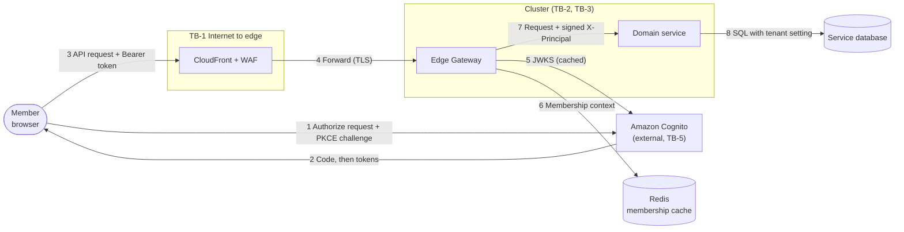
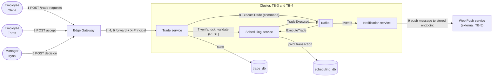
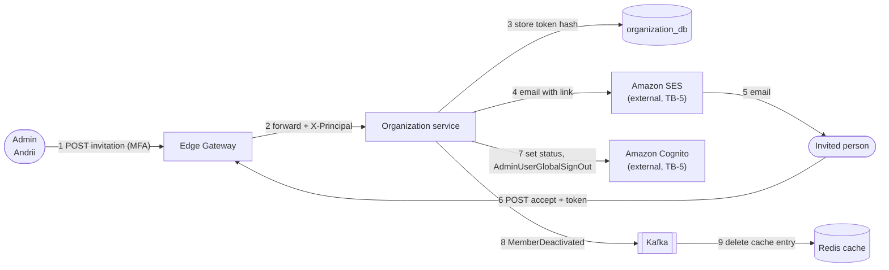

# Shift Happens security model

| Item | Value |
|---|---|
| Deliverable | 9. Security model |
| Version | 1.0 |
| Date | 2026-11-14 |
| Authors | Shift Happens team, Faculty of Applied Mathematics and Informatics, Ivan Franko National University of Lviv |
| Related documents | [SRS](01-srs.md), section 3.3.2 · [Architecture](02-architecture.md), section 8 · [Data model](05-data-model.md), section 5 |

**Revision history**

| Version | Date | Author | Change |
|---|---|---|---|
| 1.0 | 2026-11-14 | Shift Happens team | First release for deliverable 9. |

## Contents

1. [Summary](#1-summary)
1. [Scope, assets and trust boundaries](#2-scope-assets-and-trust-boundaries)
1. [Method](#3-method)
1. [Flow 1: sign-in and API request](#4-flow-1-sign-in-and-api-request)
1. [Flow 2: shift swap with manager approval](#5-flow-2-shift-swap-with-manager-approval)
1. [Flow 3: invitation and member deactivation](#6-flow-3-invitation-and-member-deactivation)
1. [Threat register and risk ranking](#7-threat-register-and-risk-ranking)
1. [Mitigation plan for the 10 most critical threats](#8-mitigation-plan-for-the-10-most-critical-threats)
1. [Decisions that the architecture left open](#9-decisions-that-the-architecture-left-open)
1. [Security verification](#10-security-verification)
1. [Related documents](#11-related-documents)

## 1. Summary

This document is the threat model of Shift Happens. It analyzes 3 main flows of the product with STRIDE, lists 22 threats, ranks them by risk, and gives a mitigation plan for the 10 most critical ones. The [SRS](01-srs.md) defines the identity and access management. The [architecture](02-architecture.md), section 8, shows where the controls are. This document checks if these controls are enough.

Main results:

- The highest risks are the theft of tokens through cross-site scripting (T-01), access to data of another tenant (T-02) and a bypass of the Edge Gateway (T-03).
- 10 threats need a mitigation action. 6 of them are already in the design, and the plan adds a verification step. 4 need a new control.
- Two open decisions of the architecture are closed here: the in-memory token stays in v1 with a strict Content Security Policy ([section 9.1](#91-in-memory-token-or-backend-for-frontend)), and the service mesh with mTLS is a planned control with a date ([section 9.2](#92-service-mesh-and-mtls)).

## 2. Scope, assets and trust boundaries

### 2.1 Assets

| ID | Asset | Why it matters | Data class ([data model](05-data-model.md)) |
|---|---|---|---|
| A-1 | Identity of a member (account, tokens, MFA) | Control of an account gives the role of the member | D4 |
| A-2 | Personal data of members (name, email, push endpoint) | Privacy and legal duty (GDPR principles) | D1 |
| A-3 | Schedules, assignments and trade requests | Business data of the tenant. The integrity of assignments is the main promise of the product. | D2 |
| A-4 | Tenant isolation | A leak between organizations is the worst failure of a SaaS | D2 |
| A-5 | Audit log | Proof of who did what | D3 |
| A-6 | Secrets and keys (`X-Principal` key, database credentials, VAPID key) | Control of a key gives control of a trust boundary | D4 |
| A-7 | Availability of the API | Employees need the schedule at all hours | — |

### 2.2 Trust boundaries

| ID | Boundary | Outside | Inside |
|---|---|---|---|
| TB-1 | Internet to AWS edge | Browsers of members and attackers | CloudFront and AWS WAF |
| TB-2 | Edge to cluster | CloudFront, ALB | Edge Gateway in the EKS cluster |
| TB-3 | Gateway to services | The Edge Gateway (trusted by the signed `X-Principal`) | Domain services |
| TB-4 | Cluster to data | Services | RDS, ElastiCache, MSK. Each service has its own credentials. |
| TB-5 | Cluster to external services | Services | Amazon Cognito, SES and the Web Push service of the browser vendor (outside our control) |

### 2.3 Attackers

| Attacker | Capability | Goal |
|---|---|---|
| External anonymous | Internet access, automated tools | Account takeover, denial of service, data theft |
| Malicious member | A valid account (EMPLOYEE) in one organization | Read or change data of another organization, claim a manager role, cheat on trades |
| Malicious manager or admin | A valid MANAGER or ADMIN account | Abuse overrides, hide actions, leak personal data |
| Former member | A token or knowledge from the time of the membership | Keep access after deactivation |
| Supply chain attacker | Control of a dependency or a build step | Run code in the cluster |

Out of scope for v1: a malicious AWS employee, a fault of the browser vendor push service, and physical attacks.

## 3. Method

The team used STRIDE on a data flow diagram (DFD) of each flow:

| Letter | Threat | Violated property |
|---|---|---|
| S | Spoofing | Authentication |
| T | Tampering | Integrity |
| R | Repudiation | Non-repudiation |
| I | Information disclosure | Confidentiality |
| D | Denial of service | Availability |
| E | Elevation of privilege | Authorization |

Steps: (1) draw the DFD with the trust boundaries, (2) apply STRIDE to each element and data flow that crosses a boundary, (3) record each threat with an ID, (4) rate likelihood (L, 1 to 5) and impact (I, 1 to 5), risk = L × I, (5) select a mitigation. The flows selected are the 3 that carry the most risk: they handle identity (Flow 1), the core business invariant and money-like trust between two employees (Flow 2), and the join and leave of members (Flow 3).

## 4. Flow 1: sign-in and API request

### 4.1 Description

A member signs in through Amazon Cognito (Authorization Code with PKCE), gets an access token, and calls the API through CloudFront, the ALB and the Edge Gateway. The gateway validates the token, adds the signed `X-Principal` header and routes the request to a service. This flow is the base of all other flows.

### 4.2 Data flow diagram

### 4.3 STRIDE analysis

| Element or flow | STRIDE | Threat | ID |
|---|---|---|---|
| Browser, token storage (steps 2 and 3) | S, I | An attacker runs JavaScript in the SPA (XSS or a bad dependency) and reads the refresh token in `sessionStorage` or the access token in memory. The attacker acts as the member. | T-01 |
| Authorize request (step 1) | S, T | An attacker steals the authorization code (a malicious redirect URI or a code injection). | T-02 |
| Sign-in (Cognito) | S | Credential stuffing, phishing or a stolen password of an ADMIN. | T-03 |
| Token validation at the gateway (step 5) | S | The gateway accepts a token of another issuer, another app client, an ID token as an access token, or an expired token. | T-04 |
| Gateway to service (step 7) | S, E | A client or an attacker inside the network sends a forged `X-Principal` header, or calls a pod directly and skips the gateway. | T-05 |
| Gateway, signing key | S, E | The key that signs `X-Principal` leaks. The attacker creates any identity. | T-06 |
| Service, resource access (step 8) | E, I | A member changes an ID in the path (for example another `shiftId`) and reads or changes a resource of another organization (broken object level authorization). | T-07 |
| Service, endpoint access | E | An EMPLOYEE calls a manager endpoint, or sends `role` in a request body (mass assignment). | T-08 |
| CloudFront, gateway (steps 3 and 4) | D | A flood of requests or WebSocket connections uses all capacity. | T-09 |
| Gateway, service, logs | I | Error bodies or logs show stack traces, SQL text, tokens or email addresses. | T-10 |
| Redis (step 6) | T | An attacker who reaches Redis writes a membership entry with a higher role. | T-11 |
| Whole flow | R | A user denies an action. The logs have no stable actor. | T-12 |

## 5. Flow 2: shift swap with manager approval

### 5.1 Description

Olena (EMPLOYEE) wants to swap her Saturday shift with Taras (EMPLOYEE). She creates a trade request (API-09). Taras accepts (API-10). Iryna (MANAGER) approves (API-11). The Trade service starts a saga with the Scheduling service: it places trade locks, checks labor rules, and executes the swap in one transaction. The Notification service informs all parties. This flow changes the core business data and involves three roles and three services.

### 5.2 Data flow diagram

### 5.3 STRIDE analysis

| Element or flow | STRIDE | Threat | ID |
|---|---|---|---|
| API-09 request (step 1) | E, T | Olena offers an assignment that is not hers, or that belongs to another organization (by a changed ID). | T-13 |
| API-10 request (step 3) | S, E | A member accepts a trade request that is addressed to another employee, or accepts twice. | T-14 |
| API-11 request (step 5) | E | An EMPLOYEE or a MANAGER of another location sends a decision. | T-15 |
| API-11, labor rule override | R, E | A manager overrides a labor rule without a reason, or denies the override. | T-16 |
| Retry of API-09 | T | An attacker replays a captured request, or reuses an `Idempotency-Key` of another user to read a stored response. | T-17 |
| Kafka commands (step 8) | T, S | A forged `ExecuteTrade` command executes a trade that no manager approved. | T-18 |
| Scheduling pivot transaction | T | A race between two trades on one assignment creates two trades for the same slot. | T-19 |
| Trade state in the database | T | A direct update changes the status (needs database access). | T-20 |
| Notification to the Web Push service (step 9) | S, I | A member stores a push endpoint that points to an internal address. The service calls it (server-side request forgery, SSRF). | T-21 |
| Notification texts | I | A notification shows data to a person who must not see it (a colleague of another location). | T-22 |

## 6. Flow 3: invitation and member deactivation

### 6.1 Description

An ADMIN invites a new member (API-01). The Organization service creates an invitation with a random token and sends it by email through Amazon SES. The invited person opens the link, signs in and accepts (API-02). Later, the ADMIN deactivates the member (API-03): the service sets the status, signs the user out in Cognito and publishes `MemberDeactivated`. This is the joiner and leaver path of the identity lifecycle.

### 6.2 Data flow diagram

### 6.3 STRIDE analysis

| Element or flow | STRIDE | Threat | ID |
|---|---|---|---|
| Invitation token (steps 4 to 6) | S, I | An attacker reads or guesses the token (an email forwarded, a log, a weak token) and joins the organization with the invited role. | T-23 |
| API-01 | E | A MANAGER invites an ADMIN, or an ADMIN of another organization invites into this organization. | T-24 |
| API-01 | D | A flood of invitations uses the email quota and damages the sender reputation of the SES domain. | T-25 |
| Invitation email | S | An attacker abuses the invitation text field to send phishing links through the trusted domain. | T-26 |
| API-03 (steps 7 to 9) | E | A deactivated member keeps access until the cache and the token expire. | T-27 |
| API-03 | R | An admin deactivates a member and the audit record is missing or can change. | T-28 |
| Cognito admin calls (step 7) | D | The call fails. The member keeps a valid token for up to 15 min. | T-27 |
| `MemberDeactivated` event (step 8) | T | A forged event on `organization.events.v1` deactivates or changes the role of any member in the replicas. | T-18 |

## 7. Threat register and risk ranking

The register keeps one row for each distinct threat. Threats that two flows share appear once. L is the likelihood and I is the impact (1 to 5). Risk = L × I. A risk of 15 or more is critical, 8 to 14 is high, and 1 to 7 is medium or low.

| ID | Threat | Category | Flow | Asset | L | I | Risk | Existing controls | Level |
|---|---|---|---|---|---|---|---|---|---|
| T-01 | Token theft through XSS or a malicious dependency | S, I | 1 | A-1 | 3 | 5 | 15 | Access token in memory, 15 min lifetime, refresh token rotation | Critical |
| T-07 | Cross-tenant or cross-user access through a changed object ID (BOLA) | E, I | 1 | A-4 | 3 | 5 | 15 | `org_id` filter, row-level security, 404 for foreign objects | Critical |
| T-05 | Bypass of the Edge Gateway or a forged `X-Principal` | S, E | 1 | A-1, A-4 | 2 | 5 | 10 | Signed header, NetworkPolicy, gateway deletes client header | High |
| T-03 | Credential stuffing, phishing, or theft of an admin password | S | 1 | A-1 | 4 | 4 | 16 | Cognito, MFA for ADMIN, rate limits | Critical |
| T-06 | Leak of the `X-Principal` signing key | S, E | 1 | A-6 | 1 | 5 | 5 | Secrets Manager, KMS | Medium |
| T-08 | Privilege escalation: an EMPLOYEE uses a manager function or sets `role` | E | 1 | A-3 | 3 | 4 | 12 | Role check in each service, DTO validation | High |
| T-09 | Denial of service by request or WebSocket flood | D | 1 | A-7 | 4 | 3 | 12 | WAF IP limit, token buckets, load shedding | High |
| T-10 | Sensitive data in logs or error bodies | I | 1 | A-2 | 3 | 3 | 9 | Problem details, log rules (REQ-OBS-001) | High |
| T-04 | Acceptance of an invalid token (wrong issuer, client or type) | S | 1 | A-1 | 2 | 5 | 10 | JWKS validation, `iss`, `exp`, `client_id`, `token_use` | High |
| T-02 | Theft of the authorization code | S | 1 | A-1 | 2 | 4 | 8 | PKCE S256, exact redirect URI | High |
| T-11 | Manipulation of the membership cache in Redis | T, E | 1 | A-4 | 1 | 4 | 4 | TLS, AUTH, security group | Low |
| T-12 | A user denies an action | R | 1 | A-5 | 2 | 3 | 6 | `traceId`, audit log | Low |
| T-13 | A trade request for an assignment that is not the requester's | E, T | 2 | A-3 | 3 | 4 | 12 | Verify assignment through the internal API | High |
| T-14 | Acceptance of a trade request by the wrong person | S, E | 2 | A-3 | 3 | 4 | 12 | Target check from `X-Principal` | High |
| T-15 | A decision of a person without the right to decide | E | 2 | A-3 | 2 | 4 | 8 | Manager of the location required | High |
| T-16 | An unexplained override of a labor rule | R, E | 2 | A-5 | 3 | 3 | 9 | Reason required, audit log | High |
| T-17 | Replay or key collision of an idempotent request | T, I | 2 | A-3 | 2 | 3 | 6 | Key scope per user, fingerprint | Low |
| T-18 | A forged event or command on Kafka | T, S | 2, 3 | A-3, A-4 | 2 | 5 | 10 | MSK IAM access control, TLS | High |
| T-19 | A race creates two trades for one assignment | T | 2 | A-3 | 3 | 4 | 12 | Trade locks, exclusion constraint, pivot transaction | High |
| T-20 | Direct change of the trade status in the database | T | 2 | A-3 | 1 | 4 | 4 | Database user per service, security groups | Low |
| T-21 | SSRF through a stored push endpoint | S, I | 2 | A-6, A-2 | 3 | 4 | 12 | None yet | High |
| T-22 | A notification shows data to a wrong person | I | 2 | A-2 | 2 | 3 | 6 | Recipient list from the owner service | Low |
| T-23 | Invitation token theft or guessing | S, I | 3 | A-1 | 3 | 4 | 12 | Random token, hash stored, 7-day expiry | High |
| T-24 | An invitation with a higher role than the inviter has | E | 3 | A-1 | 2 | 5 | 10 | Admin-only endpoint, MFA | High |
| T-25 | Invitation flood and loss of the SES reputation | D | 3 | A-7 | 3 | 3 | 9 | 20 per hour per user, 200 per day per organization | High |
| T-26 | Phishing through the invitation text | S | 3 | A-1 | 2 | 3 | 6 | None yet | Low |
| T-27 | Access of a deactivated member until the cache and the token expire | E | 3 | A-1, A-4 | 3 | 4 | 12 | Status first, 60 s cache TTL, Cognito sign-out | High |
| T-28 | Missing or changed audit record of a deactivation | R | 3 | A-5 | 2 | 4 | 8 | Append-only audit log | High |
| T-29 | Malicious dependency or build step (supply chain) | T, E | All | A-6 | 2 | 5 | 10 | Lock file, image scan | High |

## 8. Mitigation plan for the 10 most critical threats

The team selects the 10 threats with three rules: (1) every critical threat (risk 15 or more): T-03, T-01 and T-07, (2) every threat with impact 5 and risk 10 or more: T-05, T-04, T-18, T-29 and T-24, and (3) high threats where the register shows no control or a known time window: T-21 and T-27. The other high threats (T-08, T-09, T-13, T-14, T-19 and T-23) already have controls in the design. They appear in the additional actions below.

| No. | Threat | Risk | Mitigation | Type | Priority | Owner | Verification | Residual risk |
|---|---|---|---|---|---|---|---|---|
| 1 | T-03 Credential stuffing, phishing, stolen admin password | 16 | 1. TOTP MFA for every ADMIN, and a prompt for MANAGER (REQ-SEC-001). 2. Cognito advanced security: compromised credentials check and adaptive authentication. 3. Cognito password policy of at least 12 characters and lockout with a growing delay. 4. Rate limit of sign-in by Cognito and by the WAF. 5. Alert on many failed sign-ins ([monitoring model](10-monitoring-alerting-model.md)). | Existing and new | P1 | Organization service owner | Test: admin API without MFA gives 403 `MFA_REQUIRED`. Inspection of the user pool settings. | Medium. Phishing of a TOTP code is possible. WebAuthn is a later option. |
| 2 | T-01 Token theft through XSS or a malicious dependency | 15 | 1. Strict Content Security Policy: `script-src 'self'`, no `unsafe-inline`, `object-src 'none'`, `frame-ancestors 'none'`. 2. Angular template sanitization, no `bypassSecurityTrust*` calls without a review. 3. Subresource Integrity and a lock file for all assets. 4. Access token 15 min, refresh token rotation, sign-out revokes the token. 5. Refresh token binding to a sign-in session, revoke on a reuse signal. | Existing and new | P1 | SPA owner | CSP test in CI (a header check). Static analysis rule for `bypassSecurityTrust*`. Penetration test with an injected script. | Medium. See [section 9.1](#91-in-memory-token-or-backend-for-frontend). |
| 3 | T-07 Cross-tenant access (BOLA) | 15 | 1. Take `orgId` only from the signed `X-Principal`. 2. `org_id` in every query and row-level security as defense in depth. 3. Return 404 for foreign objects. 4. Authorization at the object level in each service, not only at the gateway. 5. A cross-tenant test suite that calls all operations with the token of another organization. | Existing and verification | P1 | All service owners | Automated cross-tenant test for API-01 to API-12 (REQ-SEC-002). A test that disables the application filter and still gets 0 rows. | Low |
| 4 | T-05 Bypass of the gateway, forged `X-Principal` | 10 | 1. NetworkPolicy: default deny, allow only the gateway to services. 2. ES256 signature, `aud` per service, 30 s lifetime. 3. The gateway deletes the client header. 4. Planned: mTLS between the gateway and services ([section 9.2](#92-service-mesh-and-mtls)). | Existing and new | P1 | Platform owner | Test: a request with a forged header gets 401. A test pod in another namespace cannot connect to a service. | Low after mTLS |
| 5 | T-04 Acceptance of an invalid token | 10 | 1. Validate signature, `iss`, `exp`, `client_id` and `token_use = access` in one shared library. 2. Allow only the algorithm RS256 of the JWKS. 3. Cache the JWKS and refresh it on an unknown `kid`, with a limit of one refresh per minute. 4. Unit tests with tokens of a wrong issuer, wrong client, ID token, `alg: none`, and an expired token. | Existing and verification | P1 | Edge Gateway owner | Unit and contract tests (REQ-SEC-001 criteria) | Low |
| 6 | T-18 Forged event or command on Kafka | 10 | 1. MSK IAM access control: each service writes only to its own topics and reads only the topics it consumes. 2. TLS in transit. 3. Consumers validate the envelope against a schema and check that `orgId` exists. 4. A command (`ExecuteTrade`) is valid only if the trade request exists in the status `EXECUTING`. 5. Audit of IAM policy changes. | Existing and new | P1 | Platform owner and each producer | IAM policy review. Test: a service without the right cannot publish to a foreign topic. | Low |
| 7 | T-29 Supply chain (dependency, build, image) | 10 | 1. `npm ci` with a lock file. 2. Dependabot for npm and GitHub Actions. 3. Pin GitHub Actions to commit SHAs. 4. Amazon ECR image scan on push and immutable tags. 5. Least-privilege IAM role for the deployment, no long-lived keys (OIDC from GitHub to AWS). 6. A software bill of materials (SBOM) for each image. | New | P2 | Platform owner | CI check for unpinned actions. ECR scan report gate for critical findings. | Medium |
| 8 | T-24 Invitation with a higher role | 10 | 1. API-01 allowed only for ADMIN with MFA. 2. The role in the invitation must not be higher than the role of the inviter, checked in the service. 3. Audit record of each invitation. 4. The invitation accepts only an email that is the same as the invited email (checked against the Cognito email claim). | Existing and new | P2 | Organization service owner | Test: MANAGER invites ADMIN gives 403. A token used by another email gives 403. | Low |
| 9 | T-21 SSRF through a Web Push endpoint | 12 | 1. Accept only `https` endpoints on an allowlist of known push service domains (`fcm.googleapis.com`, `*.push.apple.com`, `*.push.services.mozilla.com`, `*.notify.windows.com`). 2. Resolve the host and reject private and link-local addresses (including `169.254.169.254`) before the call. 3. Egress NetworkPolicy and security group: the Notification service can open connections only to the internet through a NAT gateway, not to the VPC. 4. Require IMDSv2 on nodes. | New | P1 | Notification service owner | Unit tests with internal URLs, redirects and DNS names that resolve to private addresses | Low |
| 10 | T-27 Access after deactivation | 12 | 1. Set the status `DEACTIVATED` before any other step. 2. Call `AdminUserGlobalSignOut` and `AdminDisableUser`, and retry every 60 s on failure. 3. The gateway deletes the cache entry on `MemberDeactivated`. 4. For an urgent case, an operator deletes the Redis key. 5. The service checks `status` in the signed `X-Principal`, which the gateway builds from the cache with a 60 s TTL. | Existing and verification | P2 | Organization service owner | Test: deactivate, then call the API within 60 s and after. The time of the first 401 is at most 60 s. | Low. A window of at most 60 s stays. |

Additional actions from the register (P3, next iteration): rate limiting for a WebSocket upgrade (T-09), a per-object ownership check test for API-09 and API-10 (T-13, T-14), a strict role matrix test for each endpoint (T-08), and a one-time use of the invitation token with a hash comparison in constant time (T-23).

## 9. Decisions that the architecture left open

### 9.1 In-memory token or Backend-for-Frontend

The [architecture](02-architecture.md), section 8.1, promised a comparison.

| Criterion | Tokens in the browser (access token in memory, refresh token in `sessionStorage`) | Backend-for-Frontend with `HttpOnly` cookies |
|---|---|---|
| Theft through XSS | The script can read the tokens | The script cannot read the cookie. It can still send requests while the page is open. |
| CSRF | Not applicable, because the `Authorization` header is set by code | Needs `SameSite` cookies and an anti-CSRF token |
| Components to build and operate | None | A new stateful service (the BFF) with a session store |
| Effect on the architecture | None | An extra hop, and a session store that must be highly available |
| WebSocket | Token in `Sec-WebSocket-Protocol` | A cookie, simpler |
| Effort for the team | Low | Medium to high |

**Decision.** v1 uses the tokens in the browser. The strict CSP, short token life and refresh token rotation reduce the risk of T-01. The threat stays in the register with residual risk Medium. The team revisits the decision when the product has a native client or when a penetration test shows a script injection that the CSP cannot stop.

### 9.2 Service mesh and mTLS

Traffic inside the cluster uses HTTP in v1. The signed `X-Principal` and the NetworkPolicy protect the traffic. They do not hide the data from a compromised node or pod.

**Decision.** The team adds mTLS with a service mesh (for example Istio ambient mode or Linkerd) after the first production release. The mesh gives encrypted service-to-service traffic and service identities, and it allows `AuthorizationPolicy` rules per path (for example, only the Trade service can call `/internal/**`). Until then, the NetworkPolicy and the signed header are the controls, and T-05 stays at residual risk Low to Medium.

## 10. Security verification

| Activity | When | What it proves |
|---|---|---|
| Cross-tenant test suite | Each pull request | T-07, REQ-SEC-002 |
| Token validation unit tests | Each pull request | T-04 |
| `docs:check` and dependency audit (`npm audit`, Dependabot) | Each pull request and daily | T-29 |
| Container image scan (Amazon ECR) | Each build | T-29 |
| Static analysis for `bypassSecurityTrust*` and secrets | Each pull request | T-01, T-06 |
| CSP header test | Each deployment to staging | T-01 |
| NetworkPolicy and forged header test | Each deployment to staging | T-05 |
| Review of IAM policies and security groups | Each release | T-18, T-21 |
| Penetration test or a structured self-test of OWASP API Security Top 10 | Before the first production release | T-01, T-07, T-08 and others |
| Review of this threat model | Each release that changes a flow, and each 6 months | All |

## 11. Related documents

| Document | Content |
|---|---|
| [SRS](01-srs.md) | Roles, permissions, MFA, joiner-mover-leaver, REQ-SEC-001 to 003 |
| [Architecture](02-architecture.md) | Identity flow, `X-Principal`, service-to-service trust, secrets, edge protection |
| [Data model](05-data-model.md) | Data classes and retention |
| [Resiliency model](06-resiliency-model.md) | Failures that also affect security (stale cache, Kafka outage) |
| [Deployment model](08-deployment-model.md) | Network, security groups, IAM, encryption |
| [Monitoring and alerting model](10-monitoring-alerting-model.md) | Detection of attacks |
