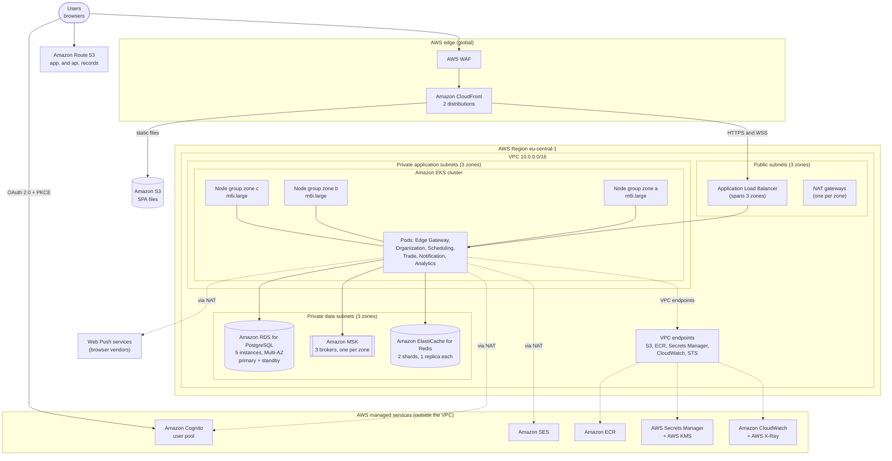
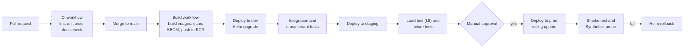

# Shift Happens deployment model

| Item | Value |
|---|---|
| Deliverable | 10. Deployment model |
| Version | 1.0 |
| Date | 2026-11-14 |
| Authors | Shift Happens team, Faculty of Applied Mathematics and Informatics, Ivan Franko National University of Lviv |
| Related documents | [Architecture](02-architecture.md), section 10 · [Resiliency model](06-resiliency-model.md) · [Security model](07-security-model.md) |

**Revision history**

| Version | Date | Author | Change |
|---|---|---|---|
| 1.0 | 2026-11-14 | Shift Happens team | First release for deliverable 10. |

## Contents

1. [Summary](#1-summary)
1. [Infrastructure diagram](#2-infrastructure-diagram)
1. [Resource types and their roles](#3-resource-types-and-their-roles)
1. [Network design](#4-network-design)
1. [Kubernetes workloads](#5-kubernetes-workloads)
1. [Identity, access and encryption](#6-identity-access-and-encryption)
1. [Environments](#7-environments)
1. [Delivery pipeline](#8-delivery-pipeline)
1. [Scaling, backup and cost](#9-scaling-backup-and-cost)
1. [Related documents](#10-related-documents)

## 1. Summary

Shift Happens runs in one AWS Region (`eu-central-1`, Frankfurt) with 3 Availability Zones. The edge is Amazon CloudFront with AWS WAF. The application runs as containers on Amazon EKS. All state is in managed services: Amazon RDS for PostgreSQL, Amazon MSK, Amazon ElastiCache, and Amazon S3. The team describes the whole infrastructure as code (Terraform), and a GitHub Actions pipeline deploys it.

| Item | Value |
|---|---|
| Region | `eu-central-1` (data of the target market stays in the EU) |
| Availability Zones | 3 (`eu-central-1a`, `eu-central-1b`, `eu-central-1c`) |
| Accounts | 3 AWS accounts: `dev`, `staging`, `prod` |
| Compute | Amazon EKS, managed node groups |
| Infrastructure as code | Terraform with a remote state in Amazon S3 and a lock in Amazon DynamoDB |
| Deployment | GitHub Actions, Helm charts, rolling updates |

## 2. Infrastructure diagram

The diagram shows the production environment. Boxes with the same name in three zones show the Multi-AZ layout. Arrows show the main traffic path and the connections to the data layer.

## 3. Resource types and their roles

| Layer | Resource type | Role in Shift Happens | Configuration (production, initial) | Why this type |
|---|---|---|---|---|
| DNS | Amazon Route 53 | Hosted zone `shifthappens.example`, alias records for `app.` and `api.` | Public hosted zone, health checks off in v1 | Managed DNS with alias records to CloudFront |
| Edge | Amazon CloudFront | Two distributions. `app.` serves the SPA from S3. `api.` passes API and WebSocket traffic to the ALB without caching. | TLS 1.2 or later, HTTP/2 and HTTP/3, origin access control for S3 | Global edge, TLS termination, one place for HSTS and CSP headers |
| Edge | AWS WAF | Managed rule groups (core rule set, known bad inputs, IP reputation) and a rate rule of 2000 requests per 5 min per IP | Web ACL on both distributions, `count` mode for 7 days, then `block` | Blocks common attacks and floods before they reach the cluster |
| Static files | Amazon S3 | Private bucket for the SPA build | Versioning on, block public access, access only for CloudFront | Cheap and durable hosting of static files |
| Certificates | AWS Certificate Manager | TLS certificates for CloudFront (in `us-east-1`) and the ALB | DNS validation, automatic renewal | Free, managed certificates |
| Load balancing | Application Load Balancer | Routes HTTPS and WebSocket traffic to the Edge Gateway pods with IP targets | Public subnets, security group allows only the CloudFront managed prefix list, idle timeout 3600 s for WebSocket | Layer 7 routing with health checks and WebSocket support |
| Network | Amazon VPC | One network for the cluster and the data layer | `10.0.0.0/16`, 3 zones, [subnet plan](#4-network-design) | Isolation of the data from the internet |
| Network | NAT gateway (one per zone) | Outbound access to SES, Cognito and the Web Push services from private subnets | One per zone, so a zone failure does not cut the other zones | Pods have no public IP addresses |
| Network | VPC endpoints | Private access to S3, ECR, Secrets Manager, CloudWatch and STS | Gateway endpoint for S3, interface endpoints for the others | Lower NAT cost and traffic that stays in the AWS network |
| Compute | Amazon EKS | Container platform for 6 services | Kubernetes 1.31 or later, managed node groups, one per zone | Managed control plane, rolling updates, autoscaling |
| Compute | EC2 `m6i.large` nodes | Worker nodes | 3 to 9 nodes, spread across 3 zones, Cluster Autoscaler (or Karpenter) | 2 vCPU and 8 GiB memory per node is enough for the first load (200 requests/s) |
| Container registry | Amazon ECR | Images of the 6 services | Scan on push, immutable tags, lifecycle rule for old images | Image scan and IAM access control |
| Database | Amazon RDS for PostgreSQL 16 | One instance per service database (5) | `db.t4g.medium` (`db.m6g.large` for `scheduling_db`), Multi-AZ, 100 GiB gp3 storage, encrypted with KMS, automated backups 7 days, extension `btree_gist` | Row locks, exclusion constraints and row-level security. Managed backups and failover. |
| Messaging | Amazon MSK | Kafka for events and commands | 3 brokers `kafka.m5.large`, one per zone, 100 GiB storage each, TLS and IAM access control, replication factor 3, `min.insync.replicas=2` | Managed Kafka with 3-zone replication |
| Cache | Amazon ElastiCache for Redis | Rate limits, idempotency reservations, membership cache, WebSocket presence | `cache.t4g.small`, cluster mode with 2 shards, 1 replica per shard in another zone, TLS and AUTH | Low-latency state that the system can lose |
| Identity | Amazon Cognito user pool | Sign-in, TOTP MFA, tokens | Public app client with PKCE, refresh token rotation, advanced security features | Managed identity provider (no password storage in the product) |
| Email | Amazon SES | Invitation and notification emails | Verified domain with DKIM, SPF and DMARC. Configuration set for bounces and complaints. | Low-cost, reliable email |
| Secrets | AWS Secrets Manager | Database credentials, `X-Principal` signing key, VAPID key, Redis AUTH token | Automatic rotation for database credentials, access by Pod Identity | No secret in images or Git |
| Keys | AWS KMS | Encryption keys for RDS, MSK, ElastiCache, S3, Secrets Manager and CloudWatch Logs | One customer-managed key per data type, key rotation on | Control and audit of key use |
| Observability | Amazon CloudWatch | Logs, metrics, alarms, dashboards, Synthetics probe | Log retention 30 days, alarms to Amazon SNS | One place for logs and metrics |
| Observability | AWS X-Ray with the ADOT collector | Distributed traces | Sampling 5 % and all errors | Trace search by `traceId` |
| Notification of alarms | Amazon SNS and AWS Chatbot | Send alarms to email and a team chat channel | Two topics: `alerts-critical`, `alerts-warning` | Simple fan-out of alarms |
| IaC state | Amazon S3 and Amazon DynamoDB | Terraform state and lock | Versioning, encryption, access only for the pipeline | Safe team use of Terraform |

## 4. Network design

### 4.1 Subnets

| Subnet group | Zones | CIDR (per zone) | Contents | Route to the internet |
|---|---|---|---|---|
| Public | a, b, c | `10.0.0.0/24`, `10.0.1.0/24`, `10.0.2.0/24` | ALB, NAT gateways | Internet gateway |
| Private application | a, b, c | `10.0.16.0/20`, `10.0.32.0/20`, `10.0.48.0/20` | EKS nodes and pods | Through the NAT gateway of the zone |
| Private data | a, b, c | `10.0.64.0/24`, `10.0.65.0/24`, `10.0.66.0/24` | RDS, MSK, ElastiCache | None |

The data subnets have no route to the internet. The nodes use the VPC endpoints for AWS services.

### 4.2 Security groups

| Security group | Inbound | Outbound |
|---|---|---|
| `sg-alb` | 443 from the CloudFront managed prefix list only | To `sg-nodes` on the gateway port |
| `sg-nodes` | From `sg-alb` (gateway port), and from other nodes (pod to pod, restricted by Kubernetes NetworkPolicy) | To the data security groups, the NAT gateway, and the VPC endpoints |
| `sg-rds` | 5432 from `sg-nodes` | None needed |
| `sg-msk` | 9098 (TLS and IAM) from `sg-nodes` | None needed |
| `sg-redis` | 6379 from `sg-nodes` | None needed |
| `sg-vpce` | 443 from `sg-nodes` | None needed |

### 4.3 Kubernetes network rules

- A default-deny NetworkPolicy in each namespace.
- Only the Edge Gateway pods can connect to the service pods. Only the Trade service can reach `/internal/**` of the Scheduling service.
- Only the Notification service has a route to the internet (through the NAT gateway), and only on port 443. This control also limits SSRF ([security model](07-security-model.md), T-21).
- A mesh with mTLS is planned after the first release ([security model](07-security-model.md), section 9.2).

## 5. Kubernetes workloads

| Workload | Replicas (min to max) | CPU request and limit | Memory request and limit | Autoscaling signal | Notes |
|---|---|---|---|---|---|
| `edge-gateway` | 2 to 10 | 250 m, 1 | 256 MiB, 512 MiB | CPU 60 % | PodDisruptionBudget `minAvailable: 1`, topology spread across zones |
| `organization-service` | 2 to 4 | 250 m, 500 m | 256 MiB, 512 MiB | CPU 60 % | Runs the outbox relay (Lease) |
| `scheduling-service` | 2 to 8 | 500 m, 1 | 384 MiB, 768 MiB | CPU 60 % | Runs the outbox relay (Lease) |
| `trade-service` | 2 to 4 | 250 m, 500 m | 256 MiB, 512 MiB | CPU 60 % | Runs the relay and the trade expiry job (Lease) |
| `notification-service` | 2 to 12 | 250 m, 1 | 256 MiB, 512 MiB | CPU 60 % and Kafka consumer lag | At most 12 replicas, because of 12 partitions. Runs the reminders job (Lease). |
| `analytics-service` | 2 to 4 | 250 m, 500 m | 384 MiB, 768 MiB | CPU 60 % | Runs the rollup job (Lease) |
| `adot-collector` | DaemonSet | 100 m | 128 MiB | — | Traces and metrics |
| `fluent-bit` | DaemonSet | 100 m | 128 MiB | — | Logs to CloudWatch |
| AWS Load Balancer Controller, Cluster Autoscaler, Secrets Store CSI driver | 2 | Small | Small | — | Cluster add-ons |

Each Deployment has a readiness probe and a liveness probe, a rolling update with `maxUnavailable: 0`, and a `terminationGracePeriodSeconds` of 30 s. A pod stops accepting new connections, finishes the active requests, and then ends. A WebSocket client reconnects to another pod.

## 6. Identity, access and encryption

| Area | Design |
|---|---|
| Pod access to AWS | EKS Pod Identity. One IAM role per service account with least privilege (for example only the Organization service can call Cognito admin APIs, and only the Notification service can call SES). |
| Human access | AWS IAM Identity Center with MFA. Read-only role by default. A separate role with a time limit for changes in production. No IAM users and no long-lived access keys. |
| Pipeline access | GitHub OIDC to an IAM role per environment. No stored AWS keys in GitHub. |
| Encryption in transit | TLS 1.2 or later from the browser to CloudFront and the ALB. TLS to RDS, MSK and ElastiCache. HTTP inside the cluster in v1 (mTLS planned). |
| Encryption at rest | KMS keys for RDS, MSK, ElastiCache, S3, Secrets Manager, EBS volumes and CloudWatch Logs |
| Secrets | AWS Secrets Manager, mounted through the Secrets Store CSI driver ([architecture](02-architecture.md), section 8.4) |
| Audit of AWS | AWS CloudTrail in all accounts, delivered to a separate log archive bucket with Object Lock |
| Threat detection | Amazon GuardDuty and AWS Security Hub on all accounts |

## 7. Environments

| Environment | Purpose | AWS account | Size | Data |
|---|---|---|---|---|
| Local | Development and unit tests | None | Docker Compose with PostgreSQL, Redpanda (Kafka), Redis and a Cognito mock | Fixtures |
| `dev` | Integration of the main branch, manual tests | `dev` | 1 zone, 1 replica per service, `db.t4g.micro` single-AZ, 1 Kafka broker | Fixtures |
| `staging` | Release tests, load tests (REQ-PERF-001) and failure tests ([resiliency model](06-resiliency-model.md)) | `staging` | Same as production | Synthetic organization with 200 employees. No production data. |
| `prod` | Real users | `prod` | As in [section 3](#3-resource-types-and-their-roles) | Real data |

The same container image and the same Helm chart run in all environments. Only the values file and the Terraform variables change ([architecture](02-architecture.md), section 9.5).

## 8. Delivery pipeline

The team uses GitHub Actions. The documentation check workflow ([docs.yml](../.github/workflows/docs.yml)) already exists. The application workflows follow the same style.

| Stage | What happens | Gate |
|---|---|---|
| Pull request | Lint, type check, unit tests, `npm run docs:check`, dependency audit | All checks green and one review |
| Build | Build one image per service. Scan with Amazon ECR. Create an SBOM. Tag with the commit SHA. | No critical vulnerability |
| `dev` | `helm upgrade` and database migrations | Smoke test |
| `staging` | Same, then the cross-tenant test suite, k6 load test and selected failure tests | p95 and error targets (REQ-PERF-001) |
| `prod` | Manual approval, then a rolling update, one service at a time | No 5xx because of the rollout (REQ-AVAIL-001) |
| Rollback | `helm rollback` to the previous revision. Database migrations are backward compatible for one release (expand and contract), so a rollback is safe. | — |

Terraform changes run in a separate workflow: `terraform plan` on a pull request (the plan is a comment), and `terraform apply` after the merge, with a manual approval for `prod`.

## 9. Scaling, backup and cost

### 9.1 Scaling

| Layer | How it scales | Limit |
|---|---|---|
| Pods | HPA on CPU and on Kafka consumer lag | Maximum replicas in [section 5](#5-kubernetes-workloads) |
| Nodes | Cluster Autoscaler adds nodes when pods cannot be scheduled | 9 nodes |
| RDS | Vertical: change the instance class (a short failover) | Storage autoscaling to 500 GiB |
| MSK | Add brokers or increase storage | 12 partitions per topic limit the consumers |
| ElastiCache | Add shards (online resharding) | — |
| CloudFront, S3, Cognito, SES | Managed | SES sending quota must grow with the number of users |

### 9.2 Backup and recovery

| Resource | Backup | Recovery objective |
|---|---|---|
| RDS | Automated daily snapshot, transaction logs every 5 min, 7 days retention. A weekly snapshot copied to another region (35 days). | RPO 5 min, RTO 1 h per database ([resiliency model](06-resiliency-model.md), section 6) |
| MSK | None. Topics keep 7 days of events. The outbox can publish again. | — |
| ElastiCache | None. Redis holds only rebuildable data. | — |
| S3 (SPA files) | Versioning. The pipeline can rebuild the files from Git. | Minutes |
| Terraform state | S3 versioning | — |
| Region failure | Terraform creates the stack in another region. RDS snapshots come from the copy. | RTO 4 h, manual |

### 9.3 Cost estimate (production, initial)

The estimate uses public list prices and is approximate. The team checks it again with the AWS Pricing Calculator before the first release.

| Item | Approximate monthly cost (USD) |
|---|---|
| EKS control plane | 75 |
| 3 to 5 `m6i.large` nodes | 210 to 350 |
| 5 RDS Multi-AZ instances (4 small and 1 medium) | 450 |
| MSK (3 `kafka.m5.large` brokers with storage) | 650 |
| ElastiCache (2 shards, 1 replica each, `cache.t4g.small`) | 140 |
| 3 NAT gateways and data transfer | 130 |
| ALB, CloudFront, WAF, Route 53 | 80 |
| CloudWatch, X-Ray, Secrets Manager, KMS | 80 |
| Total | About 1 800 to 2 000 |

The largest item is Amazon MSK. For a student demonstration, the `dev` environment uses one small MSK Serverless cluster or Redpanda on EKS, and the team shuts down `staging` outside the test windows. [ADR-0001](adr/0001-architecture-style.md) lists the cost of this architecture as a known trade-off.

## 10. Related documents

| Document | Content |
|---|---|
| [Architecture](02-architecture.md) | Logical containers, AWS mapping |
| [Resiliency model](06-resiliency-model.md) | Failure behavior, RTO and RPO |
| [Security model](07-security-model.md) | Network, IAM and encryption controls, threats |
| [Monitoring and alerting model](10-monitoring-alerting-model.md) | CloudWatch metrics and alarms for these resources |
| [Documentation workflow](../.github/workflows/docs.yml) | The existing GitHub Actions workflow |
