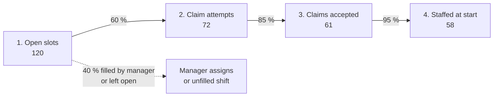
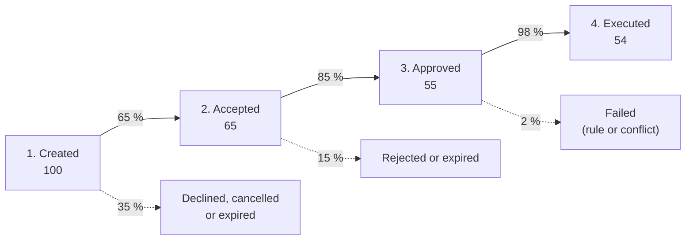
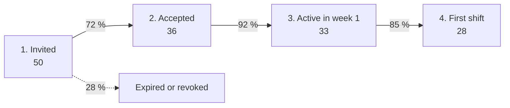
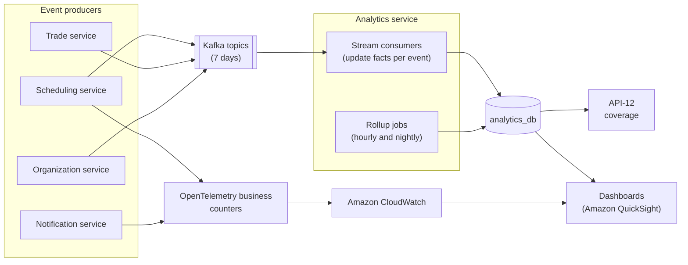

# Shift Happens analytics model

| Item | Value |
|---|---|
| Deliverable | 11. Analytics model |
| Version | 1.0 |
| Date | 2026-11-14 |
| Authors | Shift Happens team, Faculty of Applied Mathematics and Informatics, Ivan Franko National University of Lviv |
| Related documents | [SRS](01-srs.md), section 3.2 · [Architecture](02-architecture.md), section 5.6 · [Data model](05-data-model.md), sections 8 and 9 |

**Revision history**

| Version | Date | Author | Change |
|---|---|---|---|
| 1.0 | 2026-11-14 | Shift Happens team | First release for deliverable 11. |

## Contents

1. [Summary](#1-summary)
1. [Metric catalogue](#2-metric-catalogue)
1. [Funnels](#3-funnels)
1. [Collection and processing](#4-collection-and-processing)
1. [Dimensions](#5-dimensions)
1. [Privacy and data quality](#6-privacy-and-data-quality)
1. [Reports and dashboards](#7-reports-and-dashboards)
1. [Related documents](#8-related-documents)

## 1. Summary

The analytics model defines the functional metrics of Shift Happens: numbers that show if the product helps its users. It is different from the [monitoring model](10-monitoring-alerting-model.md), which measures the health of the infrastructure. The model has 16 metrics. Each metric has a definition, dimensions, a source, a link to the functional requirements and an owner. Three funnels join the metrics into the main user journeys.

The product goal is a schedule without double booking, fewer unfilled shifts and no trades that only exist in group chats ([SRS](01-srs.md), section 1.2). Thus the metrics answer 4 questions:

| Question | Metrics |
|---|---|
| Do managers publish schedules in time, and are the shifts staffed? | M-01 to M-05 |
| Do employees use the self-service claim, and does it work? | M-06 to M-07 |
| Do swaps and covers replace the group chat? | M-08 to M-12 |
| Are the rules, notifications and onboarding healthy? | M-13 to M-16 |

## 2. Metric catalogue

### 2.1 Table

| ID | Metric | Definition | Unit | Dimensions | Source | Mode | Related requirements |
|---|---|---|---|---|---|---|---|
| M-01 | Schedules published | Count of schedules that change to `PUBLISHED` | count per week | org, location, week | `SchedulePublished` | Stream, rollup | REQ-FUNC-006, REQ-FUNC-008 |
| M-02 | Publication lead time | `week_start` minus `published_at` for each published schedule. Median and p10. | hours | org, location | `SchedulePublished` | Stream, rollup | REQ-FUNC-008 |
| M-03 | Coverage rate | Filled slots divided by required slots of published shifts | ratio (0 to 1) | org, location, position, day, week | `shift_facts` (events `SchedulePublished`, `ShiftChanged`, `AssignmentCreated`, `AssignmentCancelled`, `ShiftClaimed`) | Stream and nightly rollup | REQ-FUNC-018, REQ-FUNC-009, REQ-FUNC-010 |
| M-04 | Unfilled shifts | Count of shifts with at least one open slot at `starts_at` | count | org, location, position, day | `shift_facts` at shift start | Nightly rollup | REQ-FUNC-018 |
| M-05 | Time to fill an open slot | Time from the moment a slot opens (`SchedulePublished` or `AssignmentCancelled`) to the next `AssignmentCreated` or `ShiftClaimed` for the shift. Median and p90. | minutes | org, location, position, fill source (`MANAGER`, `CLAIM`, `TRADE`) | `slot_facts` | Stream | REQ-FUNC-009, REQ-FUNC-010 |
| M-06 | Claim success rate | Claims with 201 divided by all claim attempts | ratio | org, location, outcome code (`201`, `SLOT_FILLED`, `ASSIGNMENT_OVERLAP`, `LABOR_RULE_VIOLATION`, `NOT_QUALIFIED`, `RATE_LIMITED`) | Counter `claim_attempts_total{outcome}` of the Scheduling service | Stream (metric) | REQ-FUNC-010, REQ-FUNC-016, REQ-REL-001 |
| M-07 | Claim conflict rate | Attempts that end with `SLOT_FILLED` or `ASSIGNMENT_OVERLAP` divided by all attempts | ratio | org, location, hour of day | Same as M-06 | Stream (metric) | REQ-FUNC-010, REQ-REL-001 |
| M-08 | Trade requests created | Count of trade requests | count per week | org, location, type (`SWAP`, `COVER`) | `TradeRequested` | Stream, rollup | REQ-FUNC-011, REQ-FUNC-012 |
| M-09 | Trade acceptance rate | Requests accepted by a peer divided by requests created | ratio | org, location, type | `TradeAccepted`, `TradeRequested` | Stream, rollup | REQ-FUNC-013 |
| M-10 | Trade approval rate | Requests approved by a manager divided by requests that reach `PENDING_MANAGER` | ratio | org, location, type, manager role | `TradeApproved`, `TradeRejected`, `TradeAccepted` | Stream, rollup | REQ-FUNC-014 |
| M-11 | Trade decision time | Time from `TradeRequested` to the final status `APPROVED`. Median and p90. | hours | org, location, type | `trade_facts` | Nightly rollup | REQ-FUNC-013, REQ-FUNC-014 |
| M-12 | Trade expiry and failure rate | Requests that end in `EXPIRED` or `FAILED` divided by requests created | ratio | org, location, type, final status | `TradeExpired`, `TradeFailed` | Stream, rollup | REQ-FUNC-015 |
| M-13 | Labor rule violation and override rate | Violations found by the rule engine, and overrides by managers, each divided by all assignment checks | ratio | org, location, rule (`MIN_REST`, `MAX_WEEKLY_HOURS`, `MAX_SHIFT_HOURS`), operation | Counter `rule_checks_total{rule,result}` and `AssignmentCreated` with `overridden = true` | Stream (metric) | REQ-FUNC-016 |
| M-14 | Notification delivery and read rate | Delivered notifications divided by created notifications, and read notifications divided by delivered notifications | ratio | org, notification type, channel (`IN_APP`, `WEB_PUSH`, `EMAIL`) | `notification_db` (`deliveries`, `notifications.read_at`) | Nightly rollup | REQ-FUNC-017 |
| M-15 | Invitation acceptance rate | Invitations accepted within 7 days divided by invitations sent | ratio | org, role | `MemberInvited`, `MemberJoined`, invitation status | Stream, rollup | REQ-FUNC-001, REQ-FUNC-002 |
| M-16 | Weekly active members | Members with at least one authenticated read or write in a calendar week, divided by all `ACTIVE` members | ratio | org, location, role | Gateway request counter `member_activity{orgId}` per member (pseudonymous ID) | Daily rollup | REQ-SEC-001 (sign-in), all |

### 2.2 Notes

- **Metrics from events or from counters.** The events of Kafka contain only successful business changes. A rejected claim is not an event. Thus M-06, M-07 and M-13 use counters that the Scheduling service writes as OpenTelemetry business metrics with the label `outcome`. The labels are a fixed list, so the cardinality is small.
- **New events.** v1 needs no new Kafka event for these metrics. The analytics database adds three tables for them: `slot_facts` (M-05), `member_facts` (M-15, M-16) and `claim_attempt_daily` (M-06, M-07) ([data model](05-data-model.md), section 3.5).
- **Target values.** The team sets the first targets after the pilot. The values below are a starting point for the dashboards, not requirements.

| Metric | Starting target |
|---|---|
| M-02 Publication lead time | At least 72 h (median) |
| M-03 Coverage rate | At least 0.95 |
| M-05 Time to fill, `CLAIM` source | Median under 4 h |
| M-06 Claim success rate | Above 0.80 (a lower value means that shifts are too contested or the UI hides conflicts) |
| M-09 Trade acceptance rate | Above 0.60 |
| M-11 Trade decision time | Median under 12 h |
| M-12 Trade expiry and failure rate | Below 0.15 |
| M-14 Delivery rate | Above 0.99 for `IN_APP`, above 0.95 for `EMAIL` |
| M-15 Invitation acceptance rate | Above 0.70 |

## 3. Funnels

A funnel is an ordered list of steps. Each step uses one of the metrics above. The conversion is the ratio of the entities in a step to the entities in the previous step. The numbers in the diagrams are an illustration with fixture data, not measured values.

### 3.1 Funnel 1: from published schedule to a staffed shift

**Question.** How many open slots become staffed shifts, and how fast?

| Step | Event or counter | Metric | Entity |
|---|---|---|---|
| 1. Slot opens | `SchedulePublished`, `AssignmentCancelled` | M-01, M-05 (start) | Slot |
| 2. Employee attempts a claim | `claim_attempts_total` | M-06 | Claim attempt |
| 3. Claim accepted by the rule engine | Outcome 201 | M-06, M-13 | Claim |
| 4. Slot stays filled until `starts_at` | `shift_facts` at start | M-03, M-04 | Slot |

Drop-offs and what they show:

| Drop-off | Likely reason | Action |
|---|---|---|
| Step 1 to 2 is low | Employees do not see the open slots, or the notification is late | Check M-14 and M-05 |
| Step 2 to 3 is low | Many conflicts (`SLOT_FILLED`) or rule violations | Check M-07 and M-13. Show the rule in the UI before the claim. |
| Step 3 to 4 is low | Employees cancel after a claim | Add a cancel reason in a later release |

### 3.2 Funnel 2: trade request from creation to execution

**Question.** Do swaps and covers reach the final status, and where do they stop?

| Step | Event | Metric | Entity |
|---|---|---|---|
| 1. Request created | `TradeRequested` | M-08 | Trade request |
| 2. Accepted by a peer | `TradeAccepted` | M-09 | Trade request |
| 3. Approved by a manager | `TradeApproved` | M-10 | Trade request |
| 4. Executed | `TradeExecuted` (status `APPROVED`) | M-11, M-12 | Trade request |

| Drop-off | Likely reason | Action |
|---|---|---|
| Step 1 to 2 is low | No peer answers, the offer is unattractive, or the cutoff is too short | Check `EXPIRED` count in M-12 and the `tradeCutoffHours` setting |
| Step 2 to 3 is low | Managers do not decide in time, or they reject often | Check M-11 and M-10. Send a reminder to the manager. |
| Step 3 to 4 is low | The execution fails because a rule or an overlap appeared after the acceptance | Check `TradeFailed` and M-13 |

### 3.3 Funnel 3: onboarding of a new member

**Question.** Does an invited person become an active user?

| Step | Event | Metric | Entity |
|---|---|---|---|
| 1. Invitation sent | `MemberInvited` | M-15 (denominator) | Invitation |
| 2. Invitation accepted | `MemberJoined` | M-15 | Member |
| 3. First sign-in week with activity | `member_activity` | M-16 | Member |
| 4. First assignment or claim | `AssignmentCreated`, `ShiftClaimed` | M-05, M-06 | Member |

## 4. Collection and processing

| Step | Description |
|---|---|
| 1. Event | A service writes the event to its outbox in the same transaction as the business change ([architecture](02-architecture.md), section 6.3). |
| 2. Stream | The Analytics service consumes the topics with its own consumer group. For each event it updates the fact tables and `location_watermarks` in one transaction. The normal lag is below 5 s. |
| 3. Batch | An hourly job recomputes the previous local day for each location between 02:00 and 03:00 local time. It repairs late or missed events and builds the daily and weekly rollups. |
| 4. Business counters | Counters that have no event (rejected claims, rule checks, member activity) go through OpenTelemetry to Amazon CloudWatch. The nightly job copies the daily totals to `analytics_db`. |
| 5. Serve | API-12 serves the coverage metrics M-03 and M-04. The other metrics are in the dashboards for the team and, later, for managers. |
| 6. Replay | A replay of the last 7 days from Kafka rebuilds the facts. Older data comes from `scheduling_db` and `trade_db` with a batch job ([data model](05-data-model.md), section 9). |

The model uses both processing styles on purpose. The stream gives fresh values for the current day. The batch gives exact values for past days, and it is simple to repeat after an error.

## 5. Dimensions

| Dimension | Values | Used by |
|---|---|---|
| `org` | Organization ID | All metrics |
| `location` | Location ID. Local day and week use the time zone of the location. | All metrics |
| `position` | Position ID | M-03, M-04, M-05 |
| `time` | Local day, ISO week, hour of day | All metrics |
| `role` | `EMPLOYEE`, `MANAGER`, `ADMIN` | M-10, M-15, M-16 |
| `type` | Trade type: `SWAP`, `COVER` | M-08 to M-12 |
| `fill_source` | `MANAGER`, `CLAIM`, `TRADE` | M-05 |
| `outcome` | Claim result code, from a fixed list | M-06, M-07 |
| `rule` | `MIN_REST`, `MAX_WEEKLY_HOURS`, `MAX_SHIFT_HOURS` | M-13 |
| `channel` | `IN_APP`, `WEB_PUSH`, `EMAIL` | M-14 |
| `final_status` | Final status of a trade request | M-11, M-12 |

## 6. Privacy and data quality

| Rule | Description |
|---|---|
| IDs only | The analytics tables hold IDs, not names or emails ([data model](05-data-model.md), class D6). A member ID is a pseudonym. |
| Tenant isolation | Every row has `org_id`, and API-12 returns only the data of the caller's organization (REQ-SEC-002). A comparison between organizations is not part of v1. |
| Aggregation for managers | A manager sees per-location values. The per-member values (M-16) are for the product team only and use pseudonymous IDs. |
| Retention | Facts and rollups: 3 years. Business counters in CloudWatch: 15 months. |
| Deletion | After a deletion request, the member ID stays in the facts as an anonymous ID, because the name and email are not in the analytics database ([SRS](01-srs.md), section 3.4). |
| Idempotent updates | Every consumer uses `processed_events`, so a duplicate event does not change a metric. |
| Late events | The nightly job repairs the last 7 days. Older rows are final, because a shift cannot change after its start. |
| Freshness | Each answer carries `asOf`. A dashboard shows the age of the data. |
| Reconciliation | A daily check compares M-03 with a query on `scheduling_db` for a sample of locations. A difference above 0.5 % raises a warning ([monitoring model](10-monitoring-alerting-model.md)). |

## 7. Reports and dashboards

| Report | Audience | Metrics | Refresh |
|---|---|---|---|
| Coverage per location (API-12 and the SPA chart) | Manager, Admin | M-03, M-04 | Stream, `asOf` shown |
| Schedule health | Product team | M-01, M-02, M-05 | Hourly |
| Self-service and claims | Product team | M-06, M-07, Funnel 1 | Hourly |
| Trades | Product team, later Manager | M-08 to M-12, Funnel 2 | Hourly |
| Rules and overrides | Product team | M-13 | Daily |
| Onboarding and activity | Product team | M-15, M-16, Funnel 3 | Daily |
| Notification effectiveness | Product team | M-14 | Daily |

## 8. Related documents

| Document | Content |
|---|---|
| [SRS](01-srs.md) | Functional requirements that the metrics refer to |
| [Architecture](02-architecture.md) | Analytics service, topics, outbox |
| [Data model](05-data-model.md) | Tables of `analytics_db`, batching and streaming |
| [Monitoring and alerting model](10-monitoring-alerting-model.md) | Operational metrics (this document covers functional metrics) |
